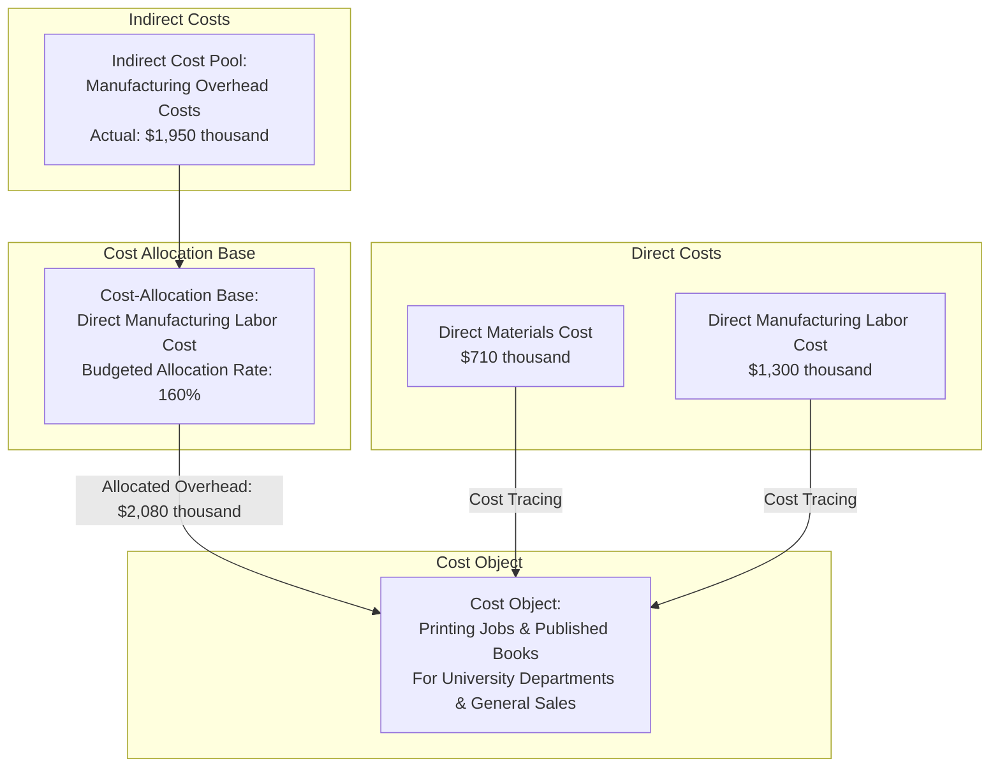

> [!info] Source question
> [[PYQ ACC 304|Open the ACC 304 question bank]] — 2024 Examination, Question 5

### (i)
#### Job-Costing System Overview Diagram
The University of Chicago Press utilizes a normal-costing system featuring two direct-cost categories (direct materials and direct manufacturing labor) and one indirect-cost pool (manufacturing overhead, allocated at 160% of direct manufacturing labor cost).

### (ii)
#### Journal Entries to Summarize 2024 Transactions
Below are the standard general ledger journal entries summarizing the 2024 transactions for the University of Chicago Press. Amounts are presented in thousands of dollars.

$$
\begin{array}{llrr} \hline \textbf{No.} & \textbf{Account Title \& Description} & \textbf{Debit (\$)} & \textbf{Credit (\$)} \\ \hline 1. & \text{Materials Control} & 800 & \\ & \quad \text{Accounts Payable Control} & & 800 \\ & \text{(Purchases of direct materials and supplies on credit)} & & \\[1.5ex] 2. & \text{Work-in-Process Control (Direct materials)} & 710 & \\ & \text{Manufacturing Overhead Control (Indirect materials)} & 100 & \\ & \quad \text{Materials Control} & & 810 \\ & \text{(Direct and indirect materials issued to production)} & & \\[1.5ex] 3. & \text{Work-in-Process Control (Direct manufacturing labor)} & 1,300 & \\ & \text{Manufacturing Overhead Control (Indirect manufacturing labor)} & 900 & \\ & \quad \text{Wages Payable Control / Cash Control} & & 2,200 \\ & \text{(Direct and indirect manufacturing labor costs incurred)} & & \\[1.5ex] 4
\end{array}
$$

> [!abstract] Working Notes
> 1. **Allocated Manufacturing Overhead:**

$$
\text{Allocated MOH} = \text{Actual Direct Labor Cost} \times \text{Predetermined Rate}
$$

$$
\text{Allocated MOH} = \$1,300 \times 160\% = \$2,080 \text{ (in thousands)}
$$

> 2. **Actual Manufacturing Overhead Incurred:**

$$
\text{Actual MOH} = \text{Indirect Materials } (\$100) + \text{Indirect Labor } (\$900) + \text{Depreciation } (\$400) + \text{Misc. MOH } (\$550) = \$1,950 \text{ (in thousands)}
$$

> 3. **Manufacturing Overhead Variance:**

$$
\text{Overallocated MOH} = \text{Allocated MOH } (\$2,080) - \text{Actual MOH } (\$1,950) = \$130 \text{ (in thousands)}
$$

> 4. **Ending Inventory Balances (as of December 31, 2024):**
>     - **Materials Control:** $\$100 (\text{Beg.}) + \$800 (\text{Purchases}) - \$810 (\text{Issued}) = \$90 \text{ (in thousands)}$
>     - **Work-in-Process Control:** $\$60 (\text{Beg.}) + \$710 (\text{DM}) + \$1,300 (\text{DML}) + \$2,080 (\text{Alloc. MOH}) - \$4,120 (\text{COGM}) = \$30 \text{ (in thousands)}$
>     - **Finished Goods Control:** $\$500 (\text{Beg.}) + \$4,120 (\text{COGM}) - \$4,020 (\text{Unadjusted COGS}) = \$600 \text{ (in thousands)}$

> [!warning] Assumption Material purchases ($800 thousand) are assumed to be made on credit to Accounts Payable Control, and factory payroll ($2,200 thousand) is credited to Wages Payable / Cash Control in accordance with standard job-costing practice.

> [!success] Final Answer: Overallocated Manufacturing Overhead = $130 thousand; Adjusted Cost of Goods Sold = $3,890 thousand ($4,020 - $130).

### (iii)
#### Evaluation of Operating Performance in 2024
To evaluate how the University of Chicago Press performed in 2024, an income statement summarizing financial performance after adjusting for overallocated overhead is presented below:

$$
\begin{array}{lr}
\hline
\textbf{University of Chicago Press -- Income Statement (in thousands)} & \textbf{Amount (\$)} \\
\hline
\text{Revenues} & 8,000 \\
\text{Cost of Goods Sold after MOH adjustment} & (3,890) \\
\hline
\textbf{Gross margin / operating income} & \underline{\underline{4,110}} \\
\hline
\end{array}
$$

- **Exceptional Profitability:** The Press performed exceptionally well financially in 2024, generating a gross margin / operating income of **$4,110 thousand** on revenues of **$8,000 thousand**, achieving an outstanding gross margin percentage of **51.38%**.
- **Effective Cost Control & Realistic Allocation Rate:** Manufacturing overhead was slightly overallocated by **$130 thousand** (allocated $\$2,080$ thousand vs. actual incurred $\$1,950$ thousand). This minor variance of 6.67% of actual overhead indicates that the budgeted allocation rate of 160% was highly realistic and that actual manufacturing overhead costs were kept well within operational estimates.
- **Healthy Inventory Flow:** Ending finished goods inventory grew modestly from $\$500$ thousand to $\$600$ thousand, indicating smooth production throughput and sufficient stock buffer to fulfill departmental orders and general book sales without over-accumulation.
