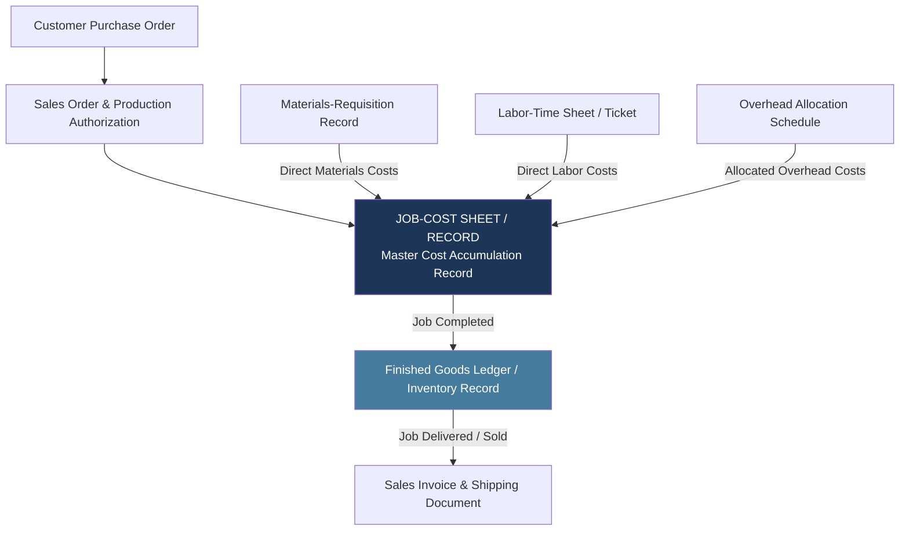
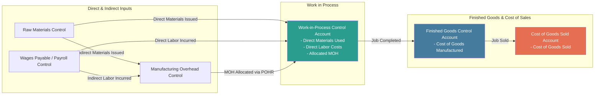

### (i)
#### Steps of Job Order Costing According to BCAS-7
Under Bangladesh Cost Accounting Standard 7 (BCAS-7) and the standard normal costing framework, job order costing assigns direct and indirect manufacturing costs to individual jobs following a structured seven-step operational sequence:
1. **Step 1: Identify the Job That Is the Chosen Cost Object**
    - The cost object is a distinct, identifiable job, order, or batch of unique products or services.
    - A master **job-cost record** (or job-cost sheet) is initiated to accumulate all cost inputs for the specific job.
2. **Step 2: Identify the Direct Costs of the Job**
    - Actual direct materials issued to the job are traced via **materials-requisition records**.
    - Actual direct manufacturing labor costs incurred on the job are traced via employee **labor-time sheets**.
3. **Step 3: Select the Cost-Allocation Base(s) for Allocating Indirect Costs**
    - Identify cost driver(s) that logically cause manufacturing overhead costs to be incurred (e.g., direct manufacturing labor-hours, direct labor cost, or machine-hours).
4. **Step 4: Identify the Indirect Cost Pool(s) Associated with Each Cost-Allocation Base**
    - Group all estimated indirect manufacturing costs (indirect materials, indirect labor, plant depreciation, factory utilities) into appropriate overhead cost pools.
5. **Step 5: Compute the Predetermined Indirect-Cost Rate (Predetermined Overhead Rate)**
    - Calculate the budgeted overhead rate per unit of the cost-allocation base prior to the production period:

$$
\text{Predetermined Overhead Rate (POHR)} = \frac{\text{Total Budgeted Manufacturing Overhead Costs}}{\text{Total Budgeted Quantity of Cost-Allocation Base}} \quad \text{}
$$

6. **Step 6: Compute the Indirect Costs Allocated to the Job**
    - Allocate indirect manufacturing overhead costs to the job as work progresses based on actual allocation base consumption:

$$
\text{Allocated Manufacturing Overhead} = \text{POHR} \times \text{Actual Quantity of Allocation Base Used by Job} \quad \text{}
$$

7. **Step 7: Compute Total Job Cost**
    - Sum all direct materials, direct manufacturing labor, and allocated manufacturing overhead assigned to the job:

$$
\text{Total Job Cost} = \text{Direct Materials} + \text{Direct Labor} + \text{Allocated Manufacturing Overhead} \quad \text{}
$$

$$

\begin{array}{cll}
\hline
\textbf{Step} & \textbf{Operational Phase} & \textbf{Core Documentation / Mechanics} \\
\hline
\text{Step 1} & \text{Identify Cost Object} & \text{Assign Job ID and create job-cost sheet} \\
\text{Step 2} & \text{Trace Direct Costs} & \text{Record direct materials and direct labor} \\
\text{Step 3} & \text{Select Allocation Base} & \text{Choose the cost driver} \\
\text{Step 4} & \text{Pool Indirect Costs} & \text{Accumulate budgeted manufacturing overhead} \\
\text{Step 5} & \text{Compute POHR} & \text{Budgeted overhead divided by budgeted base quantity} \\
\text{Step 6} & \text{Allocate Overhead} & \text{POHR multiplied by actual base used} \\
\text{Step 7} & \text{Compute Total Job Cost} & \text{Direct materials plus direct labor plus allocated overhead} \\
\hline
\end{array}

$$

### (ii)
#### Flow of Documents Chart in a Job Order Costing System
The flow of underlying source documents captures, authorizes, and records costs as work moves from initial customer order to completed job delivery:

##### Primary Source Documents
- **Production Order / Job Authorization:** Formally authorizes the manufacturing facility to initiate work on a specific batch or unit.
- **Job-Cost Sheet (Job-Cost Record):** Functions as the primary subsidiary record that accumulates direct materials, direct labor, and allocated overhead for a specific job.
- **Materials-Requisition Record:** Authorizes storeroom personnel to issue raw materials to the production floor and identifies the job number, item quantity, and cost.
- **Labor-Time Sheet (Time Ticket):** Records the specific hours an individual employee spends working on a specific job to trace direct labor costs.
- **Overhead Allocation Schedule:** Applies manufacturing overhead to the job-cost sheet using the predetermined overhead rate and actual driver volume consumed.
### (iii)
#### Cost Flow Chart in a Job Costing Environment
The accounting flow of costs tracks resource consumption through general ledger inventory and expense accounts:

##### General Ledger Accounting Cost Flows

$$
\begin{array}{clll} \hline \textbf{Stage} & \textbf{Accounting Transaction} & \textbf{Debit Account} & \textbf{Credit Account} \\ \hline 1 & \text{Purchase raw materials on credit} & \text{Materials Control} & \text{Accounts Payable Control} \\ 2 & \text{Issue direct materials to job} & \text{Work-in-Process Control} & \text{Materials Control} \\ & \text{Issue indirect materials} & \text{Manufacturing Overhead Control} & \text{Materials Control} \\ 3 & \text{Incur direct factory labor} & \text{Work-in-Process Control} & \text{Wages Payable Control} \\ & \text{Incur indirect factory labor} & \text{Manufacturing Overhead Control} & \text{Wages Payable Control} \\ 4 & \text{Incur other actual factory overhead} & \text{Manufacturing Overhead Control} & \text{Accumulated Depreciation / Payables} \\ 5 & \text{Allocate overhead to production} & \text{Work-in-Process Control} & \text{Manufacturing Overhead Allocated} \\ 6 & \text{Complete job (Transfer to FG)} & \text{Finished Goods Control} & \text{Work-in-Process Control} \\ 7 & \text{Sell completed job} & \text{Cost of Goods Sold} & \text{Finished Goods Control} \\ & \text{Record sale revenue} & \text{Accounts Receivable / Cash} & \text{Revenues} \\ \hline \end{array}
$$

