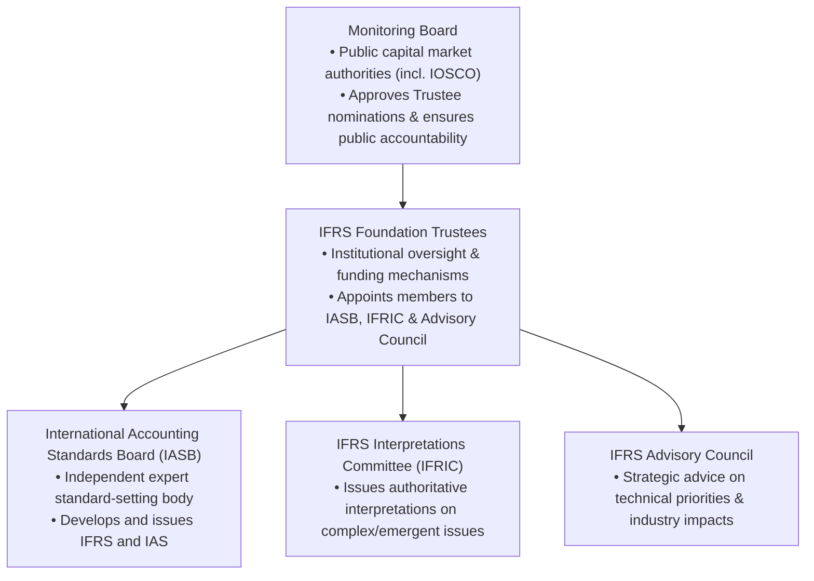
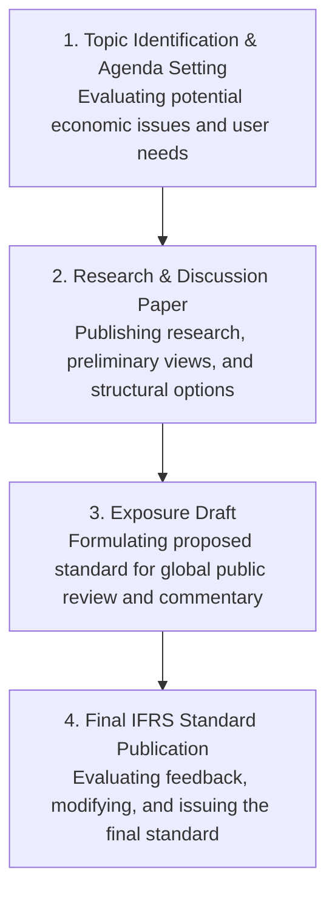
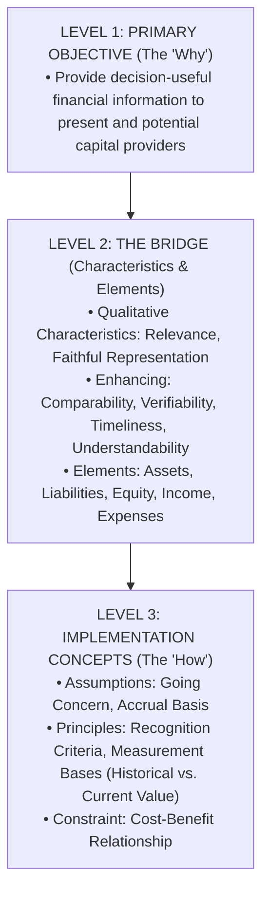
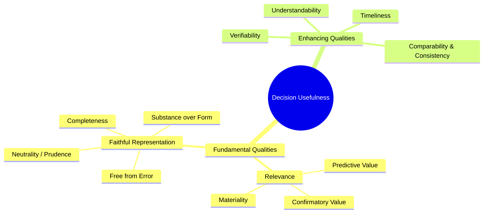

# Financial Reporting & Conceptual Framework (IFRS-Aligned Study Note)
> [!abstract] ACC 301: Intermediate Accounting — Curriculum & Statutory Context
> - **Course:** ACC 301 (Intermediate Accounting)
> - **Phase Focus:** Phase 1 — Conceptual & Procedural Foundations
> - **Target Reading:** Kieso, Weygandt, and Warfield, *Intermediate Accounting: IFRS Edition* (3rd Edition), Chapters 1 and 2
> - **Syllabus Focus:** The global financial reporting environment, institutional standard-setting governance, capital allocation efficiency, the IASB Conceptual Framework for Financial Reporting, fundamental and enhancing qualitative characteristics, financial statement elements, underlying operational assumptions, recognition criteria, measurement bases, and the cost constraint.
> - **Statutory Alignment in Bangladesh:** Synthesises local corporate reporting mandates under the Companies Act, 1994 (Schedule XI — Part I Order of Permanence balance sheet layout, Part II Profit & Loss account disclosures, and Part III Holding/Subsidiary rules) and the Securities and Exchange Rules, 1987 (Rule 12(2) compliance timeline, mandatory Statement of Cash Flows per IAS 7 / BFRS, quarterly interim filings, and CA/CMA-certified Corporate Governance compliance reporting).

---
### 2. The Global Standard-Setting Environment
#### 2.1 Governance Structure of the IFRS Foundation and IASB
The international financial reporting governance architecture operates through a formal four-tier structure designed to enforce technical rigour, professional independence, public accountability, and global capital market alignment.

##### The IASB Standard-Setting Due Process
To ensure complete transparency, public participation, and technical validity, the IASB follows a strict four-step due process before issuing an authoritative standard:

#### 2.2 Global Regulatory Oversight & IOSCO
* **Capital Market Consistency:** The International Organization of Securities Commissions (IOSCO) represents global securities market regulators and plays a vital role in endorsing and facilitating high-quality, international accounting standards across multinational capital markets.
* **Cross-Border Enforcement:** While IOSCO does not directly enact accounting standards, it officially recommends that its member securities regulators permit foreign issuers to utilise IFRS-compliant financial statements for cross-border securities offerings, listings, and filings.
* **Multilateral Enforcement & Transparency:** IOSCO fosters rigorous cross-border enforcement protocols, information-sharing agreements, and continuous monitoring to mitigate market manipulation, reduce information asymmetry, and guarantee compliance with published financial reporting frameworks.
#### 2.3 The Authoritative IFRS Hierarchy
When selecting and establishing accounting policies in the absence of an explicit standard directly governing a transaction, event, or condition, preparers must follow the formal IFRS hierarchy in top-down sequential order:
1. **Primary IFRS and IAS Standards:** Primary authoritative guidance comprising active International Financial Reporting Standards (IFRS) and International Accounting Standards (IAS) that specifically apply to the accounting transaction or event.
2. **IFRS Interpretations:** Authoritative technical interpretations promulgated by IFRIC or its predecessor body, the Standing Interpretations Committee (SIC).
3. **The Conceptual Framework for Financial Reporting:** The IASB Conceptual Framework serves as authoritative guidance to assist preparers in formulating consistent accounting policies when no specific standard or interpretation applies.
4. **Pronouncements of Other Standard-Setting Bodies & Industry Practices:** Pronouncements of other standard-setting bodies that utilise a similar conceptual framework to develop accounting standards, alongside accepted, high-quality industry practices that do not conflict with primary IFRS sources or the Conceptual Framework.
#### 2.4 Standard-Setting Philosophy: Principles-Based vs. Rules-Based Approaches

| Dimension / Criteria | Principles-Based Framework (IFRS / IASB) | Rules-Based Framework (US GAAP / FASB) |
| :--- | :--- | :--- |
| **Standard Complexity & Volume** | Standard texts are concise, focusing on overarching principles, economic substance, and clear broad objectives. | Standard texts are extensive, containing detailed prescriptive rules, scope exceptions, and bright-line quantitative tests. |
| **Reliance on Professional Judgment** | High reliance; mandates that preparers and auditors exercise professional judgment to reflect true economic reality. | Lower reliance; prioritises compliance with explicit rule criteria, quantitative boundaries, and detailed technical checklists. |
| **Bright-Line Tests & Exceptions** | Avoids rigid numerical thresholds or scope exceptions, drastically reducing opportunities for structured financial engineering. | Features specific numerical bright-line rules (e.g., specific percentage thresholds for lease classification or consolidation). |
| **Adaptability to Novel Transactions** | Highly adaptable; underlying core concepts can be applied directly to emerging transaction structures without delay. | Less adaptable; frequently requires specific standard updates or updates (ASUs) to address novel transaction mechanics. |

#### 2.5 Strategic Synthesis: Standard-Setting Governance and Capital Allocation
The structural integrity of global standard-setting governance directly influences market participant confidence, capital allocation efficiency, and systemic financial stability. Robust due process and independent oversight ensure that financial accounting standards reflect true economic reality rather than political lobbying. Transparent, high-quality reporting mitigates information asymmetry between enterprise insiders and external capital providers, lowering information risk premiums, optimizing capital deployment, and reducing the cost of capital across capital markets.

---
### 3. Objective of General-Purpose Financial Reporting
#### 3.1 Primary Objective & Target Audience
> [!info] Key Definition: Objective of General-Purpose Financial Reporting
> The foundational objective of general-purpose financial reporting under the IASB Conceptual Framework is to **provide financial information about the reporting entity that is useful to present and potential equity investors, lenders, and other creditors in making decisions about providing resources to the entity**.

* **Primary User Group:** The framework explicitly targets existing and prospective capital providers—specifically equity investors, lenders, and other creditors—who cannot demand tailored financial reports directly from the enterprise and must rely on general-purpose financial statements.
* **Capital Allocation Mechanics:** Efficient capital allocation directs financial capital toward economically viable, productive business enterprises. High-quality, decision-useful financial reporting reduces information asymmetry, lowers credit risk premiums, and prevents the misallocation of scarce economic resources across global capital markets.
#### 3.2 Decision-Usefulness & Management Stewardship
* **Assessing Prospects for Future Net Cash Inflows (Decision-Usefulness):** Capital providers require transparent financial information to evaluate the amount, timing, and inherent uncertainty of an entity's future net cash inflows. This enables users to estimate potential investment returns, dividend distributions, debt service capacity, and principal liquidations.
* **Evaluating Management Stewardship:** Financial reporting must equip users with the tools to evaluate management's performance in protecting, maintaining, and enhancing enterprise resources. Users assess how efficiently and effectively management and governing boards have discharged their stewardship responsibilities regarding entity assets and corporate governance.

---
### 4. The IASB Conceptual Framework for Financial Reporting
#### 4.1 Architecture of the Three-Level Framework

#### 4.2 Qualitative Characteristics of Accounting Information

**1. Fundamental Qualitative Characteristics**
* **Relevance:** Accounting information is relevant if it is capable of making a difference in user decisions by possessing predictive value, confirmatory value, or both.
  * *Predictive Value:* Enables users to evaluate historical, current, or future events to forecast prospective operational performance or cash generation.
  * *Confirmatory Value:* Provides feedback that confirms or corrects prior expectations and evaluations.
  * *Materiality:* An entity-specific aspect of relevance. Information is material if omitting, misstating, or obscuring it could reasonably be expected to influence decisions made by primary users. Materiality assessment mandates evaluating both quantitative magnitude (relative monetary size) and qualitative factors (e.g., turning a net loss into a profit, impacting loan covenant compliance, or affecting executive compensation).
* **Faithful Representation:** Financial reports must faithfully represent the economic phenomena they purport to depict.
  * *Completeness:* Includes all information, quantitative descriptions, and narrative explanations necessary for a user to understand the depicted economic phenomenon.
  * *Neutrality:* Information is selected, prepared, and presented without bias. Neutrality is supported by exercising Prudence.
  * *Free from Error:* No errors or omissions in describing the economic phenomenon, and the process used to produce the reported information has been selected and applied without procedural error.
  * *Substance over Form:* Economic reality and economic substance must take precedence over legal form when they differ.

> [!warning] Exam Pitfall: Re-introduction of Prudence under IFRS
> Under the IASB Conceptual Framework, **Prudence** was explicitly re-introduced to support neutrality. Prudence means exercising caution when making judgments under conditions of uncertainty. It does *not* permit the deliberate understatement of assets/income or the deliberate overstatement of liabilities/expenses (traditional conservatism), as systematic bias violates neutrality and faithful representation.

**2. Enhancing Qualitative Characteristics**
* **Comparability (and Consistency):** Enables users to identify and understand economic similarities and differences across entities and periods. Consistency refers to utilising the same accounting treatments for identical items from period to period within an entity.
* **Verifiability:** Assures users that information faithfully represents underlying economic phenomena. Information is verifiable if independent, knowledgeable observers could reach consensus that a depiction is faithfully representative.
* **Timeliness:** Having information available to decision-makers in time to influence their financial and resource allocation decisions.
* **Understandability:** Classifying, categorising, and presenting information clearly and concisely, assuming users possess reasonable business knowledge and conduct diligent study.
#### 4.3 The Five Elements of Financial Statements (IFRS)
**Balance Sheet Elements (Position at a Point in Time)**
* **Asset:** A present economic resource controlled by the entity as a result of past events. An economic resource is a right that has the potential to produce economic benefits.
* **Liability:** A present obligation of the entity to transfer an economic resource as a result of past events. An obligation is a duty or responsibility that the entity has no practical ability to avoid.
* **Equity:** The residual interest in the assets of the entity after deducting all its liabilities ($\text{Equity} = \text{Assets} - \text{Liabilities}$).

**Income Statement Elements (Performance over a Period of Time)**
* **Income:** Increases in economic benefits during the period in the form of inflows or enhancements of assets, or decreases of liabilities, resulting in increases in equity (other than contributions from equity participants). Encompasses both:
  * *Revenues:* Income arising in the course of an entity's ordinary central operations.
  * *Gains:* Other items meeting the definition of income that may or may not arise in the course of ordinary activities (e.g., disposal gains on PP&E).
* **Expenses:** Decreases in economic benefits during the period in the form of outflows or depletions of assets, or incurrences of liabilities, resulting in decreases in equity (other than distributions to equity participants). Encompasses both:
  * *Expenses:* Outflows arising in the course of ordinary central operations.
  * *Losses:* Other items meeting the definition of expenses that may or may not arise in the course of ordinary activities (e.g., casualty or disposal losses).
#### 4.4 Recognition, Measurement, Assumptions, and Constraints (Level 3)
**Underlying Assumptions**
* **Going Concern Assumption:** Financial statements are prepared on the assumption that the entity will continue in operation for the foreseeable future, with no intention or need to liquidate or cease trading.
* **Accrual Basis Assumption:** Economic events and transactions are recognised in the periods in which they occur, rather than when cash is received or paid.

**Recognition Criteria**
An item meeting the definition of a financial statement element is recognised on the balance sheet or income statement only when:
1. It provides users of financial statements with relevant information about the asset or liability and about any resulting income, expenses, or changes in equity; and
2. It provides a faithful representation of the asset or liability and of any resulting income, expenses, or changes in equity;
3. Evaluating recognition factors demonstrates that the decision-useful benefits of providing the information outweigh the implementation cost constraint.

**Measurement Bases (Historical Cost vs. Current Value Attributes)**
* **Historical Cost Principle:** Assets are recorded at the value of consideration given plus transaction costs at acquisition. Liabilities are recorded at the value of consideration received to incur the obligation. Historical cost provides an objective, verifiable benchmark, but lacks timeliness when market values fluctuate.
* **Current Value Attributes:**
  * *Fair Value (IFRS 13):* The price that would be received to sell an asset or paid to transfer a liability in an orderly transaction between market participants at the measurement date. Valuation inputs are prioritised using a **Three-Level Fair Value Hierarchy**:
    * **Level 1 (Highest Priority):** Unadjusted quoted prices in active markets for identical assets or liabilities accessible at the measurement date.
    * **Level 2:** Observable inputs other than Level 1 quoted prices (e.g., quoted prices for similar assets in active markets, yield curves, interest rate spreads).
    * **Level 3 (Lowest Priority):** Unobservable inputs based on management assumptions, entity forecasts, or discounted cash flow (DCF) models.
  * *Value in Use / Fulfillment Value:* Entity-specific present values of cash flows expected to be derived from asset usage and final disposal (Value in Use) or required to settle a liability (Fulfillment Value).
  * *Current Cost:* Reflects the monetary amount that would be required currently to acquire an equivalent asset or settle an equivalent obligation.
* **Revaluation Model Permission (IAS 16 / IAS 38):** Unlike standard US GAAP restrictions, IFRS permits the Revaluation Model for Property, Plant & Equipment (IAS 16) and Intangibles with active secondary markets (IAS 38). Under the revaluation model, carrying values are updated periodically to fair value. In Bangladesh, this links directly to Schedule XI, Part I of the Companies Act, 1994, which explicitly mandates disclosing revalued asset amounts alongside gross historical cost additions, disposals, and cumulative depreciation deductions on the statutory balance sheet.

**Cost Constraint**
* **Cost-Benefit Relationship:** The benefits derived from financial reporting information must exceed the operational costs of gathering, auditing, presenting, and analysing it. Standard-setters conduct extensive cost-benefit evaluations during standard development.

---
### 5. Strategic Synthesis: Key IFRS vs. US GAAP Conceptual Distinctions

| Conceptual Feature / Dimension | IFRS Framework (IASB) | US GAAP Framework (FASB) |
| :--- | :--- | :--- |
| **Standard Orientation** | Principles-based, relying on broad economic concepts and professional judgment. | Rules-based, featuring detailed guidelines, bright-line quantitative tests, and specific exceptions. |
| **Status of Conceptual Framework** | Authoritative guidance (Level 3 of IFRS hierarchy when no specific standard applies). | Non-authoritative guidance (SFACs do not override ASC Codification updates). |
| **Financial Statement Elements** | **5 Combined Elements:** Assets, Liabilities, Equity, Income (Revenues + Gains), Expenses (Expenses + Losses). | **10 Distinct Elements:** Assets, Liabilities, Equity, Investments by Owners, Distributions, Comprehensive Income, Revenues, Expenses, Gains, Losses. |
| **Role of Prudence & Substance over Form** | Explicitly included to support neutrality and faithful representation; Substance over Form explicitly defined. | Prudence was historically omitted to prevent deliberate bias; Substance over Form is implied across standards. |
| **Accrual Basis Assumption** | Explicit overarching operational assumption within the framework architecture. | Treated as an operational assumption across individual standard framework texts. |
| **Asset Measurement Options (PP&E)** | Permits Historical Cost Model or Revaluation Model (fair value revaluations to OCI allowed under IAS 16). | Requires Historical Cost Model for PP&E (fair value revaluations generally prohibited). |
| **Balance Sheet Presentation Order** | Flexible; commonly presents assets/liabilities in Reverse Liquidity / Order of Permanence (Noncurrent items first). | Standardised presentation strictly in Order of Liquidity (Current items listed first). |

---
### 6. Bangladesh Statutory Context & Regulatory Alignment
In Bangladesh, corporate reporting is legally governed by national statutory frameworks alongside International Financial Reporting Standards (adopted locally as Bangladesh Financial Reporting Standards — BFRS by the Institute of Chartered Accountants of Bangladesh - ICAB):

**1. Companies Act, 1994 (Schedule XI Layout & Rules)**
All companies registered under the Companies Act, 1994 must strictly comply with Section 185 and Schedule XI:
* **Part I — Balance Sheet Presentation:** Mandates the statutory layout of the Balance Sheet, adhering strictly to the **Order of Permanence**. Share Capital, Reserves, and Long-Term Liabilities are presented first, followed by Current Liabilities. Fixed Assets (PP&E) are presented first under assets (disclosing revalued balances, additions, deductions, and accumulated depreciation), followed by Current Assets.
* **Part II — Profit & Loss Account Disclosures:** Requires explicit line-item disclosures for gross turnover, raw material consumption (quantities and indigenous vs. imported breakdown), managerial remuneration and director perquisites, auditor fees (audit, tax, and advisory breakdown), and industrial capacity utilisation (licensed, installed, and actual output).
* **Part III — Holding and Subsidiary Structures:** Establishes statutory accounting, consolidation, and audit rules for corporate parent and subsidiary arrangements.

**2. Securities and Exchange Rules, 1987 (Rule 12(2) Mandates)**
For publicly listed corporations trading on the Dhaka Stock Exchange (DSE) or Chittagong Stock Exchange (CSE), the Bangladesh Securities and Exchange Commission (BSEC) enforces additional mandates under Rule 12(2):
* **Compliance Timeline:** Complete audited financial statement packages must be submitted to the Commission and Stock Exchanges within 120 days (4 months) of fiscal year-end.
* **Statement of Cash Flows:** Mandatory inclusion of a Statement of Cash Flows prepared in accordance with IAS 7 / BFRS.
* **Interim Filings:** Submission of quarterly financial reports within 30 days of quarter-end and half-yearly reports within 45 days.
* **Corporate Governance Compliance Report:** Annual reports must include a Corporate Governance Compliance Report certified by a practicing Chartered Accountant (CA) or Cost & Management Accountant (CMA).

---
### 7. Practice Walkthroughs & Numerical Analysis
> [!example] Problem 1: Materiality Assessment (Quantitative & Qualitative Evaluation)
> **Scenario:** An accounting specialist is evaluating an unrecorded legal fee liability of $\text{BDT } 50,000$ discovered during year-end audit procedures. Analyse the materiality of this transaction for two separate Bangladesh entities operating under IFRS reporting standards:
> $$ \begin{array}{lrr}
> \textbf{Financial Line Item} & \textbf{Company A (BDT)} & \textbf{Company B (BDT)} \\
> \hline
> \text{Sales Revenue} & 20,000,000 & 500,000 \\
> \text{Operating Costs \& Expenses} & 18,000,000 & 460,000 \\
> \hline
> \textbf{Operating Income (Pre-Tax)} & \textbf{2,000,000} & \textbf{40,000} \\
> \hline \hline
> \text{Unrecorded Legal Fee Item} & 50,000 & 50,000 \\
> \end{array} $$
> **Step-by-Step Mathematical Analysis:**
> 1. **Compute Quantitative Materiality Ratios relative to Operating Income:**
>    $$ \text{Ratio}_{\text{Company A}} = \frac{\text{BDT } 50,000}{\text{BDT } 2,000,000} = 2.5\% $$
>    $$ \text{Ratio}_{\text{Company B}} = \frac{\text{BDT } 50,000}{\text{BDT } 40,000} = 125.0\% $$
> 2. **Analytical Evaluation & Decision Rules:**
>    * **Company A:** The $\text{BDT } 50,000$ item represents $2.5\%$ of operating income. From a quantitative standpoint, items below $5\%$ are frequently treated as quantitatively immaterial. Unless qualitative factors indicate otherwise (e.g., deliberate distortion to achieve an executive bonus target or breach loan covenants), omitting this adjustment does not distort user decision-making.
>    * **Company B:** The $\text{BDT } 50,000$ item represents $125.0\%$ of operating income. Quantitatively, it is highly material. Furthermore, recognising the $\text{BDT } 50,000$ expense transforms Company B's operating profit of $\text{BDT } 40,000$ into a net operating loss of $\text{BDT } 10,000$ ($\text{BDT } 40,000 - \text{BDT } 50,000 = -\text{BDT } 10,000$).
> 3. **Qualitative Synthesis:**
>    For Company B, this transaction alters the financial trend from a profitable operating position to a loss-making position. Under IFRS, qualitative materiality overrides simple quantitative size. Company B must adjust its financial statements to record the liability and expense to achieve a faithful representation.

> [!example] Problem 2: Fair Value Hierarchy Classification & Valuation Attribute Application
> **Scenario:** Prioritise and classify the following three corporate investment assets held by Meridian Capital Ltd. into Level 1, Level 2, or Level 3 of the Fair Value Hierarchy in accordance with IFRS 13 / IASB Conceptual Framework guidance:
> 4. **Investment A:** 5,000 ordinary shares of British American Tobacco Bangladesh (BATBC) traded actively on the Dhaka Stock Exchange (DSE), with closing market price quotations readily available daily.
> 5. **Investment B:** $\text{BDT } 5,000,000$ unlisted corporate debentures. The debentures do not trade in an active secondary market; however, their value is estimated using observable yield curves and interest rate spreads derived from actively traded Bangladesh Government Treasury Bonds with identical maturity terms.
> 6. **Investment C:** A 15% equity interest in a local tech start-up. No observable market transactions exist for the equity shares. Valuation is derived using management's internal discounted cash flow (DCF) model incorporating unobservable projected revenue growth rates and entity-specific discount factors.
> **Step-by-Step Classification & Valuation Attributes:**
> * **Investment A — Level 1 Classification (Least Subjective):**
>   * *Valuation Attribute:* Valuation is based on unadjusted quoted prices in active markets for identical assets accessible at the measurement date.
>   * *IFRS Assessment:* Level 1 input. Provides the most reliable evidence of fair value and must be utilised without adjustment.
> * **Investment B — Level 2 Classification (Moderately Subjective):**
>   * *Valuation Attribute:* Valuation uses inputs other than quoted prices included within Level 1 that are observable for the asset, either directly or indirectly.
>   * *IFRS Assessment:* Level 2 input. The yield curves and market risk premiums are observable inputs derived from benchmark government debt markets.
> * **Investment C — Level 3 Classification (Most Subjective):**
>   * *Valuation Attribute:* Valuation relies on unobservable inputs reflecting the entity's own assumptions regarding future cash inflows and discount rates.
>   * *IFRS Assessment:* Level 3 input. Utilised when observable inputs are unavailable. Requires significant disclosure regarding valuation processes, sensitivity analyses, and model inputs to satisfy the qualitative characteristic of faithful representation.