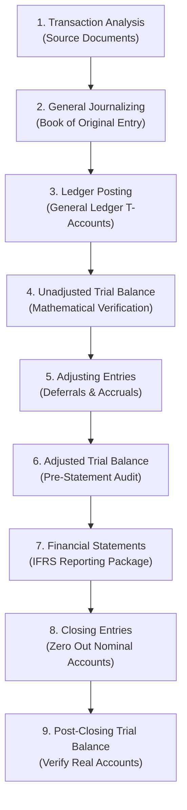
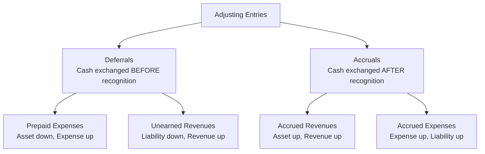

# The Accounting Information System & Cycle Mechanics (IFRS 3rd Edition Alignment)
> [!abstract] Curriculum & Syllabus Context
> - **Course:** ACC 301 Intermediate Accounting
> - **Phase:** Phase 1: Conceptual & Procedural Foundations
> - **Target Reading:** Kieso, Weygandt, and Warfield, *Intermediate Accounting: IFRS Edition* (3rd Edition), Chapter 3
> - **Syllabus Focus:** Foundations of the Accounting Information System (AIS), double-entry mechanics, the 9-step accounting cycle, transaction analysis, journalizing, ledger posting, trial balances, adjusting entries (deferrals and accruals), financial statement preparation (IFRS framework), closing process, cash-to-accrual conversions, and Bangladesh statutory reporting alignment (Schedule XI).

---
### Section 1: Foundations of the Accounting Information System (AIS) & IFRS Mapping
#### 1.1 Definition, Objectives, and Core Principles
> [!info] Key Definition
> An **Accounting Information System (AIS)** is a structured operational framework that collects, processes, categorises, and summarises financial transaction data to disseminate reliable, decision-useful accounting information to internal and external stakeholders. The ultimate output of an AIS is the complete set of general-purpose financial statements prepared in accordance with International Financial Reporting Standards (IFRS).

The complete set of IFRS financial statements includes:
* Statement of Profit or Loss (Income Statement)
* Statement of Changes in Equity / Retained Earnings Statement
* Statement of Financial Position (Balance Sheet)
* Statement of Cash Flows
* Related Notes and Accounting Policies

To deliver maximum value to decision-makers, every accounting system—whether manual or automated—must satisfy three fundamental principles:
1. **Cost-Effectiveness:** The benefits derived from the financial information produced by the system must exceed the costs of establishing, operating, and auditing it.
2. **Usefulness:** The output must be relevant, faithfully representative, timely, understandable, and comparable across reporting periods and peer entities.
3. **Flexibility:** The system must continuously adapt to technological advancements, growth in transaction volume, organizational restructuring, and regulatory updates promulgated by the International Accounting Standards Board (IASB).
##### Manual vs. Computerized Systems & Automated Emerging Technologies
* **Manual Accounting Systems:** Each procedural step (journalising, posting, balance computation, trial balance compilation, and statement drafting) is executed by hand. While inefficient for large commercial enterprises, manual mechanics illustrate the core database architecture of modern accounting software.
* **Computerized Systems (ERP Systems):** Transaction data is captured at the point of sale or via electronic data interchange (EDI). Ledger posting, trial balance generation, and financial statement consolidation occur automatically.
* **Robotic Process Automation (RPA / Bots):** Software bots monitor incoming digital vendor invoices, extract invoice line items, perform three-way matching against purchase orders and receiving reports, and execute accounts payable journal entries without human intervention.
* **Blockchain Technology:** A decentralized, cryptographic, immutable ledger where economic transactions are recorded in linked blocks, establishing verifiable, real-time audit trails that prevent retroactive alteration of accounting records.
#### 1.2 Double-Entry Accounting Rules & Expanded Accounting Equation
Under the double-entry accounting system, every economic transaction exerts a dual effect on the accounting equation. Total debits recorded must identically equal total credits recorded for every transaction:

> [!quote] Formula & Derivation
> $$ \text{Total Debits} = \text{Total Credits} $$

* **Terminology:**
  * **Debit ($\text{Dr.}$):** Refers strictly to the *left side* of a ledger T-account.
  * **Credit ($\text{Cr.}$):** Refers strictly to the *right side* of a ledger T-account.
  * Debits and credits do not inherently signify increases or decreases; their directional effect depends entirely on the specific account classification.
##### Expanded Accounting Equation (IFRS Terminology Framework)
Under IFRS 3rd Edition, equity accounts are explicitly divided into contributed capital components ($\text{Share Capital—Ordinary}$ and $\text{Share Premium—Ordinary}$) and earned capital ($\text{Retained Earnings}$):

> [!quote] Formula & Derivation
> $$ \text{Assets} = \text{Liabilities} + \text{Share Capital—Ordinary} + \text{Share Premium—Ordinary} + \text{Retained Earnings} + \text{Revenues} - \text{Expenses} - \text{Dividends} $$

| Account Category | Classification | Normal Balance | Increase Direction | Decrease Direction |
| :--- | :--- | :--- | :--- | :--- |
| **Assets** | Real (Permanent) | Debit ($\text{Dr.}$) | Debit ($\text{Dr.}$) | Credit ($\text{Cr.}$) |
| **Liabilities** | Real (Permanent) | Credit ($\text{Cr.}$) | Credit ($\text{Cr.}$) | Debit ($\text{Dr.}$) |
| **Share Capital—Ordinary** | Real (Permanent) | Credit ($\text{Cr.}$) | Credit ($\text{Cr.}$) | Debit ($\text{Dr.}$) |
| **Share Premium—Ordinary** | Real (Permanent) | Credit ($\text{Cr.}$) | Credit ($\text{Cr.}$) | Debit ($\text{Dr.}$) |
| **Retained Earnings** | Real (Permanent) | Credit ($\text{Cr.}$) | Credit ($\text{Cr.}$) | Debit ($\text{Dr.}$) |
| **Revenues** | Nominal (Temporary) | Credit ($\text{Cr.}$) | Credit ($\text{Cr.}$) | Debit ($\text{Dr.}$) |
| **Expenses** | Nominal (Temporary) | Debit ($\text{Dr.}$) | Debit ($\text{Dr.}$) | Credit ($\text{Cr.}$) |
| **Dividends** | Nominal (Temporary) | Debit ($\text{Dr.}$) | Debit ($\text{Dr.}$) | Credit ($\text{Cr.}$) |

#### 1.3 Account Classifications: Real vs. Nominal Accounts & Equity Frameworks
* **Real (Permanent) Accounts:** Asset, liability, and permanent equity accounts (e.g., Cash, Accounts Receivable, Equipment, Accounts Payable, Share Capital—Ordinary, Retained Earnings). Their balances are reported on the Statement of Financial Position and carried forward from one accounting period to the next. They are **never closed**.
* **Nominal (Temporary) Accounts:** Revenue, expense, and dividend accounts (e.g., Service Revenue, Salaries and Wages Expense, Dividends). They measure financial performance and distributions over a specific time period. Their balances must be **reduced to zero** at the end of each fiscal period through the closing process.
##### Legal Structure Impact on Equity Accounts
* **Corporate Framework (IFRS):** Segregates contributed equity from earned equity. Uses Share Capital—Ordinary, Share Capital—Preference, Share Premium—Ordinary, Retained Earnings, and Dividends.
* **Proprietorships & Partnerships:** Maintain an Owner's Capital account (recording owner investments and cumulative profits) and an Owner's Drawings account (tracking personal cash or asset withdrawals).

---
### Section 2: The 9-Step Accounting Cycle: Comprehensive Walkthrough

#### 2.1 Overview of the 9 Sequential Steps
The accounting cycle represents a standardized sequence of accounting procedures executed during each fiscal period to ensure complete, accurate, and IFRS-compliant financial reporting.
#### 2.2 Step 1: Transaction Identification and Analysis
The accounting cycle begins with identifying economic events recorded from source documents (e.g., sales invoices, bank statements, purchase orders, payroll registers).
* **External Transactions:** Economic exchanges between the entity and external parties (e.g., purchasing machinery from a vendor, paying cash rent to a landlord, issuing ordinary shares to investors).
* **Internal Transactions:** Economic events occurring entirely within the enterprise that modify asset or liability valuations (e.g., consuming raw material inventory in production, recognizing monthly equipment depreciation).
* **Non-Transactions:** Business activities or contractual agreements that do not alter assets, liabilities, or equity at the time of occurrence (e.g., placing a purchase order, interviewing prospective employees, signing an employment contract prior to performance).
#### 2.3 Step 2: General Journalizing (Book of Original Entry)
Transactions are entered in chronological order in the General Journal prior to ledger posting. Each journal entry contains:
1. Date of transaction.
2. Account title debited (aligned to the extreme left margin) with the debit monetary value.
3. Account title credited (indented to the right) with the credit monetary value.
4. Explanatory memorandum.
#### 2.4 Step 3: General Ledger Posting & Chart of Accounts
Posting is the transfer of debit and credit amounts from the General Journal to individual T-accounts or three-column running-balance accounts in the General Ledger. Posting reference ($\text{Ref.}$) tags in the journal and ledger establish cross-indexing audit trails (e.g., linking Journal Page $\text{J1}$ with Ledger Account $\text{No. 101}$).

**Chart of Accounts Framework**
A master listing of all ledger account titles and assigned numerical codes:
* $101–199$: Asset Accounts
* $200–299$: Liability Accounts
* $300–399$: Equity Accounts (Share Capital—Ordinary, Retained Earnings)
* $400–499$: Revenue Accounts
* $500–799$: Operating Expense Accounts
* $800–899$: Other Income and Gains
* $900–999$: Other Expenses and Losses
#### 2.5 Step 4: Unadjusted Trial Balance (Purpose & Limitations)
An Unadjusted Trial Balance lists all open general ledger accounts and their respective debit or credit balances at a specific date.
* **Primary Purpose:** Proves the mathematical equality of total debits and total credits after posting.
* **Limitations (Errors Not Uncovered by a Balanced Trial Balance):**
  1. Complete omission of an economic transaction from the journal.
  2. Failure to post a valid journal entry to the ledger.
  3. Posting a journal entry twice.
  4. Posting a correct debit or credit to the wrong account (e.g., debiting Maintenance Expense instead of Equipment).
  5. Offsetting mathematical errors made simultaneously in recording transaction figures.
#### 2.6 Step 5: Adjusting Entries (The Deferral & Accrual Matrix)
In accordance with the **Revenue Recognition Principle** (recognizing revenue when performance obligations are satisfied) and the **Expense Recognition Principle** (matching expenses with generated revenues), adjusting entries are recorded at period-end to align real and nominal accounts.
#### 2.7 Step 6: Adjusted Trial Balance
After posting all period-end adjusting entries, the Adjusted Trial Balance is compiled. It confirms the mathematical equality of total debits and total credits across all adjusted ledger accounts and serves as the direct primary source for constructing the IFRS financial statements.
#### 2.8 Step 7: Financial Statement Preparation (Articulation & Hierarchy)
Financial statements must be constructed in strict sequential order due to data articulation between statements:
1. **Income Statement / Statement of Profit or Loss:** Summarizes revenues and expenses to compute Net Income (or Net Loss).
2. **Statement of Changes in Equity / Retained Earnings Statement:** Combines opening Retained Earnings, adds Net Income (or subtracts Net Loss), and deducts Dividends declared to establish Ending Retained Earnings.
3. **Statement of Financial Position:** Reports real accounts (Assets, Liabilities, Share Capital, and the updated Ending Retained Earnings).
4. **Statement of Cash Flows:** Details cash flows from operating, investing, and financing activities.
#### 2.9 Step 8: Closing Entries & Income Summary Clearing
The closing process reduces all nominal accounts to zero and transfers net operating income/loss and dividends declared into permanent Retained Earnings. A clearing account titled **Income Summary** is utilized.

**The 4 Standard Closing Entries:**
1. **Close Revenue Accounts to Income Summary:**
   $$ \begin{array}{llrr}
   \text{Date} & \text{Account Titles and Explanation} & \text{Debit (£)} & \text{Credit (£)} \\
   \hline
   \text{Dec 31} & \text{Service Revenue} & \text{XXX} & \\
   & \quad \text{Income Summary} & & \text{XXX} \\
   \end{array} $$
2. **Close Expense Accounts to Income Summary:**
   $$ \begin{array}{llrr}
   \text{Date} & \text{Account Titles and Explanation} & \text{Debit (£)} & \text{Credit (£)} \\
   \hline
   \text{Dec 31} & \text{Income Summary} & \text{XXX} & \\
   & \quad \text{Salaries and Wages Expense} & & \text{XXX} \\
   & \quad \text{Supplies Expense} & & \text{XXX} \\
   & \quad \text{Depreciation Expense} & & \text{XXX} \\
   \end{array} $$
3. **Close Income Summary to Retained Earnings:**
   - *In the event of Net Income (Credit balance in Income Summary):*
     $$ \begin{array}{llrr}
     \text{Date} & \text{Account Titles and Explanation} & \text{Debit (£)} & \text{Credit (£)} \\
     \hline
     \text{Dec 31} & \text{Income Summary} & \text{XXX} & \\
     & \quad \text{Retained Earnings} & & \text{XXX} \\
     \end{array} $$
   - *In the event of Net Loss (Debit balance in Income Summary):*
     $$ \begin{array}{llrr}
     \text{Date} & \text{Account Titles and Explanation} & \text{Debit (£)} & \text{Credit (£)} \\
     \hline
     \text{Dec 31} & \text{Retained Earnings} & \text{XXX} & \\
     & \quad \text{Income Summary} & & \text{XXX} \\
     \end{array} $$
4. **Close Dividends Directly to Retained Earnings:**
   *(Dividends represent distributions of capital, not operational expenses, and bypass Income Summary).*
   $$ \begin{array}{llrr}
   \text{Date} & \text{Account Titles and Explanation} & \text{Debit (£)} & \text{Credit (£)} \\
   \hline
   \text{Dec 31} & \text{Retained Earnings} & \text{XXX} & \\
   & \quad \text{Dividends} & & \text{XXX} \\
   \end{array} $$
#### 2.10 Step 9: Post-Closing Trial Balance
Compiled immediately after posting closing entries. It contains **only real accounts** (Assets, Liabilities, Share Capital, and Retained Earnings). Its purpose is to verify debit-credit equality before opening the ledger for the subsequent accounting period.

---
### Section 3: The Complete Adjusting Entry Matrix & Omission Analysis

#### 3.1 Deferrals: Prepaid Expenses & Unearned Revenues
**1. Prepaid Expenses (Prepayments)**
Expenses paid in cash and recorded as assets before they are consumed or expired.
* **Unadjusted State:** Assets are overstated; Expenses are understated.
* **Adjustment Rule:** Debit an Expense account; Credit an Asset account.

*Case A: Supplies Accounting*
> [!quote] Formula & Derivation
> $$ \text{Supplies Consumed (Expense)} = \text{Beginning Supplies Balance} + \text{Supplies Purchased} - \text{Physical Ending Inventory} $$

$$ \begin{array}{llrr}
\text{Date} & \text{Account Titles and Explanation} & \text{Debit (£)} & \text{Credit (£)} \\
\hline
\text{Period-End} & \text{Supplies Expense} & \text{XXX} & \\
& \quad \text{Supplies} & & \text{XXX} \\
\end{array} $$

*Case B: Prepaid Insurance*
> [!quote] Formula & Derivation
> $$ \text{Insurance Expense Per Period} = \frac{\text{Total Premium Paid}}{\text{Policy Term (Months)}} \times \text{Months Expired} $$

$$ \begin{array}{llrr}
\text{Date} & \text{Account Titles and Explanation} & \text{Debit (£)} & \text{Credit (£)} \\
\hline
\text{Period-End} & \text{Insurance Expense} & \text{XXX} & \\
& \quad \text{Prepaid Insurance} & & \text{XXX} \\
\end{array} $$

**2. Unearned Revenues**
Cash received from customers before performance obligations are satisfied.
* **Unadjusted State:** Liabilities are overstated; Revenues are understated.
* **Adjustment Rule:** Debit a Liability account ($\text{Unearned Revenue}$); Credit a Revenue account.

$$ \begin{array}{llrr}
\text{Date} & \text{Account Titles and Explanation} & \text{Debit (£)} & \text{Credit (£)} \\
\hline
\text{Period-End} & \text{Unearned Service Revenue} & \text{XXX} & \\
& \quad \text{Service Revenue} & & \text{XXX} \\
\end{array} $$
#### 3.2 Accruals: Accrued Revenues & Accrued Expenses
**1. Accrued Revenues**
Revenues earned for services performed or goods delivered but not yet billed or collected.
* **Unadjusted State:** Assets are understated; Revenues are understated.
* **Adjustment Rule:** Debit an Asset account ($\text{Accounts Receivable}$); Credit a Revenue account.

$$ \begin{array}{llrr}
\text{Date} & \text{Account Titles and Explanation} & \text{Debit (£)} & \text{Credit (£)} \\
\hline
\text{Period-End} & \text{Accounts Receivable} & \text{XXX} & \\
& \quad \text{Service Revenue} & & \text{XXX} \\
\end{array} $$

**2. Accrued Expenses**
Expenses incurred but not yet paid in cash or recorded at period-end.
* **Unadjusted State:** Expenses are understated; Liabilities are understated.
* **Adjustment Rule:** Debit an Expense account; Credit a Liability account.

*Case A: Accrued Interest Expense*
> [!quote] Formula & Derivation
> $$ \text{Accrued Interest} = \text{Principal (Face Value)} \times \text{Annual Interest Rate } (i) \times \text{Fraction of Year } \left(\frac{n}{12}\right) $$

$$ \begin{array}{llrr}
\text{Date} & \text{Account Titles and Explanation} & \text{Debit (£)} & \text{Credit (£)} \\
\hline
\text{Period-End} & \text{Interest Expense} & \text{XXX} & \\
& \quad \text{Interest Payable} & & \text{XXX} \\
\end{array} $$

*Case B: Accrued Salaries and Wages*
Calculated based on daily employee wage rates for unpaid days worked between the final payroll date and the period-end date:

$$ \begin{array}{llrr}
\text{Date} & \text{Account Titles and Explanation} & \text{Debit (£)} & \text{Credit (£)} \\
\hline
\text{Period-End} & \text{Salaries and Wages Expense} & \text{XXX} & \\
& \quad \text{Salaries and Wages Payable} & & \text{XXX} \\
\end{array} $$
#### 3.3 Depreciation Allocation & Allowance for Doubtful Accounts
**1. Depreciation Allocation (IAS 16 Alignment)**
Depreciation is a process of cost allocation, not asset valuation.
> [!quote] Formula & Derivation
> $$ \text{Annual Straight-Line Depreciation} = \frac{\text{Historical Cost} - \text{Residual Value}}{\text{Estimated Useful Life (Years)}} $$
> $$ \text{Carrying Amount (Book Value)} = \text{Historical Cost} - \text{Accumulated Depreciation} $$

$$ \begin{array}{llrr}
\text{Date} & \text{Account Titles and Explanation} & \text{Debit (£)} & \text{Credit (£)} \\
\hline
\text{Period-End} & \text{Depreciation Expense} & \text{XXX} & \\
& \quad \text{Accumulated Depreciation—Equipment} & & \text{XXX} \\
\end{array} $$

**2. Bad Debt Expense (Allowance Method under IFRS 9)**
Recognizes expected credit losses associated with trade receivables.

$$ \begin{array}{llrr}
\text{Date} & \text{Account Titles and Explanation} & \text{Debit (£)} & \text{Credit (£)} \\
\hline
\text{Period-End} & \text{Bad Debt Expense} & \text{XXX} & \\
& \quad \text{Allowance for Doubtful Accounts} & & \text{XXX} \\
\end{array} $$
#### 3.4 Summary Table of Adjusting Entry Omission Effects

| Adjustment Category | Account Debited | Account Credited | Assets Impact | Liabilities Impact | Equity Impact | Revenue Impact | Expense Impact | Net Income Impact |
| :--- | :--- | :--- | :--- | :--- | :--- | :--- | :--- | :--- |
| **Prepaid Expense** | Expense | Asset | Overstated | No Effect | Overstated | No Effect | Understated | Overstated |
| **Unearned Revenue** | Liability | Revenue | No Effect | Overstated | Understated | Understated | No Effect | Understated |
| **Accrued Revenue** | Asset | Revenue | Understated | No Effect | Understated | Understated | No Effect | Understated |
| **Accrued Expense** | Expense | Liability | No Effect | Understated | Overstated | No Effect | Understated | Overstated |
| **Depreciation** | Expense | Contra-Asset | Overstated | No Effect | Overstated | No Effect | Understated | Overstated |
| **Bad Debt Expense** | Expense | Contra-Asset | Overstated | No Effect | Overstated | No Effect | Understated | Overstated |

---
### Section 4: Appendices & Procedural Extensions
#### 4.1 Appendix A: Cash-Basis vs. Accrual-Basis Accounting & Conversion Formulas
* **Strict Cash Basis:** Revenue is recognized strictly when cash receipts occur; expenses are recorded only when cash disbursements are executed. This approach violates IFRS because it fails to adhere to revenue recognition and matching principles.
* **Accrual Basis (IFRS Mandatory Framework):** Transactions are recorded in the periods in which events occur, regardless of when cash flows materialize.

> [!quote] Formula & Derivation: Cash-to-Accrual Conversion
> **1. Converting Cash Collections to Accrual Service Revenue:**
> $$ \text{Service Revenue}_{\text{Accrual}} = \text{Cash Collected} - \text{A/R}_{\text{Beginning}} + \text{A/R}_{\text{Ending}} + \text{Unearned Revenue}_{\text{Beginning}} - \text{Unearned Revenue}_{\text{Ending}} $$
> **2. Converting Cash Disbursements to Accrual Operating Expenses:**
> $$ \text{Operating Expenses}_{\text{Accrual}} = \text{Cash Paid} + \text{Prepaids}_{\text{Beginning}} - \text{Prepaids}_{\text{Ending}} - \text{Accrued Liab}_{\text{Beginning}} + \text{Accrued Liab}_{\text{Ending}} + \text{Depreciation/Amortisation} $$

#### 4.2 Appendix B: Reversing Entries Mechanics & Implementation Rules
A reversing entry is an optional bookkeeping procedure executed on the first day of a new accounting period. It is the exact reverse of an adjusting entry made at the close of the prior period.
* **Mandatory Rules for Reversing Entries:**
  1. **All Accruals** MUST be reversed (Accrued Revenues and Accrued Expenses).
  2. **Deferrals** recorded initially in nominal (income statement) accounts SHOULD be reversed.
  3. **Deferrals** recorded initially in real (balance sheet) accounts are **NEVER** reversed.
  4. **Depreciation and Bad Debt adjustments** are **NEVER** reversed.
#### 4.3 Appendix C: The 10-Column Accounting Worksheet Structure
An informal working tool utilized by accountants to organize trial balance data, adjusting entries, and financial statement line items across five pairs of debit/credit columns:

$$ \begin{array}{c}
\text{10-COLUMN ACCOUNTING WORKSHEET LAYOUT} \\
\hline
\begin{array}{|c|c|c|c|c|c|c|c|c|c|}
\hline
\multicolumn{2}{|c|}{\textbf{Unadjusted Trial Bal.}} & \multicolumn{2}{c|}{\textbf{Adjustments}} & \multicolumn{2}{c|}{\textbf{Adjusted Trial Bal.}} & \multicolumn{2}{c|}{\textbf{Income Statement}} & \multicolumn{2}{c|}{\textbf{Financial Position}} \\
\hline
\text{Dr.} & \text{Cr.} & \text{Dr.} & \text{Cr.} & \text{Dr.} & \text{Cr.} & \text{Dr.} & \text{Cr.} & \text{Dr.} & \text{Cr.} \\
\hline
\end{array}
\end{array} $$

---
### Section 5: Statutory Reporting & Legal Context: Bangladesh Companies Act 1994 (Schedule XI)
#### 5.1 Schedule XI Part I: Balance Sheet Presentation (Order of Permanence)
In Bangladesh, corporate reporting is governed by Section 185 and Schedule XI of the Companies Act, 1994. Schedule XI Part I dictates a statutory balance sheet format using the **Order of Permanence**, which presents permanent capital and non-current assets first. This contrasts with the liquidity-first approach standard in some other jurisdictions.

**Statutory Balance Sheet Format (Schedule XI, Part I)**
$$ \begin{array}{lrr}
\hline
\multicolumn{3}{c}{\textbf{[Company Name, Limited]}} \\
\multicolumn{3}{c}{\textbf{Balance Sheet as at [Date]}} \\
\hline
\textbf{Capital and Liabilities} & & \textbf{Amount (BDT)} \\
\hline
\textbf{1. Share Capital:} & & \\
\quad \text{Authorized Capital: [X] shares of BDT [Y] each} & & \text{XXX} \\
\cline{3-3}
\quad \text{Issued, Subscribed, and Paid-up Capital:} & & \\
\quad \quad \text{Shares allotted as fully paid up for cash} & \text{XXX} & \\
\quad \quad \text{Bonus Shares distributed} & \text{XXX} & \text{XXX} \\
\textbf{2. Reserves and Surplus:} & & \\
\quad \text{Share Premium Account} & \text{XXX} & \\
\quad \text{General Reserve \& Revenue Surplus (P\&L balance)} & \text{XXX} & \text{XXX} \\
\textbf{3. Secured Loans:} & & \\
\quad \text{Debentures / Bank Loans (secured against assets)} & & \text{XXX} \\
\textbf{4. Unsecured Loans:} & & \\
\quad \text{Short-term borrowings / Deposits} & & \text{XXX} \\
\textbf{5. Current Liabilities and Provisions:} & & \\
\quad \text{Trade Creditors \& Acceptances} & \text{XXX} & \\
\quad \text{Provision for Taxation} & \text{XXX} & \text{XXX} \\
\hline
\textbf{Total Capital and Liabilities} & & \mathbf{\text{XXXXX}} \\
\hline \hline
& & \\
\textbf{Property and Assets} & & \textbf{Amount (BDT)} \\
\hline
\textbf{1. Fixed Assets (PP\&E):} & & \\
\quad \text{Land, Buildings, Plant, Machinery} & & \\
\quad \text{Gross Historical Cost / Revalued Amount} & \text{XXX} & \\
\quad \text{Less: Cumulative Depreciation to date} & (\text{XXX}) & \text{XXX} \\
\textbf{2. Investments:} & & \\
\quad \text{Government Securities / Subsidiary Shares} & & \text{XXX} \\
\textbf{3. Current Assets, Loans, and Advances:} & & \\
\quad \text{Inventories (Raw Materials, WIP, Finished Goods)} & \text{XXX} & \\
\quad \text{Sundry Debtors (segregated by recovery likelihood)} & \text{XXX} & \\
\quad \text{Cash and Bank Balances} & \text{XXX} & \text{XXX} \\
\textbf{4. Miscellaneous Expenditure:} & & \\
\quad \text{Preliminary Expenses (unwritten off balance)} & & \text{XXX} \\
\hline
\textbf{Total Property and Assets} & & \mathbf{\text{XXXXX}} \\
\hline \hline
\end{array} $$
#### 5.2 Schedule XI Part II & BSEC Rule 12(2) Disclosures
* **Part II Statutory Disclosures:** Mandates disclosure of gross turnover, raw material consumption, managerial remuneration, statutory auditor fee breakdowns, licensed vs. installed plant capacity, and foreign currency transactions.
* **Securities and Exchange Rules, 1987 (Rule 12(2)):** Requires companies listed on the Dhaka Stock Exchange (DSE) or Chittagong Stock Exchange (CSE) to submit audited financial statement packages—including an IAS 7-compliant Statement of Cash Flows—to the Commission within 120 days of fiscal year-end.

---
### Section 6: Comprehensive Numerical Problem Walkthroughs
> [!example] Walkthrough 6.1: Comprehensive Accounting Cycle (Kleene Window Washing Inc.)
> **Fact Pattern:**
> Kleene Window Washing Inc. was incorporated on 1 July 2025. During July 2025, the following transactions occurred:
> * **1 July:** Stockholders invested £12,000 cash in exchange for 12,000 ordinary shares (£1 par value).
> * **1 July:** Purchased cleaning truck/equipment for £8,000, paying £2,000 cash and signing an £6,000 accounts payable obligation.
> * **3 July:** Purchased cleaning supplies on account for £900.
> * **5 July:** Paid £1,800 cash for a 1-year insurance policy effective 1 July.
> * **12 July:** Billed customers £3,700 for services performed.
> * **18 July:** Paid £1,500 cash on account to creditors.
> * **20 July:** Paid £2,000 cash for employee salaries.
> * **21 July:** Collected £1,600 cash from credit customers billed on 12 July.
> * **25 July:** Billed customers £2,500 for services performed.
> * **31 July:** Paid £290 cash for truck maintenance and repairs.
> * **31 July:** Declared and paid a £600 cash dividend.
> **Adjustment Data at 31 July 2025:**
> 1. Unbilled service revenue at 31 July: £1,700.
> 2. Monthly equipment depreciation: £180.
> 3. Insurance expired during July: £150 (£1,800 / 12).
> 4. Physical count shows £320 of cleaning supplies on hand at 31 July.
> 5. Accrued unpaid salaries at 31 July: £400.
> ---
> **Step 1: General Journal Entries for July Transactions**
> $$ \begin{array}{llrr}
> \text{Date} & \text{Account Titles and Explanation} & \text{Debit (£)} & \text{Credit (£)} \\
> \hline
> \text{July 1} & \text{Cash} & 12,000 & \\
> & \quad \text{Share Capital—Ordinary} & & 12,000 \\
> & \text{(Issued 12,000 ordinary shares for cash)} & & \\
> \hline
> \text{July 1} & \text{Equipment} & 8,000 & \\
> & \quad \text{Cash} & & 2,000 \\
> & \quad \text{Accounts Payable} & & 6,000 \\
> & \text{(Purchased equipment for cash and accounts payable)} & & \\
> \hline
> \text{July 3} & \text{Supplies} & 900 & \\
> & \quad \text{Accounts Payable} & & 900 \\
> & \text{(Purchased supplies on account)} & & \\
> \hline
> \text{July 5} & \text{Prepaid Insurance} & 1,800 & \\
> & \quad \text{Cash} & & 1,800 \\
> & \text{(Paid 1-year insurance policy in advance)} & & \\
> \hline
> \text{July 12} & \text{Accounts Receivable} & 3,700 & \\
> & \quad \text{Service Revenue} & & 3,700 \\
> & \text{(Billed customers for services performed)} & & \\
> \hline
> \text{July 18} & \text{Accounts Payable} & 1,500 & \\
> & \quad \text{Cash} & & 1,500 \\
> & \text{(Paid cash on account to creditors)} & & \\
> \hline
> \text{July 20} & \text{Salaries and Wages Expense} & 2,000 & \\
> & \quad \text{Cash} & & 2,000 \\
> & \text{(Paid employee salaries)} & & \\
> \hline
> \text{July 21} & \text{Cash} & 1,600 & \\
> & \quad \text{Accounts Receivable} & & 1,600 \\
> & \text{(Collected cash from credit customers)} & & \\
> \hline
> \text{July 25} & \text{Accounts Receivable} & 2,500 & \\
> & \quad \text{Service Revenue} & & 2,500 \\
> & \text{(Billed customers for services performed)} & & \\
> \hline
> \text{July 31} & \text{Maintenance and Repairs Expense} & 290 & \\
> & \quad \text{Cash} & & 290 \\
> & \text{(Paid truck repair expenses)} & & \\
> \hline
> \text{July 31} & \text{Dividends} & 600 & \\
> & \quad \text{Cash} & & 600 \\
> & \text{(Declared and paid cash dividend)} & & \\
> \end{array} $$
> ---
> **Step 2: Unadjusted Trial Balance at 31 July 2025**
> $$ \begin{array}{lrr}
> \multicolumn{3}{c}{\textbf{Kleene Window Washing Inc.}} \\
> \multicolumn{3}{c}{\textbf{Unadjusted Trial Balance}} \\
> \multicolumn{3}{c}{\textbf{31 July 2025}} \\
> \hline
> \text{Account Title} & \text{Debit (£)} & \text{Credit (£)} \\
> \hline
> \text{Cash} & 5,410 & \\
> \text{Accounts Receivable} & 4,600 & \\
> \text{Supplies} & 900 & \\
> \text{Prepaid Insurance} & 1,800 & \\
> \text{Equipment} & 8,000 & \\
> \text{Accounts Payable} & & 5,400 \\
> \text{Share Capital—Ordinary} & & 12,000 \\
> \text{Dividends} & 600 & \\
> \text{Service Revenue} & & 6,200 \\
> \text{Maintenance and Repairs Expense} & 290 & \\
> \text{Salaries and Wages Expense} & 2,000 & \\
> \hline
> \textbf{Totals} & \mathbf{23,600} & \mathbf{23,600} \\
> \hline \hline
> \end{array} $$
> ---
> **Step 3: Adjusting Journal Entries at 31 July 2025**
> $$ \begin{array}{llrr}
> \text{Date} & \text{Account Titles and Explanation} & \text{Debit (£)} & \text{Credit (£)} \\
> \hline
> \text{July 31} & \text{Accounts Receivable} & 1,700 & \\
> & \quad \text{Service Revenue} & & 1,700 \\
> & \text{(1. Accrued unbilled service revenue)} & & \\
> \hline
> \text{July 31} & \text{Depreciation Expense} & 180 & \\
> & \quad \text{Accumulated Depreciation—Equipment} & & 180 \\
> & \text{(2. Monthly equipment depreciation)} & & \\
> \hline
> \text{July 31} & \text{Insurance Expense} & 150 & \\
> & \quad \text{Prepaid Insurance} & & 150 \\
> & \text{(3. Expired insurance for July)} & & \\
> \hline
> \text{July 31} & \text{Supplies Expense } (£900 - £320) & 580 & \\
> & \quad \text{Supplies} & & 580 \\
> & \text{(4. Cleaning supplies consumed during July)} & & \\
> \hline
> \text{July 31} & \text{Salaries and Wages Expense} & 400 & \\
> & \quad \text{Salaries and Wages Payable} & & 400 \\
> & \text{(5. Accrued unpaid salaries at month-end)} & & \\
> \end{array} $$
> ---
> **Step 4: Adjusted Trial Balance at 31 July 2025**
> $$ \begin{array}{lrr}
> \multicolumn{3}{c}{\textbf{Kleene Window Washing Inc.}} \\
> \multicolumn{3}{c}{\textbf{Adjusted Trial Balance}} \\
> \multicolumn{3}{c}{\textbf{31 July 2025}} \\
> \hline
> \text{Account Title} & \text{Debit (£)} & \text{Credit (£)} \\
> \hline
> \text{Cash} & 5,410 & \\
> \text{Accounts Receivable } (£4,600 + £1,700) & 6,300 & \\
> \text{Supplies } (£900 - £580) & 320 & \\
> \text{Prepaid Insurance } (£1,800 - £150) & 1,650 & \\
> \text{Equipment} & 8,000 & \\
> \text{Accumulated Depreciation—Equipment} & & 180 \\
> \text{Accounts Payable} & & 5,400 \\
> \text{Salaries and Wages Payable} & & 400 \\
> \text{Share Capital—Ordinary} & & 12,000 \\
> \text{Dividends} & 600 & \\
> \text{Service Revenue } (£6,200 + £1,700) & & 7,900 \\
> \text{Salaries and Wages Expense } (£2,000 + £400) & 2,400 & \\
> \text{Supplies Expense} & 580 & \\
> \text{Maintenance and Repairs Expense} & 290 & \\
> \text{Depreciation Expense} & 180 & \\
> \text{Insurance Expense} & 150 & \\
> \hline
> \textbf{Totals} & \mathbf{25,880} & \mathbf{25,880} \\
> \hline \hline
> \end{array} $$
> ---
> **Step 5: Financial Statement Construction**
> $$ \begin{array}{lrr}
> \multicolumn{3}{c}{\textbf{Kleene Window Washing Inc.}} \\
> \multicolumn{3}{c}{\textbf{Income Statement / Statement of Profit or Loss}} \\
> \multicolumn{3}{c}{\textbf{For the Month Ended 31 July 2025}} \\
> \hline
> \textbf{Revenue:} & & \\
> \quad \text{Service Revenue} & & £7,900 \\
> \textbf{Expenses:} & & \\
> \quad \text{Salaries and Wages Expense} & £2,400 & \\
> \quad \text{Supplies Expense} & 580 & \\
> \quad \text{Maintenance and Repairs Expense} & 290 & \\
> \quad \text{Depreciation Expense} & 180 & \\
> \quad \text{Insurance Expense} & 150 & \\
> \quad \text{Total Expenses} & & 3,600 \\
> \hline
> \textbf{Net Income for the Period} & & \mathbf{£4,300} \\
> \hline \hline
> \end{array} $$
> $$ \begin{array}{lrr}
> \multicolumn{3}{c}{\textbf{Kleene Window Washing Inc.}} \\
> \multicolumn{3}{c}{\textbf{Retained Earnings Statement}} \\
> \multicolumn{3}{c}{\textbf{For the Month Ended 31 July 2025}} \\
> \hline
> \text{Retained Earnings, 1 July 2025} & & £0 \\
> \text{Add: Net Income} & & 4,300 \\
> \hline
> \text{Subtotal} & & 4,300 \\
> \text{Less: Dividends Declared} & & (600) \\
> \hline
> \textbf{Retained Earnings, 31 July 2025} & & \mathbf{£3,700} \\
> \hline \hline
> \end{array} $$
> $$ \begin{array}{lrr}
> \multicolumn{3}{c}{\textbf{Kleene Window Washing Inc.}} \\
> \multicolumn{3}{c}{\textbf{Statement of Financial Position}} \\
> \multicolumn{3}{c}{\textbf{As at 31 July 2025}} \\
> \hline
> \textbf{Assets} & & \\
> \text{Non-Current Assets:} & & \\
> \quad \text{Equipment} & £8,000 & \\
> \quad \text{Less: Accumulated Depreciation—Equipment} & (180) & £7,820 \\
> \text{Current Assets:} & & \\
> \quad \text{Prepaid Insurance} & £1,650 & \\
> \quad \text{Supplies} & 320 & \\
> \quad \text{Accounts Receivable} & 6,300 & \\
> \quad \text{Cash} & 5,410 & 13,680 \\
> \hline
> \textbf{Total Assets} & & \mathbf{£21,500} \\
> \hline \hline
> \textbf{Equity and Liabilities} & & \\
> \text{Equity:} & & \\
> \quad \text{Share Capital—Ordinary} & £12,000 & \\
> \quad \text{Retained Earnings} & 3,700 & £15,700 \\
> \text{Current Liabilities:} & & \\
> \quad \text{Accounts Payable} & £5,400 & \\
> \quad \text{Salaries and Wages Payable} & 400 & 5,800 \\
> \hline
> \textbf{Total Equity and Liabilities} & & \mathbf{£21,500} \\
> \hline \hline
> \end{array} $$
> ---
> **Step 6: Closing Journal Entries at 31 July 2025**
> $$ \begin{array}{llrr}
> \text{Date} & \text{Account Titles and Explanation} & \text{Debit (£)} & \text{Credit (£)} \\
> \hline
> \text{July 31} & \text{Service Revenue} & 7,900 & \\
> & \quad \text{Income Summary} & & 7,900 \\
> & \text{(1. Close revenue accounts to Income Summary)} & & \\
> \hline
> \text{July 31} & \text{Income Summary} & 3,600 & \\
> & \quad \text{Salaries and Wages Expense} & & 2,400 \\
> & \quad \text{Supplies Expense} & & 580 \\
> & \quad \text{Maintenance and Repairs Expense} & & 290 \\
> & \quad \text{Depreciation Expense} & & 180 \\
> & \quad \text{Insurance Expense} & & 150 \\
> & \text{(2. Close expense accounts to Income Summary)} & & \\
> \hline
> \text{July 31} & \text{Income Summary } (£7,900 - £3,600) & 4,300 & \\
> & \quad \text{Retained Earnings} & & 4,300 \\
> & \text{(3. Close Net Income to Retained Earnings)} & & \\
> \hline
> \text{July 31} & \text{Retained Earnings} & 600 & \\
> & \quad \text{Dividends} & & 600 \\
> & \text{(4. Close Dividends directly to Retained Earnings)} & & \\
> \end{array} $$
> ---
> **Step 7: Post-Closing Trial Balance at 31 July 2025**
> $$ \begin{array}{lrr}
> \multicolumn{3}{c}{\textbf{Kleene Window Washing Inc.}} \\
> \multicolumn{3}{c}{\textbf{Post-Closing Trial Balance}} \\
> \multicolumn{3}{c}{\textbf{31 July 2025}} \\
> \hline
> \text{Account Title} & \text{Debit (£)} & \text{Credit (£)} \\
> \hline
> \text{Cash} & 5,410 & \\
> \text{Accounts Receivable} & 6,300 & \\
> \text{Supplies} & 320 & \\
> \text{Prepaid Insurance} & 1,650 & \\
> \text{Equipment} & 8,000 & \\
> \text{Accumulated Depreciation—Equipment} & & 180 \\
> \text{Accounts Payable} & & 5,400 \\
> \text{Salaries and Wages Payable} & & 400 \\
> \text{Share Capital—Ordinary} & & 12,000 \\
> \text{Retained Earnings} & & 3,700 \\
> \hline
> \textbf{Totals} & \mathbf{21,680} & \mathbf{21,680} \\
> \hline \hline
> \end{array} $$

> [!example] Walkthrough 6.2: Cash-to-Accrual Conversion Walkthrough (Dr. Diane Windsor Dental Practice)
> **Fact Pattern:**
> Dr. Diane Windsor maintains accounting records on a cash basis. In 2025, she collected £300,000 from patients and disbursed £170,000 for operating expenses, generating a cash-basis excess of receipts over disbursements of £130,000. Balance sheet items at the beginning and end of the year were:
> * Accounts Receivable: 1 Jan 2025 = £12,000; 31 Dec 2025 = £9,000
> * Unearned Service Revenue: 1 Jan 2025 = £0; 31 Dec 2025 = £4,000
> * Accrued Operating Liabilities: 1 Jan 2025 = £2,000; 31 Dec 2025 = £5,500
> * Prepaid Operating Expenses: 1 Jan 2025 = £1,800; 31 Dec 2025 = £2,700
> ---
> **Step 1: Conversion of Cash Collections to Accrual Service Revenue**
> $$ \text{Service Revenue}_{\text{Accrual}} = \text{Cash Receipts} - \text{A/R}_{\text{Beginning}} + \text{A/R}_{\text{Ending}} + \text{Unearned}_{\text{Beginning}} - \text{Unearned}_{\text{Ending}} $$
> $$ \text{Service Revenue}_{\text{Accrual}} = £300,000 - £12,000 + £9,000 + £0 - £4,000 = \mathbf{£293,000} $$
> **Proof of Logic:**
> * Deduct £12,000 collected in 2025 that was earned in 2024 ($\text{A/R}_{\text{Beginning}}$).
> * Add £9,000 earned in 2025 that remains uncollected ($\text{A/R}_{\text{Ending}}$).
> * Deduct £4,000 collected in 2025 for services to be rendered in 2026 ($\text{Unearned}_{\text{Ending}}$).
> ---
> **Step 2: Conversion of Cash Payments to Accrual Operating Expenses**
> $$ \text{Operating Expenses}_{\text{Accrual}} = \text{Cash Paid} + \text{Prepaids}_{\text{Beginning}} - \text{Prepaids}_{\text{Ending}} - \text{Accrued Liab}_{\text{Beginning}} + \text{Accrued Liab}_{\text{Ending}} $$
> $$ \text{Operating Expenses}_{\text{Accrual}} = £170,000 + £1,800 - £2,700 - £2,000 + £5,500 = \mathbf{£172,600} $$
> **Proof of Logic:**
> * Add £1,800 paid in 2024 that expired and benefited 2025 operations ($\text{Prepaids}_{\text{Beginning}}$).
> * Deduct £2,700 paid in 2025 that benefits 2026 operations ($\text{Prepaids}_{\text{Ending}}$).
> * Deduct £2,000 paid in 2025 that settled obligations incurred in 2024 ($\text{Accrued Liab}_{\text{Beginning}}$).
> * Add £5,500 incurred in 2025 that remains unpaid at year-end ($\text{Accrued Liab}_{\text{Ending}}$).
> ---
> **Step 3: Comparative Performance Summary**
> $$ \begin{array}{lrr}
> \textbf{Financial Performance Line Item} & \textbf{Cash Basis (£)} & \textbf{Accrual Basis (£)} \\
> \hline
> \text{Service Revenue / Cash Collections} & 300,000 & 293,000 \\
> \text{Operating Expenses / Cash Disbursements} & (170,000) & (172,600) \\
> \hline
> \textbf{Net Income / Operating Surplus} & \mathbf{130,000} & \mathbf{120,400} \\
> \hline \hline
> \end{array} $$
> $$ \text{Net Income Reconciliation} = £130,000 - £12,000 + £9,000 - £4,000 + £1,800 - £2,700 - £2,000 + £5,500 = \mathbf{£120,400} $$