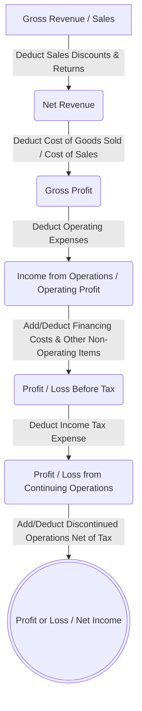
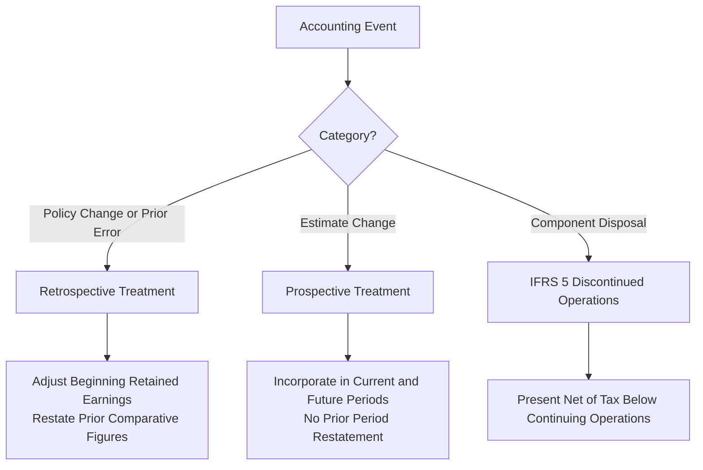

# Financial Statement Formats (IAS 1, IAS 8, IFRS 5, IAS 7)
> [!abstract] Curriculum & Syllabus Context
> - **Course:** ACC 301 Intermediate Accounting
> - **Phase:** Phase 4: Financial Statement Synthesis & Global Standards
> - **Target Reading:** Weygandt, Kieso, and Warfield, *Intermediate Accounting: IFRS Edition* (3rd Edition) — **Financial Statement Formats**
> - **Syllabus Focus:** Statement of Financial Position, Statement of Profit or Loss (function vs. nature of expense), Comprehensive Income (one vs. two-statement approach), accounting changes and errors (IAS 8), discontinued operations (IFRS 5), and cash flow reconciliation mechanics (IAS 7). Incorporates Bangladesh statutory reporting mandates under the Companies Act, 1994 (Schedule XI).

---
### 1. Conceptual Framework & IFRS Presentation Overview (IAS 1)
#### 1.1 Objective and Scope of Financial Statements under IAS 1
> [!info] Key Definition
> Under **IAS 1: Presentation of Financial Statements**, the primary objective of general-purpose financial reporting is to provide information about the financial position, financial performance, and cash flows of an entity that is useful to a wide range of users (present and potential equity investors, lenders, and other creditors) in making financial decisions.

A complete set of financial statements prepared in accordance with International Financial Reporting Standards (IFRS) comprises:
1. A **Statement of Financial Position** at the end of the period.
2. A **Statement of Profit or Loss and Other Comprehensive Income** for the period (presented either as a single combined statement or as two separate statements: a Statement of Profit or Loss followed immediately by a Statement of Comprehensive Income).
3. A **Statement of Changes in Equity** for the period.
4. A **Statement of Cash Flows** for the period (governed by IAS 7).
5. **Notes**, comprising a summary of significant accounting policies and other explanatory notes.
#### 1.2 Strict IFRS Terminology Mapping
To ensure complete alignment with IFRS, traditional US GAAP terms are replaced with standard IFRS terminology throughout financial statement presentation:

| US GAAP Terminology | IFRS / IAS 1 Standard Terminology |
| :--- | :--- |
| Balance Sheet | **Statement of Financial Position** |
| Income Statement | **Statement of Profit or Loss** |
| Stockholders' Equity | **Equity** |
| Common Stock | **Share Capital—Ordinary** |
| Preferred Stock | **Share Capital—Preference** |
| Additional Paid-in Capital (APIC) | **Share Premium** |
| Net Income | **Profit or Loss** (or Net Income) |
| Retained Earnings | **Retained Earnings** |
| Accumulated Other Comprehensive Income (AOCI) | **Accumulated Other Comprehensive Income (AOCI)** |

---
### 2. Statement of Profit or Loss (Income Statement) under IAS 1
#### 2.1 Structure and Core Components
The Statement of Profit or Loss measures the financial performance of an entity over a specified period. Under IAS 1, entities may present expenses using a multi-step format that segregates key operational thresholds.

The standard multi-step line items include:
1. **Revenue** (Gross Sales less Discounts and Returns): Inflows arising from ongoing central operations.
2. **Cost of Sales**: Direct manufacturing or procurement costs associated with goods sold.
3. **Gross Profit**: The intermediate difference between Net Revenue and Cost of Sales ($\text{Gross Profit} = \text{Net Revenue} - \text{Cost of Sales}$).
4. **Operating Expenses**: Disaggregated operational costs (Selling, Distribution, Administrative expenses).
5. **Financing Costs**: Interest expense and borrowing costs incurred on debt financing.
6. **Tax Expense**: Income tax expense determined via intraperiod tax allocation.
7. **Discontinued Operations**: Post-tax profit or loss from discontinued operations (IFRS 5).
8. **Profit or Loss (Net Income)**: The final residual earnings attributable to the period.
#### 2.2 Classification of Expenses: By Function vs. By Nature
IAS 1 mandates that an entity must present an analysis of expenses recognized in profit or loss using a classification based on either their **function** or their **nature**, whichever provides information that is reliable and more relevant.

**1. Expenses Classified by Function (Cost of Sales Method)**
Expenses are grouped according to their operational function within the entity (e.g., Cost of Sales, Selling/Distribution Costs, Administrative Activities). Entities choosing this method must disclose additional information on the nature of expenses (including depreciation, amortisation, and employee benefit costs).

$$ \begin{array}{lrr}
\hline
\multicolumn{3}{c}{\textbf{Expense Classification by Function Format}} \\
\hline
\text{Revenue} & & \text{XXX} \\
\text{Cost of Sales} & & (\text{XXX}) \\
\hline
\textbf{Gross Profit} & & \mathbf{\text{XXX}} \\
\text{Other Income} & & \text{XXX} \\
\text{Distribution / Selling Costs} & & (\text{XXX}) \\
\text{Administrative Expenses} & & (\text{XXX}) \\
\text{Financing Costs} & & (\text{XXX}) \\
\hline
\textbf{Profit Before Tax} & & \mathbf{\text{XXX}} \\
\hline \hline
\end{array} $$

**2. Expenses Classified by Nature**
Expenses are aggregated in the Statement of Profit or Loss according to their nature (e.g., raw materials and consumables used, employee benefits expense, depreciation and amortisation expense, transport costs) without reallocating them among functional units.

$$ \begin{array}{lrr}
\hline
\multicolumn{3}{c}{\textbf{Expense Classification by Nature Format}} \\
\hline
\text{Revenue} & & \text{XXX} \\
\text{Other Income} & & \text{XXX} \\
\text{Changes in Inventories of Finished Goods and WIP} & & \text{XXX} \text{ or } (\text{XXX}) \\
\text{Raw Materials and Consumables Used} & & (\text{XXX}) \\
\text{Employee Benefits Expense} & & (\text{XXX}) \\
\text{Depreciation and Amortisation Expense} & & (\text{XXX}) \\
\text{Other Expenses} & & (\text{XXX}) \\
\hline
\textbf{Total Operating Expenses} & & (\text{XXX}) \\
\hline
\textbf{Profit Before Tax} & & \mathbf{\text{XXX}} \\
\hline \hline
\end{array} $$
#### 2.3 Prohibition of 'Extraordinary Items'
> [!warning] Exam Pitfall / Exception
> **Prohibition of Extraordinary Items:** Under IAS 1 (and standard IFRS), the classification or presentation of any items of income or expense as "Extraordinary Items" is **strictly prohibited** anywhere on the face of the financial statements or in the notes. All peripheral, unusual, or non-recurring items (such as casualty losses, flood damage, or gains/losses on disposal of plant assets) must be reported within profit or loss before tax (typically as Other Income/Expenses or as separate line items if material).

#### 2.4 Earnings Per Share (EPS) Presentation Rules
Basic Earnings Per Share (EPS) must be presented on the face of the Statement of Profit or Loss for entities whose shares are publicly traded.

> [!quote] Formula & Derivation: Earnings Per Share (EPS)
> $$ \text{Basic EPS} = \frac{\text{Profit or Loss (Net Income)} - \text{Preference Share Dividends}}{\text{Weighted-Average Number of Ordinary Shares Outstanding}} $$

* **Preference Dividends Allocation**: Cumulative preference dividends (declared or undeclared) or non-cumulative preference dividends declared during the period are deducted from Profit or Loss.
* **Disaggregated EPS**: If an entity presents a discontinued operation, it must present basic and diluted EPS for both continuing operations and discontinued operations either on the face of the statement or in the notes.

---
### 3. Statement of Comprehensive Income (IAS 1)
#### 3.1 Presentation Options: One-Statement vs. Two-Statement Approach
IAS 1 allows entities two presentation options for comprehensive income:
1. **One-Statement Approach (Statement of Comprehensive Income)**: A single, continuous statement presenting both the components of Profit or Loss and the components of Other Comprehensive Income (OCI), arriving at Total Comprehensive Income at the bottom.
2. **Two-Statement Approach**:
   * *Statement 1*: A separate Statement of Profit or Loss displaying operational revenues, expenses, and ending at Profit or Loss (Net Income).
   * *Statement 2*: A Statement of Comprehensive Income beginning with Profit or Loss from Statement 1, followed immediately by items of Other Comprehensive Income to derive Total Comprehensive Income.
#### 3.2 The Comprehensive Income Equation
Total Comprehensive Income encompasses all non-owner changes in equity during a period.

> [!quote] Formula & Derivation: Comprehensive Income
> $$ \text{Total Comprehensive Income} = \text{Profit or Loss (Net Income)} + \text{Other Comprehensive Income (OCI)} $$

#### 3.3 Components of Other Comprehensive Income (OCI)
Other Comprehensive Income comprises items of income and expense (including reclassification adjustments) that are not recognized in Profit or Loss as required or permitted by specific IFRSs:
1. **Revaluation Surplus (IAS 16 / IAS 38)**: Increases arising on the revaluation of Property, Plant, and Equipment (PP&E) or Intangible Assets under the revaluation model.
2. **Unrealized Gains/Losses on FVOCI Investments (IFRS 9)**: Fair value gains or losses on Fair Value through Other Comprehensive Income (FVOCI) financial assets (both debt instruments and non-trading equity investments).
3. **Actuarial Gains/Losses on Defined Benefit Plans (IAS 19)**: Remeasurements of defined benefit pension plans arising from actuarial adjustments and adjustments to plan asset returns.
4. **Foreign Currency Translation Gains/Losses (IAS 21)**: Gains and losses arising from translating the financial statements of a foreign operation into the entity's presentation currency.
#### 3.4 Accumulated Other Comprehensive Income (AOCI) in Equity
While OCI represents the periodic flow of unrealized items during a fiscal year, the cumulative balance of these items over time is held in a permanent equity reserve on the Statement of Financial Position titled **Accumulated Other Comprehensive Income (AOCI)**.

> [!quote] Formula & Derivation
> $$ \text{Ending AOCI} = \text{Beginning AOCI} \pm \text{Current Period OCI} $$

---
### 4. Accounting Changes, Error Corrections, and Discontinued Operations (IAS 8 & IFRS 5)
#### 4.1 Discontinued Operations (IFRS 5)
**Definition and Classification**
Under **IFRS 5: Non-current Assets Held for Sale and Discontinued Operations**, a discontinued operation is a component of an entity that either has been disposed of or is classified as held for sale, and:
* Represents a separate major line of business or geographical area of operations;
* Is part of a single coordinated plan to dispose of a separate major line of business or geographical area of operations; or
* Is a subsidiary acquired exclusively with a view to resale.

A component comprises operations and cash flows that can be clearly distinguished, operationally and for financial reporting purposes, from the rest of the entity.

**Presentation on the Statement of Profit or Loss**
Discontinued operations are presented as a single amount on the face of the Statement of Profit or Loss, net of tax, directly below Income from Continuing Operations:

$$ \begin{array}{l}
\text{Profit / Loss from Continuing Operations (After Tax)} \\
\pm \text{Discontinued Operations:} \\
\quad \text{Income (Loss) from Operations of Discontinued Component (Net of Tax)} \\
\quad \pm \text{Gain (Loss) on Disposal of Discontinued Component (Net of Tax)} \\
\hline
= \textbf{Profit or Loss (Net Income)}
\end{array} $$

**Intraperiod Tax Allocation Formula**
To avoid distorting continuing operations, total income tax expense must be allocated across financial statement components:

> [!quote] Formula & Derivation: Intraperiod Tax Allocation
> $$ \text{Tax Effect of Item} = \text{Pre-Tax Amount} \times \text{Marginal Tax Rate } (t) $$
> $$ \text{After-Tax Gain} = \text{Pre-Tax Gain} \times (1 - t) $$
> $$ \text{After-Tax Loss} = \text{Pre-Tax Loss} \times (1 - t) \quad [\text{Tax Benefit } = \text{Pre-Tax Loss} \times t] $$

#### 4.2 Changes in Accounting Policy & Error Corrections (IAS 8) - Retrospective Treatment
Under **IAS 8: Accounting Policies, Changes in Accounting Estimates and Errors**:

**1. Changes in Accounting Policy**
* **Definition**: A change from one accepted IFRS accounting principle to another (e.g., changing inventory costing method from Weighted Average to FIFO).
* **Accounting Treatment**: Applied **retrospectively**.
* **Mechanics**:
  1. Adjust the opening balance of Retained Earnings for the earliest prior period presented.
  2. Restate prior period comparative figures for all comparative periods presented as if the new policy had always been applied.

**2. Prior Period Error Corrections**
* **Definition**: Errors resulting from mathematical mistakes, mistakes in applying accounting policies, or oversight/misinterpretation of facts in prior periods.
* **Accounting Treatment**: Corrected **retrospectively** as a Prior Period Adjustment.
* **Mechanics**: Adjust opening Retained Earnings and restate comparative financial statements for prior periods.
#### 4.3 Changes in Accounting Estimates (IAS 8) - Prospective Treatment
* **Definition**: Revisions to operational benchmarks based on new information or development (e.g., adjustments to bad debt rates, changes in asset useful lives or residual values, revisions to warranty provisions).
* **Accounting Treatment**: Applied **prospectively**.
* **Mechanics**:
  * Recognized in the period of change (and future periods if affected).
  * No restatement of prior periods and no adjustment to opening Retained Earnings.

---
### 5. Statement of Financial Position (IAS 1)
#### 5.1 Current vs. Non-Current Classification Criteria
IAS 1 requires entities to present current and non-current assets, and current and non-current liabilities, as separate classifications on the face of the Statement of Financial Position.
* **Operating Cycle**: The time elapsed between the acquisition of materials/services and the final cash realization from sales. If the normal operating cycle is not clearly identifiable, its duration is assumed to be 12 months.
* **Current Classification Rule**: An asset or liability is classified as current if it is expected to be realized, sold, consumed, or settled within 12 months after the reporting period or within the entity's normal operating cycle. Otherwise, it is classified as non-current.
#### 5.2 Asset Classifications
**1. Non-Current Assets**
Long-term operational assets and investments held for capital growth or strategic control:
* **Property, Plant, and Equipment (PP&E) (IAS 16)**: Tangible assets used in central operations (Land, Buildings, Plant, Machinery). Valued at Historical Cost or Revalued Amount less Cumulative Depreciation.
* **Investment Property (IAS 40)**: Land or buildings held to earn rentals, for capital appreciation, or both.
* **Intangibles (IAS 38)**: Identifiable non-monetary assets without physical substance (Patents, Trademarks, Copyrights, Software).
* **Long-Term Investments**: Financial assets held for long-term strategic purposes (e.g., debt and equity securities, sinking funds).

**2. Current Assets**
Assets expected to be converted into cash, sold, or consumed within one year or the operating cycle:
* **Inventories (IAS 2)**: Assets held for sale in the ordinary course of business, in process of production, or materials/supplies to be consumed (valued at Lower of Cost and Net Realizable Value).
* **Trade and Other Receivables**: Open account balances owed by customers less Allowance for Doubtful Accounts.
* **Cash and Cash Equivalents**: Currency on hand, demand deposits, and highly liquid short-term investments with maturities of 3 months or less.
#### 5.3 Equity Section Structure
The equity section reflects the residual interest in the assets of the entity after deducting all liabilities:
$$ \text{Total Equity} = \text{Share Capital} + \text{Share Premium} + \text{Retained Earnings} + \text{Accumulated OCI} + \text{Non-Controlling Interest} $$
1. **Share Capital—Ordinary**: Par or stated value of issued ordinary shares.
2. **Share Capital—Preference**: Par or stated value of preference shares (provided they do not possess mandatorily redeemable debt characteristics under IAS 32/IFRS 9).
3. **Share Premium**: Capital contributed by owners in excess of par or stated value.
4. **Retained Earnings**: Cumulative net profits retained in the enterprise (unappropriated and appropriated).
5. **Accumulated Other Comprehensive Income (AOCI)**: Cumulative unrealized OCI reserves.
6. **Non-Controlling Interest (NCI)**: Equity in a subsidiary not attributable, directly or indirectly, to the parent company.
#### 5.4 Liability Classifications
**1. Non-Current Liabilities**
Obligations not expected to be liquidated within 12 months or the operating cycle:
* **Bonds Payable / Long-Term Debt**: Formal contractual debt issues reported at amortised cost.
* **Lease Liabilities (IFRS 16)**: Long-term present value of obligation under lease contracts.

**2. Current Liabilities**
Obligations expected to be settled within 12 months or the operating cycle:
* **Trade and Other Payables**: Short-term open account obligations to suppliers.
* **Current Maturities of Long-Term Debt**: Portion of long-term debt maturing within the next 12 months (unless refinanced on or before the balance sheet date).
* **Provisions (IAS 37)**: Liabilities of uncertain timing or amount. A provision is recognized when:
  1. An entity has a present obligation (legal or constructive) as a result of a past event;
  2. It is probable (>50% likelihood) that an outflow of resources will be required; and
  3. A reliable estimate can be made.

---
### 6. Statement of Changes in Equity (IAS 1)
#### 6.1 Purpose and Format
The Statement of Changes in Equity reconciles the opening and closing balances of each equity component during the period. IAS 1 mandates that all owner changes (e.g., share issuances, dividends) and non-owner changes (Profit or Loss, OCI) be clearly segregated.
#### 6.2 Detailed Reconciliation Columnar Matrix
$$ \begin{array}{lrrrrrrr}
\hline
\textbf{(in £ / \$ thousands)} & \textbf{Pref. Share Cap.} & \textbf{Ord. Share Cap.} & \textbf{Share Premium} & \textbf{Retained Earnings} & \textbf{AOCI} & \textbf{Treasury Shares} & \textbf{Total Equity} \\
\hline
\textbf{Balance at Beginning of Year} & \text{XXX} & \text{XXX} & \text{XXX} & \text{XXX} & \text{XXX} & (\text{XXX}) & \textbf{\text{XXX}} \\
\text{Changes in Accounting Policy (IAS 8)} & - & - & - & \text{XXX} / (\text{XXX}) & - & - & \text{XXX} / (\text{XXX}) \\
\text{Prior Period Error Restatement} & - & - & - & \text{XXX} / (\text{XXX}) & - & - & \text{XXX} / (\text{XXX}) \\
\hline
\textbf{Restated Beginning Balance} & \text{XXX} & \text{XXX} & \text{XXX} & \text{XXX} & \text{XXX} & (\text{XXX}) & \textbf{\text{XXX}} \\
\text{Profit or Loss for the Year} & - & - & - & \text{XXX} & - & - & \text{XXX} \\
\text{Other Comprehensive Income} & - & - & - & - & \text{XXX} / (\text{XXX}) & - & \text{XXX} / (\text{XXX}) \\
\hline
\textbf{Total Comprehensive Income} & - & - & - & \textbf{\text{XXX}} & \textbf{\text{XXX}} / \mathbf{(\text{XXX})} & - & \textbf{\text{XXX}} \\
\text{Issue of Share Capital} & \text{XXX} & \text{XXX} & \text{XXX} & - & - & - & \text{XXX} \\
\text{Dividends Declared and Paid} & - & - & - & (\text{XXX}) & - & - & (\text{XXX}) \\
\text{Purchase of Treasury Shares} & - & - & - & - & - & (\text{XXX}) & (\text{XXX}) \\
\hline
\textbf{Balance at End of Year} & \mathbf{\text{XXX}} & \mathbf{\text{XXX}} & \mathbf{\text{XXX}} & \mathbf{\text{XXX}} & \mathbf{\text{XXX}} & \mathbf{(\text{XXX})} & \mathbf{\text{XXX}} \\
\hline \hline
\end{array} $$

---
### 7. Statement of Cash Flows Overview (IAS 7)
#### 7.1 Activity Classifications
The Statement of Cash Flows (governed by IAS 7) categorizes cash receipts and cash payments into three functional activities:
1. **Operating Activities**: Primary revenue-producing activities of the entity.
   * *Inflows*: Collections from sales of goods/services, cash receipts from interest/dividends.
   * *Outflows*: Payments to suppliers, employees, interest paid, and income taxes paid.
2. **Investing Activities**: Acquisition and disposal of long-term assets and other investments.
   * *Inflows*: Sale proceeds from PP&E, intangibles, and debt/equity securities of other entities.
   * *Outflows*: Capital expenditures for PP&E, intangible asset purchases, loans extended.
3. **Financing Activities**: Transactions that alter the equity capital and borrowing structure.
   * *Inflows*: Proceeds from issuing share capital, debentures, notes, bonds, and bank loans.
   * *Outflows*: Cash dividend payments, repurchases of share capital (treasury shares), and principal debt repayments.
#### 7.2 Operating Cash Flow Reconciliation Formats
> [!quote] Formula & Derivation: Indirect Method Formula
> Reconciles Profit or Loss (Net Income) to Net Cash Flow from Operating Activities:
> $$ \begin{aligned}
> \text{Net Operating Cash Flow} &= \text{Profit or Loss (Net Income)} \\
> &\quad + \text{Non-Cash Expenses (Depreciation, Amortisation, Impairments)} \\
> &\quad - \text{Non-Cash Gains} + \text{Non-Cash Losses} \\
> &\quad - \Delta\text{Operating Current Assets (Increases)} \\
> &\quad + \Delta\text{Operating Current Assets (Decreases)} \\
> &\quad + \Delta\text{Operating Current Liabilities (Increases)} \\
> &\quad - \Delta\text{Operating Current Liabilities (Decreases)}
> \end{aligned} $$

> [!quote] Formula & Derivation: Direct Method Conversion Formulas
> Converts each accrual revenue and expense line to direct cash flows:
> $$ \text{Cash Receipts from Customers} = \text{Net Sales Revenue} - \Delta\text{Trade Receivables} + \Delta\text{Unearned Revenue} $$
> $$ \text{Purchases} = \text{Cost of Sales} + \Delta\text{Inventory} $$
> $$ \text{Cash Paid to Suppliers} = \text{Purchases} - \Delta\text{Trade Payables} $$
> $$ \text{Cash Operating Expenses} = \text{Operating Expenses (excl. Depr/Amort)} + \Delta\text{Prepaids} - \Delta\text{Accrued Liabilities} $$

---
### 8. Statutory Reporting Framework in Bangladesh
#### 8.1 Companies Act, 1994 (Schedule XI) - 'Order of Permanence'
In Bangladesh, corporate reporting is legally governed by **Section 185 and Schedule XI of the Companies Act, 1994**. Schedule XI dictates statutory layout rules for balance sheets and profit and loss accounts.

> [!warning] Exam Pitfall / Exception
> **The Order of Permanence Requirement:** Unlike US GAAP (which uses the Order of Liquidity, placing current liquid items first), Schedule XI, Part I of the Companies Act 1994 mandates the **Order of Permanence** for Bangladeshi statutory balance sheets:
> * **Capital & Liabilities Section:** Permanent Share Capital is presented first, followed by Reserves and Surplus, Secured Loans, Unsecured Loans, and lastly Current Liabilities & Provisions.
> * **Property & Assets Section:** Non-Current Fixed Assets (PP&E) are presented first, followed by Investments, Current Assets/Loans & Advances, and Miscellaneous Expenditure last.

**Statutory Balance Sheet Format (Schedule XI, Part I)**
$$ \begin{array}{lrr}
\hline
\multicolumn{3}{c}{\textbf{[Company Name, Limited]}} \\
\multicolumn{3}{c}{\textbf{Statutory Balance Sheet as at [Date] (Schedule XI)}} \\
\hline
\textbf{Capital and Liabilities} & & \textbf{Amount (BDT)} \\
\hline
\textbf{1. Share Capital:} & & \\
\quad \text{Authorized Capital} & & \text{XXX} \\
\cline{3-3}
\quad \text{Issued, Subscribed, and Paid-up Capital} & & \text{XXX} \\
\textbf{2. Reserves and Surplus (General Reserve, Share Premium, P\&L Surplus)} & & \text{XXX} \\
\textbf{3. Secured Loans (Debentures, Bank Loans against hypothecation)} & & \text{XXX} \\
\textbf{4. Unsecured Loans (Short-term borrowings, deposits)} & & \text{XXX} \\
\textbf{5. Current Liabilities and Provisions (Acceptances, Trade Creditors, Tax Provision)} & & \text{XXX} \\
\hline
\textbf{Total Capital and Liabilities} & & \mathbf{\text{XXXXX}} \\
\hline \hline
& & \\
\textbf{Property and Assets} & & \textbf{Amount (BDT)} \\
\hline
\textbf{1. Fixed Assets (PP\&E): Land, Buildings, Plant, Machinery (Cost less Depr.)} & & \text{XXX} \\
\textbf{2. Investments (Government Securities, Subsidiary Shares/Bonds)} & & \text{XXX} \\
\textbf{3. Current Assets, Loans, and Advances:} & & \\
\quad \text{A. Current Assets (Inventories, Sundry Debtors, Cash \& Bank Balances)} & \text{XXX} & \\
\quad \text{B. Loans and Advances (Employee Advances, Prepayments)} & \text{XXX} & \text{XXX} \\
\textbf{4. Miscellaneous Expenditure (Preliminary Expenses unwritten off)} & & \text{XXX} \\
\hline
\textbf{Total Property and Assets} & & \mathbf{\text{XXXXX}} \\
\hline \hline
\end{array} $$
#### 8.2 Schedule XI, Part II: Statutory Profit & Loss Disclosures
Part II of Schedule XI requires specific statutory disclosures on the face of the Profit & Loss Account or in notes:
1. **Turnover & Sales**: Total gross sales, disaggregated by major product categories.
2. **Raw Material Consumption**: Cost of raw materials consumed, disclosing quantities and major imported vs. indigenous categories.
3. **Managerial Remuneration**: Specific disclosure of all remuneration, commissions, bonuses, and perquisites paid to managing directors and corporate executives.
4. **Auditor's Remuneration**: Detailed breakdown of fees paid to statutory auditors (for audit, taxation, advisory services, and out-of-pocket reimbursements).
5. **Industrial Capacity & Production**: Licensed capacity, installed capacity, and actual operational production realized during the year.
#### 8.3 Securities and Exchange Rules, 1987 (Rule 12(2)) Requirements
For entities listed on the Dhaka Stock Exchange (DSE) or Chittagong Stock Exchange (CSE), the **Bangladesh Securities and Exchange Commission (BSEC)** under Rule 12(2) mandates:
* **Mandatory Reporting Package**: Audited Balance Sheet, Profit and Loss Account, Statement of Cash Flows (per IAS 7), Statement of Changes in Equity, and Notes.
* **Timeline**: Submission within **120 days (4 months)** from the end of the fiscal year.
* **Governance**: Corporate Governance Compliance Certificate issued by a practicing Chartered Accountant (CA) or Cost & Management Accountant (CMA).
#### 8.4 Comparative Matrix: US GAAP vs. IFRS vs. Bangladesh Companies Act 1994

| Reporting Dimension | US GAAP (FASB ASC) | IFRS (IAS 1 / IAS 7) | Bangladesh Companies Act 1994 |
| :--- | :--- | :--- | :--- |
| **Balance Sheet Order** | **Order of Liquidity** (Current Assets first) | Flexible (typically **Reverse Liquidity** / Non-Current first) | **Order of Permanence** strictly mandated (Capital & PP&E first) |
| **Statement of Cash Flows** | Mandatory (ASC 230) | Mandatory (IAS 7) | Required by BSEC Rule 12(2) for public firms; optional for private firms |
| **Format Flexibility** | Multi-step format standard | Flexible principles-based formats | **Prescribed Statutory Layout** under Schedule XI (Part I & Part II) |
| **Interest & Dividend Cash Flows** | Operating (Interest Paid/Rec, Div Rec); Financing (Div Paid) | Operating, Investing, or Financing options allowed | Follows IAS 7 / BFRS requirements under BSEC Rules |
| **Discontinued Operations** | Net of tax below Continuing Operations | Net of tax below Continuing Operations (IFRS 5) | Presented net of tax in accordance with IFRS 5 / BFRS 5 |

---
### 9. Comprehensive Worked Example
> [!example] Comprehensive Worked Example: Apex Synthetics International Ltd.
> **Scenario Fact Pattern:**
> Apex Synthetics International Ltd. reports the following pre-tax trial balance amounts for the fiscal year ended 31 December 2025:
> * Gross Revenue from Sales: £6,000,000
> * Sales Discounts & Allowances: £200,000
> * Cost of Sales: £3,200,000
> * Selling & Distribution Costs: £500,000
> * Administrative Expenses: £400,000
> * Dividend Income: £30,000
> * Gain on Disposal of Plant Assets: £50,000
> * Financing Costs (Interest Expense): £100,000
> * Pre-Tax Loss from Discontinued Operations (Logistics Division): £160,000
> * Pre-Tax Unrealised Gain on FVOCI Debt Securities: £80,000
> **Additional Data:**
> 1. Effective Income Tax Rate: 25% across all items.
> 2. Share Capital—Preference Dividends Declared and Paid: £40,000.
> 3. Ordinary Share Capital: 200,000 ordinary shares outstanding throughout 2025.
> **Step-by-Step Derivation & Calculations**
> **Step 1: Compute Net Revenue & Operating Profit**
> $$ \text{Net Revenue} = £6,000,000 - £200,000 = £5,800,000 $$
> $$ \text{Gross Profit} = £5,800,000 - £3,200,000 = £2,600,000 $$
> $$ \text{Total Operating Expenses} = £500,000 + £400,000 = £900,000 $$
> $$ \text{Operating Profit} = £2,600,000 - £900,000 = £1,700,000 $$
> **Step 2: Compute Profit Before Tax & Tax Expense on Continuing Operations**
> $$ \text{Other Income / Gains} = £30,000 (\text{Dividends}) + £50,000 (\text{Gain}) = £80,000 $$
> $$ \text{Profit Before Tax} = £1,700,000 + £80,000 - £100,000 (\text{Financing Costs}) = £1,680,000 $$
> $$ \text{Income Tax Expense } (25\%) = £1,680,000 \times 0.25 = £420,000 $$
> $$ \text{Profit from Continuing Operations} = £1,680,000 - £420,000 = £1,260,000 $$
> **Step 3: Intraperiod Tax Allocation for Discontinued Operations**
> $$ \text{Pre-Tax Loss} = -£160,000 $$
> $$ \text{Tax Benefit } (25\%) = £160,000 \times 0.25 = £40,000 $$
> $$ \text{After-Tax Discontinued Operations Loss} = -£160,000 + £40,000 = -£120,000 $$
> $$ \textbf{Profit or Loss (Net Income)} = £1,260,000 - £120,000 = \mathbf{£1,140,000} $$
> **Step 4: Basic Earnings Per Share (EPS)**
> $$ \text{Basic EPS (Continuing Operations)} = \frac{£1,260,000 - £40,000 (\text{Preference Dividends})}{200,000 \text{ shares}} = \frac{£1,220,000}{200,000} = \mathbf{£6.10 \text{ per share}} $$
> $$ \text{Basic EPS (Discontinued Operations)} = \frac{-£120,000}{200,000 \text{ shares}} = \mathbf{-£0.60 \text{ per share}} $$
> $$ \text{Total Basic EPS} = £6.10 - £0.60 = \mathbf{£5.50 \text{ per share}} $$
> **Step 5: Compute Other Comprehensive Income & Total Comprehensive Income**
> $$ \text{Pre-Tax OCI (Unrealised Gain on FVOCI Securities)} = £80,000 $$
> $$ \text{Tax Expense on OCI } (25\%) = £80,000 \times 0.25 = £20,000 $$
> $$ \text{Net OCI} = £80,000 - £20,000 = £60,000 $$
> $$ \textbf{Total Comprehensive Income} = £1,140,000 + £60,000 = \mathbf{£1,200,000} $$
> ---
> **Statements of Performance & Comprehensive Income**
> $$ \begin{array}{lrr}
> \hline
> \multicolumn{3}{c}{\textbf{Apex Synthetics International Ltd. — Statement of Profit or Loss}} \\
> \multicolumn{3}{c}{\textbf{For the Year Ended 31 December 2025}} \\
> \hline
> \text{Revenue} & & £6,000,000 \\
> \text{Less: Sales Discounts \& Allowances} & & (200,000) \\
> \hline
> \textbf{Net Revenue} & & £5,800,000 \\
> \text{Cost of Sales} & & (3,200,000) \\
> \hline
> \textbf{Gross Profit} & & £2,600,000 \\
> \text{Other Income (Dividend Income \& Asset Disposal Gain)} & & 80,000 \\
> \text{Selling \& Distribution Costs} & & (500,000) \\
> \text{Administrative Expenses} & & (400,000) \\
> \text{Financing Costs} & & (100,000) \\
> \hline
> \textbf{Profit Before Tax} & & £1,680,000 \\
> \text{Income Tax Expense (25\%)} & & (420,000) \\
> \hline
> \textbf{Profit from Continuing Operations} & & \mathbf{£1,260,000} \\
> \textbf{Discontinued Operations:} & & \\
> \quad \text{Loss from Operations of Discontinued Division (net of £40,000 tax benefit)} & & (120,000) \\
> \hline
> \textbf{Profit or Loss (Net Income)} & & \mathbf{£1,140,000} \\
> \hline \hline
> \textbf{Earnings Per Share (200,000 Ordinary Shares):} & & \\
> \quad \text{Basic EPS from Continuing Operations} & & £6.10 \\
> \quad \text{Basic EPS from Discontinued Operations} & & (0.60) \\
> \hline
> \quad \textbf{Total Basic Earnings Per Share} & & \mathbf{£5.50} \\
> \hline \hline
> \end{array} $$
> $$ \begin{array}{lr}
> \hline
> \multicolumn{2}{c}{\textbf{Apex Synthetics International Ltd. — Statement of Comprehensive Income}} \\
> \multicolumn{2}{c}{\textbf{For the Year Ended 31 December 2025}} \\
> \hline
> \textbf{Profit or Loss (Net Income)} & \mathbf{£1,140,000} \\
> \textbf{Other Comprehensive Income (OCI):} & \\
> \quad \text{Items that may be reclassified subsequently to profit or loss:} & \\
> \quad \quad \text{Unrealised Gain on FVOCI Debt Securities (net of £20,000 tax)} & 60,000 \\
> \hline
> \textbf{Total Comprehensive Income for the Year} & \mathbf{£1,200,000} \\
> \hline \hline
> \end{array} $$