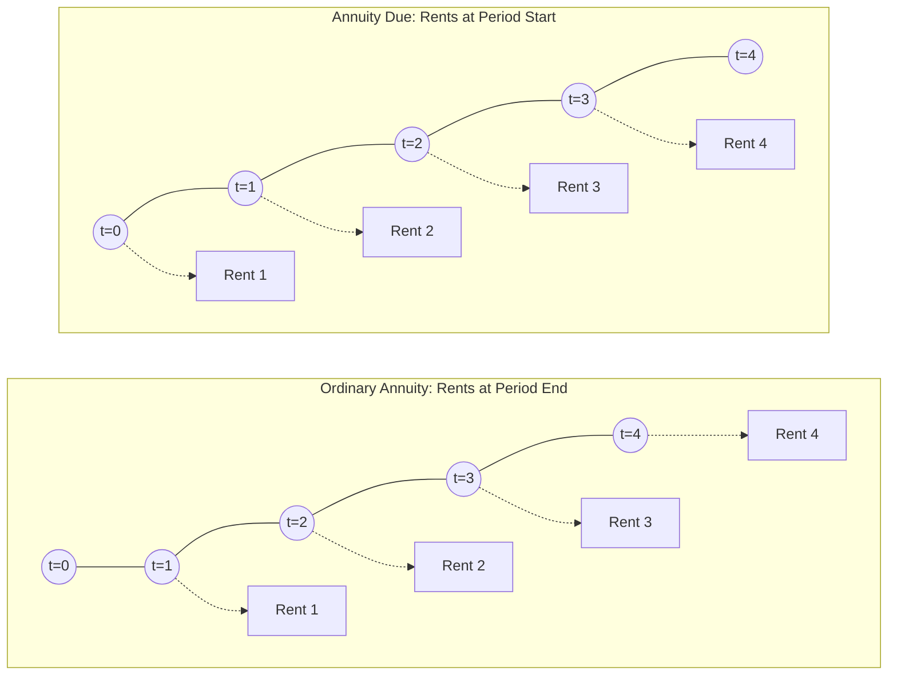

# Accounting and the Time Value of Money (IFRS 3rd Edition Alignment)
> [!abstract] Curriculum & Syllabus Context
> - **Course:** ACC 301 Intermediate Accounting
> - **Phase:** Phase 1: Conceptual & Procedural Foundations
> - **Target Reading:** Kieso, Weygandt, and Warfield, *Intermediate Accounting: IFRS Edition* (3rd Edition), Chapter 4
> - **Syllabus Focus:** Fundamental variables, components of interest rates, single-sum mathematics, ordinary annuity vs. annuity due, deferred annuities, bond valuation, expected cash flow approach (IFRS 13), and practical problem-solving applications.

---
### 1. Fundamental Variables, Components of Interest Rates, and Universal IFRS Application
#### 1.1 Core TVM Variables
The Time Value of Money (TVM) reflects the fundamental economic principle that a monetary unit received today possesses greater value than an identical monetary unit received in the future. This difference arises because cash on hand can be invested immediately to earn interest, thereby generating compounding financial returns over time.

Financial transactions involving time value calculations are defined and mathematically governed by four primary variables:
1. **Principal / Present Value ($PV$):** The current cash value or initial lump-sum amount of an asset, obligation, or investment at time period zero ($t = 0$).
2. **Future Value ($FV$):** The total accumulated cash amount to which a current sum ($PV$) or a series of periodic payments will grow at a specified future date when compounded at a given interest rate.
3. **Periodic Interest Rate ($i$):** The rate of interest charged or earned per compounding period, derived by dividing the nominal annual interest rate ($r$) by the number of compounding periods per year ($m$), such that $i = \frac{r}{m}$.
4. **Number of Compounding Periods ($n$):** The total number of periods over which interest accrues, derived by multiplying the total duration in years ($y$) by the annual compounding frequency ($m$), such that $n = y \times m$.

Mathematically, these four core variables are related through the fundamental compounding equation:

> [!quote] Formula & Derivation: Compounding & Discounting
> **Future Value (Compounding):**
> $$ FV = PV \times (1 + i)^n $$
> **Present Value (Discounting):**
> $$ PV = FV \times (1 + i)^{-n} = \frac{FV}{(1 + i)^n} $$

| Variable Name | Symbol | Unit of Measurement | Conceptual Definition |
| :--- | :---: | :--- | :--- |
| **Present Value** | $PV$ | Currency (£)* | The discounted current worth of a future sum or stream of cash flows at $t = 0$. |
| **Future Value** | $FV$ | Currency (£)* | The total accumulated balance at time period $n$ resulting from compounding $PV$. |
| **Periodic Interest Rate** | $i$ | Percentage ($\%$) per period | The effective interest rate applied per compounding interval ($i = r/m$). |
| **Number of Periods** | $n$ | Whole Integer / Time Units | The total count of compounding intervals over the investment horizon ($n = y \times m$). |

*\*Note: Pound Sterling (£) is used as the primary functional and reporting currency throughout this study guide to align with UK English IFRS compliance, though the mathematical mechanics apply universally across all currency domains (e.g., \$, BDT, €).*
#### 1.2 Components of Interest Rates & Risk Framework
In economic theory and financial reporting, the nominal interest rate charged or earned on any financial instrument comprises three distinct economic components:

> [!quote] Formula & Derivation: Interest Rate Composition
> $$ \text{Nominal Interest Rate} = \text{Pure Rate of Interest} + \text{Expected Inflation Rate} + \text{Credit Risk Premium} $$

1. **Pure Rate of Interest ($2\%\text{--}4\%$ per annum):** The real, risk-free cost of borrowing funds in the absence of inflation and default risk. It represents the baseline compensation demanded by lenders for postponing current consumption.
2. **Expected Inflation Rate:** The additional percentage yield required by capital providers to offset the anticipated decline in general purchasing power over the investment horizon.
3. **Credit Risk Premium:** An adjustment reflecting the specific creditworthiness of the debtor, the likelihood of default, and the uncertainty surrounding the timing and amount of future cash flows.

**Risk-Free Rate vs. Risk-Adjusted Discount Rates under IFRS**
* **Risk-Free Rate of Interest:** Combines the pure rate of interest and the expected inflation rate (typically measured using yields on government securities, such as sovereign treasury bonds). It excludes credit risk.
* **Risk-Adjusted Discount Rate:** Incorporates the risk-free rate plus a credit risk premium specific to the enterprise or transaction.

Under International Financial Reporting Standards (IFRS), credit risk profoundly influences asset and liability measurement:
* **Liability Measurement (IAS 37 / IFRS 16):** Non-current obligations, such as decommissioning provisions or lease liabilities, must be discounted using a pre-tax discount rate that reflects current market assessments of the time value of money and the risks specific to the liability.
* **Asset Valuation & Impairment (IAS 36 / IFRS 9):** When calculating the Value-in-Use of an asset or determining the fair value of financial assets, cash flows or discount rates are adjusted to reflect credit default exposure, market liquidity risks, and operational uncertainty.

> [!warning] Exam Pitfall / Exception
> **Discount Rate Selection & Double-Counting Risk Under IAS 37**
> When determining the discount rate for long-term provisions under IAS 37, the entity must ensure that the rate chosen reflects current market assessments of the time value of money. Crucially, while the discount rate should reflect risks specific to the liability, it **must not** reflect risks for which future cash flow estimates have already been adjusted. Adjusting both the cash flows and the discount rate for the same risk factors leads to double-counting and materially distorts the reported liability balance sheet amount.

#### 1.3 Universal Application Across IFRS Standards
Time value of money principles are embedded throughout IFRS to ensure that financial statements present assets and liabilities at their actual economic value rather than undiscounted face amounts.

| IFRS Standard | Accounting Application | TVM Measurement Technique |
| :--- | :--- | :--- |
| **IAS 16 Property, Plant and Equipment** | Asset Retirement Obligations (ARO) and Decommissioning Provisions | Discounting estimated future asset removal costs using single-sum PV formulas to capitalise decommissioning costs as part of the asset's historical cost. |
| **IAS 36 Impairment of Assets** | Value-in-Use (VIU) calculations for asset impairment testing | Discounting probability-weighted future operating net cash inflows using an appropriate pre-tax risk-adjusted discount rate (Weighted Average Cost of Capital). |
| **IAS 37 Provisions, Contingent Liabilities and Contingent Assets** | Present value discounting of long-term provisions | Discounting expected long-term settlement outflows (e.g., environmental remediation, legal claims) using pre-tax discount rates when the time value of money is material. |
| **IFRS 9 Financial Instruments** | Amortised cost of financial assets and liabilities | Measuring debt instruments, notes, and bonds payable at initial present value and subsequently amortising discounts/premiums using the effective-interest method. |
| **IFRS 16 Leases** | Present value of lease liabilities and Right-of-Use (ROU) assets | Discounting future lease payments using the interest rate implicit in the lease or the lessee's incremental borrowing rate, typically structured as an Annuity Due. |
| **IAS 19 Employee Benefits** | Present value of Defined Benefit Obligations (DBO) | Discounting long-term post-employment benefit obligations using high-quality corporate bond yields matching the currency and duration of the benefit commitment. |

---
### 2. Single-Sum Mathematics & Mechanics
#### 2.1 Future Value of a Single Sum ($FV$)
Compounding is the process of converting a present monetary amount into its future worth, assuming that accumulated interest in each period earns interest in all subsequent periods.

The mathematical formula for the future value of a single sum is:
$$ FV = PV \times (1 + i)^n $$

**Intra-Year Compounding Adjustments**
When interest compounds more frequently than once per year (e.g., semiannually, quarterly, or monthly), the nominal annual interest rate ($r$) and total duration in years ($y$) must be adjusted:
1. **Semiannual Compounding ($m = 2$):** $i = \frac{r}{2}, \quad n = 2 \times y$
2. **Quarterly Compounding ($m = 4$):** $i = \frac{r}{4}, \quad n = 4 \times y$
3. **Monthly Compounding ($m = 12$):** $i = \frac{r}{12}, \quad n = 12 \times y$

**Mathematical Derivation of Compounding Effect**
For an initial investment $PV$ at nominal annual rate $r$ compounded $m$ times per year over $y$ years, the balance at the end of period 1 is:
$$ FV_1 = PV \left(1 + \frac{r}{m}\right) $$
By induction, compounding across $n = m \times y$ periods yields:
$$ FV = PV \left(1 + \frac{r}{m}\right)^{m \times y} = PV (1 + i)^n $$
#### 2.2 Present Value of a Single Sum ($PV$)
Discounting is the inverse process of compounding. It reduces a known future cash flow ($FV$) back to its value at time $t = 0$ by stripping out accumulated interest.

The mathematical formula for the present value of a single sum is:
$$ PV = FV \times (1 + i)^{-n} = \frac{FV}{(1 + i)^n} $$

**Inverse Relationship Dynamics**
Present value varies inversely with both the discount rate ($i$) and the duration ($n$):
* **Higher Discount Rate ($i$) $\longrightarrow$ Lower Present Value ($PV$)**
  $$ \text{As } i \uparrow \implies (1 + i)^n \uparrow \implies \frac{FV}{(1 + i)^n} \downarrow $$
* **Longer Time Horizon ($n$) $\longrightarrow$ Lower Present Value ($PV$)**
  $$ \text{As } n \uparrow \implies (1 + i)^n \uparrow \implies \frac{FV}{(1 + i)^n} \downarrow $$
#### 2.3 Solving for Unknown Variables ($i$ and $n$)
When $PV$ and $FV$ are known, financial analysts must solve algebraically for either the implicit interest rate ($i$) or the time period ($n$).

> [!quote] Formula & Derivation: Solving for Unknowns
> **1. Solving for the Periodic Interest Rate ($i$)**
> Starting from $FV = PV(1 + i)^n$:
> $$ \frac{FV}{PV} = (1 + i)^n $$
> Taking the $n$-th root of both sides:
> $$ 1 + i = \left(\frac{FV}{PV}\right)^{\frac{1}{n}} \implies i = \left(\frac{FV}{PV}\right)^{\frac{1}{n}} - 1 $$
> **2. Solving for the Number of Compounding Periods ($n$)**
> Starting from $\frac{FV}{PV} = (1 + i)^n$:
> Taking the natural logarithm ($\ln$) of both sides:
> $$ \ln\left(\frac{FV}{PV}\right) = n \times \ln(1 + i) \implies n = \frac{\ln(FV / PV)}{\ln(1 + i)} $$

**Harmonised Factor Table Lookup Procedure**
When applying compound interest factor tables to determine an unknown variable:
* **To solve for $n$ or $i$ using Future Value:** Divide $FV$ by $PV$ to obtain the Future Value Factor ($FVF_{n, i}$). Locate the resulting factor in the FVF table along the row for period $n$ (to find rate $i$) or down the column for interest rate $i$ (to find period $n$).
* **To solve for $n$ or $i$ using Present Value:** Divide $PV$ by $FV$ to obtain the Present Value Factor ($PVF_{n, i}$). Locate the resulting factor in the PVF table along the row for period $n$ or down the column for interest rate $i$.

> [!warning] Exam Pitfall / Exception
> **Algebraic Logarithm Shortcuts vs. Factor Table Interpolation**
> On university financial accounting examinations, solving for $n$ using logarithmic formulas $\left(n = \frac{\ln(FV/PV)}{\ln(1+i)}\right)$ yields an exact mathematical answer. If factor tables are required by the examiner, locate the two surrounding factors in the table and perform linear interpolation to derive the fractional period or rate.

---
### 3. Annuity Mechanics: Ordinary Annuity vs. Annuity Due
#### 3.1 Annuity Criteria & Classification Framework
> [!info] Key Definition
> An **annuity** is a structured series of periodic cash receipts or payments (termed **rents**, $R$). An investment or obligation qualifies as an annuity only if it satisfies three strict criteria:
> 1. The periodic payments or receipts ($R$) are equal in monetary amount.
> 2. The time intervals between rents are identical in length (e.g., monthly, quarterly, annually).
> 3. Interest is compounded once per interval.

Annuities are classified based on the timing of cash flows:
* **Ordinary Annuity (Annuity in Arrears):** Cash flows occur at the **end** of each period.
* **Annuity Due (Annuity in Advance):** Cash flows occur at the **beginning** of each period.

#### 3.2 Conversion Mechanics and Mathematical Derivations
Because each rent in an Annuity Due occurs one period earlier than in an Ordinary Annuity, every cash flow in an Annuity Due earns **one additional period of interest**.

> [!quote] Formula & Derivation: Annuity Due Conversion
> **Mathematical Proof:**
> Let the Future Value of an Ordinary Annuity ($FV\text{-}OA$) of rent $R$ for $n$ periods at rate $i$ be:
> $$ FV\text{-}OA = R \sum_{k=0}^{n-1} (1 + i)^k = R \left[ \frac{(1 + i)^n - 1}{i} \right] $$
> For an Annuity Due ($FV\text{-}AD$), every rent is invested at time $t-1$ relative to the ordinary annuity, yielding:
> $$ FV\text{-}AD = R \sum_{k=1}^{n} (1 + i)^k = R (1 + i) \sum_{k=0}^{n-1} (1 + i)^k $$
> $$ FV\text{-}AD = FV\text{-}OA \times (1 + i) $$
> Similarly, for Present Value:
> $$ PV\text{-}AD = PV\text{-}OA \times (1 + i) $$

#### 3.3 Step-by-Step Numerical Walkthroughs
> [!example] Numerical Problem: Accumulating a Future Value
> **Scenario:** Accumulating a future value over 5 Years, at 6% Interest, with an Annual Rent $R = £10,000$.
> * **Ordinary Annuity Calculation:**
>   $$ FV\text{-}OA = R \times \left[ \frac{(1 + i)^n - 1}{i} \right] = £10,000 \times \left[ \frac{(1.06)^5 - 1}{0.06} \right] = £10,000 \times 5.637093 = \mathbf{£56,370.93} $$
> * **Conversion to Annuity Due:** Using the unrounded intermediate product ($£56,370.9296 \times 1.06$):
>   $$ FV\text{-}AD = FV\text{-}OA \times (1 + i) = £56,370.93 \times 1.06 = \mathbf{£59,753.19} $$
> **Schedule A1: Accumulation Schedule for Ordinary Annuity ($FV\text{-}OA$)**
> *(Rents deposited at period end; zero interest accrued in Period 1)*
> $$ \begin{array}{clrrr}
> \textbf{Period} & \textbf{Rent Date} & \textbf{Deposit Amount (£)} & \textbf{Interest Earned (6\%) (£)} & \textbf{Ending Balance (£)} \\
> \hline
> 1 & \text{31 Dec } t=1 & 10,000.00 & 0.00 & 10,000.00 \\
> 2 & \text{31 Dec } t=2 & 10,000.00 & 600.00 & 20,600.00 \\
> 3 & \text{31 Dec } t=3 & 10,000.00 & 1,236.00 & 31,836.00 \\
> 4 & \text{31 Dec } t=4 & 10,000.00 & 1,910.16 & 43,746.16 \\
> 5 & \text{31 Dec } t=5 & 10,000.00 & 2,624.77 & 56,370.93 \\
> \hline \hline
> \end{array} $$
> **Schedule A2: Accumulation Schedule for Annuity Due ($FV\text{-}AD$)**
> *(Rents deposited at period start; interest accrues across all 5 periods)*
> $$ \begin{array}{clrrrr}
> \textbf{Period} & \textbf{Rent Date} & \textbf{Deposit Amount (£)} & \textbf{Bal. Before Int. (£)} & \textbf{Interest Earned (6\%) (£)} & \textbf{Ending Balance (£)} \\
> \hline
> 1 & \text{1 Jan } t=0 & 10,000.00 & 10,000.00 & 600.00 & 10,600.00 \\
> 2 & \text{1 Jan } t=1 & 10,000.00 & 20,600.00 & 1,236.00 & 21,836.00 \\
> 3 & \text{1 Jan } t=2 & 10,000.00 & 31,836.00 & 1,910.16 & 33,746.16 \\
> 4 & \text{1 Jan } t=3 & 10,000.00 & 43,746.16 & 2,624.77 & 46,370.93 \\
> 5 & \text{1 Jan } t=4 & 10,000.00 & 56,370.93 & 3,382.26 & 59,753.19 \\
> \hline \hline
> \end{array} $$

> [!example] Numerical Problem: Settling a Liability
> **Scenario:** Settling a liability over 4 Years, at 8% Interest, with an Annual Rent $R = £20,000$.
> * **Ordinary Annuity Calculation:**
>   $$ PV\text{-}OA = R \times \left[ \frac{1 - (1 + i)^{-n}}{i} \right] = £20,000 \times \left[ \frac{1 - (1.08)^{-4}}{0.08} \right] = £20,000 \times 3.312127 = \mathbf{£66,242.54} $$
> * **Conversion to Annuity Due:**
>   $$ PV\text{-}AD = PV\text{-}OA \times (1 + i) = £66,242.54 \times 1.08 = \mathbf{£71,541.94} $$
> **Schedule B1: Amortisation Schedule for Ordinary Annuity ($PV\text{-}OA$)**
> $$ \begin{array}{crrrr}
> \textbf{Period} & \textbf{Beginning Balance (£)} & \textbf{Interest Expense (8\%) (£)} & \textbf{Payment Amount (£)} & \textbf{Ending Balance (£)} \\
> \hline
> 1 & 66,242.54 & 5,299.40 & (20,000.00) & 51,541.94 \\
> 2 & 51,541.94 & 4,123.36 & (20,000.00) & 35,665.30 \\
> 3 & 35,665.30 & 2,853.22 & (20,000.00) & 18,518.52 \\
> 4 & 18,518.52 & 1,481.48 & (20,000.00) & 0.00 \\
> \hline \hline
> \end{array} $$
> **Schedule B2: Amortisation Schedule for Annuity Due ($PV\text{-}AD$)**
> $$ \begin{array}{crrrrr}
> \textbf{Period} & \textbf{Beg. Balance (£)} & \textbf{Immediate PMT (£)} & \textbf{Bal. After PMT (£)} & \textbf{Interest Exp (8\%) (£)} & \textbf{Ending Balance (£)} \\
> \hline
> 1 & 71,541.94 & (20,000.00) & 51,541.94 & 4,123.36 & 55,665.30 \\
> 2 & 55,665.30 & (20,000.00) & 35,665.30 & 2,853.22 & 38,518.52 \\
> 3 & 38,518.52 & (20,000.00) & 18,518.52 & 1,481.48 & 20,000.00 \\
> 4 & 20,000.00 & (20,000.00) & 0.00 & 0.00 & 0.00 \\
> \hline \hline
> \end{array} $$

---
### 4. Advanced Accounting Applications
#### 4.1 Deferred Annuities
A deferred annuity is an annuity structure in which the periodic cash flows ($R$) begin only after a specified number of deferred periods ($y$). The actual cash receipt or payment stream runs for $n$ total annuity periods, but the first rent is delayed until period $y + 1$.

> [!quote] Formula & Derivation: PV of Deferred Ordinary Annuity ($PV\text{-}DA$)
> **Method 1: Two-Step Discounting**
> 1. Calculate the present value of the $n$-period ordinary annuity at the start of the annuity stream (which corresponds to time period $y$):
>    $$ PV_y = R \times PVF\text{-}OA_{n, i} $$
> 2. Discount the resulting single sum ($PV_y$) back to time $t = 0$ across the $y$ deferral periods using single-sum discounting:
>    $$ PV_0 = PV_y \times (1 + i)^{-y} $$
> **Method 2: Factor Subtraction**
> Subtract the Ordinary Annuity Present Value factor for the deferral period ($y$) from the Ordinary Annuity Present Value factor for total cumulative periods ($y + n$):
> $$ PV_0 = R \times \left[ PVF\text{-}OA_{(y+n), i} - PVF\text{-}OA_{y, i} \right] $$

> [!example] Numerical Problem: Deferred Annuity Proof of Equivalence
> **Fact Pattern:** $R = £5,000$, annuity duration $n = 4$ years, deferral period $y = 3$ years, interest rate $i = 10\%$.
> * **Method 1 Walkthrough:**
>   $$ PV_3 = £5,000 \times \left[ \frac{1 - (1.10)^{-4}}{0.10} \right] = £5,000 \times 3.169865 = £15,849.33 $$
>   $$ PV_0 = £15,849.33 \times (1.10)^{-3} = £15,849.33 \times 0.751315 = \mathbf{£11,907.83} $$
> * **Method 2 Walkthrough:**
>   $$ PVF\text{-}OA_{(3+4), 10\%} = PVF\text{-}OA_{7, 10\%} = 4.868419 $$
>   $$ PVF\text{-}OA_{3, 10\%} = 2.486852 $$
>   $$ \text{Net Factor} = 4.868419 - 2.486852 = 2.381567 $$
>   $$ PV_0 = £5,000 \times 2.381567 = \mathbf{£11,907.84} $$
>   *(Immaterial variance of £0.01 due to standard 6-decimal factor rounding).*

#### 4.2 Valuation of Long-Term Bonds Payable
The initial price or valuation of a fixed-rate corporate bond equals the sum of two distinct present value components, both discounted at the prevailing market yield ($i_{\text{market}}$) on the date of issuance:

> [!quote] Formula & Derivation: Bond Valuation
> $$ \text{Bond Price} = PV \text{ of Principal (Single Sum)} + PV \text{ of Coupon Payments (Ordinary Annuity)} $$
> $$ \text{Bond Price} = \left[ FV \times (1 + i)^{-n} \right] + \left[ INT \times \frac{1 - (1 + i)^{-n}}{i} \right] $$
> where:
> * $FV = \text{Face value or maturity amount of the bond}$
> * $INT = \text{Periodic coupon payment} = \text{Face Value} \times \frac{r_{\text{stated}}}{m}$
> * $i = \text{Market rate per period} = \frac{r_{\text{market}}}{m}$
> * $n = \text{Total compounding periods} = y \times m$

> [!example] Numerical Problem: Comprehensive Bond Pricing
> **Fact Pattern:** Face Value $FV = £1,000,000$; Term $y = 5$ years; Stated Coupon Rate $r_{\text{stated}} = 8\%$ payable semiannually ($m = 2$); Market Yield $r_{\text{market}} = 10\%$.
> **Parameter Adjustments:**
> * Periodic Coupon Payment ($INT$) $= £1,000,000 \times \frac{0.08}{2} = £40,000$
> * Periodic Market Rate ($i$) $= \frac{0.10}{2} = 5\% = 0.05$
> * Total Compounding Periods ($n$) $= 5 \times 2 = 10 \text{ semiannual periods}$
> **Mathematical Valuation:**
> 1. PV of Principal (Single Sum):
>    $$ PV_{\text{principal}} = £1,000,000 \times (1.05)^{-10} = £1,000,000 \times 0.613913 = £613,913.00 $$
> 2. PV of Interest Payments (Ordinary Annuity):
>    $$ PV_{\text{interest}} = £40,000 \times \left[ \frac{1 - (1.05)^{-10}}{0.05} \right] = £40,000 \times 7.721735 = £308,869.40 $$
> 3. Total Bond Selling Price:
>    $$ \text{Price} = £613,913.00 + £308,869.40 = \mathbf{£922,782.40} $$
> $$ \text{Discount on Bonds Payable} = £1,000,000 - £922,782.40 = \mathbf{£77,217.60} $$

#### 4.3 Expected Cash Flow Approach (IFRS 13 / Level 3 Fair Value)
**Traditional vs. Expected Cash Flow Approach**
* **Traditional Approach:** Uses a single "most likely" cash flow outcome and incorporates risk directly into the discount rate by adding a credit risk premium to the risk-free rate.
* **Expected Cash Flow Approach (IFRS 13 / SFAC No. 7):** Uses a range of possible cash flow outcomes, weighting each scenario by its assigned probability, and discounts the resulting probability-weighted expected cash flow using the risk-free interest rate.

> [!example] Numerical Problem: Decommissioning Liability (Expected Cash Flow)
> An entity incurs a legal obligation to decommission an offshore rig in 3 years ($n = 3$). The risk-free rate is 4%. Three probabilistic outcomes exist:
> $$ \begin{array}{lrrr}
> \textbf{Outcome Scenario} & \textbf{Estimated Cash Outflow (£)} & \textbf{Assigned Probability (\%)} & \textbf{Probability-Weighted Cash Flow (£)} \\
> \hline
> \text{Best Case (Optimistic)} & 50,000 & 30\% & 15,000 \\
> \text{Most Likely (Base Case)} & 80,000 & 50\% & 40,000 \\
> \text{Worst Case (Pessimistic)} & 120,000 & 20\% & 24,000 \\
> \hline
> \textbf{Total Expected Cash Flow} & & \mathbf{100\%} & \mathbf{79,000} \\
> \hline \hline
> \end{array} $$
> **Present Value Calculation under IFRS 13**
> $$ PV = \text{Expected Cash Flow} \times (1 + i_{\text{risk-free}})^{-n} $$
> $$ PV = £79,000 \times (1.04)^{-3} = £79,000 \times 0.888996 = \mathbf{£70,230.68} $$

> [!warning] Exam Pitfall / Exception
> **Annual Re-assessment of IAS 37 / IFRS 13 Discount Rates**
> At each subsequent reporting period date, IFRS requires entities to re-evaluate provisions under IAS 37 and Level 3 measurements under IFRS 13. Entities must adjust the carrying amount of the provision to reflect updated estimates of expected cash flows and current market discount rates. The accretion of the discount due to the passage of time is recognised as a finance expense in net profit or loss.

---
### 5. Practical Problem-Solving Tools & Exam-Style Walkthroughs
#### 5.1 Spreadsheet (Excel) Functions & Financial Calculator Key Mapping

| Financial Calculator Key | Equivalent Excel Function | Excel Syntax & Parameter Ordering | Parameter Explanation |
| :--- | :--- | :--- | :--- |
| **PV** | `=PV()` | `=PV(rate, nper, pmt, [fv], [type])` | Returns present value. `pmt` is periodic cash flow. |
| **FV** | `=FV()` | `=FV(rate, nper, pmt, [pv], [type])` | Returns future value accumulated over $n$ periods. |
| **I/Y** | `=RATE()` | `=RATE(nper, pmt, pv, [fv], [type])` | Solves for implicit periodic interest rate $i$. |
| **N** | `=NPER()` | `=NPER(rate, pmt, pv, [fv], [type])` | Solves for total number of compounding periods $n$. |
| **PMT** | `=PMT()` | `=PMT(rate, nper, pv, [fv], [type])` | Calculates equal periodic rent $R$ required. |

> [!warning] Exam Pitfall / Exception
> **Excel Parameter Configuration for Annuity Timing**
> In all financial Excel functions, the `[type]` argument dictates cash flow timing:
> * Set `type = 0` (or omit) for an **Ordinary Annuity** (rents at end of period).
> * Set `type = 1` for an **Annuity Due** (rents at beginning of period).
> *Sign Convention Note:* In financial calculators and Excel, cash outflows must be entered as negative numbers and cash inflows as positive numbers to avoid parameter sign errors (`#NUM!`).

#### 5.2 Comprehensive Exam-Style Numerical Problems & Solutions
> [!example] Numerical Problem 1: IAS 37 Asset Retirement Provision with Quarterly Compounding
> **Scenario**
> An industrial enterprise erects a chemical storage facility on 1 January 2025. Under environmental regulation (IAS 37 / IAS 16), the entity is legally obligated to dismantle the facility at the end of 4 years. The estimated cash outflow required in 4 years is £200,000. The appropriate pre-tax discount rate reflecting current market assessments of the time value of money is 8% per annum, compounded quarterly.
> **Required**
> 1. Calculate the initial present value of the decommissioning provision.
> 2. Prepare the journal entry to recognise the asset and provision on 1 January 2025.
> **Solution Steps**
> 3. **Parameter Adjustments:**
>    * $FV = £200,000$
>    * Periodic Rate ($i$) = $\frac{8\%}{4} = 2\% = 0.02$
>    * Total Periods ($n$) = $4 \text{ years} \times 4 = 16 \text{ quarterly periods}$
> 4. **Present Value Calculation:**
>    $$ PV = FV \times (1 + i)^{-n} = £200,000 \times (1.02)^{-16} $$
>    $$ PV = £200,000 \times 0.728446 = \mathbf{£145,689.20} $$
> 5. **Initial IFRS Journal Entry (1 January 2025):**
>    $$ \begin{array}{llrr}
>    \textbf{Date} & \textbf{Account Titles and Explanation} & \textbf{Debit (£)} & \textbf{Credit (£)} \\
>    \hline
>    \text{1 Jan 2025} & \text{Property, Plant and Equipment (Decommissioning Asset)} & 145,689.20 & \\
>    & \quad \text{Provision for Decommissioning Liability (IAS 37)} & & 145,689.20 \\
>    & \text{\small (To record initial PV of decommissioning provision)} & & \\
>    \end{array} $$

> [!example] Numerical Problem 2: IFRS 16 Lease Liability Structuring & Full Amortisation Articulation
> **Scenario**
> On 1 January 2025, an entity enters into a 3-year non-cancellable lease for specialised machinery. The lease contract requires annual payments of £25,000, payable in advance at the beginning of each year (Annuity Due structure), starting on 1 January 2025. The lessee's incremental borrowing rate is 6% per annum.
> **Required**
> 6. Compute the initial present value of the lease liability on 1 January 2025.
> 7. Prepare the Year 1 Lease Amortisation Schedule.
> 8. Prepare all required IFRS 16 journal entries for Year 1 (1 January 2025 through 31 December 2025).
> **Solution Steps**
> 9. **Calculate Initial Present Value of Lease Liability ($PV\text{-}AD$):**
>    $$ PV\text{-}OA = £25,000 \times \left[ \frac{1 - (1.06)^{-3}}{0.06} \right] = £25,000 \times 2.673012 = £66,825.30 $$
>    $$ PV\text{-}AD = £66,825.30 \times 1.06 = \mathbf{£70,834.82} $$
> 10. **Year 1 Lease Amortisation Schedule:**
>    $$ \begin{array}{lrrrrr}
>    \textbf{Date} & \textbf{Beg. Liability (£)} & \textbf{Payment (£)} & \textbf{Bal. After PMT (£)} & \textbf{Interest Exp (6\%) (£)} & \textbf{End. Liability (£)} \\
>    \hline
>    \text{1 Jan 2025} & 70,834.82 & (25,000.00) & 45,834.82 & - & 45,834.82 \\
>    \text{31 Dec 2025} & 45,834.82 & 0.00 & 45,834.82 & 2,750.09 & 48,584.91 \\
>    \text{1 Jan 2026} & 48,584.91 & (25,000.00) & 23,584.91 & - & 23,584.91 \\
>    \text{31 Dec 2026} & 23,584.91 & 0.00 & 23,584.91 & 1,415.09 & 25,000.00 \\
>    \text{1 Jan 2027} & 25,000.00 & (25,000.00) & 0.00 & 0.00 & 0.00 \\
>    \hline \hline
>    \end{array} $$
> 11. **Required IFRS 16 Journal Entries for Year 1:**
>    $$ \begin{array}{llrr}
>    \textbf{Date} & \textbf{Account Titles and Explanation} & \textbf{Debit (£)} & \textbf{Credit (£)} \\
>    \hline
>    \text{1 Jan 2025} & \text{Right-of-Use (ROU) Asset} & 70,834.82 & \\
>    & \quad \text{Lease Liability} & & 70,834.82 \\
>    & \text{\small (To record initial ROU asset and lease liability per IFRS 16)} & & \\
>    \hline
>    \text{1 Jan 2025} & \text{Lease Liability} & 25,000.00 & \\
>    & \quad \text{Cash} & & 25,000.00 \\
>    & \text{\small (To record initial lease payment made in advance)} & & \\
>    \hline
>    \text{31 Dec 2025} & \text{Interest Expense} & 2,750.09 & \\
>    & \quad \text{Lease Liability} & & 2,750.09 \\
>    & \text{\small (To accrue interest expense on lease liability for Year 1)} & & \\
>    \hline
>    \text{31 Dec 2025} & \text{Depreciation Expense (ROU Asset)} \text{\small (£70,834.82 / 3)} & 23,611.61 & \\
>    & \quad \text{Accumulated Depreciation — ROU Asset} & & 23,611.61 \\
>    & \text{\small (To record straight-line depreciation of ROU asset over lease term)} & & \\
>    \end{array} $$
> *Lecturer's Note: Balance Sheet Articulation at 31 December 2025*
> To demonstrate complete balance sheet articulation, observe how the asset and liability sides evolve independently following initial recognition:
> * **Right-of-Use Asset Balance:** The initial carrying value of £70,834.82 is depreciated straight-line over the 3-year term (£70,834.82 / 3 = £23,611.61 annual depreciation expense). At 31 December 2025, the net carrying value of the ROU asset is **£47,223.21** (£70,834.82 initial cost minus £23,611.61 accumulated depreciation).
> * **Lease Liability Balance:** The liability begins at £70,834.82, is reduced immediately by the first advance payment of £25,000.00 to £45,834.82, and accretes £2,750.09 of interest expense across Year 1. At 31 December 2025, the ending lease liability is **£48,584.91** (comprising a current portion of £23,584.91 payable on 1 January 2026 and a non-current interest portion of £25,000.00).