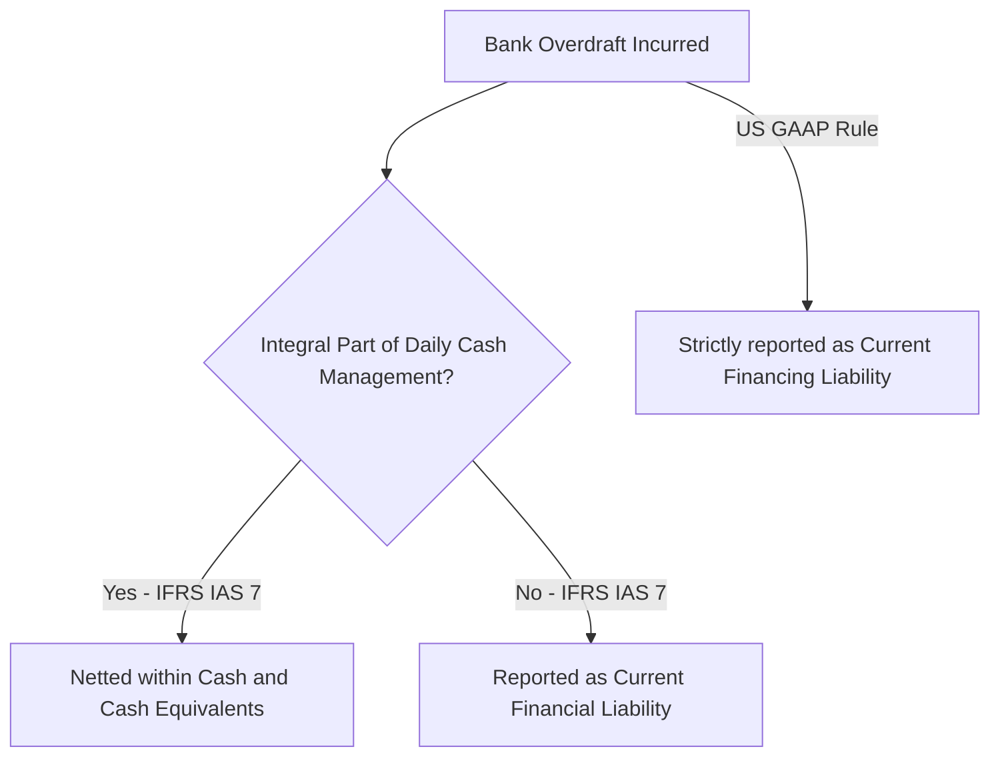
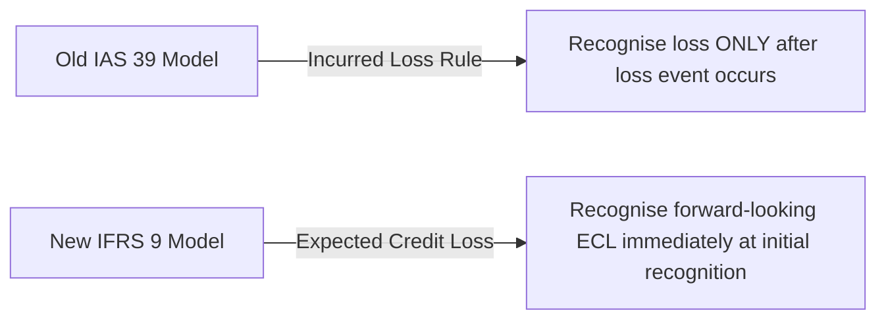
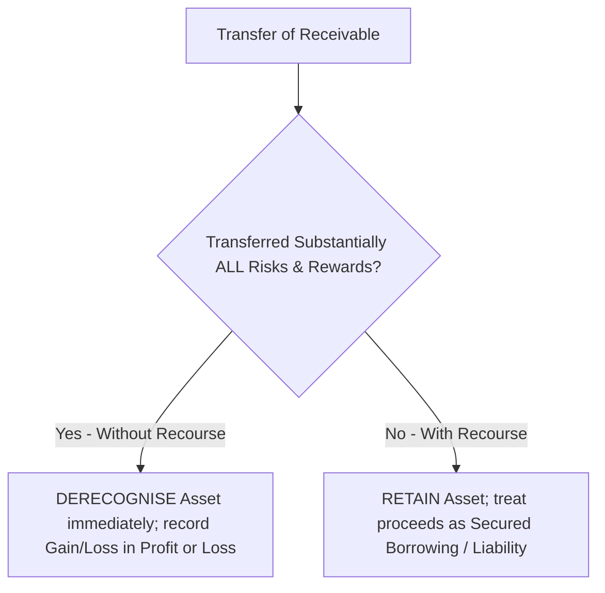

# Cash and Receivables (IFRS Study Guide)
> [!abstract] Curriculum & Syllabus Context
> - **Course:** ACC 301 Intermediate Accounting
> - **Phase:** Phase 2: Asset Valuation & Cost Allocation
> - **Target Reading:** Kieso, Weygandt, and Warfield, *Intermediate Accounting: IFRS Edition* (3rd Edition), Chapter 7
> - **Syllabus Focus:** Cash and cash equivalents (IAS 1 & IAS 7), bank overdrafts, bank reconciliations, trade receivables, trade and cash discounts (gross vs. net), IFRS 9 Expected Credit Loss (ECL) model, allowance for doubtful accounts, notes receivable valuation (effective-interest method), derecognition and factoring of receivables, and bank discounting.

---
### 1. Cash and Cash Equivalents (IAS 1 & IAS 7)
#### 1.1 Definition and Composition
> [!info] Key Definition
> Under International Financial Reporting Standards (IFRS), specifically **IAS 7 (Statement of Cash Flows)** and **IAS 1 (Presentation of Financial Statements)**, liquid monetary assets are categorized as follows:
> * **Cash:** Comprises currency on hand (paper money and coins) and demand deposits held with financial institutions (such as checking, savings, and operational bank accounts) that are accessible immediately without penalty.
> * **Cash Equivalents:** Short-term, highly liquid investments that are readily convertible to known amounts of cash and present an insignificant risk of changes in value due to interest rate fluctuations. To qualify as a cash equivalent under IAS 7, an investment must have a short maturity of **three months (90 days) or less from its acquisition date**. Examples include Treasury bills, commercial paper, and short-term money market funds.

| Asset Class | Operational Definition | IAS 7 Qualification Criteria |
| :--- | :--- | :--- |
| **Cash** | Legal tender, coins, and demand bank deposits. | Convertible on demand at face value. |
| **Cash Equivalents** | Commercial paper, Treasury bills, money market deposits. | Maturity $\le 3$ months from acquisition date; negligible value volatility. |

#### 1.2 Restricted Cash and Compensating Balances (IAS 1)
Cash held for specific operational or contractual commitments is not available for general cash management and must be evaluated for restricted classification on the Statement of Financial Position:
* **Current vs. Non-Current Classification:** Under IAS 1, if restricted cash is earmarked for obligations due within 12 months (or within the normal operating cycle), it is reported as a Current Asset (separately from general Cash and Cash Equivalents). If restricted for long-term commitments (such as plant expansion funds or debt sinking funds), it is classified as a Non-Current Asset under Long-Term Investments or Other Non-Current Assets.
* **Compensating Balances:** Minimum balance requirements mandated by financial institutions against borrowing arrangements. Legally restricted compensating balances against short-term borrowings are reported as restricted current assets. Those held against long-term borrowing arrangements are classified as non-current assets.
#### 1.3 Bank Overdrafts under IFRS (IAS 7 vs. US GAAP)
The accounting treatment for bank overdrafts (when a cash account balance falls below zero) differs between reporting frameworks:

* **IFRS (IAS 7 Framework):** If bank overdrafts are repayable on demand and form an integral part of an entity's daily cash management (where bank balances regularly fluctuate between positive and overdrawn), they are **netted against cash and cash equivalents** on the Statement of Cash Flows and Statement of Financial Position. If the overdraft is a structured short-term financing arrangement, it is reported under Current Financial Liabilities.
* **US GAAP Contrast:** Bank overdrafts cannot be netted against cash and must always be presented as current liabilities under accounts payable or short-term borrowings.
#### 1.4 Bank Reconciliation: Two-Column Format
A bank reconciliation aligns the balance reported on the bank statement with the carrying amount in the entity's general ledger cash account. Adjustments are segregated into bank balance adjustments and book balance adjustments.

$$ \begin{array}{lr|lr}
\multicolumn{2}{c|}{\textbf{BANK STATEMENT BALANCE}} & \multicolumn{2}{c}{\textbf{GENERAL LEDGER BOOK BALANCE}} \\
\hline
\text{Unadjusted Bank Balance} & \text{XXX} & \text{Unadjusted Book Balance} & \text{XXX} \\
\text{Add: Deposits in Transit} & \text{XXX} & \text{Add: Direct Bank Collections (Notes/Int)} & \text{XXX} \\
\text{Less: Outstanding Cheques} & (\text{XXX}) & \text{Add: Interest Earned} & \text{XXX} \\
\text{Add/Less: Bank Errors} & \text{XXX} & \text{Less: Bank Service Charges} & (\text{XXX}) \\
& & \text{Less: Customer NSF Cheques} & (\text{XXX}) \\
& & \text{Less: Electronic Transfer Fees} & (\text{XXX}) \\
& & \text{Add/Less: Book Errors} & \text{XXX} \\
\hline
\textbf{ADJUSTED BANK BALANCE} & \mathbf{\text{XXX}} & \textbf{ADJUSTED BOOK BALANCE} & \mathbf{\text{XXX}} \\
\hline \hline
\end{array} $$

**Reconciling Items Summary:**
1. **Bank Balance Adjustments:**
   * *Add: Deposits in Transit:* Cash deposits recorded in the entity's ledger but not yet processed or reflected on the bank statement.
   * *Deduct: Outstanding Cheques:* Cheques issued and recorded by the entity that have not yet cleared the bank.
   * *Add/Deduct: Bank Errors:* Direct corrections of bank processing errors.
2. **Book Balance Adjustments (Require Journal Entries):**
   * *Add: Direct Collections:* Notes or receivables collected directly by the bank on the entity's behalf plus interest earned.
   * *Deduct: Bank Charges & Fees:* Operational expenses deducted directly by the bank.
   * *Deduct: Non-Sufficient Funds (NSF) Cheques:* Customer cheques returned uncollected due to insufficient funds, restoring the trade receivable.
   * *Add/Deduct: Book Errors:* Corrections of manual recording errors in the general ledger.

**Adjusting Journal Entries from Bank Reconciliation**
Only items adjusting the Book Balance require adjusting journal entries in Profit or Loss and the general ledger:

$$ \begin{array}{llrr}
\textbf{Date} & \textbf{Account Titles and Explanation} & \textbf{Debit (£)} & \textbf{Credit (£)} \\
\hline
\text{End-of-Mo.} & \text{Cash} & 1,200 & \\
& \quad \text{Trade Receivables / Notes Receivable} & & 1,200 \\
& \text{\small (To record note principal and interest collected by bank)} & & \\
\hline
\text{End-of-Mo.} & \text{Bank Service Expense} & 50 & \\
& \text{Trade Receivables (NSF Customer Cheque)} & 450 & \\
& \quad \text{Cash} & & 500 \\
& \text{\small (To record bank service charges and customer NSF cheque)} & & \\
\end{array} $$

---
### 2. Trade Receivables (Trade Accounts Receivable)
#### 2.1 Recognition and Initial Measurement (IFRS 15)
Trade receivables represent unconditional contractual rights to receive cash from customers arising from sales of goods or performance of services on open credit accounts.
* **IFRS 15 Initial Measurement:** Under IFRS 15 (Revenue from Contracts with Customers), trade receivables are initially measured at their **transaction price** (the amount of consideration expected in exchange for transferring goods or services).
* **Trade Discounts vs. Cash (Prompt Payment) Discounts:**
  * *Trade Discounts:* Quantity or volume reductions off catalog prices. Applied directly to calculate the base invoice amount; never recorded in the ledger.
  * *Cash (Prompt Payment) Discounts:* Incentive reductions offered for early settlement (e.g., $2/10, n/30$).

| Feature | Gross Method | Net Method (Theoretically Preferred) |
| :--- | :--- | :--- |
| **Initial Sales Entry** | Recorded at full invoice price. | Recorded at net price after deducting prompt discount. |
| **Discount Taken** | Credited to Sales Discounts (reduces Revenue). | No special entry; receivable settled at net amount. |
| **Discount Lapsed** | No adjustment; collected at gross value. | Debited to Sales Discounts Lost (Operating/Financing Income). |
| **Financial Position Valuation** | Receivables reported at gross invoice value. | Receivables reported at net realizable value. |

**Comparative Journal Entries for Trade Discounts**
*(Scenario: Goods sold for £10,000, credit terms 2/10, n/30).*

$$ \begin{array}{lllrr}
\textbf{Transaction} & \textbf{Method} & \textbf{Account Titles} & \textbf{Debit (£)} & \textbf{Credit (£)} \\
\hline
\text{1. Initial Sale} & \textbf{Gross} & \text{Trade Receivables} & 10,000 & \\
& & \quad \text{Sales Revenue} & & 10,000 \\
\cline{2-5}
& \textbf{Net} & \text{Trade Receivables (} £10,000 \times 0.98 \text{)} & 9,800 & \\
& & \quad \text{Sales Revenue} & & 9,800 \\
\hline
\text{2a. Payment in} & \textbf{Gross} & \text{Cash} & 9,800 & \\
\text{Discount Window} & & \text{Sales Discounts} & 200 & \\
& & \quad \text{Trade Receivables} & & 10,000 \\
\cline{2-5}
& \textbf{Net} & \text{Cash} & 9,800 & \\
& & \quad \text{Trade Receivables} & & 9,800 \\
\hline
\text{2b. Payment after} & \textbf{Gross} & \text{Cash} & 10,000 & \\
\text{Discount Period} & & \quad \text{Trade Receivables} & & 10,000 \\
\cline{2-5}
& \textbf{Net} & \text{Cash} & 10,000 & \\
& & \quad \text{Trade Receivables} & & 9,800 \\
& & \quad \text{Sales Discounts Lost} & & 200 \\
\hline \hline
\end{array} $$
#### 2.2 Impairment & Expected Credit Loss (ECL) Model (IFRS 9)
IFRS 9 (Financial Instruments) mandates a forward-looking **Expected Credit Loss (ECL)** model, replacing the historical Incurred Loss approach.

* **Incurred Loss Model (Historical):** Deferred impairment recognition until an objective loss event occurred (e.g., customer default or bankruptcy).
* **Expected Credit Loss Model (IFRS 9):** Requires continuous estimation of credit risk. Entities calculate expected default probabilities across historical patterns, current economic conditions, and reasonable forward-looking macro forecasts, establishing impairment provisions immediately upon receivable origin.
#### 2.3 Allowance for Doubtful Accounts Mechanics
Trade receivables are valued on the Statement of Financial Position at Net Realisable Value (gross receivables less allowance for doubtful accounts).

> [!quote] Formula & Derivation: Net Realisable Value & ECL Adjustments
> $$ \text{Net Realisable Value} = \text{Gross Trade Receivables} - \text{Allowance for Doubtful Accounts} $$
> Under the aging matrix (Percentage-of-Receivables) approach:
> $$ \text{Required Adjustment Amount} = \text{Target Allowance Balance} - \text{Existing Credit Balance (or } + \text{Debit Balance)} $$

**Aging Schedule Calculation Example**
*(Total Gross Trade Receivables = £100,000).*

$$ \begin{array}{lrrr}
\textbf{Aging Category} & \textbf{Balance (£)} & \textbf{Forward-Looking ECL Rate (\%)} & \textbf{Required Allowance (£)} \\
\hline
\text{Current (0-30 days)} & 60,000 & 1.0\% & 600 \\
\text{31-60 days} & 25,000 & 4.0\% & 1,000 \\
\text{61-90 days} & 10,000 & 10.0\% & 1,000 \\
\text{Over 90 days} & 5,000 & 40.0\% & 2,000 \\
\hline
\textbf{Total} & \mathbf{100,000} & & \mathbf{4,600} \\
\hline \hline
\end{array} $$
* If the unadjusted Allowance balance has a credit balance of £1,000:
  $$ \text{Bad Debt Expense} = £4,600 - £1,000 = \mathbf{£3,600} $$
* If the unadjusted Allowance balance has a debit balance of £500 (due to unexpected write-offs):
  $$ \text{Bad Debt Expense} = £4,600 + £500 = \mathbf{£5,100} $$
#### 2.4 Accounting Mechanics & Journal Entries
The three essential operations for managing impaired trade receivables are:

$$ \begin{array}{llrr}
\textbf{Event} & \textbf{Account Titles and Explanation} & \textbf{Debit (£)} & \textbf{Credit (£)} \\
\hline
\text{1. Year-End} & \text{Bad Debt Expense (Profit or Loss)} & 3,600 & \\
\text{Bad Debt Est.} & \quad \text{Allowance for Doubtful Accounts} & & 3,600 \\
& \text{\small (To record expected credit loss provision)} & & \\
\hline
\text{2. Write-off} & \text{Allowance for Doubtful Accounts} & 800 & \\
\text{Uncollectible} & \quad \text{Trade Receivables} & & 800 \\
& \text{\small (Write-off has NO impact on net income or NRV)} & & \\
\hline
\text{3a. Unexpected} & \text{Trade Receivables} & 800 & \\
\text{Recovery} & \quad \text{Allowance for Doubtful Accounts} & & 800 \\
& \text{\small (To re-establish customer account)} & & \\
\text{3b. Collection} & \text{Cash} & 800 & \\
& \quad \text{Trade Receivables} & & 800 \\
\end{array} $$

---
### 3. Notes Receivable & Valuation
#### 3.1 Overview and Valuation Principles
A note receivable is a formal written promissory note conferring a legal obligation to receive a specified principal sum at a fixed future maturity date, often carrying explicit or implicit interest.
* **Short-Term Notes:** Reported at Net Realisable Value (face value less allowance).
* **Long-Term Notes:** Reported at the present value of future cash flows discounted at prevailing market interest rates.
#### 3.2 Stated Rate vs. Market Rate (Effective-Interest Rate Method)

| Rate Relationship | Issuance Pricing | Present Value relative to Face Value |
| :--- | :--- | :--- |
| **STATED RATE = MARKET RATE** | Issued at **Face Value** | Present Value = Face Value |
| **STATED RATE < MARKET RATE** | Issued at a **Discount** | Present Value < Face Value |
| **STATED RATE > MARKET RATE** | Issued at a **Premium** | Present Value > Face Value |

#### 3.3 Zero-Interest-Bearing & Low-Interest Notes Mechanics
Zero-interest-bearing notes do not specify a periodic cash interest coupon. Instead, the total implicit interest is embedded within the maturity face value. The note's present value equals the cash exchanged or fair value of goods/services provided.

> [!quote] Formula & Derivation: Zero-Interest Notes & Effective-Interest
> **Present Value Calculation:**
> $$ PV = FV \times \left(\frac{1}{(1 + i)^n}\right) $$
> *(Where $PV$ = Initial Carrying Amount, $FV$ = Maturity Amount, $i$ = Market Rate, $n$ = Total Periods)*
> **Effective-Interest Amortization Equation (For each period $t$):**
> $$ \text{Interest Revenue}_t = \text{Carrying Amount}_{t-1} \times i_{\text{market}} $$
> $$ \text{Ending Carrying Amount}_t = \text{Carrying Amount}_{t-1} + \text{Interest Revenue}_t $$

#### 3.4 IFRS 9 Net Carrying Amount Presentation
Under IFRS 9, financial assets measured at amortised cost are presented on the Statement of Financial Position at their **net carrying amount** (net present value). Unlike US GAAP—which maintains a separate contra asset account titled *Discount on Notes Receivable*—IFRS balance sheets display the net amortised cost directly.

> [!example] Numerical Problem: Zero-Interest Note Walkthrough
> **Scenario:** On 1 January 2025, an entity receives a 3-year, £10,000 zero-interest-bearing note maturing on 31 December 2027. The prevailing market interest rate for similar risk notes is $10\%$.
> **Step 1: Compute Initial Present Value**
> $$ PV = £10,000 \times \frac{1}{(1 + 0.10)^3} = £10,000 \times 0.751315 = \mathbf{£7,513.15} $$
> **Step 2: Amortization Schedule (Effective-Interest Method)**
> $$ \begin{array}{lcrrr}
> \textbf{Period} & \textbf{Date} & \textbf{Cash Interest (£)} & \textbf{Interest Revenue (10\%) (£)} & \textbf{Net Carrying Amount (£)} \\
> \hline
> \text{Initial} & \text{01/01/2025} & - & - & 7,513.15 \\
> \text{Year 1} & \text{31/12/2025} & 0 & 751.32 & 8,264.47 \\
> \text{Year 2} & \text{31/12/2026} & 0 & 826.45 & 9,090.92 \\
> \text{Year 3} & \text{31/12/2027} & 0 & 909.08 & 10,000.00 \\
> \hline \hline
> \end{array} $$
> **Step 3: Journal Entries over Note Life**
> $$ \begin{array}{llrr}
> \textbf{Date} & \textbf{Account Titles and Explanation} & \textbf{Debit (£)} & \textbf{Credit (£)} \\
> \hline
> \text{01/01/25} & \text{Notes Receivable} & 7,513.15 & \\
> & \quad \text{Cash / Sales Revenue} & & 7,513.15 \\
> & \text{\small (Recorded at initial net present value per IFRS 9)} & & \\
> \hline
> \text{31/12/25} & \text{Notes Receivable} & 751.32 & \\
> & \quad \text{Interest Revenue (Profit or Loss)} & & 751.32 \\
> & \text{\small (To record effective-interest revenue)} & & \\
> \hline
> \text{31/12/27} & \text{Cash} & 10,000.00 & \\
> & \quad \text{Notes Receivable} & & 10,000.00 \\
> & \text{\small (Collection of full maturity value)} & & \\
> \end{array} $$

---
### 4. Derecognition & Transfer of Receivables (IFRS 9)
#### 4.1 Derecognition Framework: Risk and Rewards Test
An entity derecognises a trade or note receivable from its Statement of Financial Position under IFRS 9 only when:
1. The contractual rights to the cash flows from the financial asset expire; **OR**
2. The entity transfers the financial asset, and the transfer qualifies for derecognition based on evaluating the transfer of risks and rewards.

**Factoring and Securitisation**
* **Transfers Without Recourse (Sale):** The transferee (factor) assumes all risk of credit losses. The transferor surrenders control and transfers substantially all risks and rewards. The receivable is **derecognised**. The difference between the carrying amount and cash proceeds received (net of factor service fees) is recognised as a Gain or Loss on Sale of Receivables in Profit or Loss.
* **Transfers With Recourse (Secured Borrowing):** The transferor retains default credit risk. Under IFRS 9, substantially all risks and rewards are retained. The receivable **remains** on the transferor's Statement of Financial Position, and cash proceeds received are recorded as a Financial Liability (Secured Borrowing).
#### 4.2 Bank Discounting of Notes Receivable
Bank discounting occurs when a payee transfers a customer note receivable to a bank prior to maturity to receive immediate cash financing.

> [!quote] Formula & Derivation: Bank Discounting Calculations
> **Step 1: Maturity Value (MV)**
> $$ \text{Total Interest} = \text{Principal} \times r_{\text{stated}} \times \left(\frac{\text{Full Term (Months)}}{12}\right) $$
> $$ MV = \text{Principal (Face Value)} + \text{Total Interest to Maturity} $$
> **Step 2: Bank Discount (BD)**
> $$ BD = MV \times r_{\text{bank discount}} \times \left(\frac{\text{Discount Period (Months)}}{12}\right) $$
> *(Discount Period = Remaining time from the discounting date to the note's maturity date).*
> **Step 3: Net Proceeds (NP)**
> $$ NP = MV - BD $$
> **Step 4: Gain or Loss on Discounting**
> $$ \text{Carrying Amount of Note} = \text{Principal} + \text{Accrued Interest to Discounting Date} $$
> $$ \text{Gain or Loss on Discounting} = NP - \text{Carrying Amount} $$

#### 4.3 Discounting Walkthrough and Journal Entries
> [!example] Numerical Problem: Bank Discounting
> **Fact Pattern:**
> On 1 March 2025, Company A accepts a £60,000, 6-month, 8% interest-bearing note from a customer due 1 September 2025. On 1 May 2025 (2 months later), Company A discounts the note at Barclays Bank at a bank discount rate of 10%.
> **Calculations:**
> **1. Compute Maturity Value (MV)**
> $$ \text{Total Interest} = £60,000 \times 0.08 \times \frac{6}{12} = £2,400 $$
> $$ MV = £60,000 + £2,400 = \mathbf{£62,400} $$
> **2. Determine Discount Period**
> $$ \text{Full Term} = 6 \text{ months}; \quad \text{Time Elapsed} = 2 \text{ months (March \& April)} $$
> $$ \text{Discount Period} = 6 - 2 = \mathbf{4 \text{ months}} $$
> **3. Compute Bank Discount (BD)**
> $$ BD = £62,400 \times 0.10 \times \frac{4}{12} = \mathbf{£2,080} $$
> **4. Compute Net Proceeds (NP)**
> $$ NP = £62,400 - £2,080 = \mathbf{£60,320} $$
> **5. Compute Carrying Amount & Gain/Loss on Discounting**
> $$ \text{Accrued Interest to 1 May} = £60,000 \times 0.08 \times \frac{2}{12} = £800 $$
> $$ \text{Carrying Amount at 1 May} = £60,000 + £800 = £60,800 $$
> $$ \text{Loss on Discounting} = NP - \text{Carrying Amount} = £60,320 - £60,800 = \mathbf{-£480} $$
> **Journal Entries on Company A's Books (Derecognition / Sale):**
> $$ \begin{array}{llrr}
> \textbf{Date} & \textbf{Account Titles and Explanation} & \textbf{Debit (£)} & \textbf{Credit (£)} \\
> \hline
> \text{01/05/25} & \text{Cash (Net Proceeds)} & 60,320 & \\
> & \text{Loss on Discounting of Note (Profit or Loss)} & 480 & \\
> & \quad \text{Notes Receivable (Principal / Face Value)} & & 60,000 \\
> & \quad \text{Interest Revenue (Accrued Interest Earned)} & & 800 \\
> \end{array} $$

---
### 5. Summary Comparison Table: Key Terminology
To maintain alignment with global financial standards, strict IFRS reporting terms must be utilized:

| Standard / Concept | IFRS Terminology | US GAAP Terminology |
| :--- | :--- | :--- |
| **Balance Sheet** | Statement of Financial Position | Balance Sheet |
| **Income Statement** | Profit or Loss (Statement of Comprehensive Income) | Income Statement / Net Income |
| **Accounts Receivable** | Trade Receivables | Accounts Receivable |
| **Discount Account Presentation** | Net Carrying Amount (No separate contra account) | Contra Asset / Discount Account |
| **Overdraft Treatment** | Netted in Cash Equivalents (if integral cash management) | Short-Term Borrowing / Liability |
| **Impairment Model** | Expected Credit Loss (ECL) Model (Forward-Looking) | Incurred Loss Model |
| **Receivable Recoveries** | Profit or Loss Adjustment | Bad Debt Expense Recovery |