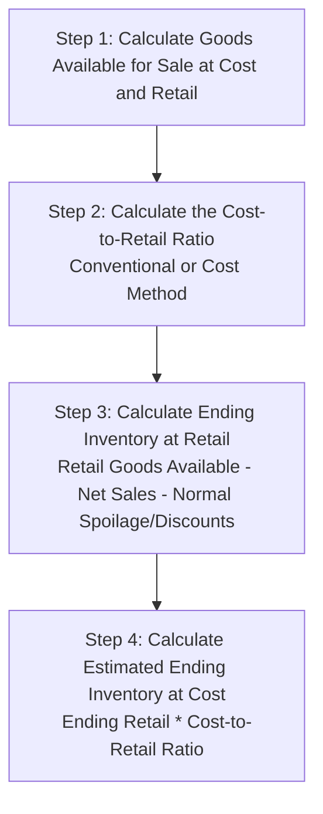

# IAS 2: Inventories (Valuation & Cost Basis)
> [!abstract] Curriculum & Syllabus Context
> - **Course:** ACC 301 Intermediate Accounting
> - **Phase:** Phase 2: Asset Valuation & Cost Allocation
> - **Target Reading:** Kieso, Weygandt, and Warfield, *Intermediate Accounting: IFRS Edition* (3rd Edition), Chapter 8
> - **Syllabus Focus:** IAS 2 Scope, product vs. period costs, perpetual vs. periodic systems, permitted cost flow assumptions (FIFO, Weighted-Average, specific identification), LCNRV valuation (item-by-item), inventory write-downs and reversals, gross profit method, and retail inventory method.

---
### 1. Scope, Classification, and Costs of Inventory (IAS 2)
#### 1.1 Definition and Classification Framework
> [!info] Key Definition
> Under **IAS 2 (Inventories)** paragraph 6, inventories are defined as assets that are:
> * Held for sale in the ordinary course of business (Finished Goods / Merchandising Inventory);
> * In the process of production for such sale (Work-in-Process); or
> * In the form of materials or supplies to be consumed in the production process or in the rendering of services (Raw Materials and Stores).

Inventories are categorised according to the operational nature of the reporting entity:
* **Merchandising Inventory:** Goods acquired by a trader or retailer held intact for resale to customers.
* **Manufacturing Inventory:** Held by production enterprises and sub-classified into four core categories:
  * *Raw Materials:* Basic inputs and components acquired for conversion into final products.
  * *Work-in-Process (WIP):* Partially completed units currently undergoing transformation within the manufacturing cycle.
  * *Finished Goods:* Completed products awaiting sale and dispatch to customers.
  * *Stores & Consumables:* Direct and indirect operational supplies consumed during maintenance or manufacturing operations.

> [!warning] Exam Pitfall / Exception
> **Scope Exclusions under IAS 2 (IAS 2.2–3):**
> IAS 2 applies to all inventories **except**:
> 1. Work-in-process arising under construction contracts, including directly related service contracts (covered under revenue recognition frameworks such as IFRS 15).
> 2. Financial instruments (covered under IFRS 9 Financial Instruments).
> 3. Biological assets related to agricultural activity and agricultural produce at the point of harvest (covered under IAS 41 Agriculture).
> 4. Measurement-only exemptions for producers of agricultural and forest products, minerals, and commodity broker-traders measuring inventory at fair value less costs to sell (changes in fair value recognised in Profit or Loss in the period of change).

#### 1.2 Goods Included in Inventory
Determining whether physical items must be included in an entity’s inventory at the Statement of Financial Position date depends strictly on legal title, economic control, and the transfer of risks and rewards.

| Transaction Type | Legal Title / Economic Control Status | Inventory Inclusion Rule |
| :--- | :--- | :--- |
| **Goods in Transit — FOB Shipping Point** | Title and economic control transfer to the purchaser at the seller's shipping dock. | Included in **Purchaser's** Inventory during transit; excluded from seller's inventory. |
| **Goods in Transit — FOB Destination** | Title and economic control remain with the seller until goods physically arrive at the purchaser's location. | Included in **Seller's** Inventory during transit; excluded from purchaser's inventory. |
| **Consigned Goods** | Consignor (principal) retains legal title and economic risk. Consignee (agent) holds physical custody only to facilitate sale. | Included in **Consignor's** Inventory at cost plus freight-in; strictly excluded from consignee's inventory. |
| **Sales with Repurchase Agreements (Financing)** | Legal title may transfer temporarily, but the seller retains economic control and risk via an obligation or option to repurchase. | Included in **Seller's** Inventory (treated as a secured borrowing liability); excluded from buyer's inventory. |
| **Sales with High Return Rates** | Control passes to buyer, but if return rates are estimable, a refund liability and return asset are recognised. | **Excluded** from Inventory upon sale; an estimated asset for the right to recover goods is recorded separately. |

#### 1.3 Product/Inventoriable Costs vs Period Costs
IAS 2 paragraphs 10–18 mandate that all costs of purchase, costs of conversion, and other costs incurred in bringing inventories to their present location and condition must be capitalised as product costs. Conversely, costs that offer no operational utility in location/condition enhancement are expensed immediately as period costs in Profit or Loss.

| Inventoriable Costs (Capitalised into Inventory under IAS 2.10) | Period Costs (Expensed in Profit or Loss as Incurred under IAS 2.16–18) |
| :--- | :--- |
| **Purchase Price:** Gross invoice amount less trade discounts, rebates, and settlement allowances. | **Abnormal Waste (IAS 2.16a):** Excess wasted materials, labour, or conversion costs above normal operating wastage. |
| **Import Duties & Non-Refundable Taxes:** Statutory tariffs, customs duties, and non-recoverable consumption taxes. | **Storage Costs (IAS 2.16b):** Warehousing costs, unless storage is necessary prior to a further production stage. |
| **Direct Transport & Handling:** Freight-in, unloading, transit insurance, and direct handling fees. | **Administrative Overheads (IAS 2.16c):** General corporate management overheads unrelated to production or location. |
| **Direct Production Costs:** Direct materials, direct labour, direct sub-contracting fees, and variable overheads. | **Selling Expenses (IAS 2.16d):** Advertising, marketing, sales force commissions, freight-out, and distribution expenses. |
| **Allocated Production Overheads (IAS 2.12–13):** Fixed manufacturing overheads allocated based on normal operating capacity. | **Unallocated Fixed Overheads (IAS 2.13):** Overhead costs unallocated due to abnormally low production levels or idle plant capacity. |
| **Qualifying Borrowing Costs (IAS 23):** Interest expense capitalised strictly when inventory requires a substantial period to get ready for sale. | **Finance Costs:** Interest and borrowing costs for standard, non-qualifying inventory items (expensed per IAS 23). |

**Technical Provisions on Overhead Allocation and Finance Costs:**
* **Unallocated Fixed Production Overheads (IAS 2.13):** Fixed manufacturing overheads (e.g., factory depreciation, plant maintenance) are allocated to inventory based on the normal capacity of production facilities. In periods of abnormally low production or idle plant, the amount of fixed overhead allocated to each unit of production is not increased. Unallocated overheads resulting from low capacity are recognised as an immediate expense in Profit or Loss in the period incurred. In periods of abnormally high production, the amount of fixed overhead allocated to each unit is decreased so that inventories are not measured above cost.
* **Borrowing Costs (IAS 23 / IAS 2.17):** Interest expense can only be capitalised into inventory carrying value when the inventory meets the definition of a qualifying asset under IAS 23 (Borrowing Costs)—that is, inventory that necessarily takes a substantial period of time to get ready for its intended sale (e.g., aging wine, whiskey, cheese, or large-scale construction items). For standard high-volume manufacturing, borrowing costs are expensed immediately as finance costs.

---
### 2. Inventory Accounting Systems & Cost Flow Assumptions
#### 2.1 Accounting Systems: Perpetual vs Periodic Mechanics
Entities track inventory continuous movements or compute period-end balances using either a Perpetual Inventory System or a Periodic Inventory System.

$$ \begin{array}{lllrr}
\textbf{Transaction Event} & \textbf{System} & \textbf{Account Titles} & \textbf{Debit (£)} & \textbf{Credit (£)} \\
\hline
\text{Purchase of Merchandise} & \textbf{Perpetual} & \text{Inventory} & \text{XXX} & \\
& & \quad \text{Trade Payables / Cash} & & \text{XXX} \\
\cline{2-5}
& \textbf{Periodic} & \text{Purchases} & \text{XXX} & \\
& & \quad \text{Trade Payables / Cash} & & \text{XXX} \\
\hline
\text{Incurrence of Freight-In} & \textbf{Perpetual} & \text{Inventory} & \text{XXX} & \\
& & \quad \text{Cash / Trade Payables} & & \text{XXX} \\
\cline{2-5}
& \textbf{Periodic} & \text{Freight-In} & \text{XXX} & \\
& & \quad \text{Cash / Trade Payables} & & \text{XXX} \\
\hline
\text{Purchase Returns \& Allowances} & \textbf{Perpetual} & \text{Trade Payables / Cash} & \text{XXX} & \\
& & \quad \text{Inventory} & & \text{XXX} \\
\cline{2-5}
& \textbf{Periodic} & \text{Trade Payables / Cash} & \text{XXX} & \\
& & \quad \text{Purchase Returns \& Allowances} & & \text{XXX} \\
\hline
\text{Sale of Goods (Revenue Portion)} & \textbf{Perpetual} & \text{Trade Receivables / Cash} & \text{XXX} & \\
& & \quad \text{Revenue} & & \text{XXX} \\
\cline{2-5}
& \textbf{Periodic} & \text{Trade Receivables / Cash} & \text{XXX} & \\
& & \quad \text{Revenue} & & \text{XXX} \\
\hline
\text{Sale of Goods (Cost Portion)} & \textbf{Perpetual} & \text{Cost of Goods Sold} & \text{XXX} & \\
& & \quad \text{Inventory} & & \text{XXX} \\
\cline{2-5}
& \textbf{Periodic} & \text{No Entry Recorded at Time of Sale} & & \\
\hline
\text{Period-End Inventory Adjustment} & \textbf{Perpetual} & \text{Continuously updated. Physical count} & & \\
& & \text{identifies shrinkage/losses.} & & \\
\cline{2-5}
& \textbf{Periodic} & \text{Inventory (Ending Balance)} & \text{XXX} & \\
& & \text{Cost of Goods Sold (Balancing Plug)} & \text{XXX} & \\
& & \text{Purchase Returns \& Allowances} & \text{XXX} & \\
& & \quad \text{Inventory (Beginning Balance)} & & \text{XXX} \\
& & \quad \text{Purchases} & & \text{XXX} \\
& & \quad \text{Freight-In} & & \text{XXX} \\
\hline \hline
\end{array} $$
#### 2.2 Permitted Cost Flow Assumptions under IAS 2
When inventory items are ordinarily interchangeable, IAS 2 paragraphs 19–27 allow specific cost formulas to assign unit costs to inventory and Cost of Goods Sold:
1. **Specific Identification Method (IAS 2.19):**
   * Mandatory for inventory items that are not ordinarily interchangeable or for goods produced and segregated for specific projects.
   * Tracks the actual physical flow and exact invoice cost of each individual item.
2. **First-In, First-Out (FIFO) Formula (IAS 2.25):**
   * Assumes that the items acquired or produced first are consumed or sold first.
   * Ending inventory is measured at the most recent acquisition costs, reflecting current values on the Statement of Financial Position.
3. **Weighted-Average Cost Formula (IAS 2.25):**
   * Under a periodic inventory system, the weighted-average cost per unit is calculated at period-end across all units available for sale:

> [!quote] Formula & Derivation: Weighted-Average Unit Cost
> $$ \text{Weighted-Average Unit Cost} = \frac{\text{Cost of Goods Available for Sale}}{\text{Total Units Available for Sale}} $$

   * Under a perpetual inventory system, a **moving-average cost per unit** is recalculated upon each purchase transaction.
#### 2.3 Strict Prohibition of LIFO under IAS 2
> [!warning] Exam Pitfall / Exception
> **PROHIBITION OF LIFO UNDER IAS 2 / IFRS**
> IAS 2 explicitly bans the Last-In, First-Out (LIFO) cost formula.
> **Theoretical Rationale for the Ban:**
> 1. **Statement of Financial Position Distortion:** LIFO values ending inventory using oldest historical costs, presenting obsolete, severely understated asset values on the Statement of Financial Position.
> 2. **Mismatch with Physical Flow:** LIFO rarely matches the actual physical flow of inventory goods in commercial operations.
> 3. **LIFO Liquidation & Earnings Manipulation:** When inventory levels decline, older, low-cost inventory layers are matched against current high revenues, artificially inflating Profit or Loss and creating earnings manipulation opportunities.
> *International Comparison:* While US GAAP (ASC 330) permits LIFO (requiring a statutory LIFO Reserve footnote disclosure), IAS 2 / IFRS strictly prohibits LIFO across all financial reporting.

---
### 3. Valuation at Lower of Cost and Net Realisable Value (LCNRV)
#### 3.1 Definition of Net Realisable Value (NRV)
IAS 2 paragraph 9 dictates that inventories must be measured on the Statement of Financial Position at the lower of cost and Net Realisable Value (LCNRV).

> [!quote] Formula & Derivation: Net Realisable Value (NRV)
> **Net Realisable Value (NRV)** is defined in IAS 2 paragraph 6 as the estimated selling price in the ordinary course of business less the estimated costs of completion and the estimated costs necessary to make the sale.
> $$ \text{Net Realisable Value (NRV)} = \text{Estimated Selling Price in Ordinary Course} - \text{Estimated Costs of Completion} - \text{Estimated Costs to Make the Sale} $$

#### 3.2 Methods of Applying LCNRV and Raw Materials Rules
Under IAS 2 paragraph 29, inventory write-downs to NRV should generally be evaluated on an **item-by-item** basis. Grouping similar or related items is permitted only within a single product line or geographic segment where items cannot be evaluated separately. Applying LCNRV to total inventory as a single aggregate block is strictly prohibited because total valuation masks required write-downs on individual damaged, obsolete, or loss-making items.

**Comparative Valuation Numerical Demonstration:**
$$ \begin{array}{lrrrrrr}
\textbf{Inventory Category} & \textbf{Unit Cost (£)} & \textbf{Unit NRV (£)} & \textbf{Total Cost (£)} & \textbf{Total NRV (£)} & \textbf{Item-by-Item Valuation (£)} & \textbf{Total Inventory Valuation (£)} \\
\hline
\text{Product Line A} & 100 & 120 & 10,000 & 12,000 & 10,000 & - \\
\text{Product Line B} & 150 & 110 & 15,000 & 11,000 & 11,000 & - \\
\text{Product Line C} & 80 & 75 & 8,000 & 7,500 & 7,500 & - \\
\hline
\textbf{Total Inventory} & - & - & \mathbf{33,000} & \mathbf{30,500} & \mathbf{28,500} & \mathbf{30,500} \\
\hline \hline
\end{array} $$

*Analysis:* Applying LCNRV on an item-by-item basis yields a carrying amount of £28,500 (a required write-down of £4,500). Evaluating on a total inventory basis yields £30,500 (understating required write-downs by £2,000).

> [!warning] Exam Pitfall / Exception
> **Professor's Technical Tip — Total Valuation Trap:**
> Evaluating LCNRV on a total inventory basis is a classic examination trap. Total valuation offsets unrealised losses on damaged or declining inventory lines (Product Lines B & C) against unrealised gains on profitable inventory lines (Product Line A). IAS 2.29 explicitly forbids this offsetting because unrealised gains cannot be recognised prior to sale, whereas anticipated inventory losses must be recognised immediately.

**3.2.1 Valuation of Raw Materials and Manufacturing Supplies (IAS 2.32)**
Under IAS 2 paragraph 32, materials and other supplies held for use in the production of inventories are not written down below cost if the finished products in which they will be incorporated are expected to be sold at or above cost.
However, when a decline in the price of raw materials indicates that the cost of the finished products will exceed their net realisable value, the raw materials are written down to net realisable value. In such circumstances, the net replacement cost of the materials is the best available measure of their net realisable value.
#### 3.3 Accounting Methods for Recording Write-Downs
When inventory cost exceeds NRV, the write-down expense must be recognised immediately in Profit or Loss (IAS 2.34). Two acceptable recording techniques exist:

**Method 1: Direct Cost of Goods Sold Method**
The write-down directly reduces the carrying amount of Inventory and increases Cost of Goods Sold.
$$ \begin{array}{llrr}
\textbf{Account Titles} & & \textbf{Debit (£)} & \textbf{Credit (£)} \\
\hline
\text{Cost of Goods Sold} & & 4,500 & \\
\quad \text{Inventory} & & & 4,500 \\
\text{(To record inventory write-down to NRV directly)} & & & \\
\end{array} $$

**Method 2: Indirect / Allowance Method**
The write-down is recorded in a separate expense account and credited to a contra-asset allowance account.
$$ \begin{array}{llrr}
\textbf{Account Titles} & & \textbf{Debit (£)} & \textbf{Credit (£)} \\
\hline
\text{Inventory Write-Down Expense (P\&L)} & & 4,500 & \\
\quad \text{Allowance to Reduce Inventory to NRV} & & & 4,500 \\
\text{(To record allowance for inventory write-down to NRV)} & & & \\
\end{array} $$
#### 3.4 Reversal of Inventory Write-Downs (IAS 2 vs US GAAP)
Under IAS 2 paragraph 34, if circumstances that previously caused inventory to be written down below cost no longer exist, or when there is clear economic evidence of an increase in NRV, the amount of the write-down is reversed. The amount of the reversal is recognised in Profit or Loss as a reduction in the amount of inventory recognised as an expense in the period in which the reversal occurs. The reversal is strictly capped at the amount of the original write-down.

| Valuation Feature | IAS 2 (IFRS) | US GAAP (ASC 330) |
| :--- | :--- | :--- |
| **Reversal of Write-Downs** | **Mandatory Reversal (IAS 2.34):** Recognised in Profit or Loss as a reduction in inventory expense. | **Strictly Prohibited:** Written-down inventory establishes a new permanent cost basis. |
| **Reversal Ceiling / Cap** | **Capped at Original Loss:** Reversal amount is limited to the amount of the original write-down. | **N/A:** Reversals are strictly forbidden under any economic condition. |

$$ \begin{array}{llrr}
\textbf{Account Titles} & & \textbf{Debit (£)} & \textbf{Credit (£)} \\
\hline
\text{Allowance to Reduce Inventory to NRV / Inventory} & & 1,500 & \\
\quad \text{Cost of Goods Sold / Inventory Expense (P\&L)} & & & 1,500 \\
\text{(To record reversal of previous inventory write-down under IAS 2)} & & & \\
\end{array} $$

---
### 4. Estimation Methods for Inventory Valuation
#### 4.1 Gross Profit Method
The Gross Profit Method estimates ending inventory and Cost of Goods Sold without a physical count. It is primarily used for interim financial reporting or estimating inventory losses resulting from catastrophic events (e.g., fire, flood).

> [!quote] Formula & Derivation: Gross Profit & Markup Conversions
> Financial accounting examinations and technical practice frequently state profit margins either as a percentage of sales or as a markup on cost. The conversion formulas are:
> $$ \text{Gross Profit \% on Sales} = \frac{\text{Markup \% on Cost}}{1 + \text{Markup \% on Cost}} $$
> $$ \text{Markup \% on Cost} = \frac{\text{Gross Profit \% on Sales}}{1 - \text{Gross Profit \% on Sales}} $$
> **Sequential Mathematical Formulas for Estimation:**
> 1. $\text{Gross Profit Percentage} = \frac{\text{Gross Profit}}{\text{Net Sales}}$
> 2. $\text{Estimated Gross Profit} = \text{Net Sales} \times \text{Gross Profit Percentage}$
> 3. $\text{Estimated COGS} = \text{Net Sales} - \text{Estimated Gross Profit}$
> 4. $\text{Estimated Ending Inventory} = \text{Cost of Goods Available for Sale} - \text{Estimated COGS}$

> [!example] Numerical Problem: Gross Profit Method Walkthrough
> **Fact Pattern:** Apex Traders lost its warehouse inventory in a flood. The accounting records reveal:
> * Beginning Inventory: £60,000
> * Net Purchases: £240,000
> * Freight-In: £15,000
> * Net Sales Revenue: £350,000
> * Historical Profit Rate: 25% Markup on Cost.
> **Sequential Derivation:**
> 1. **Convert Markup on Cost to Gross Profit Percentage on Sales:**
>    $$ \text{GP \% on Sales} = \frac{0.25}{1 + 0.25} = 0.20 \quad (20\%) $$
> 2. **Compute Cost of Goods Available for Sale:**
>    $$ \text{Goods Available for Sale} = £60,000 + £240,000 + £15,000 = £315,000 $$
> 3. **Compute Estimated Gross Profit:**
>    $$ \text{Estimated Gross Profit} = £350,000 \times 20\% = £70,000 $$
> 4. **Compute Estimated Cost of Goods Sold:**
>    $$ \text{Estimated COGS} = £350,000 - £70,000 = £280,000 $$
> 5. **Compute Estimated Ending Inventory Lost:**
>    $$ \text{Estimated Ending Inventory} = £315,000 - £280,000 = \mathbf{£35,000} $$
> *Limitations:* The Gross Profit Method uses historical gross margins, which may not reflect current-period price shifts, promotional discounts, or changes in product sales mix.

#### 4.2 Retail Inventory Method
High-volume retailers with diverse merchandise inventories use the Retail Inventory Method to estimate ending inventory at cost by applying a Cost-to-Retail Ratio.

**Operational Terminology:**
* **Markup:** An increase above the original retail price.
* **Markup Cancellation:** A reduction in markup (does not lower price below original retail).
* **Markdown:** A reduction below the original retail price.
* **Markdown Cancellation:** An increase in price that reduces a markdown.

**Handling of Normal vs Abnormal Spoilage:**
* **Abnormal Spoilage (and Abnormal Shrinkage):** Deducted from both Cost and Retail columns *before* computing the Cost-to-Retail ratio and expensed immediately as a period loss in Profit or Loss.
* **Normal Spoilage (and Normal Shrinkage):** Deducted *only* from the Retail column *after* computing the Cost-to-Retail ratio (to reduce retail goods available for sale down to expected ending inventory at retail).

> [!quote] Formula & Derivation: Retail Inventory Method Ratios
> * **Conventional Method (LCNRV Basis):** Includes Net Markups but excludes Net Markdowns from the denominator.
>   $$ \text{Conventional Ratio} = \frac{\text{Goods Available at Cost}}{\text{Goods Available at Retail (excl. Markdowns)} + \text{Net Markups}} $$
> * **Cost Retail Method:** Includes both Net Markups and Net Markdowns in the denominator.
>   $$ \text{Cost Ratio} = \frac{\text{Goods Available at Cost}}{\text{Goods Available at Retail} + \text{Net Markups} - \text{Net Markdowns}} $$
> * **Final Valuation Step:**
>   $$ \text{Ending Inventory at Cost} = \text{Ending Inventory at Retail} \times \text{Cost-to-Retail Ratio} $$

> [!warning] Exam Pitfall / Exception
> **Professor's Technical Tip — Conventional Retail Method Mechanics:**
> Under the Conventional Retail Method (Lower of Cost or NRV), Net Markdowns are excluded from the denominator when calculating the Cost-to-Retail percentage. Excluding markdowns keeps the denominator higher, resulting in a lower Cost-to-Retail ratio. When this lower ratio is applied to ending inventory at retail, it produces a lower estimated cost value, thereby automatically approximating an LCNRV valuation.

> [!example] Numerical Problem: Retail Inventory Method Walkthrough
> **Comprehensive Worked Numerical Calculation:**
> $$ \begin{array}{lrr}
> \textbf{Calculation Line Item} & \textbf{Cost (£)} & \textbf{Retail (£)} \\
> \hline
> \text{Beginning Inventory} & 30,000 & 50,000 \\
> \text{Net Purchases} & 110,000 & 170,000 \\
> \text{Freight-In} & 10,000 & - \\
> \text{Less: Abnormal Spoilage (deducted before ratio)} & (4,000) & (6,000) \\
> \text{Net Markups (Markups £12,000 less Cancellations £2,000)} & - & 10,000 \\
> \hline
> \textbf{Goods Available for Sale (Conventional / LCNRV Base)} & \mathbf{146,000} & \mathbf{224,000} \\
> \hline
> \text{Conventional Cost-to-Retail Ratio: } \left(\frac{146,000}{224,000}\right) & \mathbf{65.1786\%} & - \\
> \hline
> \text{Less: Net Markdowns (Markdowns £7,000 less Cancellations £2,000)} & - & (5,000) \\
> \hline
> \textbf{Goods Available for Sale (Cost Basis)} & \mathbf{146,000} & \mathbf{219,000} \\
> \hline
> \text{Cost Method Cost-to-Retail Ratio: } \left(\frac{146,000}{219,000}\right) & \mathbf{66.6667\%} & - \\
> \hline
> \text{Deductions from Goods Available at Retail:} & & \\
> \quad \text{Net Sales Revenue} & - & (160,000) \\
> \quad \text{Normal Spoilage} & - & (2,000) \\
> \quad \text{Employee Discounts} & - & (3,000) \\
> \hline
> \textbf{Ending Inventory at Retail} & - & \mathbf{54,000} \\
> \hline \hline
> \end{array} $$
> **Valuation Results:**
> 1. **Conventional Retail Method (Lower of Cost or NRV):**
>    $$ \text{Ending Inventory at Cost} = £54,000 \times 65.1786\% = \mathbf{£35,196} $$
> 2. **Cost Retail Method:**
>    $$ \text{Ending Inventory at Cost} = £54,000 \times 66.6667\% = \mathbf{£36,000} $$

---
### 5. Presentation and Financial Statement Disclosures (IAS 2 / IAS 1)
#### 5.1 Statement of Financial Position Presentation
Under IAS 1 (paragraph 66) and IAS 2, inventories are classified and presented as Current Assets on the Statement of Financial Position. Sub-classification amounts must be disclosed either on the face of the statement or within the financial statement footnotes.

**Sample Statement of Financial Position Excerpt:**
$$ \begin{array}{lrr}
\hline
\multicolumn{3}{c}{\textbf{[Entity Name]}} \\
\multicolumn{3}{c}{\textbf{Statement of Financial Position (Excerpt)}} \\
\multicolumn{3}{c}{\textbf{As at 31 December 202X}} \\
\hline
\textbf{ASSETS} & & \\
\textbf{Current Assets:} & & \\
\quad \text{Cash and Cash Equivalents} & & £68,000 \\
\quad \text{Trade and Other Receivables} & & 72,000 \\
\quad \text{Inventories (Note 4):} & & \\
\quad \quad \text{Raw Materials and Consumables} & £35,000 & \\
\quad \quad \text{Work-in-Process} & 25,000 & \\
\quad \quad \text{Finished Goods} & 55,000 & 115,000 \\
\quad \text{Prepayments} & & 4,000 \\
\hline
\textbf{Total Current Assets} & & \mathbf{£259,000} \\
\hline \hline
\end{array} $$
#### 5.2 Mandatory Note Disclosures
Under IAS 2 paragraph 36, an entity must explicitly disclose the following within the financial statement footnotes:
1. **Accounting Policies (IAS 2.36a):** The accounting policies adopted in measuring inventories, including the cost formula used (e.g., FIFO or Weighted-Average).
2. **Carrying Amounts and Classifications (IAS 2.36b–c):**
   * The total carrying amount of inventories and the carrying amount in classifications appropriate to the entity (Raw Materials, Work-in-Process, Finished Goods, Stores/Consumables).
   * The carrying amount of inventories carried at fair value less costs to sell.
3. **Expense Recognition (IAS 2.36d):** The amount of inventories recognised as an expense during the period (Cost of Sales / Cost of Goods Sold).
4. **Write-Downs and Reversals (IAS 2.36e–g):**
   * The amount of any write-downs of inventories recognised as an expense in Profit or Loss in the period.
   * The amount of any reversal of previous write-downs recognised as a reduction of inventory expense, alongside the specific circumstances or events leading to the reversal.
5. **Pledged Security and Encumbrances (IAS 2.36h):** The carrying amount of any inventories pledged as security for liabilities.