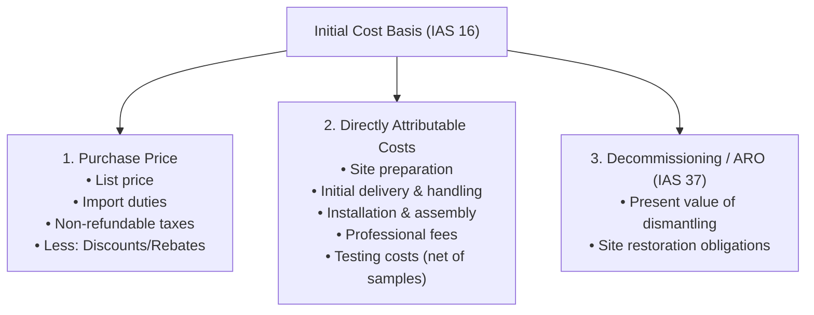
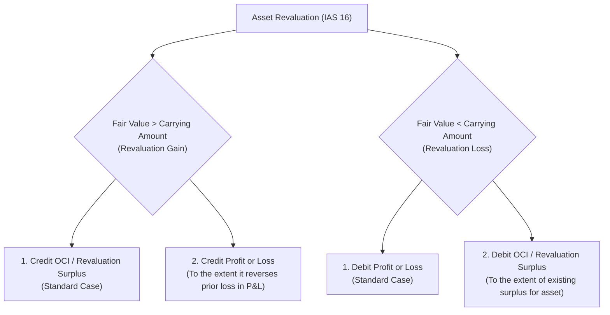
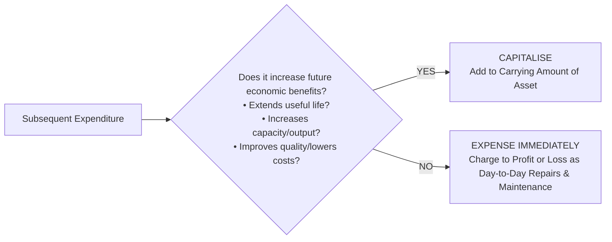
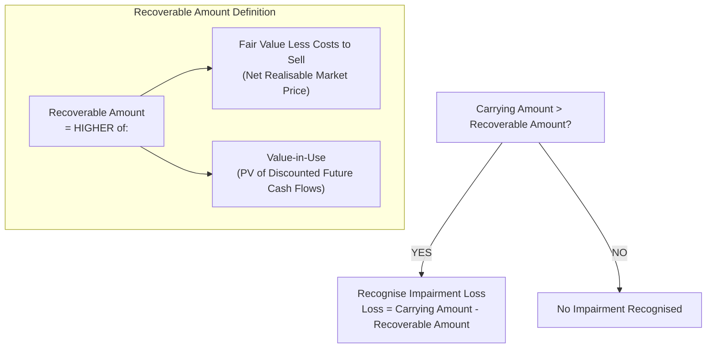

# Property, Plant, and Equipment (Acquisition, Valuation, Depreciation, and Impairments)
> [!abstract] Curriculum & Syllabus Context
> - **Course:** ACC 301 Intermediate Accounting
> - **Phase:** Phase 2: Asset Valuation & Measurement
> - **Target Reading:** Weygandt, Kieso, and Warfield, *Intermediate Accounting (IFRS Edition)* — Chapters 10 & 11: Property, Plant, and Equipment & Impairments
> - **Primary Standards:** IAS 16 (Property, Plant and Equipment), IAS 23 (Borrowing Costs), IAS 36 (Impairment of Assets), IAS 37 (Provisions, Contingent Liabilities and Contingent Assets), IFRS 5 (Non-current Assets Held for Sale and Discontinued Operations), and Companies Act 1994 (Schedule XI).
> - **Core Focus:** Initial cost measurement, component depreciation, borrowing cost capitalisation, cost model vs. revaluation model, non-monetary asset exchanges, subsequent expenditures, depreciation reviews, single-step impairment testing, reversal of impairment losses, assets held for sale, and statutory presentation under the Order of Permanence.

---
### 1. IAS 16 Framework, Definition, and Initial Recognition
#### 1.1 Definition and Recognition Criteria
Under IAS 16 (Property, Plant and Equipment), property, plant, and equipment (PP&E) are tangible non-current assets that are:
1. Held for use in the production or supply of goods or services, for rental to others, or for administrative purposes; and
2. Expected to be used during more than one accounting period.

> [!info] Key Definition: Recognition Test (IAS 16.7)
> An item of PP&E shall be recognised as an asset if, and only if:
> * It is probable that future economic benefits associated with the item will flow to the entity; and
> * The cost of the item can be measured reliably.

#### 1.2 Mandate for Component Depreciation
IAS 16 mandates **component depreciation**. Each part of an item of PP&E with a cost that is significant in relation to the total cost of the item must be depreciated separately over its individual useful life.

> [!formula] Formula & Derivation: Component Depreciation
> $$ \text{Total Depreciation Expense} = \sum_{k=1}^{m} \left( \frac{\text{Cost}_k - \text{Residual Value}_k}{\text{Useful Life}_k} \right) $$

* **Example:** An aircraft fuselage, jet engines, and cabin interior must be disaggregated into distinct asset components and depreciated over their respective useful lives rather than as a single composite asset.
#### 1.3 Initial Cost Basis & Elements of Cost

PP&E is initially measured at its cost on the acquisition date. Cost comprises:
1. **Purchase Price:** Gross purchase price including import duties and non-refundable purchase taxes, less trade discounts and rebates.
2. **Directly Attributable Costs:** Costs directly incurred in bringing the asset to the location and condition necessary for it to be capable of operating in the manner intended by management.
3. **Decommissioning / Asset Retirement Obligations (IAS 37):** The initial estimate of the costs of dismantling, removing the item, and restoring the site on which it is located.

**Breakdown of Asset Cost Categories**
* **Land:** Purchase price, legal fees, title search and registration fees, assumed mortgages or encumbrances, clearing/demolishing existing structures (net of salvage proceeds), and site grading. Land has an indefinite useful life and is not depreciated.
* **Land Improvements:** Structural enhancements with limited useful lives (e.g., driveways, parking lots, fences, outdoor lighting, landscaping). Capitalised separately from land and depreciated over their useful lives.
* **Buildings:** Purchase price or construction costs, architectural/engineering fees, building permits, excavation costs, and direct contractor expenses.
* **Machinery & Equipment:** Purchase price, freight/transportation-in, transit insurance, special foundations/installation platforms, assembly, and testing costs to ensure functional readiness.
#### 1.4 Decommissioning Obligations & Asset Retirement Obligations (IAS 37)
When an entity incurs a legal or constructive obligation to dismantle an asset or restore a site at the end of its useful life, IAS 37 mandates that the present value of the expected future restoration costs be capitalised as part of the initial carrying amount of the PP&E, with a corresponding credit to a Provision for Decommissioning / Restoration.

> [!formula] Formula & Derivation: Present Value of Decommissioning Obligation
> $$ \text{PV of Provision} = \frac{\text{Expected Future Cash Outflow}_n}{(1 + r)^n} $$
> where $r$ is the pre-tax discount rate reflecting current market assessments of the time value of money, and $n$ is the useful life of the asset in years.

> [!example] Numerical Problem: Decommissioning Obligation
> An entity constructs an offshore oil platform at a cost of $\text{BDT } 50,000,000$. The entity is contractually obligated to dismantle the platform in 10 years at an estimated cost of $\text{BDT } 10,000,000$. The applicable pre-tax discount rate is $8\%$.
> $$ \text{PV of Decommissioning Provision} = \frac{\text{BDT } 10,000,000}{(1 + 0.08)^{10}} = \text{BDT } 10,000,000 \times 0.463193 = \mathbf{\text{BDT } 4,631,930} $$
> **Journal Entry for Initial Capitalisation:**
> $$ \begin{array}{llrr}
> \textbf{Account Titles} & & \textbf{Debit (BDT)} & \textbf{Credit (BDT)} \\
> \hline
> \text{Property, Plant, and Equipment (Oil Platform)} & & 54,631,930 & \\
> \quad \text{Cash} & & & 50,000,000 \\
> \quad \text{Provision for Decommissioning (IAS 37)} & & & 4,631,930 \\
> \end{array} $$
> **Subsequent Unwinding of Discount:** In each subsequent period, the discount unwinds through Profit or Loss as Finance Cost, gradually increasing the provision carrying amount to its maturity value:
> $$ \text{Finance Cost}_t = \text{Carrying Amount of Provision}_{t-1} \times r $$

#### 1.5 Self-Constructed Assets & Borrowing Costs (IAS 23)
When an entity constructs its own asset, cost includes direct materials, direct labour, variable overhead, and allocated fixed manufacturing overhead.

**Capitalisation of Borrowing Costs under IAS 23**
Under IAS 23 (Borrowing Costs), borrowing costs directly attributable to the acquisition, construction, or production of a qualifying asset must be capitalised as part of the cost of that asset.
* **Qualifying Asset:** An asset that necessarily takes a substantial period of time to get ready for its intended use or sale (e.g., self-constructed buildings, heavy industrial plants, large machinery).

**Capitalisation Period Constraints**
Capitalisation commences when all three conditions are satisfied:
1. Expenditures for the asset are being incurred;
2. Borrowing costs are being incurred; and
3. Activities necessary to prepare the asset for its intended use or sale are in progress.

Capitalisation must be suspended during extended periods in which active development is interrupted, and ceased when substantially all activities necessary to prepare the qualifying asset for its intended use or sale are complete.

**Avoidable Interest Mechanics**
The capitalisable borrowing costs are limited to the lower of Actual Borrowing Costs incurred during the period and Avoidable Borrowing Costs.

> [!formula] Formula & Derivation: Avoidable Borrowing Costs
> $$ \text{Weighted-Average Accumulated Expenditures (WAED)} = \sum \left( \text{Expenditure Amount} \times \frac{\text{Construction Months Outstanding}}{12} \right) $$
> $$ \text{Avoidable Interest} = \left( \text{Specific Borrowing Amount} \times r_{\text{specific}} \right) + \left[ (\text{WAED} - \text{Specific Borrowing}) \times r_{\text{weighted average}} \right] $$
> $$ \text{Capitalisable Borrowing Costs} = \min\left( \text{Actual Borrowing Costs}, \text{Avoidable Borrowing Costs} \right) $$
> $$ \text{Capitalisation Rate (Weighted Average)} = \frac{\text{Total Interest on General Borrowings}}{\text{Total Principal Amount of General Borrowings}} $$

---
### 2. Valuation Models and Subsequent Expenditures
#### 2.1 Accounting Valuation Models Permitted under IAS 16
Subsequent to initial recognition, an entity must choose either the **Cost Model** or the **Revaluation Model** as its accounting policy for an entire class of PP&E.

| Valuation Attribute | Cost Model | Revaluation Model (IAS 16) |
| :--- | :--- | :--- |
| **Measurement Basis** | Carrying Amount = Historical Cost less Accumulated Depreciation and Accumulated Impairment Losses. | Carrying Amount = Fair Value at revaluation date less Subsequent Accumulated Depreciation and Subsequent Impairment Losses. |
| **Frequency of Revaluation** | None. | Performed regularly (every 3 to 5 years for stable assets; annually for volatile assets) so carrying amount does not differ materially from fair value. |
| **Treatment of Valuation Gains** | Not recognised. | Recognised in Other Comprehensive Income (OCI) and accumulated in equity as Revaluation Surplus, unless reversing a previous revaluation loss recognised in Profit or Loss. |
| **Treatment of Valuation Losses** | Recognised immediately in Profit or Loss as an Impairment Loss. | Recognised in Profit or Loss, unless reversing a previous gain stored in Revaluation Surplus for that same asset (debited to OCI). |

**Revaluation Accounting Entries**
* **Initial Revaluation Gain:**
  $$ \begin{array}{llrr}
  \textbf{Account Titles} & & \textbf{Debit} & \textbf{Credit} \\
  \hline
  \text{Accumulated Depreciation (Elimination)} & & \text{XXX} & \\
  \quad \text{Property, Plant, and Equipment} & & & \text{XXX} \\
  \text{Property, Plant, and Equipment (Adjustment to Fair Value)} & & \text{XXX} & \\
  \quad \text{Other Comprehensive Income (Revaluation Surplus)} & & & \text{XXX} \\
  \end{array} $$
* **Derecognition / Depletion of Revaluation Surplus:** As the revalued asset is used, the extra depreciation based on the revalued amount can be transferred directly from Revaluation Surplus to Retained Earnings within equity (bypassing Profit or Loss):
  $$ \text{Surplus Transfer} = \text{Depreciation}_{\text{revalued}} - \text{Depreciation}_{\text{historical cost}} $$
#### 2.2 Non-Monetary Asset Exchanges
When PP&E is acquired in exchange for a non-monetary asset (or a combination of monetary and non-monetary assets), the accounting treatment depends on whether the transaction has commercial substance.

> [!info] Key Definition: Commercial Substance
> A non-monetary exchange has **commercial substance** if the entity's future cash flows are expected to change significantly as a result of the exchange (i.e., the risk, timing, and amount of future cash flows differ, or the entity-specific value of the portion of operations changes).

**Exchange Decision Rules under IFRS**
1. **Exchange Has Commercial Substance:**
   * Measure the acquired asset at the **Fair Value** of the asset given up (adjusted for any cash paid/received), unless the fair value of the asset received is more clearly evident.
   * Recognise any resulting Gain or Loss immediately in Profit or Loss:
     $$ \text{Gain/Loss on Exchange} = \text{Fair Value of Asset Given Up} - \text{Carrying Amount of Asset Given Up} $$
2. **Exchange Lacks Commercial Substance:**
   * Measure the acquired asset at the **Carrying Amount** of the asset given up (adjusted for cash paid/received).
   * No Gain is recognised in Profit or Loss. (Losses are recognised immediately if carrying amount exceeds fair value).
#### 2.3 Accounting for Subsequent Expenditures
Subsequent costs incurred on an item of PP&E after initial acquisition are evaluated against the general recognition criteria of IAS 16.

**Classification of Subsequent Expenditures**
* **Day-to-Day Maintenance & Repairs:** Costs of servicing, routine repairs, and maintenance. Charged to Profit or Loss as incurred.
* **Additions & Major Improvements:** Distinct additions or modifications that increase the operational capacity or useful life. Capitalised to the asset account.
* **Major Inspections & Overhauls:** Under IAS 16, the cost of a major inspection or overhaul (e.g., aircraft heavy maintenance) is capitalised as a replacement component if recognition criteria are met, and any remaining carrying amount of the prior inspection component is derecognised.

---
### 3. Depreciation Methods and Changes in Estimates
#### 3.1 Depreciation Principles under IAS 16
Depreciation is the systematic allocation of the depreciable amount of an asset over its useful life.
* **Depreciable Amount:** Historical Cost (or Revalued Amount) less Estimated Residual Value.
* **Useful Life:** The period over which an asset is expected to be available for use by an entity.
#### 3.2 Standard Depreciation Methods
1. **Straight-Line Method:** Allocates an equal portion of depreciable cost to each period.
   $$ \text{Depreciation Expense} = \frac{\text{Cost} - \text{Residual Value}}{\text{Useful Life (Years)}} $$
2. **Diminishing / Declining Balance Method:** Applies a fixed percentage rate to the declining carrying amount of the asset at the beginning of each period.
   $$ \text{Depreciation Expense}_t = \text{Carrying Amount}_{t-1} \times \left( 1 - \sqrt[n]{\frac{\text{Residual Value}}{\text{Cost}}} \right) \quad \text{or} \quad \text{Carrying Amount}_{t-1} \times \text{Declining Rate} $$
3. **Units-of-Production Method:** Allocates cost based on expected operational usage or physical output.
   $$ \text{Rate per Unit} = \frac{\text{Cost} - \text{Residual Value}}{\text{Estimated Total Units of Production}} $$
   $$ \text{Depreciation Expense} = \text{Units Produced in Current Period} \times \text{Rate per Unit} $$
#### 3.3 Re-evaluation of Estimates & Accounting Treatment (IAS 16 / IAS 8)
Under IAS 16, the residual value, useful life, and depreciation method of an asset must be reviewed at least at each financial year-end.

> [!warning] Exam Pitfall / Exception: Accounting Treatment for Estimate Changes (IAS 8)
> * Any change in useful life, residual value, or depreciation method is treated as a **Change in Accounting Estimate** under IAS 8.
> * It is accounted for **prospectively** in current and future periods. Prior periods are never restated, and no cumulative adjustment is recorded in Profit or Loss.

> [!formula] Formula & Derivation: Prospective Depreciation Adjustment
> $$ \text{New Annual Depreciation} = \frac{\text{Carrying Amount at Date of Change} - \text{Revised Residual Value}}{\text{Revised Remaining Useful Life (Years)}} $$

> [!example] Numerical Problem: Change in Depreciation Estimate
> An asset was purchased on January 1, 2023, for $\text{BDT } 100,000$ with an estimated life of 10 years and zero residual value (straight-line depreciation = $\text{BDT } 10,000$/year). On January 1, 2025 (after 2 years), the entity reviews the asset and determines its remaining useful life is 4 years (total life = 6 years) and its revised residual value is $\text{BDT } 4,000$.
> 1. **Calculate Carrying Amount at January 1, 2025:**
>    $$ \text{Carrying Amount} = \text{BDT } 100,000 - (\text{BDT } 10,000 \times 2) = \mathbf{\text{BDT } 80,000} $$
> 2. **Calculate Revised Depreciation for 2025 onwards:**
>    $$ \text{Revised Depreciation} = \frac{\text{BDT } 80,000 - \text{BDT } 4,000}{4\text{ years}} = \frac{\text{BDT } 76,000}{4} = \mathbf{\text{BDT } 19,000\text{ per year}} $$

---
### 4. Impairment of Long-Lived Assets (IAS 36)
#### 4.1 Single-Step Impairment Test Framework
Unlike US GAAP (which uses a two-step impairment test based on undiscounted cash flows), IAS 36 (Impairment of Assets) prescribes a **Single-Step Impairment Test**.

> [!info] Key Definition: Impairment Criterion (IAS 36)
> An asset is impaired when its **Carrying Amount** exceeds its **Recoverable Amount**.

**Key Definitions under IAS 36**
1. **Carrying Amount:** The amount at which an asset is recognised after deducting accumulated depreciation and accumulated impairment losses.
2. **Recoverable Amount:** The higher of an asset's:
   * **Fair Value Less Costs to Sell:** The price that would be received to sell an asset in an orderly transaction between market participants, less direct disposal costs.
   * **Value-in-Use:** The present value of the estimated future cash flows expected to be derived from the asset's continuous use and ultimate disposal.

> [!formula] Formula & Derivation: Recoverable Amount & Impairment Loss
> $$ \text{Recoverable Amount} = \max\left( \text{Fair Value Less Costs to Sell}, \text{Value-in-Use} \right) $$
> $$ \text{Value-in-Use} = \sum_{t=1}^{N} \frac{\text{CF}_t}{(1 + r)^t} + \frac{\text{Terminal Value}_N}{(1 + r)^N} $$
> $$ \text{Impairment Loss} = \text{Carrying Amount} - \text{Recoverable Amount} \quad (\text{if Carrying Amount} > \text{Recoverable Amount}) $$

#### 4.2 Reversal of Impairment Loss under IAS 36
> [!warning] Exam Pitfall / Exception: IFRS vs. US GAAP Divergence
> * **IFRS (IAS 36): PERMITS** the reversal of impairment losses recognised in prior periods for PP&E if there has been a change in the estimates used to determine the asset's recoverable amount.
> * **US GAAP:** Strictly **prohibits** the reversal of impairment losses for assets held for use.

**Reversal Cap Constraint under IAS 36**
The increased carrying amount of an asset attributable to a reversal of an impairment loss **cannot exceed** the carrying amount that would have been determined (net of depreciation) had no impairment loss been recognised for the asset in prior years.

> [!formula] Formula & Derivation: Maximum Permitted Reversal
> $$ \text{Reversal Ceiling} = \text{Historical Cost} - \text{Cumulative Depreciation that would have been recorded without impairment} $$
> $$ \text{Permitted Reversal} = \min\left( \text{Recoverable Amount} - \text{Current Carrying Amount}, \text{Reversal Ceiling} - \text{Current Carrying Amount} \right) $$

#### 4.3 Comprehensive Numerical Impairment & Reversal Walkthrough
> [!example] Numerical Problem: IAS 36 Impairment and Subsequent Reversal
> On January 1, 2021, Apex Ltd. acquired industrial equipment for $\text{BDT } 1,000,000$ with an estimated useful life of 10 years and zero residual value (straight-line depreciation = $\text{BDT } 100,000$/year).
> * **Event A (Dec 31, 2023):** Indicators of impairment exist. On December 31, 2023 (after 3 years), Carrying Amount = $\text{BDT } 700,000$. Fair value less costs to sell = $\text{BDT } 450,000$; Value-in-use = $\text{BDT } 480,000$.
> * **Event B (Dec 31, 2025):** Favourable economic recovery occurs. On December 31, 2025 (after 2 more years), Recoverable Amount increases to $\text{BDT } 580,000$.
> **Step 1: Impairment Testing on December 31, 2023**
> 1. Determine Recoverable Amount:
>    $$ \text{Recoverable Amount} = \max(\text{BDT } 450,000, \text{BDT } 480,000) = \mathbf{\text{BDT } 480,000} $$
> 2. Calculate Impairment Loss:
>    $$ \text{Impairment Loss} = \text{BDT } 700,000 - \text{BDT } 480,000 = \mathbf{\text{BDT } 220,000} $$
> $$ \begin{array}{llrr}
> \textbf{Date} & \textbf{Account Titles} & \textbf{Debit (BDT)} & \textbf{Credit (BDT)} \\
> \hline
> \text{Dec 31, 2023} & \text{Impairment Loss (Profit or Loss)} & 220,000 & \\
> & \quad \text{Accumulated Impairment Losses — Equipment} & & 220,000 \\
> \end{array} $$
> **Step 2: Revised Depreciation for 2024 and 2025**
> * New Carrying Amount = $\text{BDT } 480,000$; Remaining useful life = $10 - 3 = 7\text{ years}$.
>   $$ \text{New Annual Depreciation} = \frac{\text{BDT } 480,000}{7\text{ years}} = \mathbf{\text{BDT } 68,571\text{ per year}} $$
> * Carrying Amount at December 31, 2025 (before reversal):
>   $$ \text{Carrying Amount}_{2025} = \text{BDT } 480,000 - (\text{BDT } 68,571 \times 2) = \mathbf{\text{BDT } 342,858} $$
> **Step 3: Impairment Reversal Assessment on December 31, 2025**
> 1. Calculate Reversal Ceiling (Carrying amount without any impairment):
>    $$ \text{Historical Cost} = \text{BDT } 1,000,000 $$
>    $$ \text{Depreciation without impairment (5 years)} = \text{BDT } 100,000 \times 5 = \text{BDT } 500,000 $$
>    $$ \text{Reversal Ceiling} = \text{BDT } 1,000,000 - \text{BDT } 500,000 = \mathbf{\text{BDT } 500,000} $$
> 2. Compare Recoverable Amount with Ceiling:
>    * Recoverable Amount at Dec 31, 2025 = $\text{BDT } 580,000$.
>    * Maximum allowable carrying amount after reversal = $\text{BDT } 500,000$ (capped at ceiling).
> 3. Calculate Reversal Amount:
>    $$ \text{Reversal Amount} = \text{Reversal Ceiling} - \text{Current Carrying Amount} = \text{BDT } 500,000 - \text{BDT } 342,858 = \mathbf{\text{BDT } 157,142} $$
> $$ \begin{array}{llrr}
> \textbf{Date} & \textbf{Account Titles} & \textbf{Debit (BDT)} & \textbf{Credit (BDT)} \\
> \hline
> \text{Dec 31, 2025} & \text{Accumulated Impairment Losses — Equipment} & 157,142 & \\
> & \quad \text{Reversal of Impairment Loss (Profit or Loss)} & & 157,142 \\
> \end{array} $$

---
### 5. Non-Current Assets Held for Sale and Disposals (IFRS 5)
#### 5.1 Criteria for Classification under IFRS 5
Under IFRS 5, a non-current asset is classified as Held for Sale if its carrying amount will be recovered principally through a sale transaction rather than through continuing use.

> [!info] Key Definition: Mandatory Criteria for Held for Sale
> 1. The asset must be available for immediate sale in its present condition.
> 2. The sale must be **highly probable**:
>    * Management is committed to a plan to sell the asset;
>    * An active program to locate a buyer has been initiated;
>    * The asset is being actively marketed at a reasonable price relative to fair value;
>    * The sale is expected to qualify for recognition as a completed sale within one year from the date of classification.

#### 5.2 Valuation and Accounting Treatment
1. **Measurement Basis:** Classified and measured at the **Lower of Carrying Amount and Fair Value Less Costs to Sell**.
   $$ \text{Carrying Value under IFRS 5} = \min\left( \text{Carrying Amount}, \text{Fair Value Less Costs to Sell} \right) $$
2. **Cessation of Depreciation:** As soon as an asset is classified as Held for Sale, depreciation immediately ceases.
3. **Presentation:** Presented separately on the face of the Statement of Financial Position under Current Assets.

> [!example] Numerical Problem: IFRS 5 Asset Held for Sale
> An item of equipment with a carrying amount of $\text{BDT } 200,000$ is classified as Held for Sale on October 1, 2025. Its fair value is estimated at $\text{BDT } 170,000$ with disposal costs of $\text{BDT } 10,000$.
> $$ \text{Fair Value Less Costs to Sell} = \text{BDT } 170,000 - \text{BDT } 10,000 = \mathbf{\text{BDT } 160,000} $$
> $$ \text{Write-down (Impairment Loss)} = \text{BDT } 200,000 - \text{BDT } 160,000 = \mathbf{\text{BDT } 40,000} $$
> $$ \begin{array}{llrr}
> \textbf{Account Titles} & & \textbf{Debit (BDT)} & \textbf{Credit (BDT)} \\
> \hline
> \text{Non-Current Asset Held for Sale (Equipment)} & & 160,000 & \\
> \text{Loss on Revaluation to Fair Value Less Costs to Sell (P\&L)} & & 40,000 & \\
> \quad \text{Property, Plant, and Equipment (Equipment)} & & & 200,000 \\
> \end{array} $$

---
### 6. Bangladesh Legal Context: Companies Act 1994 (Schedule XI)
#### 6.1 Order of Permanence Presentation Rules
In Bangladesh, corporate financial statements must comply with statutory reporting regulations under Schedule XI of the Companies Act, 1994.

> [!warning] Exam Pitfall / Exception: Statutory Order vs. International Practice
> Unlike standard international guidelines that frequently list assets in order of liquidity (Current Assets first), Schedule XI, Part I strictly mandates the **Order of Permanence**:
> * **Capital and Liabilities** are presented starting with permanent Share Capital down to short-term Current Liabilities.
> * **Property and Assets** are presented starting with long-term Fixed Assets (PP&E) down to liquid Current Assets.

#### 6.2 Schedule XI Statutory PP&E Disclosure Layout
Under Schedule XI, Part I, corporate entities must disclose a complete reconciliation of PP&E, distinguishing between distinct asset classes (Land, Buildings, Plant & Machinery, Vehicles) showing gross cost, additions, disposals, and cumulative depreciation.

**Statutory Presentation Format (Schedule XI, Part I)**
$$ \begin{array}{lrr}
\hline
\multicolumn{3}{c}{\textbf{[Company Name, Limited]}} \\
\multicolumn{3}{c}{\textbf{Statement of Financial Position (Balance Sheet) as at [Date]}} \\
\hline
\textbf{Property and Assets} & & \textbf{Amount (BDT)} \\
\hline
\textbf{1. Fixed Assets (PP\&E):} & & \\
\quad \text{Distinguishing Land, Buildings, Plant \& Machinery, Vehicles} & & \\
\quad \text{Gross Historical Cost / Revalued Amount} & \text{XXX} & \\
\quad \text{Add: Additions during the year} & \text{XXX} & \\
\quad \text{Less: Disposals/Deductions during the year} & (\text{XXX}) & \\
\quad \text{Less: Cumulative Depreciation to date} & (\text{XXX}) & \text{XXX} \\
\textbf{2. Investments} & & \text{XXX} \\
\textbf{3. Current Assets, Loans, and Advances} & & \text{XXX} \\
\hline
\textbf{Total Property and Assets} & & \mathbf{\text{XXXXX}} \\
\hline \hline
\end{array} $$

---
### 7. Standard IFRS Terminology Summary
To maintain strict alignment with International Financial Reporting Standards, standard technical terms must be used consistently across all financial statements and disclosures:

| Traditional / US Terminology | Mandated IFRS Terminology |
| :--- | :--- |
| Balance Sheet | **Statement of Financial Position** |
| Income Statement / Net Income | **Statement of Profit or Loss / Profit or Loss** |
| Book Value | **Carrying Amount** |
| Impairment Test (Two-Step) | **Single-Step Impairment Test (Recoverable Amount)** |
| Revaluation Reserve | **Revaluation Surplus** |
| Deferred Revenue | **Unearned Revenue / Contract Liability** |
| Accumulated Depreciation | **Accumulated Depreciation and Impairment Losses** |