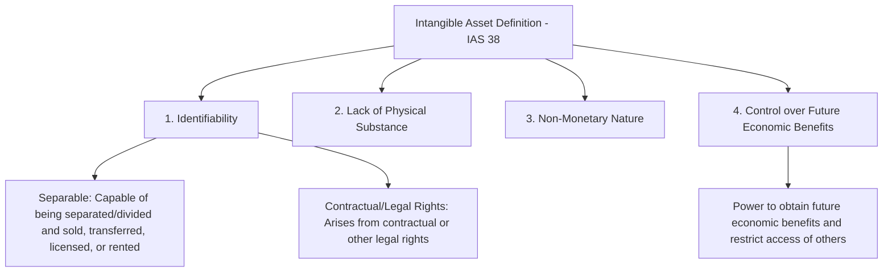
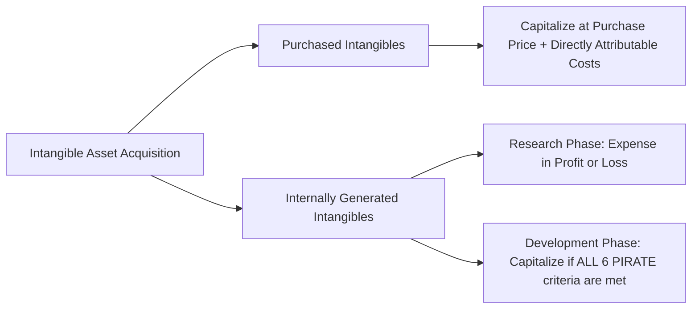
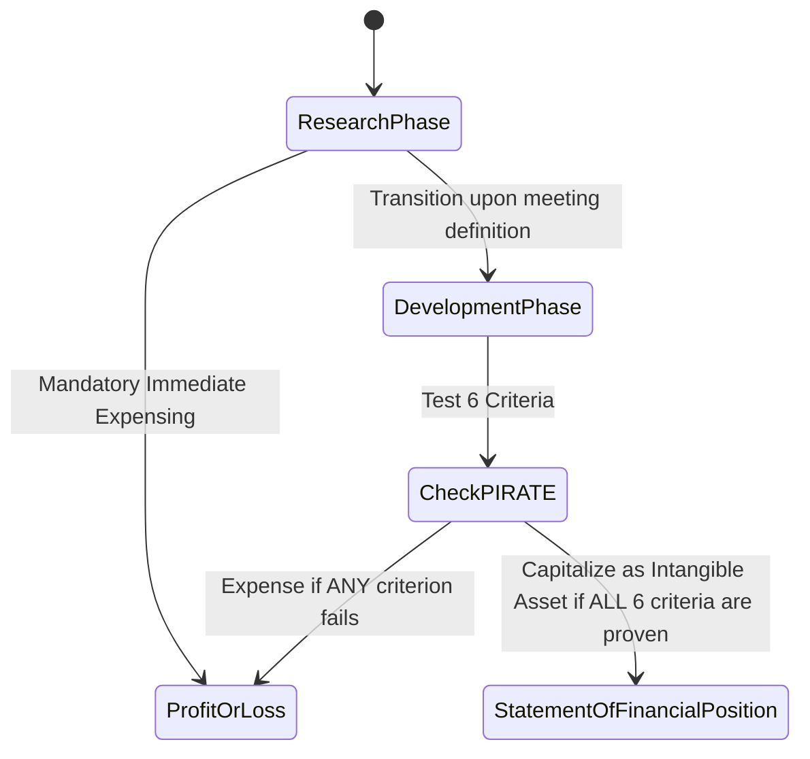
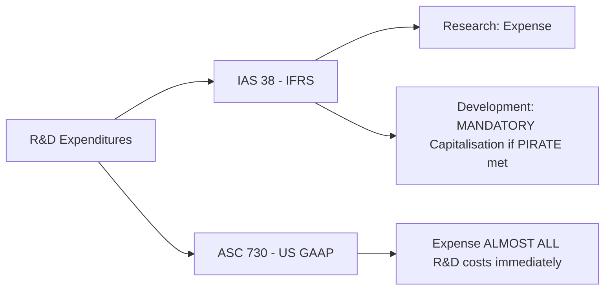
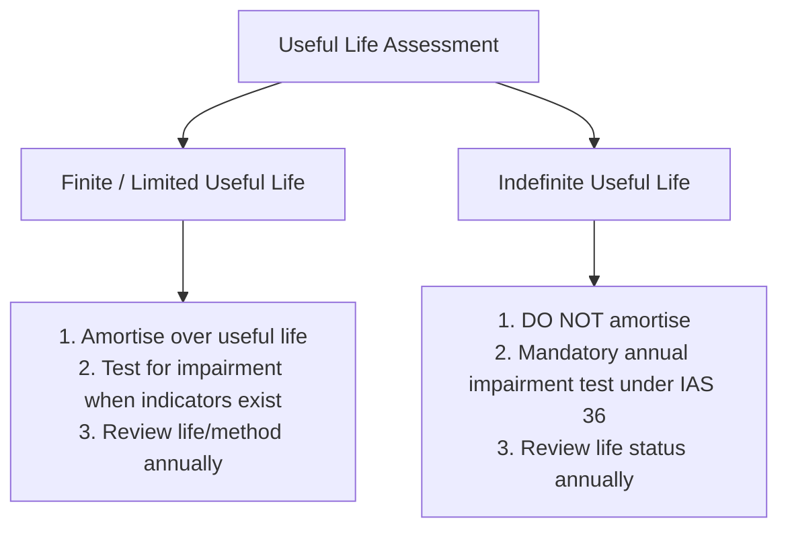
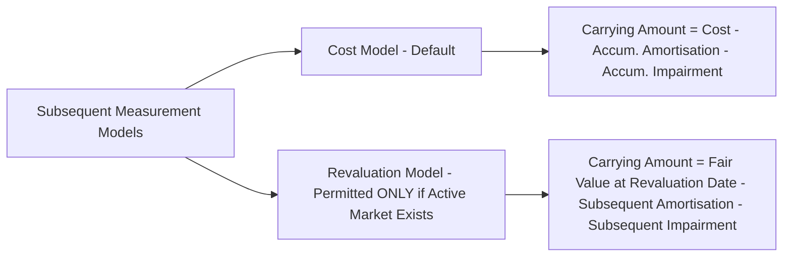
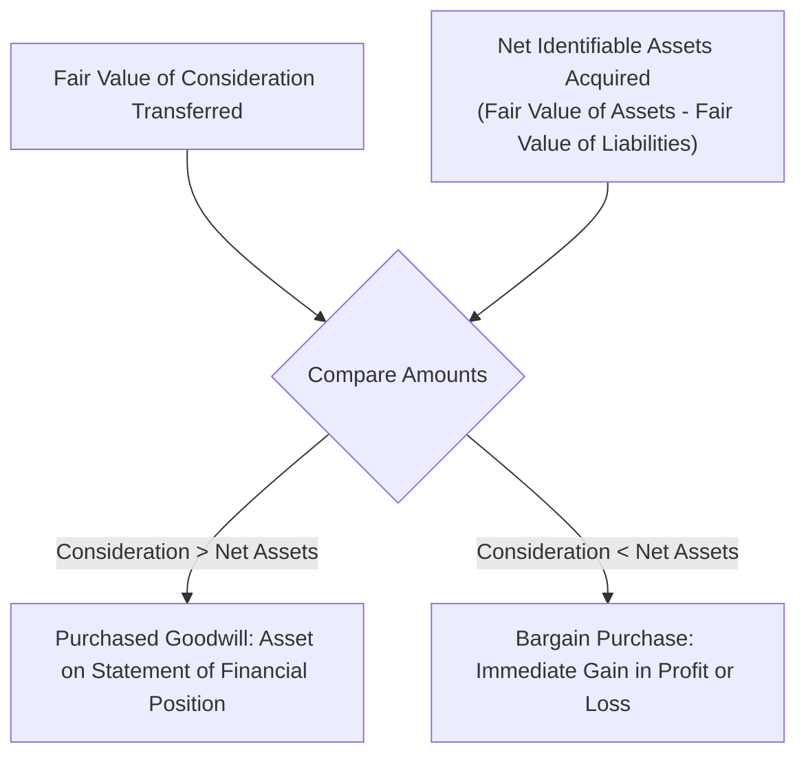
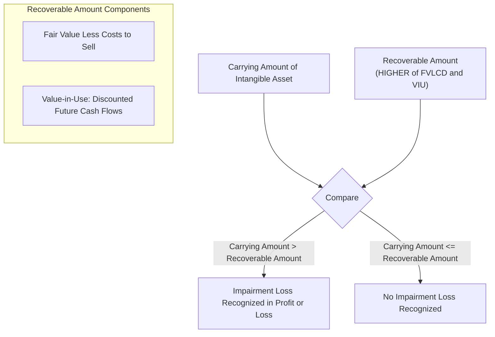
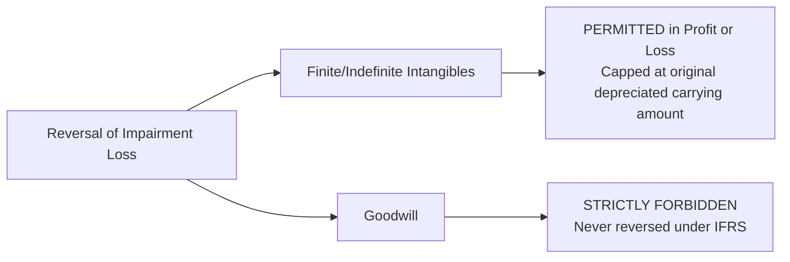

# Intangible Assets (IAS 38, IFRS 3, IAS 36)
> [!abstract] Curriculum & Course Context
> - **Course:** ACC 301 Intermediate Accounting
> - **Phase:** Phase 2: Asset Valuation & Accounting Measurement
> - **Target Reading:** Kieso, Weygandt, and Warfield, *Intermediate Accounting: IFRS Edition* (3rd Edition) — Chapter 12: Intangible Assets
> - **Applicable International Standards:**
>   - **IAS 38:** Intangible Assets
>   - **IFRS 3:** Business Combinations
>   - **IAS 36:** Impairment of Assets
> - **Syllabus Focus:** Definition and essential criteria of intangible assets, initial measurement of purchased vs internally generated intangibles, IAS 38 rules for Research and Development (R&D) costs (PIRATE criteria), contrast with US GAAP, finite vs indefinite useful lives, amortisation mechanics, IFRS 3 accounting for purchased goodwill and bargain purchases, CGU-level goodwill testing, and IAS 36 impairment testing and impairment reversals.

---
### 1. Definition, Key Characteristics, and Initial Recognition (IAS 38)
#### 1.1 Definition and Core Characteristics
> [!info] Key Definition
> Under **IAS 38 (Intangible Assets)**, an intangible asset is defined as an **identifiable non-monetary asset without physical substance**.

To be recognised as an intangible asset on the Statement of Financial Position, an item must satisfy four fundamental criteria:

1. **Identifiability:** The asset must be clearly distinguishable from goodwill. An asset meets the identifiability criterion if it either:
   * Is **separable**: It can be separated or divided from the entity and sold, transferred, licensed, rented, or exchanged, either individually or together with a related contract, identifiable asset, or liability; or
   * **Arises from contractual or other legal rights**: Regardless of whether those rights are transferable or separable from the entity or from other rights and obligations.
2. **Lack of Physical Substance:** The asset derives its value from the legal, contractual, or economic rights it confers upon the holder, rather than from any tangible physical property (unlike Property, Plant, and Equipment under IAS 16).
3. **Non-Monetary Nature:** The asset is not held in the form of cash or assets to be received in fixed or determinable amounts of cash (unlike bank deposits or accounts receivable).
4. **Control over Future Economic Benefits:** The entity possesses the power to obtain the future economic benefits flowing from the underlying resource (such as revenues from product sales or cost savings from operational efficiencies) and can restrict or regulate the access of third parties to those benefits.
#### 1.2 Initial Recognition and Measurement Principles
An intangible asset is recognised if, and only if:
* It is **probable** that the expected future economic benefits attributable to the asset will flow to the entity; and
* The cost of the asset can be measured **reliably**.

The initial accounting treatment depends entirely on how the intangible asset was acquired:

**1. Purchased Intangibles**
Intangible assets acquired separately from third parties are initially recorded at cost. Cost comprises:
* The purchase price, including import duties and non-refundable purchase taxes, after deducting trade discounts and rebates.
* Any directly attributable costs of preparing the asset for its intended use (for example, professional fees arising directly from bringing the asset to its working condition, and costs of testing whether the asset is functioning properly).

*Exclusions from Initial Cost:* Costs of introducing a new product or service (including advertising and promotional activities), costs of conducting business in a new location or with a new class of customer, and general administrative and overhead expenditures must be expensed immediately in Profit or Loss.

**2. Internally Generated Intangibles**
> [!warning] Exam Pitfall / Exception
> Internally generated brands, mastheads, publishing titles, customer lists, and items similar in substance must **never** be recognised as intangible assets. These items cannot be distinguished from the cost of developing the business as a whole; hence, all associated costs are expensed in Profit or Loss as incurred.

For all other internally generated intangible assets, IAS 38 mandates that the entity split the generation process into two distinct operational phases: the **Research Phase** and the **Development Phase**.

---
### 2. Research and Development (R&D) Costs (IAS 38 Rules)
#### 2.1 The Two-Phase Framework under IAS 38

**1. Research Phase**
* **Definition:** Research is original and planned investigation undertaken with the prospect of gaining new scientific or technical knowledge and understanding.
* **Examples:** Activities aimed at obtaining new knowledge; the search for, evaluation, and final selection of applications of research findings or other knowledge; the search for alternatives for materials, devices, products, systems, or services.
* **Mandatory Accounting Treatment:** **EXPENSE ALL** research costs immediately in Profit or Loss in the period incurred. No intangible asset arising from research (or from the research phase of an internal project) can be recognised.

**2. Development Phase**
* **Definition:** Development is the application of research findings or other knowledge to a plan or design for the production of new or substantially improved materials, devices, products, processes, systems, or services before the start of commercial production or use.
* **Examples:** The design, construction, and testing of pre-production or pre-use prototypes and models; the design of tools, jigs, moulds, and dies involving new technology; the design, construction, and operation of a pilot plant that is not of a scale economically feasible for commercial production.
#### 2.2 Capitalisation Criteria: The "PIRATE" Framework
Under IAS 38, an entity must capitalise development costs as an intangible asset if, and only if, it can demonstrate ALL SIX of the following criteria (commonly remembered by the mnemonic **PIRATE**):

| Mnemonic | Criteria Description | Operational Evidence Required |
| :---: | :--- | :--- |
| **P** | **P**robable future economic benefits | Demonstrate how the intangible asset will generate probable future economic benefits (e.g., existence of a market for the output or the usefulness of the asset internally). |
| **I** | **I**ntention to complete | Demonstrate the firm's formal intention to complete the intangible asset and use or sell it. |
| **R** | **R**esources available | Demonstrate the availability of adequate technical, financial, and other resources to complete the development and to use or sell the asset. |
| **A** | **A**bility to use or sell | Demonstrate the operational ability to use or sell the completed intangible asset. |
| **T** | **T**echnical feasibility | Demonstrate the technical feasibility of completing the intangible asset so that it will be available for use or sale. |
| **E** | **E**xpenditure reliably measurable | Demonstrate that the expenditure attributable to the intangible asset during its development phase can be reliably measured. |

> [!warning] Exam Pitfall / Exception
> **Reinstatement Prohibition:** Expenditure on an intangible item that was initially recognised as an expense in prior annual or interim financial reports **cannot be retrospectively capitalised** at a later date even if the PIRATE criteria are subsequently met.

#### 2.3 Strategic Contrast: IFRS (IAS 38) vs. US GAAP
The standardisation of R&D accounting presents a major structural point of divergence between global reporting frameworks:

| Dimension | IFRS (IAS 38) | US GAAP (FASB ASC 730) |
| :--- | :--- | :--- |
| **Research Costs** | Expense immediately in Profit or Loss as incurred. | Expense immediately as incurred. |
| **Development Costs** | **Mandatory Capitalisation** once all six PIRATE criteria are established. | Expense immediately as incurred for almost all internal R&D activities. |
| **Exceptions under US GAAP** | N/A — Standard applies across all industries. | Capitalisation is permitted only under narrow specific standards (e.g., computer software developed for sale after technological feasibility is reached under ASC 985-20, or internal-use software costs incurred during the application development stage under ASC 350-40). |
| **Financial Statement Impact** | Higher initial asset base, higher current net profit during major development phases; subsequent systematic amortisation. | Lower asset base, higher current expense volatility during development periods; lower future amortisation charges. |

---
### 3. Amortisation and Subsequent Valuation Models
#### 3.1 Life Classification and Amortisation Rules
Subsequent accounting for intangible assets depends fundamentally on the assessment of their useful life:

**1. Limited (Finite) Useful Life Intangibles**
* **Assessment:** An asset has a finite useful life if there is a limited duration or limit to the number of production units expected to be obtained from it.
* **Amortisation Period & Method:** Amortised systematically over its useful life. The amortisation method must reflect the pattern in which the asset's economic benefits are expected to be consumed by the entity. If that pattern cannot be determined reliably, the straight-line method must be used.
* **Accounting Entry:**
  $$ \begin{array}{llrr}
  \textbf{Account Titles} & & \textbf{Debit} & \textbf{Credit} \\
  \hline
  \text{Amortisation Expense (Profit or Loss)} & & \text{XXX} & \\
  \quad \text{Intangible Asset (or Allowance for Amortisation)} & & & \text{XXX} \\
  \end{array} $$
* **Residual Value Assumption:** The residual value of an intangible asset with a finite useful life is assumed to be **zero**, unless:
  * There is a commitment by a third party to purchase the asset at the end of its useful life; or
  * There is an active market for the asset, residual value can be determined by reference to that market, and it is probable that such a market will exist at the end of the asset's useful life.
* **Annual Review:** Useful life, residual value, and amortisation methods must be reviewed at least at each financial year-end. Any changes are accounted for prospectively as changes in accounting estimates under IAS 8.

**2. Indefinite Useful Life Intangibles**
* **Assessment:** An intangible asset is regarded as having an indefinite useful life when, based on an analysis of all relevant factors, there is no foreseeable limit to the period over which the asset is expected to generate net cash inflows for the entity. *(Note: Indefinite does not mean infinite).*
* **Amortisation Treatment:** **NEVER AMORTISED**.
* **Impairment Testing:** Tested for impairment under IAS 36 at least annually, and whenever there is an indication that the intangible asset may be impaired.
* **Annual Review:** The assessment of indefinite life must be reviewed each period. If circumstances change to indicate a finite life, the change is accounted for prospectively as a change in accounting estimate.
#### 3.2 Subsequent Valuation Models: Cost Model vs Revaluation Model
IAS 38 allows entities an accounting policy choice for subsequent measurement:

**1. Cost Model (Default Treatment)**
After initial recognition, an intangible asset is carried at its historical cost less any accumulated amortisation and any accumulated impairment losses:
$$ \text{Carrying Amount} = \text{Historical Cost} - \text{Accumulated Amortisation} - \text{Accumulated Impairment Losses} $$

**2. Revaluation Model**
After initial recognition, an intangible asset may be carried at a revalued amount, being its fair value at the date of the revaluation less any subsequent accumulated amortisation and subsequent accumulated impairment losses.

> [!warning] Exam Pitfall / Exception: Strict Active Market Requirement
> Under IAS 38, the revaluation model may be applied **IF AND ONLY IF** fair value can be determined by reference to an **active market** for that specific class of intangible asset.
> **Active Market Definition:** A market in which all the following conditions exist:
> 1. The items traded within the market are homogeneous;
> 2. Willing buyers and sellers can normally be found at any time; and
> 3. Prices are available to the public.

* **Practical Implication:** Active markets are extremely rare for intangible assets (e.g., patents, trademarks, brands, and custom software are unique, non-homogeneous items). Revaluation is usually restricted to transferable items like taxi licences, fishing quotas, or milk quotas.
* **Revaluation Surplus:** Increases in carrying amount resulting from revaluation are credited to Other Comprehensive Income (OCI) and accumulated in equity under Revaluation Reserve. Decreases are charged first against any existing revaluation reserve for the same asset, with any excess recognized immediately in Profit or Loss.

---
### 4. Specific Intangible Asset Categories
**Summary Classification Matrix**
The table below details the characteristics, amortisation rules, and capitalisation boundaries for primary categories of intangibles under IAS 38:

| Category | Primary Characteristics | Useful Life Assessment | Amortisation & Capitalisation Rules |
| :--- | :--- | :--- | :--- |
| **Patents** | Exclusive legal right granted by a government to use, manufacture, and sell an invention. | **Finite** (Legal life, typically 20 years, or economic life, whichever is shorter). | Capitalise purchase price plus legal defense costs. Amortise over useful life. Unsuccessful legal defense costs are expensed immediately and the remaining patent carrying amount is written off to Profit or Loss. |
| **Copyrights** | Granted by law to authors/artists for literary, musical, or artistic works. | **Finite** (Life of the creator plus a statutory period, or economic life, whichever is shorter). | Capitalise acquisition costs or qualifying development costs. Amortise over expected economic life using straight-line or unit-of-production methods. |
| **Trademarks & Trade Names** | Distinctive word, phrase, symbol, or logo identifying a firm or product line. | **Indefinite** (Usually renewable indefinitely in 10-year increments at nominal cost). | Capitalise purchase price. Internally generated trademarks cannot be capitalised. Do not amortise; test annually for impairment under IAS 36. |
| **Franchises & Licences** | Contractual right to operate a business, sell products, or render services in a designated area. | **Finite or Indefinite** (Based on contract terms and renewal rights). | Capitalise initial franchise fee and direct legal fees. Amortise finite-life franchises over contract term. Periodic operating fees paid to franchisor are expensed as incurred in Profit or Loss. |
| **Computer Software (External Sale)** | Software developed for licensing or selling to third parties. | **Finite** | Research costs expensed. Development costs capitalised once PIRATE criteria are met. Amortise over expected useful life. |
| **Computer Software (Internal Use)** | Software developed or acquired for internal operational use. | **Finite** | Capitalise acquisition or qualifying development phase costs. Amortise straight-line over estimated useful operational life. |

---
### 5. Goodwill & Business Combinations (IFRS 3)
#### 5.1 Nature and Initial Recognition
> [!info] Key Definition: Goodwill
> **Goodwill** represents future economic benefits arising from other assets acquired in a business combination that are not individually identified and separately recognised.

**Purchased Goodwill vs. Internally Generated Goodwill**
* **Purchased Goodwill:** Arises only in a business combination accounted for under IFRS 3 (Business Combinations). It is recognised as an asset on the Statement of Financial Position.
* **Internally Generated Goodwill:** MUST NEVER BE RECOGNISED. It does not satisfy the identifiability and cost measurement criteria of IAS 38 because it is not separable nor does it arise from contractual/legal rights.
#### 5.2 Mathematical Calculation of Purchased Goodwill
Under IFRS 3, purchased goodwill is measured at the acquisition date as the excess of the consideration transferred over the net fair value of the identifiable assets acquired and liabilities assumed:

> [!formula] Formula & Derivation: Purchased Goodwill
> $$ \text{Purchased Goodwill} = \text{Fair Value of Consideration Transferred} - \text{Net Identifiable Assets Acquired} $$
> Where:
> $$ \text{Net Identifiable Assets Acquired} = \text{Fair Value of Identifiable Assets Acquired} - \text{Fair Value of Liabilities Assumed} $$

#### 5.3 Bargain Purchase (Negative Goodwill)
When the fair value of net identifiable assets acquired exceeds the consideration transferred, a **bargain purchase** occurs.
Before recognising a gain on a bargain purchase, IFRS 3 requires the acquirer to:
1. Re-assess whether all assets acquired and liabilities assumed have been correctly identified; and
2. Re-assess the measurement of all identified fair values.

*Accounting Treatment:* Any remaining excess after re-assessment is recognised immediately as a **gain in Profit or Loss** on the acquisition date.
#### 5.4 Subsequent Accounting for Goodwill
* **Amortisation:** Goodwill is **NEVER AMORTISED** under IFRS.
* **Impairment Testing:** Goodwill must be tested for impairment at least annually, or more frequently if events or changes in circumstances indicate that it might be impaired, in accordance with IAS 36.
* **Cash-Generating Units (CGUs):** Because goodwill does not generate cash flows independently of other assets, it is allocated to each of the acquirer's Cash-Generating Units (CGUs) (or groups of CGUs) expected to benefit from the synergies of the combination.

---
### 6. Impairments and Reversals under IAS 36
#### 6.1 The Impairment Test Mechanics
Under IAS 36 (Impairment of Assets), an asset or CGU is impaired when its Carrying Amount exceeds its Recoverable Amount.

> [!formula] Formula & Derivation: Impairment Loss
> $$ \text{Impairment Loss} = \text{Carrying Amount} - \text{Recoverable Amount} \quad (\text{if Carrying Amount} > \text{Recoverable Amount}) $$

> [!info] Key Definition: Recoverable Amount
> The **Recoverable Amount** is defined as the **HIGHER** of:
> 1. **Fair Value Less Costs of Disposal (FVLCD):** The price that would be received to sell the asset in an orderly transaction between market participants, less direct incremental costs of disposal.
> 2. **Value-in-Use (VIU):** The present value of estimated future cash flows expected to be derived from the asset or Cash-Generating Unit in its present condition.

#### 6.2 Accounting Entry for Impairment Loss
When an impairment loss arises for an intangible asset measured under the cost model:

$$ \begin{array}{llrr}
\textbf{Account Titles} & & \textbf{Debit} & \textbf{Credit} \\
\hline
\text{Impairment Loss (Profit or Loss)} & & \text{XXX} & \\
\quad \text{Intangible Asset (or Accumulated Impairment Losses)} & & & \text{XXX} \\
\end{array} $$

For assets evaluated under the revaluation model, the loss is debited to OCI to the extent of any existing revaluation surplus for that asset, and any excess is debited to Profit or Loss.
#### 6.3 Reversal of Impairment Loss
IAS 36 outlines distinct rules for reversing impairment losses depending on the nature of the intangible asset:

**1. Reversal for Intangible Assets (Other than Goodwill)**
* At each reporting date, an entity must assess whether there is any indication that an impairment loss recognised in prior periods may no longer exist or may have decreased.
* If such indication exists, the recoverable amount is re-calculated. An impairment loss is reversed in Profit or Loss if there has been a change in the estimates used to determine the recoverable amount.
* **Cap on Reversal:** The carrying amount of the asset after reversal cannot exceed the carrying amount that would have been determined (net of amortisation) had no impairment loss been recognised for the asset in prior years.

**2. Reversal for Goodwill**
> [!warning] Exam Pitfall / Exception: Goodwill Reversal
> **IMPAIRMENT LOSSES ON GOODWILL CAN NEVER BE REVERSED UNDER IFRS.**
> *Rationale:* Any subsequent increase in recoverable amount after a goodwill impairment loss is treated as internally generated goodwill, which is explicitly banned from recognition under IAS 38.

---
### 7. Synthesis: Practical Numerical Walkthroughs
> [!example] Numerical Problem: Walkthrough 1 — R&D Cost Classification and Capitalisation (IAS 38)
> **Scenario Data**
> During 2025, BioTech Development Ltd. incurred total laboratory and engineering expenditures of £1,200,000 on Project X. The expenditures occurred evenly across the year as follows:
> * **January 1 – April 30 (£400,000):** Original scientific research seeking new compound applications.
> * **May 1 – August 31 (£400,000):** Prototype development. The 6 PIRATE criteria were formally met and documented on 1 September 2025.
> * **September 1 – December 31 (£400,000):** Final development and pre-production testing incurred after meeting PIRATE criteria.
> **Accounting Solution & Journal Entries**
> 1. **Research Costs (Jan 1 – Apr 30 = £400,000):** Must be expensed immediately as research.
> 2. **Pre-PIRATE Development Costs (May 1 – Aug 31 = £400,000):** PIRATE criteria were not yet proven; must be expensed in Profit or Loss as incurred.
> 3. **Post-PIRATE Development Costs (Sep 1 – Dec 31 = £400,000):** All 6 PIRATE criteria met; MUST BE CAPITALISED as an intangible asset.
> $$ \begin{array}{llrr}
> \textbf{Date / Period} & \textbf{Account Titles and Explanation} & \textbf{Debit (£)} & \textbf{Credit (£)} \\
> \hline
> \text{Jan 1 – Aug 31} & \text{Research and Development Expense (Profit or Loss)} & 800,000 & \\
> & \quad \text{Cash / Payables} & & 800,000 \\
> & \text{\small (Expense research and non-qualifying development costs)} & & \\
> \hline
> \text{Sep 1 – Dec 31} & \text{Intangible Asset — Development Costs (SFP)} & 400,000 & \\
> & \quad \text{Cash / Payables} & & 400,000 \\
> & \text{\small (Capitalise development expenditure meeting PIRATE criteria)} & & \\
> \hline
> \end{array} $$
> *Note: The £800,000 expensed prior to September 1 cannot be retrospectively capitalised at year-end.*

> [!example] Numerical Problem: Walkthrough 2 — Business Combination Goodwill & Impairment (IFRS 3 & IAS 36)
> **Scenario Data**
> On 1 January 2025, Global Conglomerate plc acquired 100% of the net assets of Target Corp for £5,000,000 cash. On acquisition date, Target Corp's Statement of Financial Position fair values were:
> * Property, Plant, and Equipment: £3,200,000
> * Patents (Identifiable Intangible): £1,000,000
> * Accounts Receivable: £800,000
> * Liabilities Assumed: (£1,500,000)
> Target Corp is designated as a Cash-Generating Unit (CGU). At 31 December 2025, after one year of operations, the carrying amount of Target Corp CGU's net assets (excluding goodwill) is £3,800,000. An impairment assessment performed on 31 December 2025 reveals:
> * Fair Value Less Costs of Disposal (FVLCD) of CGU: £4,500,000
> * Value-in-Use (VIU) of CGU: £4,200,000
> **Step 1: Calculate Acquisition-Date Goodwill (IFRS 3)**
> $$ \text{Fair Value of Consideration Transferred} = £5,000,000 $$
> $$ \begin{aligned}
> \text{Net Identifiable Assets Acquired} &= \text{PPE} + \text{Patents} + \text{Receivables} - \text{Liabilities} \\
> &= £3,200,000 + £1,000,000 + £800,000 - £1,500,000 \\
> &= \mathbf{£3,500,000}
> \end{aligned} $$
> $$ \begin{aligned}
> \text{Purchased Goodwill} &= \text{Consideration Transferred} - \text{Net Identifiable Assets} \\
> &= £5,000,000 - £3,500,000 = \mathbf{£1,500,000}
> \end{aligned} $$
> **Step 2: Impairment Testing of CGU at Year-End (IAS 36)**
> $$ \begin{aligned}
> \text{Total Carrying Amount of CGU} &= \text{Net Assets (excl. Goodwill)} + \text{Goodwill} \\
> &= £3,800,000 + £1,500,000 = \mathbf{£5,300,000}
> \end{aligned} $$
> $$ \begin{aligned}
> \text{Recoverable Amount} &= \text{HIGHER of FVLCD (£4,500,000) and VIU (£4,200,000)} \\
> &= \mathbf{£4,500,000}
> \end{aligned} $$
> $$ \begin{aligned}
> \text{CGU Impairment Loss} &= \text{Carrying Amount (£5,300,000)} - \text{Recoverable Amount (£4,500,000)} \\
> &= \mathbf{£800,000}
> \end{aligned} $$
> **Step 3: Allocation of Impairment Loss & Journal Entry**
> Under IAS 36, an impairment loss for a CGU is allocated first to reduce the carrying amount of goodwill to zero. Any residual loss is then allocated pro-rata to other non-current assets. Since the £800,000 impairment loss is less than the £1,500,000 goodwill carrying amount, the entire £800,000 is written off against Goodwill.
> $$ \begin{array}{llrr}
> \textbf{Date} & \textbf{Account Titles and Explanation} & \textbf{Debit (£)} & \textbf{Credit (£)} \\
> \hline
> \text{31 Dec 2025} & \text{Impairment Loss on Goodwill (Profit or Loss)} & 800,000 & \\
> & \quad \text{Goodwill (Statement of Financial Position)} & & 800,000 \\
> & \text{\small (To record IAS 36 impairment loss on goodwill allocated to Target CGU)} & & \\
> \hline
> \end{array} $$
> *Note: If in 2026 the recoverable amount of Target CGU rises to £6,000,000, this £800,000 impairment loss CAN NEVER BE REVERSED.*

---
### 8. Summary Comparison & IFRS Terminology Guide
**Key IFRS vs. US GAAP Distinctions**

| Accounting Issue | IFRS Standard (IAS 38 / IFRS 3 / IAS 36) | US GAAP Standard (FASB ASC) |
| :--- | :--- | :--- |
| **Development Costs** | Mandatory capitalisation if PIRATE criteria are met. | Expensed as incurred under ASC 730 (with limited software exceptions). |
| **Subsequent Revaluation** | Revaluation model permitted if an active market exists. | Revaluation forbidden; Cost model is mandatory. |
| **Impairment Test Mechanism** | Single-step model: Carrying Amount vs. Recoverable Amount (Higher of FVLCD and VIU). | Two-step model (historically) / Single-step carrying amount vs fair value test. |
| **Impairment Loss Reversal** | Permitted for intangibles (non-goodwill) up to depreciated cost. | Strictly prohibited for all long-lived assets held for use. |
| **Goodwill Reversal** | Strictly prohibited. | Strictly prohibited. |

**Strict IFRS Terminology Reference**

To ensure strict compliance with IFRS standards in written examinations and financial reports, use the standard terms below:

| Traditional / US GAAP Term            | Strict IFRS Terminology (IAS 38 / IAS 1)            |
| :------------------------------------ | :-------------------------------------------------- |
| Balance Sheet                         | **Statement of Financial Position**                 |
| Income Statement                      | **Profit or Loss** (or Statement of Profit or Loss) |
| Book Value                            | **Carrying Amount**                                 |
| Net Realizable Value (Asset Disposal) | **Fair Value Less Costs of Disposal (FVLCD)**       |
| Allowance for Amortisation            | **Accumulated Amortisation**                        |
| Reporting Unit                        | **Cash-Generating Unit (CGU)**                      |
| Write-down                            | **Impairment Loss**                                 |