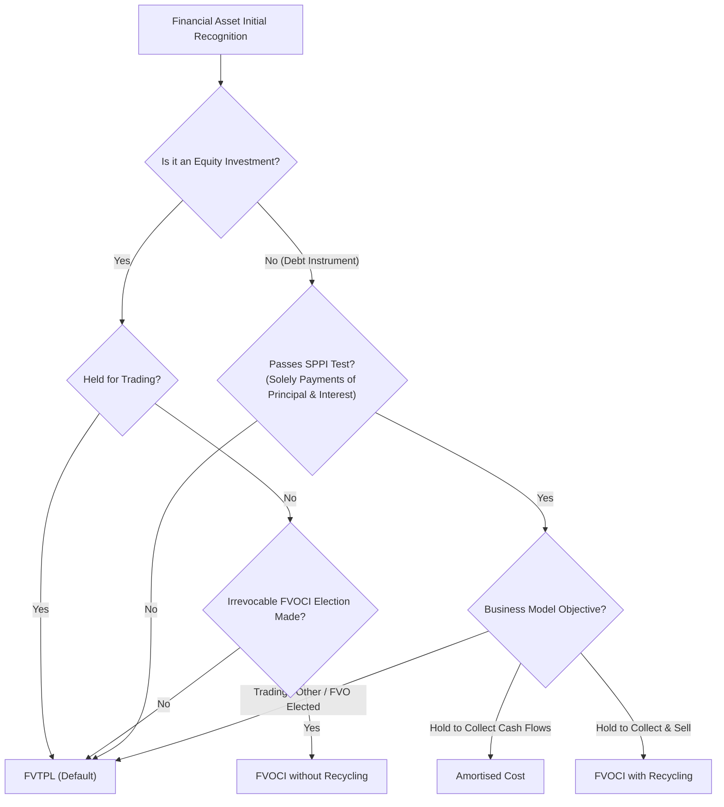
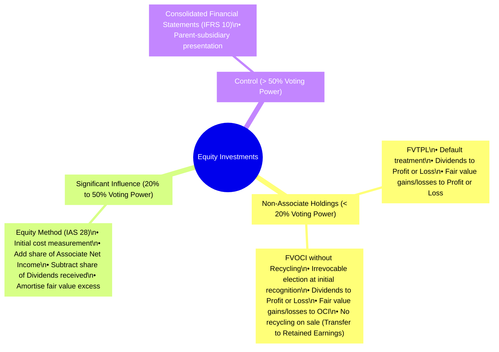
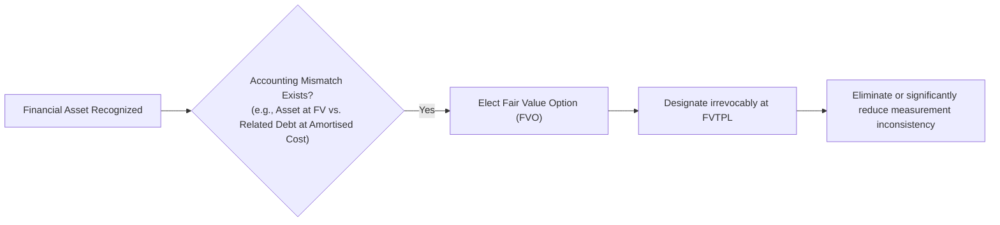
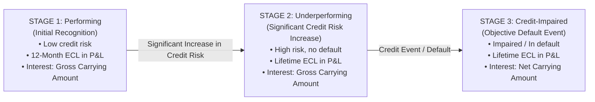

# Financial Investments (IFRS 9, IAS 28, IFRS 13)
> [!abstract] Curriculum & Syllabus Context
> - **Course:** ACC 301 Intermediate Accounting
> - **Phase:** Phase 2: Asset Valuation & Cost Allocation
> - **Target Reading:** Weygandt, Kieso, and Warfield, *Intermediate Accounting: IFRS Edition* (3rd Edition) — **Financial Investments**
> - **Syllabus Focus:** Financial asset classification framework under IFRS 9 (Business Model & SPPI tests), accounting categories for debt investments (Amortised Cost, FVOCI with recycling, FVTPL), accounting for equity investments (FVTPL, FVOCI without recycling, Equity Method IAS 28, Consolidation IFRS 10), the Fair Value Option (FVO), the 3-stage Expected Credit Loss (ECL) impairment model, and rules for reclassification.

---
### 1. Overview of Financial Assets Classification Framework (IFRS 9)
Under **IFRS 9: Financial Instruments**, the classification and subsequent measurement of financial assets depend on a two-pronged test evaluated at initial recognition:
1. **The Business Model Test**
2. **The Contractual Cash Flow Characteristics Test (SPPI Test)**

#### 1.1 The Business Model Test
The business model test reflects how an entity manages its financial assets to generate cash flows. The assessment is made at a portfolio level based on observable business activities:
* **Hold to Collect Contractual Cash Flows:** The objective is to hold the financial assets to maturity in order to collect contractual cash inflows over the life of the instrument.
* **Hold to Collect Contractual Cash Flows and Sell:** The objective is achieved by both collecting contractual cash flows and selling financial assets (e.g., managing liquidity needs while earning yield).
* **Other / Trading Models:** Portfolios managed with the primary objective of realizing short-term cash flow gains through active buying and selling.
#### 1.2 The Contractual Cash Flow Characteristics Test (SPPI)
The **Solely Payments of Principal and Interest (SPPI)** test evaluates whether the contractual cash flows of a debt instrument consist strictly of payments of principal and interest on specified dates:
* **Principal:** The fair value of the financial asset at initial recognition.
* **Interest:** Consideration for the time value of money, credit risk associated with the principal amount outstanding during a particular period of time, and basic lending risks/costs (e.g., liquidity risk and administrative fees).

If a debt instrument contains contractual terms that introduce exposure to risks or volatility unrelated to a basic lending arrangement (e.g., indexation to equity market prices or commodity indices), it **fails** the SPPI test and must be classified at Fair Value Through Profit or Loss (FVTPL).

---
### 2. Debt Investments Accounting Categories (IFRS 9)
Debt investments represent contractual rights to receive cash flows from issuers (such as government bonds, corporate debentures, and commercial paper).

| Feature | Amortised Cost | FVOCI (with Recycling) | FVTPL |
| :--- | :--- | :--- | :--- |
| **Business Model Criteria** | Hold to collect contractual cash flows. | Hold to collect cash flows and sell. | Trading strategy or managed for short-term fair value gains. |
| **SPPI Test Requirement** | Must Pass SPPI test. | Must Pass SPPI test. | Failed SPPI test or FVO elected. |
| **Statement of Financial Position Valuation** | Amortised cost (net carrying amount less ECL allowance). | Fair value at the reporting date. | Fair value at the reporting date. |
| **Profit or Loss Impact** | Effective-interest revenue, impairment losses/reversals, derecognition gains/losses. | Effective-interest revenue, impairment losses/reversals, derecognition gains/losses (including recycled OCI). | Interest revenue and unrealized/realized fair value gains and losses (Unrealized Holding Gain/Loss—Income). |
| **OCI Impact** | None. | Fair value adjustments (Unrealized Holding Gain/Loss—OCI). | None. |
| **Derecognition Recycling** | Not applicable. | Accumulated OCI gains/losses are **recycled** to Profit or Loss. | Not applicable. |

#### 2.1 Amortised Cost
* **Classification Criteria:** The debt asset is held within a business model whose objective is to *hold assets to collect contractual cash flows*, and its contractual terms pass the SPPI test.
* **Accounting Treatment:**
  * *Initial Measurement:* Recognized at fair value plus transaction costs directly attributable to the acquisition.
  * *Subsequent Measurement:* Measured at amortised cost using the effective-interest rate method.
  * *Statement of Financial Position:* Presented at its net carrying amount (gross carrying amount less allowance for expected credit losses).
  * *Fair Value Recognition:* Fair value changes are not recognized on the Statement of Financial Position or in Profit or Loss, unless impaired.
#### 2.2 Fair Value Through Other Comprehensive Income (FVOCI) with Recycling
* **Classification Criteria:** The debt asset is held within a dual-objective business model (*holding to collect cash flows AND selling*), and its contractual cash flows pass the SPPI test.
* **Accounting Treatment:**
  * *Statement of Financial Position:* Measured and reported at fair value at each reporting date.
  * *Profit or Loss:* Interest revenue is recognized using the effective-interest rate method, identical to the amortised cost treatment. Expected credit losses are recognized in Profit or Loss with a corresponding entry in OCI (rather than reducing the asset's carrying amount).
  * *Other Comprehensive Income:* Unrealized fair value gains and losses are accumulated in equity under *Unrealized Holding Gain/Loss—OCI*.
  * *Recycling Mechanism:* Upon derecognition or sale, the cumulative gain or loss previously recognized in OCI is **recycled (reclassified)** from equity to Profit or Loss as a reclassification adjustment.
#### 2.3 Fair Value Through Profit or Loss (FVTPL)
* **Classification Criteria:** Default category for debt instruments held for trading, debt assets managed under short-term profit-taking strategies, debt assets that fail the SPPI test, or debt assets designated under the Fair Value Option.
* **Accounting Treatment:**
  * *Initial Measurement:* Recognized at fair value; transaction costs are expensed immediately in Profit or Loss.
  * *Subsequent Measurement:* Remeasured to fair value at each balance sheet date.
  * *Profit or Loss Impact:* All fair value adjustments are recorded directly in Profit or Loss under *Unrealized Holding Gain/Loss—Income*. Interest revenue or investment returns are credited to Profit or Loss.

---
### 3. Equity Investments Accounting Categories (IFRS 9 & IAS 28)
Equity investments represent ownership shares in other entities (e.g., common or preferred shares) and do not contain contractual cash flow rights to principal or interest. Therefore, equity investments **automatically fail the SPPI test**.

#### 3.1 Fair Value Through Profit or Loss (FVTPL) - Default
* **Applicability:** Default classification for non-associate equity holdings where the investor exercises no significant influence (typically $<20\%$ voting power).
* **Accounting Treatment:**
  * Measured at fair value on the Statement of Financial Position.
  * Transaction costs are expensed as incurred in Profit or Loss.
  * Dividend income is recognized in Profit or Loss when the entity's right to receive payment is established.
  * Unrealized holding gains and losses arising from changes in fair value are recognized immediately in Profit or Loss.
#### 3.2 Fair Value Through Other Comprehensive Income (FVOCI) without Recycling
* **Applicability:** At initial recognition, an entity may make an irrevocable election (on an instrument-by-instrument basis) to present subsequent changes in fair value in OCI for equity holdings that are not held for trading.
* **Accounting Treatment:**
  * Measured at fair value on the Statement of Financial Position. Transaction costs are capitalized into the initial carrying amount.
  * Dividend income is recognized in Profit or Loss (unless the dividend clearly represents a recovery of part of the cost of the investment).
  * Fair value gains and losses are recognized in OCI and accumulated in Equity (*Unrealized Holding Gain/Loss—OCI*).

> [!warning] Exam Pitfall / Exception
> **Crucial IFRS Distinction — NO RECYCLING:**
> Upon derecognition or sale of the FVOCI equity instrument, cumulative gains or losses accumulated in OCI are **NEVER recycled to Profit or Loss**. Instead, the accumulated balance in OCI is transferred directly within Equity to **Retained Earnings**.

#### 3.3 Equity Method (IAS 28 — Investments in Associates)
* **Applicability:** Mandatory when an investor exercises significant influence over an investee (associate), generally presumed when holding $20\%$ to $50\%$ of the voting power.
* **Accounting Mechanics:**
  * *Initial Measurement:* Recorded initially at acquisition cost.
  * *Share of Associate's Profit or Loss:* The investor increases the carrying amount of the investment and recognizes Investment Income in Profit or Loss for its proportionate share of the associate's Net Income.
  * *Share of Dividends Received:* Dividends declared/paid by the associate reduce the carrying amount of the investment asset (treated as a return of investment cash flow).
  * *Fair Value Excess Amortisation:* Any excess of initial investment cost over the underlying net asset fair value attributable to depreciable assets (e.g., plant, machinery) is amortised over the asset's remaining life, reducing both the carrying amount and Investment Income.
  * *Impairment under IAS 28:* Evaluated for impairment whenever indicators exist; if the recoverable amount drops below the carrying amount, an impairment loss is charged directly to Profit or Loss.
#### 3.4 Consolidated Financial Statements (IFRS 10)
* **Applicability:** Mandatory when an investor obtains control over an investee (subsidiary), generally presumed when holding $>50\%$ of voting power.
* **Accounting Treatment:** The parent presents consolidated financial statements, combining assets, liabilities, equity, revenues, and expenses of parent and subsidiary entities as a single economic unit.

---
### 4. Fair Value Option (FVO) under IFRS 9
The Fair Value Option (FVO) provides entities with an irrevocable choice to designate a financial asset (or debt instrument) at FVTPL upon initial recognition.

* **Irrevocable Designation:** The election can only be made at initial recognition and cannot be changed subsequently.
* **Core Purpose:** To eliminate or significantly reduce an **accounting mismatch** (measurement or recognition inconsistency) that would otherwise arise from measuring related assets or liabilities, or recognizing gains and losses on them, on different measurement bases.
* **Fair Value Measurement Hierarchy (IFRS 13):**
  * *Level 1:* Quoted prices in active markets for identical assets (least subjective).
  * *Level 2:* Observable inputs other than Level 1 quotes (e.g., yield curves, observable prices for similar assets).
  * *Level 3:* Unobservable inputs based on management assumptions and discounted cash flow models (most subjective).

---
### 5. Impairment of Financial Assets (IFRS 9 Expected Credit Loss / ECL Model)
IFRS 9 introduced a forward-looking **Expected Credit Loss (ECL)** model, replacing the historical incurred loss model under legacy standards.
#### 5.1 Incurred Loss Model vs. Expected Credit Loss (ECL) Model
* **Incurred Loss Model:** Delayed recognition of impairment losses until a specific credit event occurred (e.g., default or payment delinquency).
* **Expected Credit Loss (ECL) Model:** Forward-looking framework requiring immediate recognition of expected credit losses at initial recognition and subsequent updates at each reporting date, incorporating historical data, current economic conditions, and reasonable forecasts.
#### 5.2 The 3-Stage Expected Credit Loss (ECL) Model

| ECL Framework Stage | Credit Quality Status | Impairment Loss Measurement | Interest Revenue Calculation Base |
| :--- | :--- | :--- | :--- |
| **Stage 1: Performing** | Credit risk has not increased significantly since initial recognition. | **12-Month Expected Credit Loss** (ECL resulting from default events possible within 12 months). | **Gross Carrying Amount** (Effective-Interest Rate $\times$ Gross Carrying Amount). |
| **Stage 2: Underperforming** | Credit risk has increased significantly since initial recognition (SICR), but asset is not credit-impaired. | **Lifetime Expected Credit Loss** (ECL resulting from all possible default events over the asset's life). | **Gross Carrying Amount** (Effective-Interest Rate $\times$ Gross Carrying Amount). |
| **Stage 3: Credit-Impaired** | Objective evidence of credit impairment/default exists (e.g., bankruptcy, restructuring). | **Lifetime Expected Credit Loss** (Discounted present value of expected cash shortfalls). | **Net Carrying Amount** (Effective-Interest Rate $\times$ [Gross Carrying Amount - Allowance]). |

---
### 6. Reclassifications of Financial Assets
IFRS 9 establishes rigid boundaries regarding the reclassification of financial assets:
#### 6.1 Debt Investments
Reclassification of debt instruments is allowed **ONLY** when an entity changes its business model for managing financial assets.
* **Operational Expectation:** Business model changes are rare, determined by senior management as a result of internal or external changes (e.g., acquisition or disposal of a business line).
* **Application:** Reclassifications are applied prospectively from the reclassification date (the first day of the reporting period following the business model change). Previously recognized gains, losses, or interest are not restated.
#### 6.2 Equity Investments
> [!warning] Exam Pitfall / Exception
> Reclassification is **STRICTLY PROHIBITED** for equity investments. The classification made at initial recognition—either FVTPL or the irrevocable election to present fair value changes in FVOCI without recycling—is permanent.

---
### 7. Master Comparison Table & IFRS Terminology Summary
#### 7.1 Comprehensive Category Summary Table

| Category | Applicable Standard | Criteria / Test | Measurement on Statement of Financial Position | Profit or Loss Impact | OCI Impact | OCI Recycling on Sale? | Reclassification Allowed? |
| :--- | :--- | :--- | :--- | :--- | :--- | :--- | :--- |
| **Debt: Amortised Cost** | IFRS 9 | Hold to Collect & Pass SPPI | Amortised cost less ECL allowance | Effective interest; ECL impairment; realized gains/losses | None | N/A | Yes (if Business Model changes) |
| **Debt: FVOCI** | IFRS 9 | Hold to Collect & Sell & Pass SPPI | Fair Value | Effective interest; ECL impairment; realized gains/losses | Unrealized fair value gains/losses | **YES** (Recycled to P&L) | Yes (if Business Model changes) |
| **Debt: FVTPL** | IFRS 9 | Trading / Failed SPPI / FVO | Fair Value | Interest income; unrealized and realized fair value gains/losses | None | N/A | Yes (if Business Model changes) |
| **Equity: FVTPL** | IFRS 9 | Non-associate ($<20\%$) default | Fair Value | Dividend income; unrealized and realized fair value gains/losses | None | N/A | **NO** (Strictly Prohibited) |
| **Equity: FVOCI** | IFRS 9 | Irrevocable non-trading election | Fair Value | Dividend income only | Unrealized fair value gains/losses | **NO** (Transfer to Retained Earnings) | **NO** (Strictly Prohibited) |
| **Equity: Associate** | IAS 28 | Significant Influence ($20\% \text{--} 50\%$) | Carrying amount (Cost + Share of Income - Dividends - Amortisation) | Share of Associate Net Income; impairment losses | Share of Associate OCI | Subject to IAS 28 rules | N/A |
| **Equity: Subsidiary** | IFRS 10 | Control ($>50\%$) | Consolidated line-by-line presentation | Full consolidation of revenue/expenses | Consolidated OCI | N/A | N/A |

#### 7.2 Key Standard IFRS Terminology
To maintain strict compliance with global accounting standards, the following standardized terminology must be applied:
* **Statement of Financial Position** (rather than Balance Sheet)
* **Profit or Loss** (rather than Income Statement or Net Income)
* **Other Comprehensive Income (OCI)**
* **Carrying Amount** (rather than Book Value)
* **Effective-Interest Rate** (rather than Stated Rate)
* **Amortised Cost** (rather than Depreciated Value)