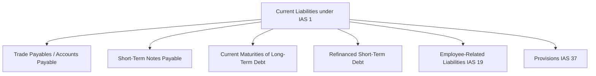
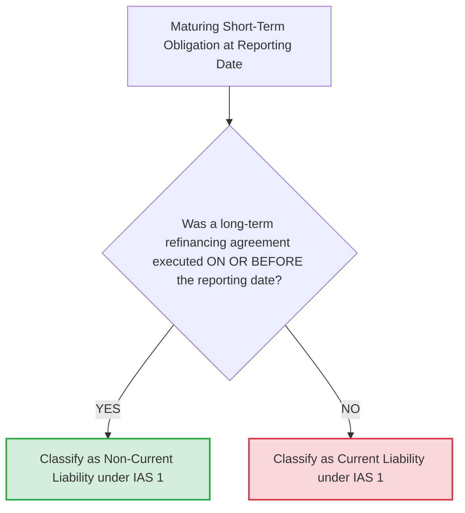
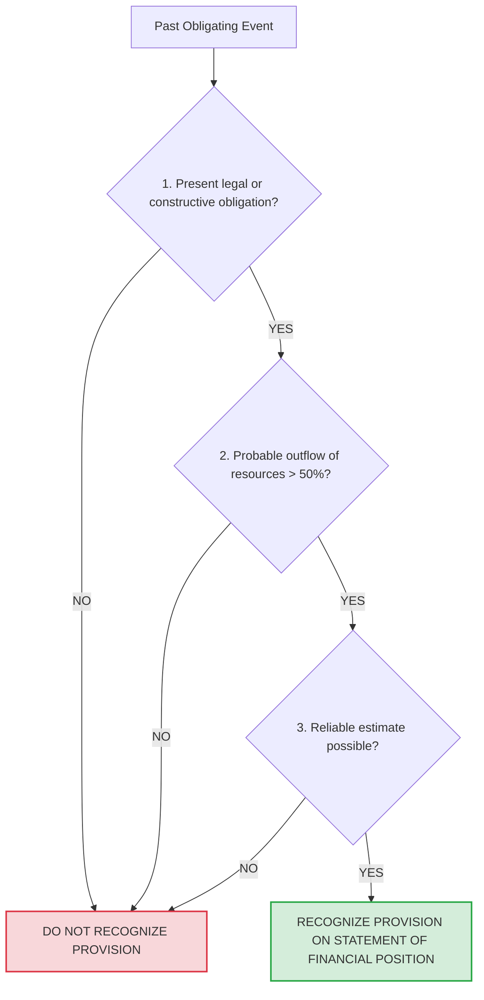
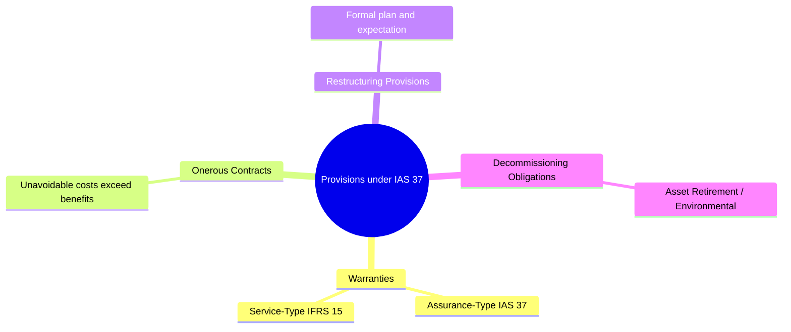

# Current Liabilities, Provisions, and Contingencies — Complete IFRS Study Guide
> [!abstract] Curriculum & Syllabus Context
> - **Course:** ACC 301 Intermediate Accounting
> - **Phase:** Phase 3: Liabilities & Owners' Equity
> - **Target Reading:** Weygandt, Kieso, and Warfield, *Intermediate Accounting: IFRS Edition* (3rd Edition) — **Current Liabilities, Provisions, and Contingencies**
> - **Syllabus Focus:** Definition and classification of current liabilities (IAS 1), accounts payable (gross vs. net), notes payable (interest-bearing vs. zero-interest), payroll accounting and compensated absences (IAS 19), short-term obligations expected to be refinanced, provisions (IAS 37) including warranties, onerous contracts, restructuring, and environmental obligations, contingent liabilities/assets, and financial statement presentation.

---
### 1. Current Liabilities Framework (IAS 1)
#### 1.1 Definition and Characteristics of a Liability
> [!info] Key Definition: Liability
> Under the International Accounting Standards Board (IASB) framework and **IAS 1 (Presentation of Financial Statements)**, a liability is defined as a present obligation of the entity arising from past events, the settlement of which is expected to result in an outflow from the entity of resources embodying economic benefits.

A liability possesses three core characteristics:
1. **Present Obligation:** The entity has a current duty or responsibility to one or more counterparties that requires settlement.
2. **Outflow of Economic Resources:** Settlement mandates the future transfer or use of assets, rendering of services, or another economic sacrifice.
3. **Past Obligating Event:** The transaction or economic event that created the legal or constructive duty has already occurred.

**Valuation Principles**
Conceptually, all liabilities should be recorded at the present value of the future cash outflows required to settle the obligation:

> [!formula] Formula & Derivation: Present Value of a Liability
> $$ \text{Present Value } (PV) = \frac{CF_n}{(1 + i)^n} $$

In practice, short-term liabilities are recorded and presented on the Statement of Financial Position at their **full face value (maturity value)**. The difference between the present value and the nominal settlement value for short-term obligations maturing within one year is quantitatively immaterial, and applying discounting would violate the cost constraint without offering decision-useful information.
#### 1.2 Criteria for Classification as a Current Liability
Under IAS 1 (Paragraph 69), an obligation must be classified as a Current Liability if it satisfies any one of the following four criteria:
1. **Normal Operating Cycle:** It is expected to be settled within the entity's normal operating cycle.
2. **Trading Purpose:** It is held primarily for the purpose of trading.
3. **12-Month Settlement Horizon:** It is due to be settled within 12 months after the reporting period (reporting date).
4. **No Unconditional Right to Defer:** The entity does not have an unconditional right to defer settlement of the liability for at least 12 months after the reporting period.

All obligations that do not satisfy at least one of these criteria must be classified as Non-Current Liabilities.

**Operating Cycle vs. One-Year Rule**
The operating cycle is the average elapsed time between the acquisition of materials/services entering a process and the final cash realization from the sale of goods or services. If the entity's normal operating cycle is longer than 12 months (e.g., tobacco, wine, or heavy capital equipment industries), the operating cycle length is used as the criterion for current versus non-current classification. If the operating cycle is shorter than 12 months, the 12-month criterion governs.
#### 1.3 Major Types of Current Liabilities

**1. Accounts Payable (Trade Payables)**
Trade payables represent balances owed to suppliers for goods, materials, or services purchased on open account credit terms (typically 30 to 60 days).

**Accounting Methods for Trade Cash Discounts**
When inventory purchases are subject to cash settlement discounts (e.g., $2/10, n/30$), entities account for trade payables using either the Gross Method or the Net Method:

| Accounting Dimension | Gross Method | Net Method (Theoretically Preferred) |
| :--- | :--- | :--- |
| **Initial Purchase Entry** | Recorded at full gross invoice value. | Recorded net of prompt payment cash discount. |
| **Discount Taken** | Credited to Purchase Discounts / Inventory. | No special adjustment required. |
| **Discount Lapsed / Missed** | No special journal entry (paid at gross value). | Debited to Purchase Discounts Lost (Financing/Operating Expense). |
| **Statement of Financial Position Valuation** | Reported at gross invoice amount. | Reported at net settlement value. |

> [!example] Numerical Problem: Comparative Journal Entry Mechanics
> **Scenario:** Purchase of inventory for £10,000, Terms $2/10, n/30$.
> $$ \begin{array}{llrr}
> \textbf{Date / Event} & \textbf{Account Titles} & \textbf{Debit (£)} & \textbf{Credit (£)} \\
> \hline
> \textbf{Gross Method} & & & \\
> \text{Oct 1: Purchase} & \text{Purchases / Inventory} & 10,000 & \\
> & \quad \text{Trade Payables} & & 10,000 \\
> \text{Oct 10: Paid within Discount Period} & \text{Trade Payables} & 10,000 & \\
> & \quad \text{Purchase Discounts} & & 200 \\
> & \quad \text{Cash} & & 9,800 \\
> \text{Oct 31: Paid after Discount Period} & \text{Trade Payables} & 10,000 & \\
> & \quad \text{Cash} & & 10,000 \\
> \hline
> \textbf{Net Method} & & & \\
> \text{Oct 1: Purchase} & \text{Purchases / Inventory (} £10,000 \times 0.98 \text{)} & 9,800 & \\
> & \quad \text{Trade Payables} & & 9,800 \\
> \text{Oct 10: Paid within Discount Period} & \text{Trade Payables} & 9,800 & \\
> & \quad \text{Cash} & & 9,800 \\
> \text{Oct 31: Paid after Discount Period} & \text{Trade Payables} & 9,800 & \\
> & \text{Purchase Discounts Lost} & 200 & \\
> & \quad \text{Cash} & & 10,000 \\
> \end{array} $$

**2. Short-Term Notes Payable**
Notes payable are formal, written promissory obligations to pay a specified sum of money at a deterministic future date. They may arise from trade credit, bank loans, or asset purchases.
* **Interest-Bearing Notes:** Notes containing an explicit stated coupon interest rate accrue interest expense over time based on face value, annual rate, and elapsed time.
* **Zero-Interest-Bearing Notes:** Zero-interest-bearing notes do not state an explicit interest rate, but are issued at a discount below face value. The implicit interest equals the difference between the cash proceeds received at issuance and the maturity face value. The discount is recorded in a contra-liability account (*Discount on Notes Payable*) and amortized to Profit or Loss as interest expense over the term of the note.

> [!example] Numerical Problem: Short-Term Notes Payable Mechanics
> **Scenario A: Interest-Bearing Note** (6-Month Note for £100,000 Principal, 6% Stated Rate)
> $$ \begin{array}{llrr}
> \textbf{Date} & \textbf{Account Titles} & \textbf{Debit (£)} & \textbf{Credit (£)} \\
> \hline
> \text{Nov 1: Issuance} & \text{Cash} & 100,000 & \\
> & \quad \text{Notes Payable} & & 100,000 \\
> \text{Dec 31: Year-End} & \text{Interest Expense (} £100,000 \times 6\% \times 2/12 \text{)} & 1,000 & \\
> & \quad \text{Interest Payable} & & 1,000 \\
> \text{May 1: Maturity} & \text{Notes Payable} & 100,000 & \\
> & \text{Interest Payable} & 1,000 & \\
> & \text{Interest Expense (} £100,000 \times 6\% \times 4/12 \text{)} & 2,000 & \\
> & \quad \text{Cash} & & 103,000 \\
> \end{array} $$
> **Scenario B: Zero-Interest-Bearing Note** (6-Month Note, £102,000 Maturity Value, Proceeds £100,000, Discount £2,000)
> $$ \begin{array}{llrr}
> \textbf{Date} & \textbf{Account Titles} & \textbf{Debit (£)} & \textbf{Credit (£)} \\
> \hline
> \text{Nov 1: Issuance} & \text{Cash} & 100,000 & \\
> & \text{Discount on Notes Payable} & 2,000 & \\
> & \quad \text{Notes Payable} & & 102,000 \\
> \text{Dec 31: Year-End} & \text{Interest Expense (} £2,000 \times 2/6 \text{)} & 667 & \\
> & \quad \text{Discount on Notes Payable} & & 667 \\
> \text{May 1: Maturity} & \text{Interest Expense (} £2,000 \times 4/6 \text{)} & 1,333 & \\
> & \quad \text{Discount on Notes Payable} & & 1,333 \\
> & \text{Notes Payable} & 102,000 & \\
> & \quad \text{Cash} & & 102,000 \\
> \end{array} $$

**3. Current Maturities of Long-Term Debt**
The portion of bonds, mortgages, or long-term notes payable maturing within 12 months after the reporting date must be reclassified from non-current liabilities to current liabilities.

*Exceptions to Current Classification:*
A short-term maturing portion of long-term debt is not classified as a current liability if:
1. It is to be retired using assets accumulated in a dedicated fund that is properly classified as a non-current asset (e.g., a non-current bond sinking fund).
2. It is to be refinanced or retired through the proceeds of a new long-term debt issue or equity security issuance under a valid agreement.
3. It is to be converted into capital stock/shares.

**4. Short-Term Obligations Expected to be Refinanced (Strict IFRS Standard under IAS 1)**
Under IAS 1, short-term debt maturing within 12 months of the reporting date must be classified as a Current Liability unless the entity has an unconditional right or an executed agreement to roll over or refinance the obligation on a long-term basis.

> [!warning] Exam Pitfall / Exception
> **Strict IFRS Refinancing Criteria vs. US GAAP**
> * **Execution Date Requirement (IFRS/IAS 1):** To exclude a short-term obligation from current liabilities, the agreement to refinance on a long-term basis must be executed **ON OR BEFORE the reporting date** (Statement of Financial Position date). Events occurring between the reporting date and the authorization date of financial statement publication (subsequent period) do not change the classification at the reporting date.
> * **US GAAP (ASC 470) Contrast:** Under US GAAP, short-term debt can be reclassified as long-term if refinancing is completed *after* the reporting date but *before* the financial statements are issued.

**5. Debt Callable by Creditors (Debt Covenant Violations)**
> [!warning] Exam Pitfall / Exception
> If an entity violates a debt covenant under a long-term agreement on or before the reporting date, rendering the debt payable on demand (callable):
> * **Default Treatment:** The long-term debt must be reclassified as a **Current Liability** at the reporting date.
> * **IFRS Reclassification Exception:** The liability can remain non-current only if the creditor has agreed, **on or before the reporting date**, to provide a grace period of at least 12 months during which the lender cannot demand immediate repayment. A waiver secured *after* the reporting date does not prevent current liability classification under IAS 1.

---
### 2. Employee-Related Liabilities (IAS 19)
#### 2.1 Payroll Deductions and Taxes
Payroll liabilities represent amounts owed to employees, government taxation authorities, and third-party institutions. They are divided into direct employee withholdings and employer payroll taxes.
1. **Employee Deductions (Withheld from Employee Gross Wages):**
   * *Income Tax Withholdings:* Taxes collected by the employer on behalf of national/local authorities.
   * *Employee Social Security / FICA Contributions:* Mandatory employee contributions for pensions, healthcare, and unemployment programs.
   * *Voluntary Deductions:* Union dues, insurance premiums, retirement plan contributions.
2. **Employer Payroll Taxes (Additional Operating Expense):**
   * *Employer Social Security Match:* Mandatory matching of social security and Medicare contributions on employee earnings.
   * *Unemployment Taxes (FUTA / SUTA):* Employer taxes paid to federal/state government funds based on eligible employee wages.

> [!example] Numerical Problem: Comprehensive Payroll Accounting Mechanics
> For a weekly gross payroll of £50,000, with income tax withholdings of £6,500, union dues of £500, employee social security tax of 7.65% (£3,825), and employer unemployment taxes of 4.3% (£2,150):
> $$ \begin{array}{llrr}
> \textbf{Account Titles} & & \textbf{Debit (£)} & \textbf{Credit (£)} \\
> \hline
> \textbf{Entry 1: Record Gross Employee Payroll \& Deductions} & & & \\
> \text{Salaries and Wages Expense} & & 50,000 & \\
> \quad \text{Income Taxes Payable} & & & 6,500 \\
> \quad \text{Social Security / FICA Taxes Payable} & & & 3,825 \\
> \quad \text{Union Dues Payable} & & & 500 \\
> \quad \text{Cash / Salaries Payable (Net Pay)} & & & 39,175 \\
> \hline
> \textbf{Entry 2: Record Employer Payroll Taxes} & & & \\
> \text{Payroll Tax Expense} & & 5,975 & \\
> \quad \text{Social Security Taxes Payable (Employer Match)} & & & 3,825 \\
> \quad \text{Unemployment Taxes Payable (FUTA/SUTA)} & & & 2,150 \\
> \end{array} $$

#### 2.2 Compensated Absences
Compensated absences are employee benefits involving paid leave for vacation, sickness, parental duties, and holidays.
* **Accumulating vs. Non-Accumulating Rights:** Accumulating rights carry forward to future periods if not fully utilized. Non-accumulating rights lapse if not used in the current period (expense recognized only when absence occurs).
* **Vesting vs. Non-Vesting:** Vested rights legally entitle the employee to a cash payout upon termination (mandatory accrual). Non-vested rights accumulate but do not guarantee a cash payout.

> [!info] Key Definition: IAS 19 Recognition Criteria
> Under IAS 19 (Employee Benefits), an entity must accrue a liability and expense for accumulating compensated absences when **all four** conditions are met:
> 1. The obligation is attributable to services already rendered by employees.
> 2. The obligation relates to rights that vest or accumulate.
> 3. Payment of the compensation is probable ($> 50\%$ likelihood).
> 4. A reliable estimate of the obligation can be made.

> [!example] Numerical Problem: Compensated Absence Accrual
> An entity employs 100 workers who each earn 10 days of paid vacation annually at a rate of £100 per day. During 2025, employees used 800 vacation days. Unused vacation days (200 days) carry forward to 2026. In 2026, the 200 days are taken when wage rates increased to £110 per day:
> $$ \begin{array}{llrr}
> \textbf{Date} & \textbf{Account Titles} & \textbf{Debit (£)} & \textbf{Credit (£)} \\
> \hline
> \text{Dec 31, 2025} & \text{Salaries and Wages Expense (} 200 \times £100 \text{)} & 20,000 & \\
> \text{(Accrual)} & \quad \text{Compensated Absences Payable} & & 20,000 \\
> \hline
> \text{2026} & \text{Compensated Absences Payable} & 20,000 & \\
> \text{(Payment)} & \text{Salaries and Wages Expense (Rate Increase)} & 2,000 & \\
> & \quad \text{Cash (} 200 \times £110 \text{)} & & 22,000 \\
> \end{array} $$

#### 2.3 Profit-Sharing and Bonus Plans
Bonus arrangements represent supplementary employee compensation tied to operational performance metrics or net earnings. Under IAS 19, profit-sharing and bonus obligations are recognized as accrued current liabilities when the entity has a present legal or constructive obligation based on past events and a reliable estimate can be derived.

> [!formula] Formula & Derivation: Algebraic Calculations for Bonus Formulas
> Let $B = \text{Bonus Amount}$, $T = \text{Tax Rate}$, $I = \text{Net Income before bonus and tax}$.
> **Case 1: Bonus Based on Income Before Tax and Before Bonus**
> $$ B = b \times I $$
> **Case 2: Bonus Based on Income After Bonus, But Before Tax**
> $$ B = b \times (I - B) \implies B = \frac{b \times I}{1 + b} $$
> **Case 3: Bonus Based on Net Income After Tax and After Bonus**
> Given $T = t \times (I - B)$:
> $$ B = b \times (I - B - T) = b \times [I - B - t(I - B)] = b(1 - t)(I - B) $$
> $$ B = \frac{b(1 - t)I}{1 + b(1 - t)} $$

---
### 3. Provisions (IAS 37)
#### 3.1 Definition and The Three Recognition Criteria
> [!info] Key Definition: Provision
> Under **IAS 37 (Provisions, Contingent Liabilities and Contingent Assets)**, a provision is defined as a liability of uncertain timing or amount.

A provision must be recognized on the Statement of Financial Position if, and only if, all three of the following conditions are met:

#### 3.2 Legal vs. Constructive Obligations
* **Legal Obligation:** An obligation that derives from a contract, explicit legislation, or other operation of law.
* **Constructive Obligation:** An obligation that derives from an entity's actions where:
  1. By an established pattern of past practice, published policies, or a sufficiently specific current statement, the entity has indicated to other parties that it will accept certain responsibilities; and
  2. As a result, the entity has created a valid expectation on the part of those other parties that it will discharge those responsibilities.
#### 3.3 Comparative Analysis: IFRS (IAS 37) vs. US GAAP (ASC 450)

| Technical Dimension | IFRS Standard (IAS 37) | US GAAP Standard (ASC 450) |
| :--- | :--- | :--- |
| **Terminology** | Provision (recognized liability). | Estimated Liability / Loss Contingency Accrual. |
| **"Probable" Recognition Threshold** | **More likely than not** ($> 50\%$ probability). | **Likely to occur** (typically $\sim 75\%$ to $80\%+$ probability). |
| **Measurement within an Equal Range** | **Midpoint / Expected Value** of the range. | **Minimum** amount in the range. |
| **Discounting / Time Value of Money** | Mandatory discounting if time value of money is material. | Restricted discounting (applied only to liabilities with fixed/determinable flows). |
| **Constructive Obligations** | Explicitly recognized and accrued. | Narrowly restricted; requires legal obligation or specific statutory rules. |
| **Onerous Contracts** | Mandatory provision under IAS 37. | No general standard; limited to specific topics (e.g., exit costs). |
| **Restructuring Provisions** | Recognized once formal plan exists and valid expectation is raised. | Accrued only when liability is incurred (ASC 420 criteria). |

#### 3.4 Measurement Principles for Provisions
> [!formula] Formula & Derivation: Measurement Principles
> **1. Best Estimate Framework:** The amount recognized must be the best estimate of the expenditure required to settle the present obligation.
> **2. Expected Value Method (Large Population of Items):**
> $$ \text{Expected Value} = \sum (\text{Outcome Amount}_i \times \text{Probability}_i) $$
> **3. Continuous Range of Equal Outcomes (Midpoint):**
> $$ \text{Midpoint Provision} = \frac{\text{Minimum Range Amount} + \text{Maximum Range Amount}}{2} $$
> **4. Present Value and Discounting Mechanics:**
> $$ \text{Provision } (PV) = \frac{\text{Future Obligation Cash Outflow } (CF)}{(1 + r)^n} $$
> *(The increase in the carrying amount of a provision due to the passage of time is recognized as an Unwinding of Discount / Finance Expense in Profit or Loss).*

#### 3.5 Common Types of Provisions

**1. Product Warranties**
* **Assurance-Type Warranty (IAS 37):** A warranty guaranteeing that the product complies with agreed specifications. It creates a present obligation from a past sales event. A provision is accrued at the time of sale.
* **Service-Type Warranty (IFRS 15):** An extended warranty offering a distinct service beyond base compliance. It represents a separate performance obligation. Consideration is allocated to Unearned Warranty Revenue and recognized over the service period.

> [!example] Numerical Problem: Assurance vs. Service Warranty
> **Scenario:** An entity sells 1,000 machinery units for £2,000 cash each (£2,000,000 total).
> 1. Includes a 1-year assurance warranty. Historical data indicates 5% of units require minor repairs (£100/unit) and 2% require major repairs (£500/unit). Actual 2025 repair costs paid equal £12,000.
> 2. Sells 200 service-type extended warranties for £300 cash each (£60,000 total).
> $$ \begin{array}{llrr}
> \textbf{Date / Event} & \textbf{Account Titles} & \textbf{Debit (£)} & \textbf{Credit (£)} \\
> \hline
> \textbf{1. Record Sales \& Assurance Warranty} & & & \\
> \text{Sale} & \text{Cash} & 2,000,000 & \\
> & \quad \text{Sales Revenue} & & 2,000,000 \\
> \text{Assurance Accrual*} & \text{Warranty Expense} & 15,000 & \\
> & \quad \text{Warranty Provision} & & 15,000 \\
> \hline
> \textbf{2. Record Actual Repairs Incurred} & & & \\
> & \text{Warranty Provision} & 12,000 & \\
> & \quad \text{Cash / Supplies / Payroll} & & 12,000 \\
> \hline
> \textbf{3. Record Service Warranty Sales} & & & \\
> & \text{Cash} & 60,000 & \\
> & \quad \text{Unearned Service Warranty Revenue} & & 60,000 \\
> \end{array} $$
> *\*(Expected Assurance Cost = $(1,000 \times 5\% \times £100) + (1,000 \times 2\% \times £500) = £15,000$)*

**2. Onerous Contracts**
An onerous contract is defined under IAS 37 as a contract in which the unavoidable costs of meeting the obligations under the contract exceed the economic benefits expected to be received under it. The provision is recognized at the lower of the net cost of fulfilling the contract, and any penalties/compensation arising from failure to fulfill the contract.

> [!example] Numerical Problem: Onerous Lease
> **Scenario:** An entity operates an uncancelable operating factory lease requiring annual payments of £50,000 for 3 remaining years. The entity relocates operations and can sublease the facility for only £20,000 annually. The penalty for early lease cancellation is £75,000. (Ignore discounting).
> * **Cost of Fulfilling** $= 3 \text{ years} \times (£50,000 - £20,000) = £90,000$
> * **Cancellation Penalty** $= £75,000$
> The provision is recognized at the lower amount (£75,000):
> $$ \begin{array}{llrr}
> \textbf{Account Titles} & & \textbf{Debit (£)} & \textbf{Credit (£)} \\
> \hline
> \text{Loss on Onerous Contract (Profit or Loss)} & & 75,000 & \\
> \quad \text{Provision for Onerous Contract} & & & 75,000 \\
> \end{array} $$

**3. Restructuring Provisions**
A constructive obligation to restructure arises only when an entity has:
1. A detailed formal plan for the restructuring specifying the business, locations, affected employees, expenditures, and execution timeline; and
2. Raised a valid expectation in those affected that it will carry out the restructuring.
* *Eligible Costs:* Direct employee termination benefits, lease termination penalties, direct closure costs.
* *Ineligible Costs:* Retraining/relocating continuing staff, marketing, new systems, future operational losses.

**4. Environmental and Decommissioning Obligations**
Entities must recognize provisions for site restoration, environmental cleanup, and asset retirement obligations when a legal or constructive duty exists.
$$ \begin{array}{llrr}
\textbf{Event} & \textbf{Account Titles} & \textbf{Debit (£)} & \textbf{Credit (£)} \\
\hline
\text{Initial Obligation} & \text{Property, Plant, and Equipment (PP\&E)} & \text{XXX} & \\
& \quad \text{Decommissioning Provision} & & \text{XXX} \\
\text{Annual Unwinding} & \text{Finance Expense (Provision } \times \text{ Discount Rate)} & \text{XXX} & \\
& \quad \text{Decommissioning Provision} & & \text{XXX} \\
\end{array} $$

---
### 4. Contingent Liabilities and Contingent Assets (IAS 37)
#### 4.1 Contingent Liabilities
A contingent liability is defined as:
1. A **possible obligation** that arises from past events and whose existence will be confirmed only by the occurrence or non-occurrence of one or more uncertain future events not wholly within the control of the entity; or
2. A **present obligation** that arises from past events but is not recognized because it is not probable that an outflow of resources will be required, or the amount cannot be measured reliably.
* *Treatment:* NEVER recognized on the face of the Statement of Financial Position. Disclosed in the notes unless the possibility of an outflow is remote.
#### 4.2 Contingent Assets
A contingent asset is a possible asset that arises from past events and whose existence will be confirmed only by uncertain future events.
* *Treatment:* NEVER recognized on the Statement of Financial Position. Disclosed in notes ONLY IF an inflow of economic benefits is probable ($> 50\%$). If realization is virtually certain ($100\%$), it is recognized as an asset.
#### 4.3 Summary IAS 37 Treatment Matrix

| Degree of Probability | Operational Definition | Treatment for Present / Possible Liability | Treatment for Possible Asset |
| :--- | :--- | :--- | :--- |
| **Virtually Certain** | Certainty ($\sim 100\%$). Event is essentially guaranteed. | Recognize Liability on Statement of Financial Position. | Recognize Asset on Statement of Financial Position. |
| **Probable** | More likely than not ($> 50\%$ to $< 100\%$). | Recognize Provision on Statement of Financial Position (if reliably measurable). | Disclose in Notes (No asset on Statement of Financial Position). |
| **Possible** | Unlikely, but more than remote ($10\%$ to $50\%$). | Disclose Contingent Liability in Notes (No provision on Statement of Financial Position). | No Entry & No Disclosure. |
| **Remote** | Slight chance ($< 10\%$). | No Entry & No Disclosure (Except specific statutory guarantees). | No Entry & No Disclosure. |

---
### 5. Presentation and Disclosures (IAS 1 & IAS 37)
#### 5.1 Statement of Financial Position Presentation
Current liabilities are presented separately from non-current liabilities on the Statement of Financial Position.

$$ \begin{array}{lrr}
\hline
\multicolumn{3}{c}{\textbf{[Entity Name] Statement of Financial Position (Excerpt)}} \\
\multicolumn{3}{c}{\textbf{as at 31 December 2025}} \\
\hline
\textbf{Current Liabilities:} & & \\
\quad \text{Trade Payables} & £125,000 & \\
\quad \text{Short-Term Notes Payable} & 50,000 & \\
\quad \text{Current Maturities of Long-Term Debt} & 30,000 & \\
\quad \text{Current Income Tax Payable} & 15,000 & \\
\quad \text{Employee Benefits Payable (Compensated Absences)} & 12,000 & \\
\quad \text{Provisions (Warranty \& Restructuring)} & 45,000 & \\
\hline
\textbf{Total Current Liabilities} & & \mathbf{£277,000} \\
\textbf{Non-Current Liabilities:} & & \\
\quad \text{Bonds Payable} & £500,000 & \\
\quad \text{Long-Term Provisions (Decommissioning)} & 85,000 & \\
\hline
\textbf{Total Non-Current Liabilities} & & \mathbf{£585,000} \\
\hline
\textbf{Total Liabilities} & & \mathbf{£862,000} \\
\hline \hline
\end{array} $$
#### 5.2 Disclosure Requirements for Provisions
For each class of provision, an entity must disclose a reconciliation of the opening carrying amount to the closing carrying amount in the notes:

$$ \begin{array}{lrrrr}
\hline
\textbf{Provision Reconciliation Movement} & \textbf{Warranty (£)} & \textbf{Restructuring (£)} & \textbf{Decommissioning (£)} & \textbf{Total (£)} \\
\hline
\text{Opening Balance (at Jan 1, 2025)} & 20,000 & 50,000 & 80,000 & 150,000 \\
\text{Additional provisions created in period} & 15,000 & 10,000 & 5,000 & 30,000 \\
\text{Amounts utilized (costs incurred \& charged)} & (12,000) & (40,000) & 0 & (52,000) \\
\text{Unused amounts reversed in period} & (3,000) & (5,000) & 0 & (8,000) \\
\text{Unwinding of discount (finance cost)} & 0 & 0 & 4,000 & 4,000 \\
\hline
\textbf{Closing Balance (at Dec 31, 2025)} & \mathbf{20,000} & \mathbf{15,000} & \mathbf{89,000} & \mathbf{124,000} \\
\hline \hline
\end{array} $$

---
### 6. Comprehensive Numerical Problem Walkthroughs
> [!example] Numerical Problem 1: Refinancing & Current Liability Classification under IAS 1
> **Scenario:** At 31 December 2025 (reporting date), Beta Ltd. has £1,000,000 of short-term notes payable due on 28 February 2026. Financial statements are authorized for issue on 15 March 2026. Evaluate liability classification under three independent cases:
> * **Case A:** On 20 January 2026, Beta Ltd. executed a binding long-term loan agreement with City Bank to refinance the note on a 5-year basis.
>   * *IAS 1 Analysis:* Execution Date is AFTER the reporting date. Refinancing executed after the reporting date cannot be considered. The liability **MUST BE CLASSIFIED AS A CURRENT LIABILITY** (£1,000,000) on the Statement of Financial Position as at 31 December 2025.
> * **Case B:** On 15 December 2025, Beta Ltd. executed a binding refinancing contract with City Bank permitting 3-year term conversion.
>   * *IAS 1 Analysis:* Execution Date is ON OR BEFORE the reporting date. The £1,000,000 obligation is **EXCLUDED FROM CURRENT LIABILITIES** and classified as a **NON-CURRENT LIABILITY**.
> * **Case C:** On 10 December 2025, Beta Ltd. breached a debt covenant on a £2,000,000 long-term bond. On 20 January 2026, the creditor provided a waiver agreeing not to demand payment for 18 months.
>   * *IAS 1 Analysis:* Because the breach occurred before the reporting date and the waiver was obtained after, the entity lacked an unconditional right to defer settlement at 31 December 2025. The entire £2,000,000 bond **MUST BE RECLASSIFIED AS A CURRENT LIABILITY**.

> [!example] Numerical Problem 2: IAS 37 Provisions — Midpoint, Discounting, and Unwinding
> **Scenario:** On 31 December 2025, Gamma Ltd. identifies an environmental contamination obligation resulting from operations during 2025. Clean-up will occur in exactly 3 years. Environmental engineering studies indicate an equal likelihood of required cash outflows ranging between £200,000 and £300,000. The pre-tax discount rate is 6% per annum.
> **Step 1: Calculate Undiscounted Midpoint Best Estimate**
> $$ \text{Midpoint Outflow} = \frac{£200,000 + £300,000}{2} = £250,000 $$
> **Step 2: Calculate Initial Discounted Provision (31 Dec 2025)**
> $$ \text{PV of Provision} = \frac{£250,000}{(1 + 0.06)^3} = \frac{£250,000}{1.191016} = £209,905 $$
> **Step 3: Initial Provision Journal Entry (31 Dec 2025)**
> $$ \begin{array}{llrr}
> \textbf{Account Titles} & & \textbf{Debit (£)} & \textbf{Credit (£)} \\
> \hline
> \text{Environmental Cleanup Expense (Profit or Loss)} & & 209,905 & \\
> \quad \text{Environmental Provision (Statement of Financial Position)} & & & 209,905 \\
> \end{array} $$
> **Step 4: Record Subsequent Unwinding of Discount (31 Dec 2026)**
> $$ \text{Interest Expense for 2026} = £209,905 \times 6\% = £12,594 $$
> $$ \begin{array}{llrr}
> \textbf{Account Titles} & & \textbf{Debit (£)} & \textbf{Credit (£)} \\
> \hline
> \text{Finance Expense (Unwinding of Discount)} & & 12,594 & \\
> \quad \text{Environmental Provision} & & & 12,594 \\
> \end{array} $$
> *(Carrying amount of provision at 31 December 2026 = £209,905 + £12,594 = £222,499).*