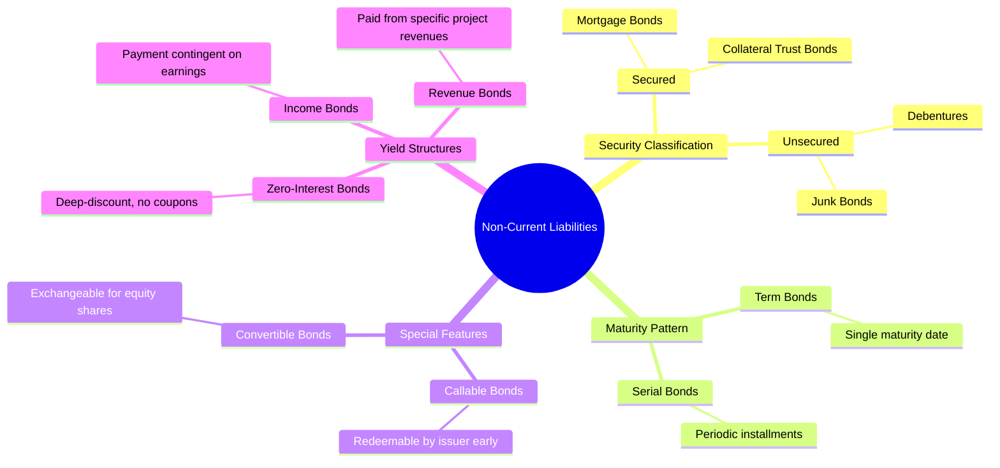
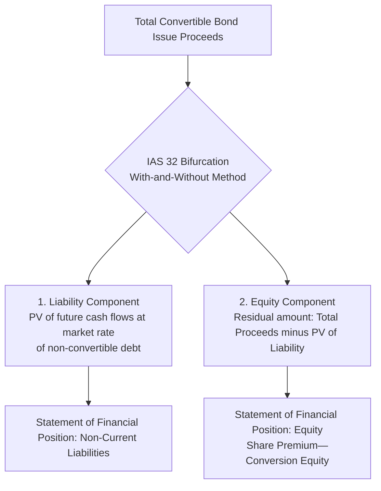
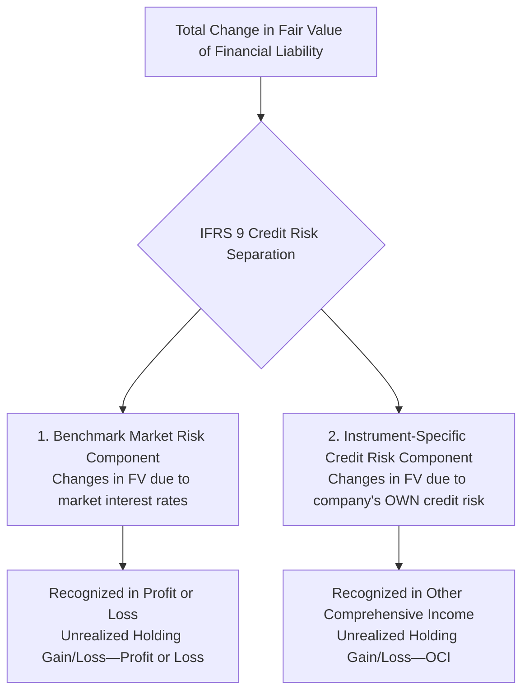

# Long-Term Liabilities (Debt Financing)
> [!abstract] Curriculum & Syllabus Context
> - **Course:** ACC 301 Intermediate Accounting
> - **Phase:** Phase 3: Liabilities & Owners' Equity
> - **Target Reading:** Weygandt, Kieso, and Warfield, *Intermediate Accounting*, 18th Edition — **Chapter 13: Long-Term Liabilities** (including IFRS 9)
> - **Syllabus Focus:** Nature and types of bonds payable, pricing and market yield mechanics, effective-interest amortization of discounts and premiums, bonds issued between interest dates, bond issue cost netting, early extinguishment gains/losses, long-term notes payable, installment mortgages, fair value option, and troubled-debt restructurings (ASC 470-60).

---
### 1. Definition, Nature, and Valuation of Non-Current Liabilities
#### 1.1 Nature and Types of Non-Current Liabilities
> [!info] Key Definition
> **Non-current liabilities (long-term liabilities)** represent obligations that are not reasonably expected to be liquidated using current assets or through the creation of other current liabilities within one year or the normal operating cycle, whichever is longer.

Non-current liabilities primarily comprise:
* **Bonds Payable:** Contractual financial instruments issued by corporations or governmental entities that divide a large long-term borrowing into smaller, standardized denominations (typically £1,000 or $1,000 face value per bond).
* **Long-Term Notes Payable:** Formal written promissory notes to pay a specified sum of money at a specified future date, issued for bank borrowings or equipment acquisitions.
* **Mortgage Notes Payable:** Promissory notes secured by a legal document (mortgage) pledging real property as collateral, typically settled via periodic installment payments.
* **Lease Liabilities:** Obligations recognized under lease contracts for the right to use underlying assets.

The contract between the bond issuer and the bondholders is known as the **bond indenture**. It specifies the maturity date, coupon (stated) interest rate, periodic interest payment dates, restrictive covenants, call or conversion features, and collateral obligations.

#### 1.2 Mathematical Valuation & Pricing Mechanism of Bonds
The market price of a bond is determined by the **present value of all future cash flows**, discounted at the prevailing market yield rate (effective interest rate) on the issue date. A standard coupon bond produces two distinct cash flow streams:
1. **Principal (Face Value, $FV$):** A single lump-sum payment payable at maturity.
2. **Periodic Coupon Interest Payments ($INT$):** An ordinary annuity paid periodically (typically semiannually) based on the stated (coupon) interest rate ($r_{\text{stated}}$).

> [!formula] Formula & Derivation: Bond Pricing
> $$ \text{Periodic Coupon Payment } (INT) = \text{Face Value} \times \frac{r_{\text{stated}}}{m} $$
> *(where $m$ is the number of interest payment compounding periods per year)*
> **Bond Present Value Equation:**
> $$ \text{Price}_{\text{bond}} = FV \times \left( \frac{1}{(1+i)^n} \right) + INT \times \left( \frac{1 - (1+i)^{-n}}{i} \right) $$
> Where:
> * $FV = \text{Face or Maturity Value of the Bond}$
> * $i = \frac{\text{Market Yield Rate per Annum } (r_{\text{market}})}{m}$
> * $n = \text{Total Number of Compounding Periods } (\text{Years} \times m)$
> * $INT = \text{Periodic Cash Coupon Interest Payment}$

#### 1.3 Stated Coupon Rate vs. Effective Market Yield Relationships
The relationship between the stated coupon rate ($r_{\text{stated}}$) and the effective market yield rate ($r_{\text{market}}$) dictates the initial market pricing of the instrument:

| Rate Relationship | Issuance Price Condition | Economic Mechanism |
| :--- | :--- | :--- |
| **$r_{\text{stated}} = r_{\text{market}}$** | Issued at **Par** | The present value of future cash flows equals the face value. Proceeds equal face value. |
| **$r_{\text{stated}} < r_{\text{market}}$** | Issued at a **Discount** | Investors demand a higher yield than the coupon rate. To yield the market rate, the bond sells for less than face value. The discount represents an additional borrowing cost realized over the bond term. |
| **$r_{\text{stated}} > r_{\text{market}}$** | Issued at a **Premium** | The coupon rate exceeds prevailing market yields. High investor demand prices the bond at more than face value. The premium represents a reduction of the net borrowing cost over the bond term. |

---
### 2. Statement of Financial Position Presentation (IFRS 9 Direct Net Carrying Amount)
#### 2.1 IFRS 9 Direct Net Carrying Amount vs. US GAAP Presentation
International Financial Reporting Standards (IFRS 9 / IAS 1) mandate a direct net presentation of non-current financial liabilities on the Statement of Financial Position:
* **IFRS Requirement (Direct Net Carrying Amount):** Bonds payable are reported *net* of any unamortised discount or premium directly within the Bonds Payable carrying amount. IFRS explicitly forbids the use of separate contra-liability (Discount on Bonds Payable) or adjunct-liability (Premium on Bonds Payable) accounts on the Statement of Financial Position.
* **Contrast with US GAAP:** US GAAP maintains separate valuation accounts, reporting *Discount on Bonds Payable* as a contra-liability account or *Premium on Bonds Payable* as an adjunct account offsetting or adding to the Face Value of Bonds Payable.
#### 2.2 Journal Entries for Issuance under IFRS Terminology
Under strict IFRS accounting entries, proceeds received are credited directly to Bonds Payable at the initial Net Carrying Amount:

**1. Issuance at Par**
When market yield equals coupon rate ($\text{Proceeds} = \text{Face Value}$):

$$ \begin{array}{llrr}
\textbf{Account Titles} & \textbf{Debit (£)} & \textbf{Credit (£)} \\
\hline
\text{Cash} & \text{[PV Proceeds]} & \\
\quad \text{Bonds Payable} & & \text{[Face Value]} \\
\end{array} $$

**2. Issuance at a Discount**
When market yield exceeds coupon rate ($\text{Proceeds} < \text{Face Value}$):

$$ \begin{array}{llrr}
\textbf{Account Titles} & \textbf{Debit (£)} & \textbf{Credit (£)} \\
\hline
\text{Cash} & \text{[PV Proceeds]} & \\
\quad \text{Bonds Payable} & & \text{[Net Carrying Amount]} \\
\end{array} $$
*(Note: Under IFRS 9, no separate "Discount on Bonds Payable" contra account is debited; Bonds Payable is credited directly for the Net Carrying Amount).*

**3. Issuance at a Premium**
When coupon rate exceeds market yield ($\text{Proceeds} > \text{Face Value}$):

$$ \begin{array}{llrr}
\textbf{Account Titles} & \textbf{Debit (£)} & \textbf{Credit (£)} \\
\hline
\text{Cash} & \text{[PV Proceeds]} & \\
\quad \text{Bonds Payable} & & \text{[Net Carrying Amount]} \\
\end{array} $$

---
### 3. Effective-Interest Method of Amortisation (IFRS 9 Mandatory Requirement)
#### 3.1 Mechanics and Core Amortisation Formulas
Under IFRS 9, the **effective-interest method** is mandatory for amortising debt discounts and premiums. The straight-line method is not permitted under IFRS. The effective-interest method applies a constant effective market interest rate to the beginning Net Carrying Amount of the liability for each period.

> [!formula] Formula & Derivation: Effective-Interest Amortisation
> For any interest period $t$:
> 1. **Cash Interest Paid:**
>    $$ \text{Cash Paid}_t = \text{Face Value} \times \frac{r_{\text{stated}}}{m} $$
> 2. **Interest Expense (Profit or Loss):**
>    $$ \text{Interest Expense}_t = \text{Beginning Net Carrying Amount}_{t-1} \times \frac{r_{\text{market}}}{m} $$
> 3. **Amortisation Amount:**
>    $$ \text{Discount Amortised}_t = \text{Interest Expense}_t - \text{Cash Paid}_t \quad (\text{Expense} > \text{Cash Paid}) $$
>    $$ \text{Premium Amortised}_t = \text{Cash Paid}_t - \text{Interest Expense}_t \quad (\text{Expense} < \text{Cash Paid}) $$
> 4. **Ending Net Carrying Amount:**
>    $$ \text{Discount: Net Carrying Amount}_t = \text{Beginning Net Carrying Amount}_{t-1} + \text{Discount Amortised}_t $$
>    $$ \text{Premium: Net Carrying Amount}_t = \text{Beginning Net Carrying Amount}_{t-1} - \text{Premium Amortised}_t $$

#### 3.2 Comprehensive Discount Amortisation Schedule & Journal Entries
> [!example] Numerical Problem: Discount Amortisation
> **Fact Pattern:**
> On 1 January 2025, Apex Corp. issued £1,000,000 face value of 5-year, 8% coupon bonds payable. Interest is payable semiannually on 30 June and 31 December. The market yield rate on the date of issuance was 10%.
> * $FV = £1,000,000$
> * Semiannual Stated Rate = $8\% / 2 = 4\%$
> * Semiannual Cash Coupon ($INT$) = $£1,000,000 \times 4\% = £40,000$
> * Semiannual Market Rate ($i$) = $10\% / 2 = 5\%$
> * Total Compounding Periods ($n$) = $5 \times 2 = 10$
> $$ \text{PV of Principal} = £1,000,000 \times (1 + 0.05)^{-10} = £1,000,000 \times 0.613913 = £613,913 $$
> $$ \text{PV of Coupon Annuity} = £40,000 \times \left( \frac{1 - (1 + 0.05)^{-10}}{0.05} \right) = £40,000 \times 7.721735 = £308,869 $$
> $$ \textbf{Initial Selling Price (Net Carrying Amount)} = £613,913 + £308,869 = \mathbf{£922,782} $$
> $$ \text{Initial Discount} = £1,000,000 - £922,782 = £77,218 $$
> **Amortisation Schedule (Discount Bond):**
> $$ \begin{array}{cccccc}
> \hline
> \textbf{Period} & \textbf{Date} & \textbf{Cash Paid (4\%)} & \textbf{Interest Exp. (5\%)} & \textbf{Discount Amort.} & \textbf{Net Carrying Amount} \\
> \hline
> 0 & 01/01/25 & - & - & - & £922,782 \\
> 1 & 30/06/25 & £40,000 & £46,139 & £6,139 & £928,921 \\
> 2 & 31/12/25 & £40,000 & £46,446 & £6,446 & £935,367 \\
> 3 & 30/06/26 & £40,000 & £46,768 & £6,768 & £942,135 \\
> 4 & 31/12/26 & £40,000 & £47,107 & £7,107 & £949,242 \\
> 5 & 30/06/27 & £40,000 & £47,462 & £7,462 & £956,704 \\
> \hline
> \end{array} $$
> **IFRS Journal Entries for Discount Bond:**
> **1. Initial Issuance (1 January 2025):**
> $$ \begin{array}{llrr}
> \textbf{Account Titles} & \textbf{Debit (£)} & \textbf{Credit (£)} \\
> \hline
> \text{Cash} & 922,782 & \\
> \quad \text{Bonds Payable} & & 922,782 \\
> \end{array} $$
> **2. First Semiannual Interest Payment (30 June 2025):**
> $$ \begin{array}{llrr}
> \textbf{Account Titles} & \textbf{Debit (£)} & \textbf{Credit (£)} \\
> \hline
> \text{Interest Expense (Profit or Loss)} & 46,139 & \\
> \quad \text{Bonds Payable (Discount Amortisation)} & & 6,139 \\
> \quad \text{Cash} & & 40,000 \\
> \end{array} $$
> **3. Second Semiannual Interest Payment (31 December 2025):**
> $$ \begin{array}{llrr}
> \textbf{Account Titles} & \textbf{Debit (£)} & \textbf{Credit (£)} \\
> \hline
> \text{Interest Expense (Profit or Loss)} & 46,446 & \\
> \quad \text{Bonds Payable (Discount Amortisation)} & & 6,446 \\
> \quad \text{Cash} & & 40,000 \\
> \end{array} $$

#### 3.3 Premium Amortisation Schedule & Mechanics
When bonds are issued at a premium ($r_{\text{stated}} > r_{\text{market}}$), the initial Net Carrying Amount exceeds face value. Interest Expense in Profit or Loss is less than cash paid, and periodic amortisation directly reduces the Net Carrying Amount of Bonds Payable over time toward maturity face value.

**IFRS Periodic Premium Entry:**
$$ \begin{array}{llrr}
\textbf{Account Titles} & \textbf{Debit (£)} & \textbf{Credit (£)} \\
\hline
\text{Interest Expense (Profit or Loss)} & \text{[Beginning Carrying Amount } \times \text{ Market Yield]} & \\
\text{Bonds Payable (Premium Amortisation)} & \text{[Difference]} & \\
\quad \text{Cash (or Interest Payable)} & & \text{[Face Value } \times \text{ Stated Coupon Rate]} \\
\end{array} $$
#### 3.4 Accounting for Bonds Issued Between Interest Dates & Issue Costs
**Bonds Issued Between Interest Dates**
When bonds are issued between scheduled interest payment dates, the buyer pays the issuer the purchase price of the bonds **plus accrued interest** from the last interest payment date to the issue date. On the next interest payment date, the issuer pays the full periodic interest payment to the bondholder, extinguishing the accrued interest liability.

$$ \begin{array}{llrr}
\textbf{Account Titles} & \textbf{Debit (£)} & \textbf{Credit (£)} \\
\hline
\text{Cash} & \text{[PV Proceeds + Accrued Interest]} & \\
\quad \text{Bonds Payable} & & \text{[Initial Net Carrying Amount]} \\
\quad \text{Interest Expense (or Interest Payable)} & & \text{[Accrued Interest Amount]} \\
\end{array} $$

**Transaction Costs / Bond Issue Costs**
Under IFRS 9, direct bond issue costs (e.g., legal fees, accounting fees, underwriting commissions, printing costs) are **netted against the initial carrying amount** of the bonds payable. They are not capitalized as deferred asset charges. Nettings reduce the initial carrying amount of debt, automatically increasing the effective interest rate over the term of the obligation.

---
### 4. Compound Financial Instruments & Convertible Bonds (IAS 32)
#### 4.1 Classification as Compound Financial Instruments
Under IAS 32, financial instruments that contain both a liability component and an equity component are classified as compound financial instruments. Convertible bonds that grant the holder the option to convert the debt security into a fixed number of ordinary shares of the issuing entity represent classic compound financial instruments.

#### 4.2 Split / Bifurcation Mechanics: The 'With-and-Without Method'
IAS 32 requires the split (bifurcation) of compound instruments at initial recognition using the **With-and-Without Method**:
1. **Determine the Liability Component:** Measure the fair value of the liability component by computing the present value of future principal and interest cash flows discounted at the market yield rate for a similar *non-convertible* bond (a bond with identical term and credit risk but without the conversion option).
2. **Determine the Equity Component:** Subtract the fair value of the liability component from the total gross proceeds of the compound instrument.
3. **Record Equity Component:** The residual balance is credited directly to equity under `Share Premium—Conversion Equity`.

> [!formula] Formula & Derivation: Equity Component Residual
> $$ \text{Equity Component} = \text{Total Issue Proceeds} - \text{Fair Value of Liability Component} $$

> [!example] Numerical Problem: Convertible Bond Bifurcation
> A company issues 1,000 convertible bonds at par (£1,000 face value per bond = £1,000,000 total proceeds). The coupon rate is 6% per annum payable annually for 3 years. Non-convertible bonds with similar risk yield 9% per annum.
> * Total Proceeds = £1,000,000
> * Annual Cash Coupon = £1,000,000 \times 6\% = £60,000
> * Discount Rate for Liability = 9%
> * $n = 3 \text{ years}$
> $$ \text{PV of Principal} = £1,000,000 \times (1 + 0.09)^{-3} = £1,000,000 \times 0.772183 = £772,183 $$
> $$ \text{PV of Coupon Payments} = £60,000 \times \left( \frac{1 - (1 + 0.09)^{-3}}{0.09} \right) = £60,000 \times 2.531295 = £151,878 $$
> $$ \textbf{Fair Value of Liability Component} = £772,183 + £151,878 = \mathbf{£924,061} $$
> $$ \textbf{Fair Value of Equity Component} = £1,000,000 - £924,061 = \mathbf{£75,939} $$
> **Initial Journal Entry under IFRS:**
> $$ \begin{array}{llrr}
> \textbf{Account Titles} & \textbf{Debit (£)} & \textbf{Credit (£)} \\
> \hline
> \text{Cash} & 1,000,000 & \\
> \quad \text{Bonds Payable (Liability Component)} & & 924,061 \\
> \quad \text{Share Premium—Conversion Equity} & & 75,939 \\
> \end{array} $$

#### 4.3 Conversion Accounting under the Book Value Method
When bondholders exercise their conversion options, the accounting is executed under the **Book Value Method**.
* The net carrying amount of the liability component on the conversion date plus the balance in `Share Premium—Conversion Equity` are transferred to `Share Capital (Ordinary Shares)` and `Share Premium—Ordinary`.
* **No Gain or Loss** is recognized in Profit or Loss upon conversion.

**Journal Entry upon Full Conversion at Maturity:**
Assuming the Net Carrying Amount of Bonds Payable reached £1,000,000 at maturity:

$$ \begin{array}{llrr}
\textbf{Account Titles} & \textbf{Debit (£)} & \textbf{Credit (£)} \\
\hline
\text{Bonds Payable} & 1,000,000 & \\
\text{Share Premium—Conversion Equity} & 75,939 & \\
\quad \text{Share Capital (Ordinary Shares - Par Value)} & & \text{[Par Value of Shares]} \\
\quad \text{Share Premium—Ordinary} & & \text{[Excess Balance]} \\
\end{array} $$

---
### 5. Extinguishment and Derecognition of Debt (IFRS 9 & IFRIC 19)
#### 5.1 Gain or Loss on Debt Extinguishment Calculation & Mechanics
An entity derecognizes a financial liability from its Statement of Financial Position when the obligation is discharged, cancelled, or expires.

> [!formula] Formula & Derivation: Early Extinguishment Gain/Loss
> $$ \text{Gain or Loss on Extinguishment} = \text{Net Carrying Amount at Settlement} - \text{Reacquisition Price} $$
> * **Net Carrying Amount (NCA):** Face Value minus unamortised discount or plus unamortised premium and issue costs on reacquisition date.
> * **Reacquisition Price:** Cash paid to redeem the debt (including call premiums and redemption fees, but excluding accrued interest).
> * **Statement of Comprehensive Income Impact:** If $\text{NCA} > \text{Reacquisition Price}$, a **Gain** on Extinguishment is reported in Profit or Loss. If $\text{Reacquisition Price} > \text{NCA}$, a **Loss** on Extinguishment is reported in Profit or Loss.

> [!example] Numerical Problem: Extinguishment Walkthrough
> *(Continuing from Section 3.2 Apex Corp. Example)*
> On 1 July 2027 (Period 5), Apex calls and extinguishes the entire £1,000,000 bond issue at 101.
> * Net Carrying Amount on 1 July 2027 = £956,704
> * Reacquisition Price = £1,000,000 \times 1.01 = £1,010,000
> * **Loss on Extinguishment** = £1,010,000 - £956,704 = **£53,296**
> $$ \begin{array}{llrr}
> \textbf{Account Titles (1 July 2027)} & \textbf{Debit (£)} & \textbf{Credit (£)} \\
> \hline
> \text{Bonds Payable} & 956,704 & \\
> \text{Loss on Extinguishment of Debt (Profit or Loss)} & 53,296 & \\
> \quad \text{Cash} & & 1,010,000 \\
> \end{array} $$

#### 5.2 Debt Modifications & Substantial Modification Test under IFRS 9
When debt terms are modified between a borrower and creditor, IFRS 9 dictates whether the modification is accounted for as an extinguishment or a refinancing modification:

> [!warning] Exam Pitfall / Exception
> **10% Test for Substantial Modification:** Compare the undiscounted cash flows under new terms discounted at the *original effective rate* against the carrying amount of original debt. If the present value of cash flows under the new terms differs by **at least 10%** from the present value of the remaining cash flows of the original financial liability, the modification is deemed substantial and must be accounted for as an **extinguishment of old debt** and recognition of new debt at fair value. Any difference is recognized immediately in Profit or Loss.

#### 5.3 Debt-for-Equity Swaps under IFRIC 19
Under IFRIC 19 (Extinguishing Financial Liabilities with Equity Instruments), when a debtor issues equity instruments to a creditor to extinguish all or part of a financial liability:
1. Equity instruments issued are measured at their **fair value** on the date of extinguishment.
2. If fair value of equity instruments cannot be reliably measured, equity is measured at the fair value of the liability extinguished.
3. The difference between the Net Carrying Amount of the financial liability extinguished and the initial measurement amount of equity instruments issued is recognized immediately in Profit or Loss as a gain or loss on extinguishment.

$$ \begin{array}{llrr}
\textbf{Account Titles} & \textbf{Debit (£)} & \textbf{Credit (£)} \\
\hline
\text{Bonds / Notes Payable (Net Carrying Amount)} & \text{[Net Carrying Amount]} & \\
\quad \text{Share Capital (Ordinary Shares)} & & \text{[Par Value]} \\
\quad \text{Share Premium—Ordinary} & & \text{[Fair Value Excess]} \\
\quad \text{Gain on Debt Extinguishment (Profit or Loss)} & & \text{[Difference]} \\
\end{array} $$

---
### 6. Fair Value Option (FVO) under IFRS 9
#### 6.1 Objective and Irrevocable Designation at FVTPL
Under IFRS 9, companies may make an **irrevocable election** at initial recognition to designate non-current financial liabilities at Fair Value Through Profit or Loss (FVTPL). This option is permitted if designation eliminates or significantly reduces an **accounting mismatch** that would otherwise arise from measuring assets or liabilities or recognizing gains and losses on them on different bases.
#### 6.2 Credit Risk Separation: Market Risk vs. Own Credit Risk
To eliminate volatility in Profit or Loss caused by changes in an entity's own credit standing, IFRS 9 mandates **Credit Risk Separation** for liabilities designated under the Fair Value Option:

1. **General Market Risk Component:** Changes in fair value attributable to changes in benchmark market interest rates are reported directly in Profit or Loss (*Unrealized Holding Gain or Loss—Profit or Loss*).
2. **Own Credit Risk Component:** Changes in fair value attributable to changes in the company's own credit risk (creditworthiness) are reported in Other Comprehensive Income (OCI) (*Unrealized Holding Gain or Loss—OCI*).

---
### 7. Solvency Ratios & Financial Analysis
#### 7.1 Key Long-Term Solvency Metrics
Solvency refers to an entity's ability to pay interest and principal obligations as they mature over the long term.

> [!formula] Formula & Derivation: Solvency Ratios
> **1. Debt to Assets Ratio:**
> Measures the percentage of total assets funded by creditors:
> $$ \text{Debt to Assets Ratio} = \frac{\text{Total Liabilities}}{\text{Total Assets}} $$
> **2. Times Interest Earned Ratio (Interest Coverage):**
> Measures the firm's capacity to cover periodic interest payments out of operating earnings:
> $$ \text{Times Interest Earned} = \frac{\text{Profit Before Tax} + \text{Finance Costs}}{\text{Finance Costs}} = \frac{\text{EBIT}}{\text{Interest Expense}} $$

---
### 8. Summary Comparison: IFRS vs. US GAAP for Non-Current Liabilities

| Feature / Dimension | IFRS (IAS 1, IAS 32, IFRS 9) | US GAAP (ASC 470, ASC 835, ASC 825) |
| :--- | :--- | :--- |
| **Amortisation Method** | Effective-interest method mandatory without exception. | Effective-interest method required; straight-line permitted if results are not materially different. |
| **Statement Position Presentation** | Direct Net Carrying Amount; discount/premium netted directly in Bonds Payable (no separate discount/premium accounts). | Valuation accounts permitted (Discount on Bonds Payable as contra-liability, Premium as adjunct). |
| **Bond Issue Costs** | Netted against initial carrying amount of liability, increasing effective interest rate. | Netted against liability carrying amount (aligned under ASC 835-30). |
| **Convertible Debt (IAS 32)** | Mandatory bifurcation into debt liability component and equity option component (Share Premium—Conversion Equity). | Recorded entirely as debt liability; no separation of equity component unless cash-settlement features apply. |
| **Debt Restructuring / Modifications** | Substantial modifications (>10% PV difference test) treated as debt extinguishments. No distinct TDR rules. | Specific non-symmetric rules for Troubled Debt Restructuring (TDR) (undiscounted cash flows for debtor gain). |
| **Fair Value Option Credit Risk** | Own credit risk component reported in OCI; market risk in Profit or Loss. | Aligned treatment (own credit risk component reported in OCI under ASC 825). |
| **Key Terminology** | Statement of Financial Position, Profit or Loss, Share Premium—Conversion Equity, Net Carrying Amount. | Balance Sheet, Net Income, Additional Paid-in Capital, Carrying Value. |