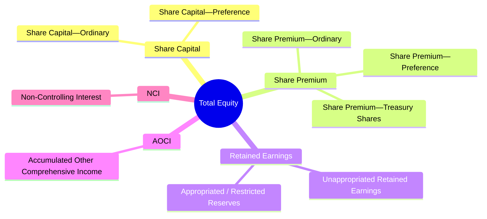
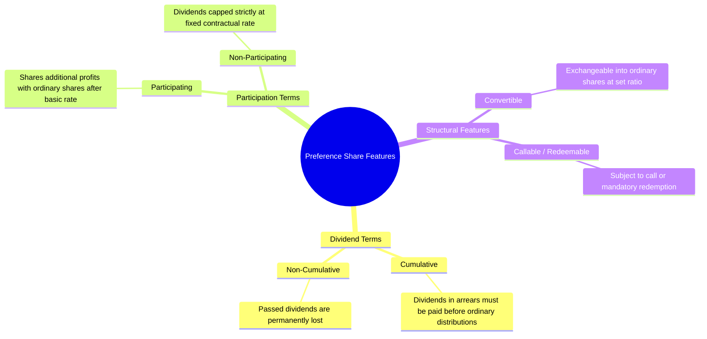

# Equity, Share Capital, Treasury Shares, Dividends, and Retained Earnings (IFRS Study Guide)
> [!abstract] Curriculum & Syllabus Context
> - **Course:** ACC 301 Intermediate Accounting
> - **Phase:** Phase 3: Liabilities & Owners' Equity
> - **Target Reading:** Weygandt, Kieso, and Warfield, *Intermediate Accounting: IFRS Edition* (3rd Edition) — **Equity**
> - **Syllabus Focus:** Corporate capital structure, rights of ordinary shareholders, par/stated vs. no-par shares, lump-sum issuance allocations (proportional vs. incremental), non-cash share issuances, preference share characteristics (cumulative, participating, convertible, mandatorily redeemable debt classification under IAS 32), treasury share cost method, cash/property/liquidating dividends, share dividends vs. share splits, Statement of Changes in Equity, and equity ratios (ROE, payout, book value per share).

---
### 1. Corporate Form and Corporate Capital Structure
#### 1.1 Characteristics of the Corporate Form and Shareholders' Rights
A corporation is a distinct legal entity created under applicable corporate law. Ownership in a corporation is held through transferable shares of capital stock. In the absence of restrictive contractual provisions, each ordinary share confers four fundamental statutory rights:
1. **Profit Allocation (Dividend Right):** The right to share proportionately in net profits and losses through dividend distributions when declared by the board of directors.
2. **Management Participation (Voting Right):** The right to vote in the election of the board of directors and on major corporate decisions (such as mergers, corporate charter amendments, and liquidations) at general meetings of shareholders.
3. **Liquidation Right:** The right to share proportionately in corporate assets remaining after the full satisfaction of all creditor claims upon corporate liquidation.
4. **Preemptive Right:** The right to purchase a proportionate share of any new share issuance of the same class to protect the existing shareholder against involuntary ownership and voting dilution.
#### 1.2 Components of Equity under IFRS
Under International Financial Reporting Standards (IFRS), equity represents the residual interest in the assets of an entity after deducting all of its liabilities:

> [!formula] Formula & Derivation: Total Equity
> $$ \text{Equity} = \text{Total Assets} - \text{Total Liabilities} $$

Equity is presented on the Statement of Financial Position across five primary components:
1. **Share Capital:** Represents the nominal or par value of shares that have been issued to investors (e.g., Share Capital—Ordinary, Share Capital—Preference).
2. **Share Premium:** Represents the excess consideration received from investors above the nominal or par value of issued shares (e.g., Share Premium—Ordinary, Share Premium—Preference), as well as premium arising from treasury share transactions.
3. **Retained Earnings:** Represents cumulative net earnings or profits realized by the enterprise since inception, less net losses, dividend distributions to shareholders, and direct transfers to share capital or capital reserves.
4. **Accumulated Other Comprehensive Income (AOCI):** The aggregate cumulative balance of non-owner changes in equity recognized outside Profit or Loss, such as unrealized gains and losses on Available-for-Sale debt instruments, foreign currency translation differences, and revaluation surpluses.
5. **Non-Controlling Interest (NCI):** The portion of equity in a subsidiary entity not attributable, directly or indirectly, to the parent company.

---
#### 1.3 Accounting for Capital Share Issuances
**Par Value, No-Par, and Stated Value Shares**
* **Par Value Shares:** Par value is an arbitrary nominal amount per share established in the corporate charter. It does not reflect economic or market value. When par value shares are issued, the `Share Capital—Ordinary` account is credited for the aggregate par value, and any excess proceeds are credited to `Share Premium—Ordinary`.
* **No-Par Shares:** Shares issued without a nominal or par value. Under pure no-par systems, the entire net cash consideration received is credited directly to `Share Capital—Ordinary`.
* **No-Par Shares with Stated Value:** Where permitted, boards of directors may establish a "stated value" for no-par shares. The accounting mechanics mirror par value shares: stated value is credited to `Share Capital—Ordinary`, and proceeds in excess of stated value are credited to `Share Premium—Ordinary`.

**Lump-Sum (Basket) Issuances**
When two or more classes of securities (such as ordinary shares and preference shares) are issued for a single lump-sum cash consideration, the total proceeds must be allocated among the individual classes using one of two methods:

> [!formula] Formula & Derivation: Lump-Sum Allocation
> **1. Proportional Method** (Applied when the fair value of every class of security is reliably determinable)
> $$ \text{Proportional Allocation} = \text{Lump-Sum Proceeds} \times \left( \frac{\text{Aggregate Fair Value of Specific Class}}{\text{Total Aggregate Fair Value of All Classes}} \right) $$
> **2. Incremental Method** (Applied when the fair value of only one class of security is determinable)
> The known fair market value is allocated to that specific security, and the remaining (incremental) balance of the lump-sum proceeds is allocated to the security with the unknown fair value.

> [!example] Numerical Problem: Lump-Sum Share Issuance Allocation
> **Scenario:** Corporate Titan Inc. issues 1,000 shares of £10 par value Preference Shares and 2,000 shares of £5 par value Ordinary Shares for a single lump-sum cash payment of £100,000.
> **Case A: Both Fair Values Known (Proportional Method)**
> * Preference share market value = £60 per share $\rightarrow$ Aggregate Fair Value = $1,000 \times £60 = £60,000$.
> * Ordinary share market value = £25 per share $\rightarrow$ Aggregate Fair Value = $2,000 \times £25 = £50,000$.
> * Total Aggregate Fair Value = $£60,000 + £50,000 = £110,000$.
> **Allocations:**
> $$ \text{Preference Shares} = £100,000 \times \left( \frac{£60,000}{£110,000} \right) = \mathbf{£54,545.45} $$
> $$ \text{Ordinary Shares} = £100,000 \times \left( \frac{£50,000}{£110,000} \right) = \mathbf{£45,454.55} $$
> **Journal Entry (Case A):**
> $$ \begin{array}{llrr}
> \textbf{Date / Account Titles} & & \textbf{Debit (£)} & \textbf{Credit (£)} \\
> \hline
> \text{Cash} & & 100,000.00 & \\
> \quad \text{Share Capital—Preference (} 1,000 \times £10 \text{)} & & & 10,000.00 \\
> \quad \text{Share Premium—Preference} & & & 44,545.45 \\
> \quad \text{Share Capital—Ordinary (} 2,000 \times £5 \text{)} & & & 10,000.00 \\
> \quad \text{Share Premium—Ordinary} & & & 35,454.55 \\
> \end{array} $$
> **Case B: Only Ordinary Share Fair Value Known (Incremental Method)**
> * Ordinary share market value = £25 per share $\rightarrow$ Allocation to Ordinary = $2,000 \times £25 = £50,000$.
> * Preference share market value is unknown. Incremental allocation = $£100,000 - £50,000 = \mathbf{£50,000}$.
> **Journal Entry (Case B):**
> $$ \begin{array}{llrr}
> \textbf{Date / Account Titles} & & \textbf{Debit (£)} & \textbf{Credit (£)} \\
> \hline
> \text{Cash} & & 100,000.00 & \\
> \quad \text{Share Capital—Ordinary (} 2,000 \times £5 \text{)} & & & 10,000.00 \\
> \quad \text{Share Premium—Ordinary} & & & 40,000.00 \\
> \quad \text{Share Capital—Preference (} 1,000 \times £10 \text{)} & & & 10,000.00 \\
> \quad \text{Share Premium—Preference} & & & 40,000.00 \\
> \end{array} $$

**Shares Issued for Non-Cash Consideration**
When capital shares are issued for non-cash assets (such as land, buildings, equipment) or services:
* **Valuation Principle:** The transaction is measured at the **fair value of the consideration received**. If the fair value of the consideration received cannot be estimated reliably, the transaction is measured at the fair value of the shares issued.
* **Watered Shares:** Occur when assets received in exchange for share capital are deliberately overvalued on the Statement of Financial Position, artificially inflating equity.
* **Secret Reserves:** Occur when assets received are undervalued or liabilities are overstated, understating total equity.
#### 1.4 Direct Accounting Treatment of Share Issuance Costs
Direct transaction costs of issuing ordinary or preference shares—including underwriting commissions, legal fees, accounting fees, and prospectus printing costs—are treated as a **direct reduction of the cash proceeds** received from the issuance.
* **IFRS Accounting Requirement:** Direct issuance costs are debited against `Share Premium—Ordinary` (or `Share Premium—Preference`), reducing net proceeds.
* **Prohibition:** Share issuance costs must **never** be recognized as an expense in Profit or Loss, nor may they be capitalized as intangible assets.

---
### 2. Treasury Shares (IAS 32)
#### 2.1 Nature, Definition, and Strategic Rationales for Repurchase
> [!info] Key Definition
> Under **IAS 32**, **Treasury Shares** are an entity's own capital shares that have been issued, fully paid, and subsequently reacquired by the issuing enterprise, but not formally cancelled or retired.

**Core Presentation Principles:**
* **Contra-Equity Account:** Treasury shares do not constitute financial assets. Treasury shares are presented as a deduction from Total Equity on the Statement of Financial Position.
* **Deprivation of Ownership Rights:** Treasury shares carry no voting rights, no preemptive rights, no entitlement to cash or property dividend distributions, and receive no asset allocations upon corporate liquidation.

**Strategic Rationales for Repurchasing Shares:**
1. To fulfill share commitments for employee share option and compensation plans.
2. To enhance Earnings Per Share (EPS) by reducing the number of outstanding shares in the denominator.
3. To return excess liquid capital to shareholders efficiently.
4. To signal to financial markets that the enterprise's shares are undervalued.
5. To defend against hostile takeover attempts by reducing the publicly available share float.
#### 2.2 Cost Method Accounting for Share Buybacks
Under the Cost Method (the standard approach under IAS 32), the reacquisition of shares is recorded at the total cash cost paid:
$$ \text{Purchase of Treasury Shares: } \quad \text{Dr. Treasury Shares (at acquisition cost)}, \quad \text{Cr. Cash} $$
#### 2.3 Reissuance of Treasury Shares (Above and Below Cost)
When treasury shares are subsequently reissued to the market, the `Treasury Shares` account is credited for the original acquisition cost of those shares.
1. **Reissuance Above Cost:** When treasury shares are sold at a price exceeding cost, the excess cash proceeds are credited to `Share Premium—Treasury Shares`.
2. **Reissuance Below Cost:** When treasury shares are sold at a price below cost, the cash deficit is debited to `Share Premium—Treasury Shares` up to its existing credit balance. Any remaining unabsorbed deficit is debited directly to `Retained Earnings`.

> [!warning] Exam Pitfall / Exception
> **Absolute Prohibition of Profit or Loss Recognition:** Under IAS 32, an enterprise must **never** recognize a gain or loss in Profit or Loss on the purchase, sale, reissuance, or cancellation of treasury shares.

#### 2.4 Retirement of Treasury Shares
When treasury shares are formally retired by board resolution:
* The nominal par value is removed from `Share Capital—Ordinary`.
* The original share premium associated with the retired shares is removed from `Share Premium—Ordinary`.
* The cost of the treasury shares is removed from `Treasury Shares`.
* Any net excess cost upon retirement is debited to `Share Premium—Treasury Shares` to the extent of its balance, with any remaining deficit charged to `Retained Earnings`.

> [!example] Comprehensive Walkthrough: Treasury Share Transactions
> **Initial Equity Context:** Zenith Corp. has 100,000 shares of £5 par value Ordinary Shares issued at £15 per share ($\text{Share Premium—Ordinary} = £10 \text{ per share}$). Retained Earnings = £500,000.
> $$ \begin{array}{llrr}
> \textbf{Date / Event} & \textbf{Account Titles} & \textbf{Debit (£)} & \textbf{Credit (£)} \\
> \hline
> \textbf{15 Jan} & \text{Treasury Shares (} 5,000 \text{ shares} \times £20 \text{ cost)} & 100,000 & \\
> \text{(Share Repurchase)} & \quad \text{Cash} & & 100,000 \\
> \hline
> \textbf{10 May} & \text{Cash (} 2,000 \text{ shares} \times £25 \text{)} & 50,000 & \\
> \text{(Reissuance > Cost)} & \quad \text{Treasury Shares (} 2,000 \times £20 \text{ cost)} & & 40,000 \\
> & \quad \text{Share Premium—Treasury Shares} & & 10,000 \\
> \hline
> \textbf{20 Aug} & \text{Cash (} 2,000 \text{ shares} \times £14 \text{)} & 28,000 & \\
> \text{(Reissuance < Cost)} & \text{Share Premium—Treasury Shares (Clears bal)} & 10,000 & \\
> & \text{Retained Earnings (Absorbs deficit)} & 2,000 & \\
> & \quad \text{Treasury Shares (} 2,000 \times £20 \text{ cost)} & & 40,000 \\
> \hline
> \textbf{12 Nov} & \text{Share Capital—Ordinary (} 1,000 \times £5 \text{ par)} & 5,000 & \\
> \text{(Share Retirement)} & \text{Share Premium—Ordinary (} 1,000 \times £10 \text{)} & 10,000 & \\
> & \text{Retained Earnings (Plug for excess cost)} & 5,000 & \\
> & \quad \text{Treasury Shares (} 1,000 \times £20 \text{ cost)} & & 20,000 \\
> \hline \hline
> \end{array} $$

---
### 3. Preference Shares (Share Capital—Preference)
#### 3.1 Key Features of Preference Shares
Preference shares confer specific statutory preferences over ordinary shares, primarily regarding dividend distribution priority and asset claims upon liquidation.

**Special Contractual Features:**
* **Cumulative Preference Shares:** If the board of directors does not declare a dividend in a given year, the passed dividend accumulates as a **dividend in arrears**. Dividends in arrears do not represent legal liabilities (because no dividend has been declared), but must be fully disclosed in notes to the financial statements and paid in full prior to any dividend distributions to ordinary shareholders.
* **Non-Cumulative Preference Shares:** Unpaid dividends in passed years are permanently lost to preferred shareholders.
* **Participating Preference Shares:** Entitle holders to share with ordinary shareholders in additional profit distributions beyond the fixed preference rate (either fully participating or partially participating up to a specified cap).
* **Convertible Preference Shares:** Permit holders to exchange preference shares for ordinary shares at a specified conversion ratio using the Book Value Method (no gain or loss recognized upon conversion).
* **Callable Preference Shares:** Permit the issuing enterprise to call or redeem the shares at specified future dates and call prices.

> [!warning] Exam Pitfall / Exception
> **Mandatorily Redeemable Preference Shares (IAS 32):**
> Preference shares that feature mandatory redemption dates, or redemption at the option of the holder, must be classified as **Financial Liabilities (Debt)** on the Statement of Financial Position, rather than Equity. Dividend distributions made on mandatorily redeemable preference shares are not treated as equity distributions; they are recognized as **Finance Costs (Interest Expense)** in Profit or Loss.

#### 3.2 Complex Dividend Allocations (Cumulative & Participating Mechanics)
> [!example] Numerical Problem: Complex Dividend Allocation Breakdown
> **Scenario:** Apex Corp. has the following capital structure:
> * **Share Capital—Preference:** 5,000 shares, 6%, £100 par value ($\text{Total Par} = £500,000$).
> * **Share Capital—Ordinary:** 20,000 shares, £10 par value ($\text{Total Par} = £200,000$).
> * Total cash dividends declared in 2025 = £72,000.
> * Preference dividends are 2 years in arrears prior to 2025.
> **Case 1: Cumulative, Non-Participating**
> 1. **Dividends in Arrears (2 years):** $2 \times (6\% \times £500,000) = £60,000$.
> 2. **Current Year Preference Dividend (2025):** $6\% \times £500,000 = £30,000$.
>    * Total Preference Requirement = $£60,000 + £30,000 = £90,000$.
> 3. **Allocation of £72,000 Declared:**
>    * Preference shareholders receive all **£72,000** (£60,000 for arrears + £12,000 partial current year).
>    * Remaining Dividends in Arrears carried forward = $£30,000 - £12,000 = £18,000$.
>    * Ordinary shareholders receive **£0**.
> **Case 2: Cumulative, Fully Participating (Assuming No Arrears)**
> Assume total dividends declared = £72,000 and no arrears exist.
> 4. **Preference Basic Dividend (6%):** $6\% \times £500,000 = £30,000$.
> 5. **Ordinary Matching Dividend (6%):** $6\% \times £200,000 = £12,000$.
>    * Subtotal Basic Allocations = $£30,000 + £12,000 = £42,000$.
> 6. **Remaining Dividend Available for Participation:** $£72,000 - £42,000 = £30,000$.
> 7. **Participation Rate Calculation:**
>    $$ \text{Participation Rate} = \frac{£30,000}{\text{Total Combined Par Value } (£700,000)} \approx 4.285714\% $$
> 8. **Participation Allocation:**
>    * Preference Participation = $4.285714\% \times £500,000 = £21,428.57$
>    * Ordinary Participation = $4.285714\% \times £200,000 = £8,571.43$
> 9. **Total Distribution Summary:**
>    * **Preference Total:** $£30,000 + £21,428.57 = \mathbf{£51,428.57}$ (£10.29 per share)
>    * **Ordinary Total:** $£12,000 + £8,571.43 = \mathbf{£20,571.43}$ (£1.03 per share)

#### 3.3 Accounting Classification under IAS 32: Equity vs. Financial Liabilities
Under IAS 32 (Financial Instruments: Presentation), the legal form of a financial instrument does not dictate its balance sheet classification. Classification is governed by substance over form:

> [!formula] Formula & Derivation: IAS 32 Contractual Obligation Rule
> $$ \text{IAS 32 Rule} \implies \begin{cases} \text{Mandatory Cash Redemption / Contractual Debt} \longrightarrow \mathbf{Financial\ Liability\ (Debt)} \\ \text{Discretionary Dividend / No Repayment Duty} \longrightarrow \mathbf{Equity} \end{cases} $$

---
### 4. Dividends and Earnings Distributions
#### 4.1 Financial, Legal, and Procedural Drivers of Dividend Policy
* **Legal Capital Constraints:** Corporate statutory rules mandate that dividend distributions must be made out of accumulated realized earnings (Retained Earnings / Earned Surplus) to safeguard creditor capital protections.
* **Cash Liquidity:** A positive Retained Earnings balance does not equal cash availability. An enterprise must possess uncommitted liquid cash to execute cash dividend payments.
#### 4.2 Cash Dividends and Critical Dates
Cash dividends represent a pro-rata distribution of cash to shareholders. Cash dividends are declared and paid exclusively on outstanding shares (excluding treasury shares).

1. **Date of Declaration:** The board of directors formalizes a resolution declaring a dividend. This action creates a legal liability on the declaration date: `Dr. Retained Earnings`, `Cr. Dividends Payable`.
2. **Date of Record:** The entity closes its transfer books to identify registered shareholders eligible to receive the dividend. **No journal entry is required**.
3. **Date of Payment:** The entity distributes cash payments to registered shareholders: `Dr. Dividends Payable`, `Cr. Cash`.
#### 4.3 Property Dividends (Dividends in Kind) and Fair Value Adjustment
A property dividend is a distribution of non-cash corporate assets (such as inventory, land, or equity securities of other entities) to shareholders.

**IFRS Accounting Sequence:**
1. **Remeasurement to Fair Value:** On the date of declaration, the asset to be distributed must be remeasured to its fair value, with any resulting gain or loss recognized immediately in Profit or Loss: `Dr. Asset Account`, `Cr. Gain on Asset Revaluation`.
2. **Dividend Declaration Entry:** Retained Earnings is debited for the fair value of the property: `Dr. Retained Earnings (at Fair Value)`, `Cr. Property Dividends Payable`.
3. **Payment Settlement:** Settlement is recorded by clearing the liability against the carrying amount of the non-cash asset.
#### 4.4 Liquidating Dividends
Dividends that exceed cumulative retained earnings represent a return of owner capital rather than a distribution of accumulated profits. The portion of the dividend exceeding retained earnings is debited directly to **Share Premium—Ordinary**.
#### 4.5 Share Dividends and Share Splits
Share dividends (stock dividends) and share splits involve the distribution of an entity's own shares to existing shareholders on a pro-rata basis without cash consideration. Total equity remains unchanged under both procedures.

| Characteristic | Small Share Dividend ($< 20\% \text{--} 25\%$) | Large Share Dividend ($\ge 20\% \text{--} 25\%$) | Share Split (e.g., 2-for-1) |
| :--- | :--- | :--- | :--- |
| **Accounting Valuation Basis** | **Fair Market Value** at declaration | **Par / Nominal Value** | No Entry (Memo entry only) |
| **Retained Earnings Impact** | Debited for aggregate Fair Market Value | Debited for aggregate Par Value | Unchanged |
| **Total Equity Impact** | Unchanged (Reclassification) | Unchanged (Reclassification) | Unchanged |
| **Par Value per Share** | Unchanged | Unchanged | Reduced proportionally |
| **Number of Outstanding Shares** | Increases | Increases | Increases proportionally |

---
### 5. Retained Earnings and Statement of Changes in Equity (IAS 1)
#### 5.1 Retained Earnings Mechanics, Appropriations, and Reserves
Retained Earnings represents cumulative earned capital held within the enterprise.
An enterprise may segregate Retained Earnings into **Appropriated Retained Earnings** (restricted reserves) versus **Unappropriated Retained Earnings** (available for dividend distribution) due to:
1. **Legal Restrictions:** Mandatory statutory capital reserves required by national corporate laws.
2. **Contractual Restrictions:** Debt covenants (such as bond indentures) restricting dividend payouts during loan tenors.
3. **Voluntary Restrictions:** Internal board decisions to reserve earnings for planned capital expenditures or contingent liabilities.
#### 5.2 Structure and Reconciliation of the Statement of Changes in Equity
Under IAS 1 (Presentation of Financial Statements), an enterprise must present a comprehensive Statement of Changes in Equity reconciling opening and closing balances for every component of equity:

> [!formula] Formula & Derivation: Equity Component Rollforward
> $$ \text{Ending Equity Component} = \text{Opening Balance} \pm \text{Accounting Policy Changes} + \text{Total Comprehensive Income} \pm \text{Transactions with Owners} $$

**Comprehensive Layout: Statement of Changes in Equity (IAS 1 Matrix Format)**
$$ \begin{array}{lrrrrrr}
\hline
\textbf{Item (£ thousands)} & \textbf{Share Cap.} & \textbf{Share Premium} & \textbf{Ret. Earn.} & \textbf{AOCI} & \textbf{Treas. Shares} & \textbf{Total Equity} \\
\hline
\textbf{Balance at 1 Jan 2025} & \mathbf{100,000} & \mathbf{500,000} & \mathbf{800,000} & \mathbf{80,000} & \mathbf{(50,000)} & \mathbf{1,430,000} \\
\text{Profit or Loss for the Year} & - & - & 150,000 & - & - & 150,000 \\
\text{Other Comprehensive Income} & - & - & - & (25,000) & - & (25,000) \\
\text{Ordinary Share Issuance} & 20,000 & 260,000 & - & - & - & 280,000 \\
\text{Cash Dividends Declared} & - & - & (40,000) & - & - & (40,000) \\
\text{Treasury Share Buyback} & - & - & - & - & (20,000) & (20,000) \\
\hline
\textbf{Balance at 31 Dec 2025} & \mathbf{120,000} & \mathbf{760,000} & \mathbf{910,000} & \mathbf{55,000} & \mathbf{(70,000)} & \mathbf{1,775,000} \\
\hline \hline
\end{array} $$

---
### 6. Financial Analysis and Equity Ratios
> [!formula] Formula & Derivation: Key Equity Ratios
> **1. Return on Ordinary Shareholders' Equity (ROE)**
> Measures corporate profitability generated per unit of ordinary equity capital invested:
> $$ \text{ROE} = \frac{\text{Profit or Loss} - \text{Preference Dividends}}{\text{Average Ordinary Shareholders' Equity}} $$
> *(Ordinary Shareholders' Equity = Total Equity - Preference Share Liquidation Value - Preference Dividends in Arrears).*
> **2. Dividend Payout Ratio**
> Measures the proportion of net earnings distributed to ordinary shareholders as cash dividends:
> $$ \text{Dividend Payout Ratio} = \frac{\text{Cash Dividends Paid to Ordinary Shareholders}}{\text{Profit or Loss} - \text{Preference Dividends}} $$
> **3. Book Value per Share**
> Represents the net asset value per outstanding ordinary share upon corporate liquidation:
> $$ \text{Book Value per Share} = \frac{\text{Ordinary Shareholders' Equity}}{\text{Number of Outstanding Ordinary Shares}} $$

> [!example] Numerical Problem: Equity Ratio Analysis
> **Scenario Context:**
> * Share Capital—Preference, 8% cumulative, £100 par, 2,000 shares outstanding = £200,000.
> * Preference Liquidation Value = £105 per share = £210,000.
> * Preference Dividends in Arrears = 3 years (including current year) = $3 \times (8\% \times £200,000) = £48,000$.
> * Share Capital—Ordinary, £5 par, 50,000 shares issued, 5,000 shares held in treasury (45,000 shares outstanding) = £250,000.
> * Share Premium—Ordinary = £350,000.
> * Retained Earnings = £400,000.
> * Treasury Shares (Cost) = (£40,000).
> **Step 1: Compute Total Stockholders' Equity**
> $$ \text{Total Equity} = £200,000 + £250,000 + £350,000 + £400,000 - £40,000 = \mathbf{£1,160,000} $$
> **Step 2: Calculate Total Claim of Preference Shareholders**
> $$ \text{Preference Claim} = \text{Liquidation Value} + \text{Dividends in Arrears} = £210,000 + £48,000 = \mathbf{£258,000} $$
> **Step 3: Compute Equity Attributable to Ordinary Shareholders**
> $$ \text{Ordinary Equity} = \text{Total Equity } (£1,160,000) - \text{Preference Claim } (£258,000) = \mathbf{£902,000} $$
> **Step 4: Calculate Book Value per Share**
> $$ \text{Book Value per Ordinary Share} = \frac{£902,000}{45,000 \text{ outstanding shares}} = \mathbf{£20.04 \text{ per share}} $$