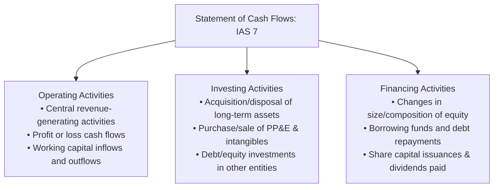
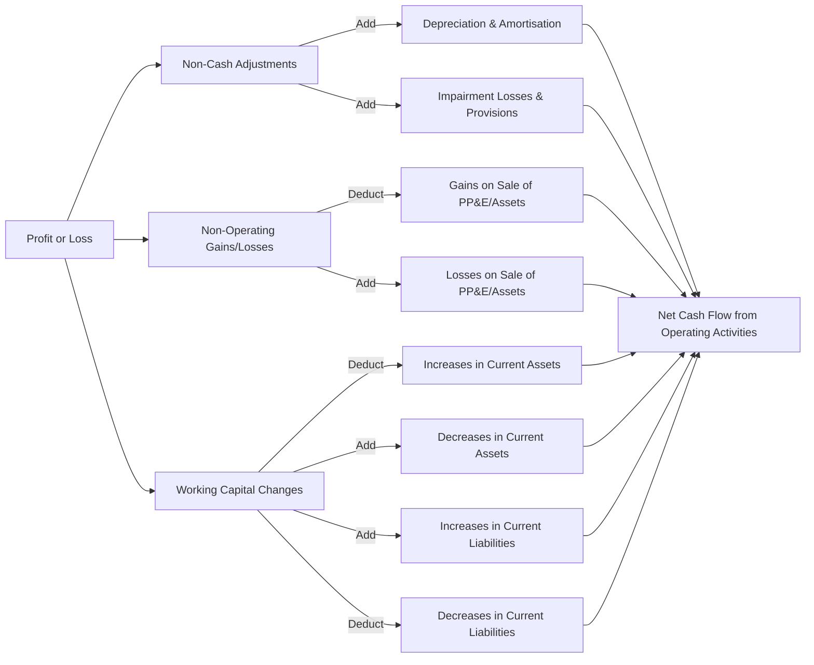

# Statement of Cash Flows & Full Disclosure (IAS 7 & Bangladesh Statutory Framework)
> [!abstract] Curriculum & Syllabus Context
> - **Course:** ACC 301 Intermediate Accounting
> - **Phase:** Phase 4: Financial Statement Synthesis & Global Standards
> - **Target Reading:** Weygandt, Kieso, and Warfield, *Intermediate Accounting: IFRS Edition* (3rd Edition) — **Statement of Cash Flows (IAS 7)**
> - **Syllabus Focus:** Statement of cash flows purpose and definitions, operating, investing, and financing activity classifications, indirect vs. direct operating cash flow methods with all reconciliation adjustments, noncash investing/financing disclosures, free cash flow and cash coverage ratios, and synthesis of key IFRS terminology with Bangladesh statutory mandates (Companies Act 1994, BSEC Rule 12(2)).

---
### 1. Purpose and Decision-Usefulness
> [!info] Key Definition
> The **Statement of Cash Flows** (governed globally by International Accounting Standard 7: *Statement of Cash Flows* — IAS 7) reports the cash receipts, cash payments, and net change in cash and cash equivalents resulting from an entity's operating, investing, and financing activities during an accounting period. It provides a complete, transparent reconciliation of the opening and closing balances of cash and cash equivalents.

While the Statement of Comprehensive Income measures financial performance on an accrual basis and the Statement of Financial Position presents the financial posture at a specific date, neither document isolates the exact physical movement of liquid funds. The Statement of Cash Flows fulfills this essential analytical function, allowing investors, lenders, and creditors to evaluate:
1. **Liquidity:** The entity's capacity to generate positive future net cash flows to meet short-term commitments and operational requirements.
2. **Solvency and Financial Flexibility:** The entity's ability to service long-term debt obligations, distribute dividends to shareholders, and adapt to unexpected business challenges or investment opportunities.
3. **Quality of Earnings:** The precise rationale for discrepancies between accrual-basis profit or loss and net cash flow provided by operating activities.
4. **Capital Allocation and Financing Requirements:** The cash and non-cash impacts of long-term asset acquisition, debt issuances, and equity transactions executed during the financial period.

---
### 2. Definition of Cash and Cash Equivalents
Under IAS 7, cash flows must reconcile the change across the combined total of cash and cash equivalents:
* **Cash:** Comprises physical currency on hand and demand deposits held with financial institutions (such as checking, savings, and instant-access call accounts).
* **Cash Equivalents:** Short-term, highly liquid investments that are readily convertible to known amounts of cash and which are subject to an insignificant risk of changes in value.
  * *Maturity Threshold:* To qualify as a cash equivalent, an investment must normally have a short maturity of **three months or less** from its acquisition date (for example, Treasury bills, commercial paper, and 90-day certificates of deposit). Equity investments are excluded unless they are, in substance, cash equivalents (e.g., preferred shares acquired within a short period of their specified redemption date).

---
### 3. The Three Core Business Activities
IAS 7 mandates that cash flows be categorised into three primary operational categories:

#### 1. Operating Activities
Operating activities are the principal revenue-producing activities of the entity and other activities that are not investing or financing activities. They represent the cash inflows and outflows derived from transactions and events that enter into the determination of Profit or Loss.
* **Cash Inflows:** Cash received from customers for the sale of goods or rendering of services; collections on trade accounts and notes receivable; receipts of interest revenue or dividend revenue (where classified as operating).
* **Cash Outflows:** Cash payments to suppliers for raw materials and inventory; payments to employees for salaries and wages; payments to tax authorities for income taxes; payments to lenders for interest expense (where classified as operating); and payments for administrative, selling, and other operational expenses.
#### 2. Investing Activities
Investing activities represent the acquisition and disposal of long-term assets and other investments not included in cash equivalents. They reflect the extent to which expenditures have been made for resources intended to generate future income and cash flows.
* **Cash Inflows:** Principal collections on loans or notes extended to third parties; cash proceeds from the sale or disposal of Property, Plant, and Equipment (PP&E), investment properties, and intangible assets; and cash proceeds from selling debt or equity instruments of other entities (e.g., FVOCI or amortised cost investments).
* **Cash Outflows:** Cash payments to acquire PP&E, intangible assets, and other long-lived assets; cash disbursements to purchase debt or equity securities of other entities or associates; and cash advances and loans extended to third parties.
#### 3. Financing Activities
Financing activities represent activities that result in changes in the size and composition of the contributed equity and borrowings of the entity. They capture the cash flows associated with capital providers (shareholders and debt holders).
* **Cash Inflows:** Cash proceeds from issuing Share Capital—Ordinary or preferred shares (including share premium); and proceeds from issuing short-term or long-term debt (bonds payable, notes payable, mortgages, or bank loans).
* **Cash Outflows:** Cash payments to shareholders for dividend distributions; cash payments to repurchase or redeem ordinary shares (treasury share buybacks); and cash payments for the principal reduction or retirement of short-term and long-term borrowing balances.

---
### 4. Classification Flexibility under IAS 7 (IFRS vs US GAAP)
#### 1. Interest and Dividend Classification Options
Unlike US GAAP (ASC 230), which mandates a rigid, non-flexible treatment for interest and dividend flows, IAS 7 provides explicit policy choices. Entities under IFRS may select accounting policy choices for the classification of interest paid, interest received, dividends received, and dividends paid, provided the chosen classification is applied consistently from period to period.
* **Interest Paid:** May be classified as an **Operating Activity** (because it enters into the determination of Profit or Loss) OR as a **Financing Activity** (because it represents a cost of obtaining financial resources).
* **Interest Received:** May be classified as an **Operating Activity** (because it enters into Profit or Loss) OR as an **Investing Activity** (because it represents a return on investments).
* **Dividends Received:** May be classified as an **Operating Activity** (because it enters into Profit or Loss) OR as an **Investing Activity** (because it represents a return on equity investments).
* **Dividends Paid:** May be classified as a **Financing Activity** (because it is a cost of obtaining equity resources) OR as an **Operating Activity** (to assist users in assessing the entity's ability to pay dividends out of operating cash flows).
#### 2. Taxes on Income
Under IAS 7, cash flows arising from taxes on income (income tax paid) must be disclosed separately and classified as an **Operating Activity**, unless they can be specifically identified with financing or investing activities. When tax cash flows are directly attributable to an investing or financing transaction (such as a tax paid on the sale of property or capital gain tax on debt retirement), the tax cash flow is classified in the corresponding activity section.
#### 3. Bank Overdrafts
Under US GAAP, bank overdrafts are universally treated as short-term financing liabilities and presented as a financing cash flow. Under IAS 7, where bank overdrafts are repayable on demand and form an integral part of the entity's cash management system, they are **included as a component of cash and cash equivalents** (reducing the net cash balance) rather than classified as a financing liability.
#### 4. Comparative Classification Table (IAS 7 vs US GAAP ASC 230)

| Transaction / Line Item | IAS 7 Permitted Classifications (IFRS) | Default IFRS Choice | US GAAP Classification (ASC 230) |
| :--- | :--- | :--- | :--- |
| **Interest Paid** | Operating OR Financing | Operating | Operating (Mandatory) |
| **Interest Received** | Operating OR Investing | Operating | Operating (Mandatory) |
| **Dividends Received** | Operating OR Investing | Operating | Operating (Mandatory) |
| **Dividends Paid** | Financing OR Operating | Financing | Financing (Mandatory) |
| **Income Taxes Paid** | Operating (unless linked to Investing/Financing) | Operating | Operating (Mandatory) |
| **Bank Overdrafts** | Cash & Cash Equivalents OR Financing | Cash Equivalent | Financing Liability (Mandatory) |

---
### 5. Operating Activities Section Mechanics
Entities reporting under IAS 7 may present net operating cash flows using either the **Indirect Method** or the **Direct Method**. IAS 7 encourages the direct method because it provides information that may be useful in estimating future cash flows which is not available under the indirect method. However, the indirect method remains the standard and most widely used approach in global financial reporting.
#### 1. The Indirect Method Mechanics
The indirect method converts accrual-basis Profit or Loss to net cash flow from operating activities through a systematic series of non-cash, non-operating, and working capital adjustments.

> [!formula] Formula & Derivation: Master Reconciliation Formula (Indirect Method)
> $$ \begin{aligned}
> \text{Net Cash Provided by Operating Activities} &= \text{Profit or Loss (Net Income)} \\
> &\quad + \text{Non-Cash Expenses and Losses} \\
> &\quad - \text{Non-Cash Revenues and Gains} \\
> &\quad \pm \text{Non-Operating Adjustments (Gains/Losses on Disposals)} \\
> &\quad - \Delta \text{Operating Current Assets} \\
> &\quad + \Delta \text{Operating Current Liabilities}
> \end{aligned} $$

**Categorisation of Indirect Adjustments:**
1. **Adjustments for Non-Cash Items**
   * *Add Back Expenses:* Depreciation of PP&E, amortisation of intangible assets and lease Right-of-Use (ROU) assets, impairment losses on PP&E/goodwill, bond discount amortisation, and increases in provisions or bad debt expenses (allowance for doubtful accounts).
   * *Deduct Non-Cash Income:* Amortisation of bond premiums, unrealised holding gains on financial assets, decreases in deferred tax liabilities / increases in deferred tax assets, and equity method earnings in excess of dividends received.
2. **Adjustments for Non-Operating Items**
   * *Deduct Gains:* Gains on the disposal/sale of PP&E, investment properties, or intangible assets (since the total cash received must be reported in full under Investing Activities).
   * *Add Back Losses:* Losses on the disposal/sale of PP&E or early debt extinguishments (added back to profit because the underlying transaction belongs in Investing or Financing Activities).
3. **Adjustments for Working Capital Changes**
   * *Operating Current Assets:*
     * **Subtract** increases in accounts receivable, inventory, and prepaid expenses (reflects cash outflows or revenue recognised without cash collection).
     * **Add** decreases in accounts receivable, inventory, and prepaid expenses (reflects cash collections exceeding recognized revenues or expense consumption exceeding cash payments).
   * *Operating Current Liabilities:*
     * **Add** increases in accounts payable, accrued salaries/expenses, and income taxes payable (reflects expenses incurred for which cash has not yet been paid).
     * **Subtract** decreases in accounts payable, accrued expenses, and taxes payable (reflects cash paid to liquidate liabilities in excess of period expenses).
#### 2. The Direct Method Mechanics
The direct method presents the specific major classes of gross cash receipts and gross cash payments.

> [!formula] Formula & Derivation: Major Line-Item Conversion Formulas
> **1. Cash Received from Customers**
> $$ \text{Cash Receipts} = \text{Sales Revenue} - (\text{Ending A/R} - \text{Beginning A/R}) + (\text{Ending Unearned} - \text{Beginning Unearned}) $$
> **2. Cash Paid to Suppliers**
> $$ \text{Purchases} = \text{COGS} + (\text{Ending Inventory} - \text{Beginning Inventory}) $$
> $$ \text{Cash Paid to Suppliers} = \text{Purchases} - (\text{Ending A/P} - \text{Beginning A/P}) $$
> **3. Cash Paid for Operating Expenses**
> $$ \begin{aligned}
> \text{Cash Operating Expenses} &= \text{Operating Expenses (excl. Depr/Amort)} \\
> &\quad + (\text{Ending Prepaids} - \text{Beginning Prepaids}) \\
> &\quad - (\text{Ending Accrued Liabilities} - \text{Beginning Accrued Liabilities})
> \end{aligned} $$
> **4. Cash Paid for Income Taxes**
> $$ \text{Cash Taxes Paid} = \text{Income Tax Expense} - (\text{Ending Taxes Payable} - \text{Beginning Taxes Payable}) $$

**Reconciliation Requirement:**
When an entity prepares its cash flow statement under the Direct Method under IAS 7, a separate reconciliation of Profit or Loss to Net Cash Flow from Operating Activities may be provided in the notes to the financial statements (mandatory under US GAAP, encouraged under IFRS).

---
### 6. Investing and Financing Activities Mechanics
#### 1. Investing Cash Flows
Investing activities measure the net inflows and outflows associated with long-term productive assets and non-operating financial investments.

> [!formula] Formula & Derivation: Analysis Rules for PP&E and Intangible Accounts
> To isolate cash paid for additions or received from disposals, reconstruct the asset and accumulated depreciation ledger accounts:
> $$ \text{Beginning PP\&E (Gross)} + \text{Purchases (Cash CapEx)} - \text{Cost of Assets Sold/Retired} = \text{Ending PP\&E (Gross)} $$
> $$ \text{Beginning Accum. Depr.} + \text{Depreciation Expense} - \text{Accum. Depr. of Assets Sold} = \text{Ending Accum. Depr.} $$
> $$ \text{Cash Proceeds from Sale} = \text{Carrying Amount of Asset Sold} \pm \text{Gain (or Loss) on Sale} $$
> $$ \text{Carrying Amount of Asset Sold} = \text{Cost of Asset Sold} - \text{Accum. Depr. of Asset Sold} $$

**Summary Matrix of Investing Items**

| Transaction Type | Financial Statement Source | Statement Classification |
| :--- | :--- | :--- |
| **Purchase of Land / Buildings / Equipment** | Statement of Financial Position / Notes | Investing Cash Outflow |
| **Proceeds from Sale of PP&E** | Note Disclosures / Profit or Loss | Investing Cash Inflow |
| **Purchase of Intangible Assets (Patents, Software)** | Statement of Financial Position / Notes | Investing Cash Outflow |
| **Acquisition of Debt/Equity Investments** | Financial Position (FVOCI / Amortised Cost) | Investing Cash Outflow |
| **Proceeds from Sale of Debt/Equity Investments** | Financial Position / Profit or Loss | Investing Cash Inflow |

#### 2. Financing Cash Flows
Financing activities focus on equity contributions, dividend returns, debt contract originations, and principal repayments.

> [!formula] Formula & Derivation: Analysis Rules for Equity and Debt Accounts
> $$ \text{Beginning Share Capital} + \text{Par Value of Shares Issued} = \text{Ending Share Capital} $$
> $$ \text{Beginning Share Premium} + \text{Excess Proceeds over Par} = \text{Ending Share Premium} $$
> $$ \text{Beginning Retained Earnings} + \text{Profit or Loss} - \text{Dividends Declared} = \text{Ending Retained Earnings} $$
> $$ \text{Beginning Dividends Payable} + \text{Dividends Declared} - \text{Dividends Paid in Cash} = \text{Ending Dividends Payable} $$
> $$ \text{Beginning Long-Term Debt} + \text{New Debt Issuances} - \text{Principal Repayments} = \text{Ending Long-Term Debt} $$

**Summary Matrix of Financing Items**

| Transaction Type | Financial Statement Source | Statement Classification |
| :--- | :--- | :--- |
| **Issuance of Ordinary Shares (at Par + Premium)** | Share Capital & Share Premium Accounts | Financing Cash Inflow |
| **Repurchase of Shares (Treasury Shares Buyback)** | Statement of Changes in Equity | Financing Cash Outflow |
| **Issuance of Bonds Payable / Long-Term Notes** | Long-Term Liabilities | Financing Cash Inflow |
| **Repayment / Redemption of Bonds or Mortgages** | Long-Term Liabilities | Financing Cash Outflow |
| **Payment of Cash Dividends** | Retained Earnings / Dividends Payable | Financing Cash Outflow |

---
### 7. Significant Non-Cash Investing and Financing Activities
> [!warning] Exam Pitfall / Exception
> **Definition and Presentation Rules:**
> Significant non-cash transactions are investing and financing events that alter the asset or capital structure of an entity but do not involve direct cash receipts or payments in the current period.
> Under IAS 7, non-cash investing and financing transactions **must be excluded from the body of the Statement of Cash Flows**. They must be disclosed in the notes to the financial statements or in a supplementary schedule to maintain full compliance with the Full Disclosure Principle.
> **Examples of Non-Cash Transactions:**
> * Acquisition of PP&E or intangibles by issuing Ordinary Shares, Share Premium, or Bonds Payable.
> * Conversion of convertible bonds or preference shares into Ordinary Shares.
> * Acquiring PP&E or Right-of-Use (ROU) assets through finance leases.
> * Non-monetary asset exchanges (e.g., swapping land for a commercial building).
> * Refinancing existing long-term debt by replacing it directly with a new long-term debt issue.

---
### 8. Step-by-Step Comprehensive Preparation Method & Worked Example
#### 1. Analysis Method for Statement Preparation
Preparing a Statement of Cash Flows requires a comparative analysis of three primary financial inputs:
1. **Comparative Statements of Financial Position** (opening and closing balances to identify net changes).
2. **Current Statement of Profit or Loss** (to obtain Profit or Loss, depreciation, gains/losses, and interest/tax expenses).
3. **Selected Transaction Data from the General Ledger and Notes** (to isolate non-cash transactions, asset acquisitions/disposals, share issuances, and dividend payments).

> [!example] Comprehensive Numerical Problem: Apex Synthetics Ltd. Walkthrough
> **Financial Context & Data:**
> Apex Synthetics Ltd. presents the following comparative financial information for the years ended 31 December 2024 and 31 December 2025:
> **Comparative Statements of Financial Position:**
> $$ \begin{array}{lrrr}
> \hline
> \textbf{Account Title} & \textbf{31 Dec 2024 (£)} & \textbf{31 Dec 2025 (£)} & \textbf{Net Change (£)} \\
> \hline
> \textbf{Assets:} & & & \\
> \quad \text{Cash and Cash Equivalents} & 25,000 & 68,000 & +43,000 \\
> \quad \text{Accounts Receivable (Net)} & 45,000 & 72,000 & +27,000 \\
> \quad \text{Inventory} & 80,000 & 115,000 & +35,000 \\
> \quad \text{Prepaid Insurance} & 6,000 & 4,000 & -2,000 \\
> \quad \text{Land} & 100,000 & 160,000 & +60,000 \\
> \quad \text{Equipment} & 220,000 & 310,000 & +90,000 \\
> \quad \text{Less: Accumulated Depreciation—Equipment} & (50,000) & (72,000) & -22,000 \\
> \hline
> \textbf{Total Assets} & \mathbf{426,000} & \mathbf{657,000} & \mathbf{+231,000} \\
> \hline \hline
> \textbf{Liabilities and Equity:} & & & \\
> \quad \text{Accounts Payable} & 38,000 & 52,000 & +14,000 \\
> \quad \text{Accrued Salaries Payable} & 8,000 & 5,000 & -3,000 \\
> \quad \text{Income Taxes Payable} & 7,000 & 11,000 & +4,000 \\
> \quad \text{Bonds Payable} & 90,000 & 150,000 & +60,000 \\
> \quad \text{Share Capital—Ordinary (£10 par)} & 200,000 & 260,000 & +60,000 \\
> \quad \text{Retained Earnings} & 83,000 & 179,000 & +96,000 \\
> \hline
> \textbf{Total Liabilities and Equity} & \mathbf{426,000} & \mathbf{657,000} & \mathbf{+231,000} \\
> \hline \hline
> \end{array} $$
> **Statement of Profit or Loss for the Year Ended 31 December 2025:**
> $$ \begin{array}{lrr}
> \hline
> \textbf{Line Item} & \textbf{Subtotal (£)} & \textbf{Amount (£)} \\
> \hline
> \text{Sales Revenue} & & 620,000 \\
> \text{Cost of Goods Sold} & & (340,000) \\
> \hline
> \textbf{Gross Profit} & & \mathbf{280,000} \\
> \text{Operating Expenses (excl. Depreciation)} & (95,000) & \\
> \text{Depreciation Expense} & (30,000) & \\
> \text{Loss on Sale of Equipment} & (4,000) & \\
> \hline
> \textbf{Operating Profit} & & \mathbf{151,000} \\
> \text{Interest Expense} & & (11,000) \\
> \hline
> \textbf{Profit Before Income Taxes} & & \mathbf{140,000} \\
> \text{Income Tax Expense} & & (35,000) \\
> \hline
> \textbf{Profit or Loss (Net Income)} & & \mathbf{105,000} \\
> \hline \hline
> \end{array} $$
> **Additional Transaction Notes:**
> 1. Equipment costing £30,000 with accumulated depreciation of £8,000 (carrying amount £22,000) was sold for £18,000 cash, resulting in a loss of £4,000.
> 2. New equipment was purchased for £120,000 cash.
> 3. Land costing £60,000 was acquired via direct cash purchase.
> 4. Bonds payable with a face value of £60,000 were issued at par for cash.
> 5. Share Capital—Ordinary was issued for cash: £60,000 (6,000 shares at £10 par).
> 6. Declared and paid cash dividends during 2025: £9,000 ($\text{Beginning RE } £83,000 + \text{Profit } £105,000 - \text{Ending RE } £179,000 = £9,000$).
> ---
> **Step-by-Step Statement Preparation Walkthrough**
> **1. Operating Activities Walkthrough (Indirect Method):**
> * Start with Profit or Loss: £105,000
> * Add back non-cash Depreciation Expense: +£30,000
> * Add back Non-Operating Loss on Sale of Equipment: +£4,000
> * Deduct increase in Accounts Receivable (£72,000 - £45,000): -£27,000
> * Deduct increase in Inventory (£115,000 - £80,000): -£35,000
> * Add decrease in Prepaid Insurance (£4,000 - £6,000): +£2,000
> * Add increase in Accounts Payable (£52,000 - £38,000): +£14,000
> * Deduct decrease in Accrued Salaries Payable (£5,000 - £8,000): -£3,000
> * Add increase in Income Taxes Payable (£11,000 - £7,000): +£4,000
> * **Net Cash Flow Provided by Operating Activities = £94,000**
> **Direct Method (Alternative):**
> * *Cash Received from Customers:* £620,000 - £27,000 ($\Delta\text{A/R}$) = £593,000
> * *Cash Paid to Suppliers:* Purchases = £340,000 (COGS) + £35,000 ($\Delta\text{Inventory}$) = £375,000. Cash Paid = £375,000 - £14,000 ($\Delta\text{A/P}$) = £361,000
> * *Cash Paid for Operating Expenses:* £95,000 - £2,000 ($\Delta\text{Prepaids}$) + £3,000 ($\Delta\text{Accrued Salaries}$) = £96,000
> * *Cash Paid for Interest:* £11,000
> * *Cash Paid for Income Taxes:* £35,000 - £4,000 ($\Delta\text{Taxes Payable}$) = £31,000
> * **Net Cash Provided by Operating Activities:** £593,000 - £361,000 - £96,000 - £11,000 - £31,000 = **£94,000**
> **2. Investing Activities Walkthrough:**
> * Proceeds from sale of equipment: +£18,000
> * Purchase of equipment: -£120,000
> * Purchase of land: -£60,000
> * **Net Cash Used in Investing Activities = -£162,000**
> **3. Financing Activities Walkthrough:**
> * Proceeds from issuance of bonds payable: +£60,000
> * Proceeds from issuance of Share Capital—Ordinary: +£60,000
> * Payment of cash dividends: -£9,000
> * **Net Cash Provided by Financing Activities = +£111,000**
> ---
> **Final Statement of Cash Flows (Apex Synthetics Ltd.)**
> $$ \begin{array}{lrr}
> \hline
> \multicolumn{3}{c}{\textbf{Apex Synthetics Ltd.}} \\
> \multicolumn{3}{c}{\textbf{Statement of Cash Flows}} \\
> \multicolumn{3}{c}{\textbf{For the Year Ended 31 December 2025}} \\
> \hline
> \textbf{Cash Flows from Operating Activities (Indirect Method)} & \textbf{Subtotal (£)} & \textbf{Amount (£)} \\
> \hline
> \text{Profit or Loss (Net Income)} & & 105,000 \\
> \text{Adjustments to reconcile profit to net cash flow:} & & \\
> \quad \text{Add: Depreciation Expense} & 30,000 & \\
> \quad \text{Add: Loss on Sale of Equipment} & 4,000 & \\
> \quad \text{Deduct: Increase in Accounts Receivable} & (27,000) & \\
> \quad \text{Deduct: Increase in Inventory} & (35,000) & \\
> \quad \text{Add: Decrease in Prepaid Insurance} & 2,000 & \\
> \quad \text{Add: Increase in Accounts Payable} & 14,000 & \\
> \quad \text{Deduct: Decrease in Accrued Salaries Payable} & (3,000) & \\
> \quad \text{Add: Increase in Income Taxes Payable} & 4,000 & (11,000) \\
> \hline
> \textbf{Net Cash Provided by Operating Activities} & & \mathbf{94,000} \\
> \textbf{Cash Flows from Investing Activities} & & \\
> \quad \text{Proceeds from Sale of Equipment} & 18,000 & \\
> \quad \text{Purchase of Equipment} & (120,000) & \\
> \quad \text{Purchase of Land} & (60,000) & \\
> \hline
> \textbf{Net Cash Used in Investing Activities} & & \mathbf{(162,000)} \\
> \textbf{Cash Flows from Financing Activities} & & \\
> \quad \text{Proceeds from Issuance of Bonds Payable} & 60,000 & \\
> \quad \text{Proceeds from Issuance of Share Capital—Ordinary} & 60,000 & \\
> \quad \text{Payment of Cash Dividends} & (9,000) & \\
> \hline
> \textbf{Net Cash Provided by Financing Activities} & & \mathbf{111,000} \\
> \textbf{Net Increase in Cash and Cash Equivalents} & & \mathbf{43,000} \\
> \text{Cash and Cash Equivalents Balance, 1 January 2025} & & 25,000 \\
> \hline
> \textbf{Cash and Cash Equivalents Balance, 31 December 2025} & & \mathbf{68,000} \\
> \hline \hline
> \end{array} $$

---
### 9. Free Cash Flow & Financial Statement Analysis
#### 1. Free Cash Flow (FCF) under IFRS
Free Cash Flow evaluates an entity's discretionary cash flow available for future growth, debt reduction, share buybacks, or shareholder dividend expansions after maintaining existing operational and physical asset capacities.

> [!formula] Formula & Derivation: Master Free Cash Flow Formula
> $$ \text{Free Cash Flow (FCF)} = \text{Net Cash Provided by Operating Activities} - \text{Capital Expenditures (CapEx)} - \text{Cash Dividends} $$
> * **Capital Expenditures (CapEx):** Cash outflows spent to purchase PP&E and maintain current production capacity (investing cash outflows).
> * **Cash Dividends:** Preferred and ordinary cash dividend payouts expected by equity capital providers.

**Application to Apex Synthetics Ltd. Walkthrough:**
$$ \begin{aligned}
\text{Free Cash Flow} &= £94,000 (\text{Operating Cash Flow}) - £180,000 (\text{Equipment } £120,000 + \text{Land } £60,000) - £9,000 (\text{Dividends}) \\
&= \mathbf{-£95,000}
\end{aligned} $$

*Financial Interpretation:* Although Apex Synthetics generated strong operating cash flow (£94,000), aggressive physical asset expansion (£180,000) resulted in negative Free Cash Flow (-£95,000). To bridge this liquidity deficit and fund investment, the entity raised £120,000 through long-term debt (£60,000) and share issues (£60,000).
#### 2. Cash Flow Ratios (Liquidity and Solvency Analysis)
> [!formula] Formula & Derivation: Cash Coverage Ratios
> **1. Current Cash Debt Coverage Ratio (Short-Term Liquidity)**
> Measures the entity's ability to settle short-term debt obligations out of current operational cash flows without relying on asset liquidations.
> $$ \text{Current Cash Debt Coverage Ratio} = \frac{\text{Net Cash Provided by Operating Activities}}{\text{Average Current Liabilities}} $$
> **2. Cash Debt Coverage Ratio (Long-Term Solvency)**
> Measures the entity's financial solvency and long-term debt coverage capability.
> $$ \text{Cash Debt Coverage Ratio} = \frac{\text{Net Cash Provided by Operating Activities}}{\text{Average Total Liabilities}} $$

---
### 10. Synthesis of Key IFRS Terminology and Regulatory Mandates
#### 1. Strict IFRS Terminology Mapping
When preparing IAS 7 compliant study notes and financial statements, standard IFRS terminology must be strictly maintained to prevent compliance errors:

| Terminology Concept | Strict IFRS / IAS 7 Term | Disallowed US GAAP Term |
| :--- | :--- | :--- |
| **Balance Sheet** | Statement of Financial Position | Balance Sheet |
| **Income Statement / Net Income** | Profit or Loss (or Statement of Comprehensive Income) | Income Statement / Net Income |
| **Book Value** | Carrying Amount | Book Value |
| **Common Stock** | Share Capital—Ordinary | Common Stock |
| **Additional Paid-In Capital** | Share Premium | Additional Paid-In Capital (APIC) |
| **Stockholders' Equity** | Equity / Statement of Changes in Equity | Stockholders' Equity |

#### 2. Statutory Framework Context (Bangladesh Companies Act 1994 & BSEC)
For entities subject to national legal requirements in Bangladesh, financial statement preparation synthesises international accounting standards (IAS/IFRS adopted by ICAB) with national corporate statutes:
* **The Companies Act, 1994 (Schedule XI):**
  * *Part I:* Prescribes the statutory format of the Statement of Financial Position, mandating an **Order of Permanence** structure (Capital, Share Premium, and Long-Term Liabilities presented first; Property, Plant, and Equipment presented before Current Assets).
  * *Part II:* Prescribes statutory disclosures for the Profit & Loss Account, including gross turnover, raw material consumption, managerial remuneration, auditor fees, foreign exchange transactions, and plant capacity utilisation.
* **Securities and Exchange Rules, 1987 (Rule 12(2)):**
  * Governed by the Bangladesh Securities and Exchange Commission (BSEC) for publicly traded entities listed on the Dhaka (DSE) or Chittagong (CSE) Stock Exchanges.
  * Mandates preparation and submission of a complete audited reporting package—including the Statement of Cash Flows prepared in accordance with IAS 7—within **120 days** of the financial year-end.