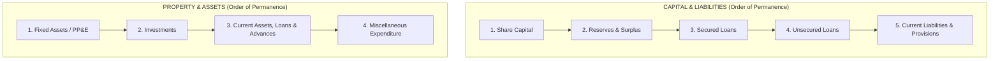
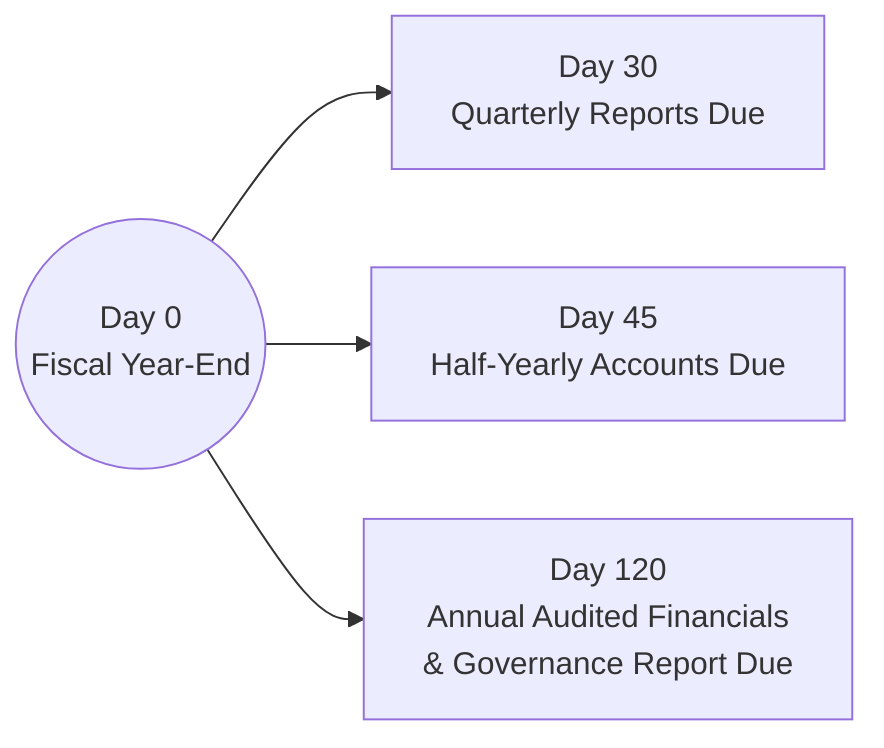

# Bangladesh Corporate Law and Financial Disclosures
> [!abstract] Curriculum & Syllabus Context
> - **Course:** ACC 301 Intermediate Accounting
> - **Phase:** Phase 4: Financial Statement Synthesis & Global Standards
> - **Target Reading:** **Companies Act, 1994 (Schedule XI)** & **Securities and Exchange Rules, 1987 (Rule 12(2))**
> - **Syllabus Focus:** Companies Act 1994 Schedule XI Part I statutory balance sheet format (Order of Permanence), Part II profit and loss disclosures (raw materials, turnover, managerial remuneration, auditor fees, plant capacity), Part III holding/subsidiary rules, BSEC Rule 12(2) compliance timeline and corporate governance code, and synthesis with IAS/IFRS.

---
### 1. Overview of the Bangladesh Statutory Reporting Framework
> [!info] Key Definition: Bangladesh Statutory Framework
> In Bangladesh, financial reporting is governed by a combination of statutory legal frameworks and international professional standards. While the Institute of Chartered Accountants of Bangladesh (ICAB) adopts International Accounting Standards (IAS) and International Financial Reporting Standards (IFRS)—historically issued as Bangladesh Accounting Standards (BAS) and Bangladesh Financial Reporting Standards (BFRS)—all corporate entities registered under national jurisdiction must strictly comply with the **Companies Act, 1994**.

The primary statutory mandate for financial statement layout, presentation, and disclosure is codified under **Section 185 and Schedule XI of the Companies Act, 1994**. Schedule XI establishes the minimum mandatory rules for constructing corporate balance sheets and profit and loss accounts.

**Structure of Schedule XI**
Schedule XI is structured into three operational parts:
* **Part I:** Prescribed form, layout, and classification criteria for the Balance Sheet (Statement of Financial Position).
* **Part II:** Statutory disclosure requirements for the Profit and Loss Account (Statement of Comprehensive Income).
* **Part III:** Statutory rules and requirements governing Holding and Subsidiary Company accounts and group disclosures.

For publicly listed enterprises whose equity or debt instruments trade on public stock exchanges—such as the Dhaka Stock Exchange (DSE) or the Chittagong Stock Exchange (CSE)—statutory compliance extends to the regulatory mandates enforced by the **Bangladesh Securities and Exchange Commission (BSEC)** under **Rule 12(2) of the Securities and Exchange Rules, 1987**.

---
### 2. Schedule XI, Part I: Statutory Balance Sheet Presentation
#### 2.1 Format Options and Presentation Order
Under Schedule XI, Part I, companies may prepare their statutory balance sheets in either a horizontal format (two-column account form) or a vertical format (report/statement form). Regardless of the layout chosen, Schedule XI strictly prescribes the ordering and categorization of assets and liabilities.
#### 2.2 The 'Order of Permanence' Concept
> [!warning] Exam Pitfall / Exception
> The presentation hierarchy under Schedule XI, Part I follows the **Order of Permanence**, which is the inverse of the presentation order standard under U.S. GAAP (which prioritises liquidity).
> * **Capital and Liabilities** are presented starting with the most permanent capital sources (Share Capital) down to temporary operational obligations (Current Liabilities and Provisions).
> * **Property and Assets** are presented starting with long-term, non-liquid productive assets (Fixed Assets / Property, Plant, and Equipment) down to liquid current assets and temporary deferrals (Current Assets, Loans, Advances, and Miscellaneous Expenditure).

#### 2.3 Prescribed Statutory Layout (Schedule XI, Part I)
The table below outlines the precise structural groupings and qualitative line-item disclosures mandated by Part I:

| Category | Sub-category / Mandatory Line Items | Statutory Disclosure & Detail Requirements |
| :--- | :--- | :--- |
| **Capital & Liabilities** | **1. Share Capital** | • **Authorised Capital:** Number of shares and nominal par value per share. • **Issued, Subscribed, and Paid-up Capital:** Broken down by:   - Shares allotted as fully paid up for cash.   - Shares allotted as fully paid up without payment in cash (e.g., consideration other than cash).   - Bonus shares issued.   - Forfeited shares balance. |
| | **2. Reserves and Surplus** | • Capital Reserve / Capital Redemption Reserve. • Share Premium Account. • General Reserve. • Revenue Surplus (Credit balance of Profit & Loss Account after appropriations). |
| | **3. Secured Loans** | • Debentures and Bonds (specifying the nature of underlying security). • Loans and Advances from Banks (secured against hypothecation, mortgage, or pledge of assets). • Other secured loans. |
| | **4. Unsecured Loans** | • Short-term borrowings. • Deposits from public or directors. • Other unsecured loans and advances. |
| | **5. Current Liabilities & Provisions** | • **Current Liabilities:** Acceptances, Trade Creditors, Sundry Creditors, Unclaimed Dividends, Interest accrued but not due. • **Provisions:** Provision for Taxation, Proposed Dividends, Provision for Contingencies. |
| **Property & Assets** | **1. Fixed Assets (PP&E)** | • Mandatory itemisation distinguishing Land, Buildings, Plant & Machinery, Vehicles, Furniture & Fixtures. • For each asset class, show:   - Gross historical cost or revalued amount at start of period.   - Additions during the fiscal year.   - Disposals/deductions during the fiscal year.   - Cumulative depreciation provided to date.   - Net carrying book value. |
| | **2. Investments** | • Investments in Government Securities. • Shares, Debentures, or Bonds of Subsidiary Companies. • Other long-term or short-term equity/debt investments. |
| | **3. Current Assets, Loans, and Advances** | • **A. Current Assets:**   - Inventories (disaggregated into Stores & Spares, Raw Materials, Work-in-Progress, Finished Goods).   - Sundry Debtors (segregated into good debts secured, good debts unsecured, and doubtful/bad debts).   - Cash and Bank Balances (distinguishing cash in hand, current bank deposits, and term deposits). • **B. Loans and Advances:** Advances to employees, prepayments, security deposits. |
| | **4. Miscellaneous Expenditure** | • Unamortised balances not written off (e.g., Preliminary Expenses, Underwriting Commission, Discount on Issuance of Shares or Debentures). |

---
### 3. Schedule XI, Part II: Statutory Profit and Loss Account Disclosures
Part II of Schedule XI outlines specific operational figures and detailed disclosure items that must appear either on the face of the Profit and Loss Account or within accompanying statutory footnotes.
1. **Turnover and Revenue Disclosures**
   * Gross Sales Revenue (Turnover): Disclosure of gross turnover, showing physical sales quantities sold where practicable.
   * Disaggregation of sales revenues across major product lines or service categories.
2. **Raw Material Consumption**
   * Total monetary value of raw materials consumed in manufacturing.
   * Quantitative details of raw material consumption.
   * Breakdown between imported raw materials and indigenously procured raw materials.
3. **Managerial Remuneration**
   * Statutory line-item disclosure of all payments made to managing directors, board directors, and key corporate management, categorized by:
     * Salaries, allowances, and fees.
     * Performance bonuses and profit-sharing commissions.
     * Company contributions to pension or provident funds.
     * Monetary value of perquisites and non-cash benefits (e.g., housing, transport, utilities).
4. **Auditor's Remuneration**
   * Detailed disaggregation of all fees paid or payable to statutory audit firms:
     * Statutory audit fee (for conducting the annual financial statement audit).
     * Fees for taxation services and advice.
     * Fees for other advisory, certification, or professional services.
     * Reimbursement of out-of-pocket audit expenses.
5. **Industrial Capacity and Production Realisation**
   * Manufacturing and industrial enterprises must disclose operational capacity metrics:
     * **Licensed Capacity:** Production volume authorized by state authorities.
     * **Installed Capacity:** Maximum theoretical production volume of physical plant and machinery.
     * **Actual Operational Production:** Actual output volume achieved during the accounting period, accompanied by explanations for significant underutilisation of capacity.
6. **Foreign Currency Transactions**
   * **Foreign Exchange Earnings:** Categorised by export sales (FOB basis), royalties, license fees, and professional service fees.
   * **Foreign Exchange Expenditures:** Categorised by import of raw materials (CIF basis), import of capital goods/machinery, technical advice fees, and foreign travel expenses.

---
### 4. Schedule XI, Part III: Holding and Subsidiary Company Accounts
Part III of Schedule XI establishes legal accounting requirements when a holding company owns or controls subsidiary entities:
1. **Attachment Requirements:** The annual financial statements of every subsidiary company (including its statutory Balance Sheet, Profit and Loss Account, Directors' Report, and Auditors' Report) must be attached to the financial statements of the parent (holding) company.
2. **Financial Year Realignment:** The financial year of the subsidiary must not end more than six months prior to the closing date of the holding company's financial year.
3. **Statement of Holding Interest:** The parent company must present a statutory statement signed by directors detailing:
   * The percentage of equity stock or voting rights held in each subsidiary at the close of the financial year.
   * The net aggregate amount of the subsidiary's profits or losses that have not been dealt with in the parent company's accounts.
   * The net aggregate amount of profits or losses of the subsidiary that have been incorporated into the parent company's accounts (e.g., through dividend declarations).

---
### 5. Securities and Exchange Rules, 1987: Rule 12(2) Regulatory Mandates
For companies listed on stock exchanges in Bangladesh, the Bangladesh Securities and Exchange Commission (BSEC) imposes continuous financial reporting and governance requirements under **Rule 12(2)** of the Securities and Exchange Rules, 1987.

#### 5.1 Mandatory Reporting Package
Rule 12(2) mandates that listed companies submit a complete financial package to the BSEC and the relevant stock exchanges, including:
1. Audited Balance Sheet (Statement of Financial Position).
2. Audited Profit and Loss Account (Statement of Comprehensive Income).
3. Statement of Cash Flows (prepared in accordance with IAS 7 / BFRS).
4. Statement of Changes in Equity.
5. Explanatory notes and accounting policy disclosures.
#### 5.2 Statutory Submission Timelines
Listed issuers must adhere to strict filing deadlines following the close of reporting periods:
* **Annual Audited Financial Statements:** Must be audited and submitted within **120 days (4 months)** from the end of the fiscal year.
* **Half-Yearly Financial Statements:** Unaudited half-yearly accounts must be published and submitted within **45 days** of the end of the second quarter.
* **Quarterly Financial Statements:** Unaudited 1st and 3rd quarter financial accounts must be submitted within **30 days** of the end of the respective quarterly periods.
#### 5.3 Directors' Report Disclosures
Under BSEC Rule 12(2) and the applicable Corporate Governance Code, the annual Directors' Report presented to shareholders must include:
* An explanation of any significant variance between quarterly performance and final audited annual financial metrics.
* A complete disclosure of all related-party transactions, including transaction descriptions, values, and outstanding balances.
* A formal statement on the operational effectiveness of internal financial and accounting control systems.
* An explicit statement on the entity's ability to continue as a going concern.
* A **Corporate Governance Compliance Certificate** issued by an independent practicing Chartered Accountant (CA) or Cost and Management Accountant (CMA), certifying compliance with BSEC corporate governance guidelines.

---
### 6. Comparative Synthesis: US GAAP vs. IFRS vs. Bangladesh Statutory Framework
The table below contrasts key financial presentation dimensions across US GAAP, IFRS, and the Bangladesh Companies Act 1994:

| Dimension / Feature | US GAAP (FASB ASC) | IFRS (IAS 1 / IAS 7) | Bangladesh Companies Act, 1994 |
| :--- | :--- | :--- | :--- |
| **Balance Sheet Order** | **Order of Liquidity** (Current Assets and Current Liabilities presented first). | Flexible presentation allowed; typically **Reverse Liquidity** (Noncurrent items first). | **Order of Permanence** strictly mandated by Schedule XI, Part I (Capital and PP&E presented first). |
| **Statement of Cash Flows** | Mandatory statement required under ASC 230. | Mandatory statement required under IAS 7. | Mandatory for listed public entities via BSEC Rule 12(2) / IAS 7; not explicitly set out in Schedule XI for small private entities. |
| **Prescribed Financial Formats** | Flexible layout options (multiple-step vs single-step). | Flexible, principles-based presentation frameworks. | **Prescribed Statutory Layout** strictly defined under Schedule XI (Part I Balance Sheet and Part II P&L). |
| **Statutory Disclosure Requirements** | General footnote disclosures and SEC disclosures (Form 10-K). | Footnote disclosures (e.g., related-party rules under IAS 24). | **Mandatory statutory line items** for managerial remuneration, auditor fees, plant capacity utilisation, and raw material imports. |
| **Audit & Governance Compliance** | SEC / PCAOB regulatory filings and Sarbanes-Oxley (SOX) reporting. | Jurisdiction-specific statutory frameworks. | Annual submission of audited statements within **120 days** plus CA/CMA corporate governance certification under BSEC Rule 12(2). |

---
### 7. Core Exam Focus & Study Checklist
> [!info] Core Exam Focus & Study Checklist
> When preparing for examination questions on Step 14, ensure mastery of the following technical points:
> 1. **Balance Sheet Classification:** Ability to draft a statutory Balance Sheet following Schedule XI, Part I, placing Share Capital at the top of Liabilities and Fixed Assets (PP&E) at the top of Assets.
> 2. **Order of Permanence:** Explaining why the Bangladesh statutory framework reverses the U.S. GAAP order of liquidity.
> 3. **Part II Disclosures:** Memorising the mandatory line items under Schedule XI Part II (Managerial Remuneration breakdowns, Auditor Fee breakdowns, Industrial Capacity vs Actual Production, and Foreign Currency Earnings/Expenditures).
> 4. **BSEC Rule 12(2) Deadlines:** Key timelines (120 days for annual audited accounts, 45 days for half-yearly, 30 days for quarterly) and the requirement for a CA/CMA Corporate Governance Compliance Certificate.
> 5. **Holding/Subsidiary Rules:** Understanding Part III requirements regarding attaching subsidiary financial statements and reporting non-consolidated profit/loss balances.